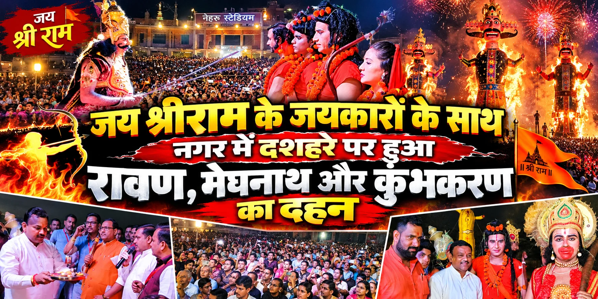
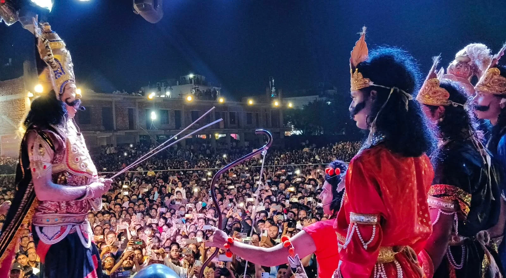
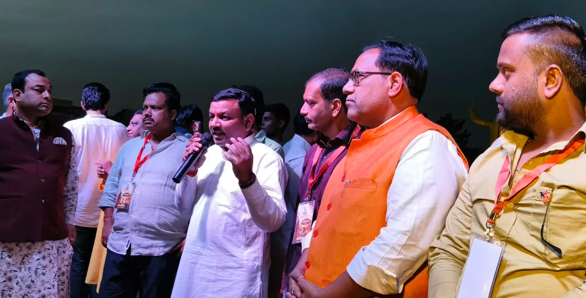

**रुड़की संवाददाता | आसिफ खान**

रुड़की। असत्य पर सत्य की विजय, अधर्म पर धर्म की जीत और बुराई के अंत का प्रतीक दशहरा पर्व रुड़की में पूरे उत्साह, उमंग और धार्मिक उल्लास के साथ मनाया गया। बीटी गंज रामलीला समिति की ओर से आयोजित 107वें रामलीला महोत्सव के अंतर्गत नेहरू स्टेडियम में भव्य दशहरा मेले का आयोजन हुआ। जैसे ही रावण, मेघनाद और कुंभकर्ण के विशालकाय पुतलों का दहन हुआ, पूरा स्टेडियम रंग-बिरंगी आतिशबाजी से जगमगा उठा और हजारों दर्शकों के बीच जय श्रीराम के गगनभेदी जयकारे गूंजने लगे।

दशहरा मेले को लेकर शहरवासियों में खासा उत्साह देखने को मिला। इससे पहले बीटी गंज से भगवान श्रीराम की भव्य शोभायात्रा निकाली गई, जो नगर के विभिन्न बाजारों से होते हुए नेहरू स्टेडियम पहुंची। शोभायात्रा के दौरान श्रद्धालुओं का उत्साह देखते ही बन रहा था। धार्मिक माहौल और जय श्रीराम के उद्घोष से पूरा नगर राममय नजर आया।

**श्रीराम-रावण युद्ध के मंचन ने बांधा समां**

नेहरू स्टेडियम पहुंचने के बाद भगवान श्रीराम और रावण की सेनाओं के बीच युद्ध का जीवंत मंचन किया गया। जैसे-जैसे युद्ध अपने निर्णायक मोड़ पर पहुंचा, दर्शकों की उत्सुकता बढ़ती गई। अंततः भगवान श्रीराम ने रावण का वध कर अधर्म के अंत और धर्म की विजय का संदेश दिया। इसके बाद अतिथियों ने भगवान श्रीराम, लक्ष्मण और माता सीता की आरती की तथा परंपरागत रूप से रावण, मेघनाद और कुंभकर्ण के पुतलों का दहन किया गया।

पुतलों में आग लगते ही आसमान आतिशबाजी की चमक से रोशन हो उठा। पूरा स्टेडियम जय श्रीराम के नारों से गूंज उठा। दर्शकों ने बुराई पर अच्छाई की जीत का उत्सव मनाते हुए इस पर्व की धार्मिक और सामाजिक महत्ता को याद किया।

**पूर्व मेयर गौरव गोयल सहित गणमान्य लोगों की रही मौजूदगी**

दशहरा महोत्सव में पूर्व मेयर गौरव गोयल सहित शहर के अनेक गणमान्य लोगों ने शिरकत की। कार्यक्रम में उनकी मौजूदगी भी आयोजन का हिस्सा रही। इस अवसर पर मेयर अनीता देवी अग्रवाल, पूर्व मेयर गौरव गोयल, मनोज अग्रवाल, राकेश गर्ग, एडवोकेट नवीन जैन, विभोर सेठी, अक्षय प्रताप सिंह, दीपक शुक्ला, ललित मोहन अग्रवाल, प्रदीप परूथी, सावित्री मंगला, अरविंद गोयल और वरुण गोयल सहित बड़ी संख्या में श्रद्धालु एवं नगरवासी उपस्थित रहे।

कार्यक्रम का संचालन समिति के महामंत्री सौरभ सिंघल ने किया। भव्य आयोजन के माध्यम से बीटी गंज रामलीला समिति ने दशहरा पर्व की परंपरा को आगे बढ़ाते हुए शहरवासियों को सत्य, धर्म और सदाचार के मार्ग पर चलने का संदेश दिया। पूरा आयोजन धार्मिक उत्साह और उल्लास के बीच संपन्न हुआ।
