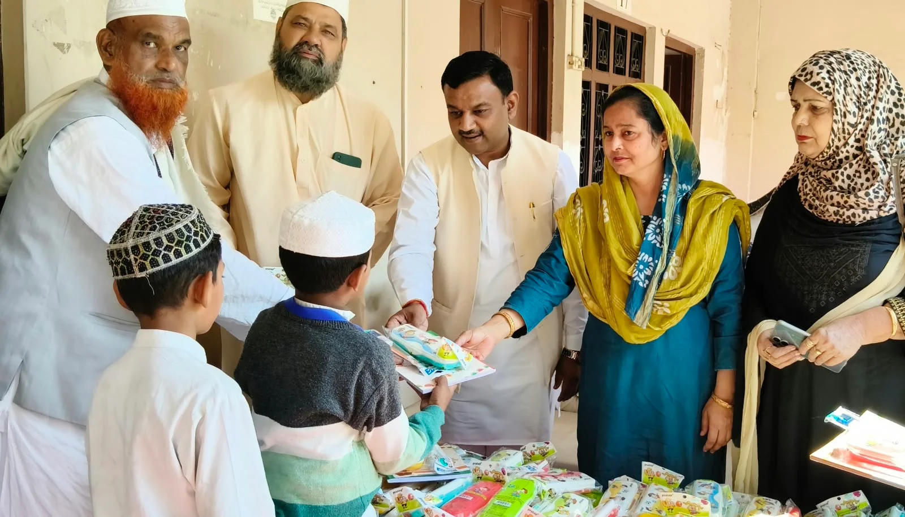
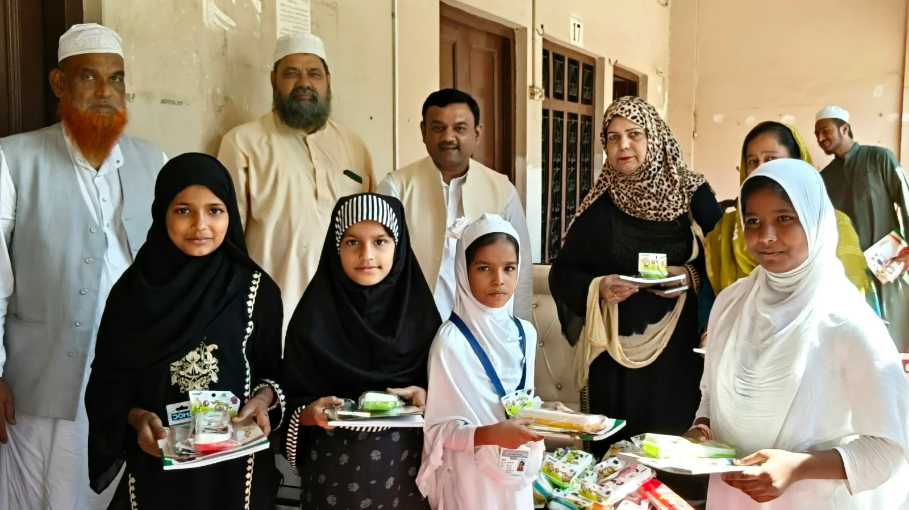
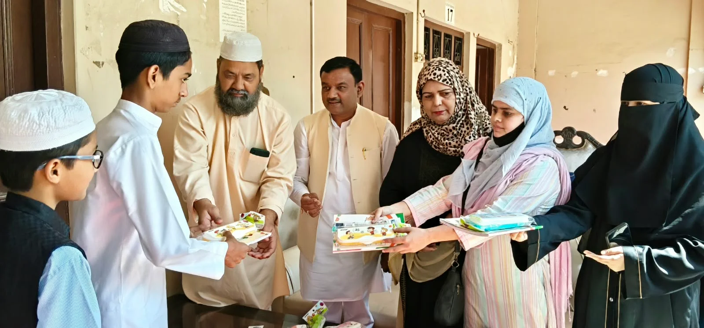

**रुड़की संवाददाता | आसिफ खान**

रुड़की। शिक्षा केवल किताबी ज्ञान तक सीमित नहीं, बल्कि एक आदर्श समाज और सशक्त राष्ट्र के निर्माण की सबसे मजबूत नींव है। इसी सोच के साथ रहमानिया हाई स्कूल में पूर्व मेयर गौरव गोयल ने सैकड़ों छात्र-छात्राओं को पाठ्य सामग्री, किताबें और कॉपियां निःशुल्क वितरित कीं। इस पहल के माध्यम से उन्होंने शिक्षा के प्रति जागरूकता का संदेश देते हुए बच्चों के उज्ज्वल भविष्य के लिए समाज के प्रत्येक वर्ग से आगे आने का आह्वान किया।

इस अवसर पर पूर्व मेयर गौरव गोयल ने कहा कि किसी भी परिवार की उन्नति की शुरुआत शिक्षा से होती है। जब परिवार शिक्षित होता है, तो उसका सकारात्मक प्रभाव पूरे समाज पर पड़ता है और यही शिक्षित बच्चे आगे चलकर राष्ट्र निर्माण में महत्वपूर्ण योगदान देते हैं। उन्होंने कहा कि प्रारंभिक शिक्षा बच्चों के ज्ञान, सोच और व्यक्तित्व के विकास में अहम भूमिका निभाती है, जिसका लाभ उन्हें जीवनभर मिलता है।

गौरव गोयल ने कहा कि शिक्षा के क्षेत्र में सेवा करना उनके लिए विशेष महत्व रखता है। बच्चों को आवश्यक शैक्षिक सामग्री उपलब्ध कराने का उद्देश्य यह है कि आर्थिक परिस्थितियां उनकी पढ़ाई में बाधा न बनें और वे बेहतर शिक्षा प्राप्त कर अपने सपनों को साकार कर सकें। उन्होंने जोर देते हुए कहा कि आज के विद्यार्थी ही कल के जिम्मेदार नागरिक हैं, इसलिए उनके भविष्य को संवारना समाज की सामूहिक जिम्मेदारी है।

**शिक्षित विद्यार्थी ही बनाएंगे आदर्श समाज**

विद्यालय के प्रधानाचार्य मौलाना अजहरूल हक ने पूर्व मेयर गौरव गोयल की पहल की सराहना करते हुए कहा कि बच्चों के विकास और शैक्षिक उन्नति के लिए समय-समय पर सामाजिक संगठनों और समाजसेवियों का सहयोग महत्वपूर्ण है। उन्होंने कहा कि गौरव गोयल बिना किसी भेदभाव के बच्चों को निःशुल्क शैक्षिक सामग्री उपलब्ध कराते हैं, जो सराहनीय कार्य है।

उन्होंने कहा कि एक शिक्षित विद्यार्थी ही समाज में आपसी सद्भाव, प्रेम, भाईचारे और आदर्शवादी विचारों को मजबूत कर सकता है। बच्चों की शिक्षा और शैक्षिक प्रगति के लिए समाज के लोगों को आगे आकर सहयोग करना चाहिए, ताकि प्रत्येक बच्चे को आगे बढ़ने के समान अवसर मिल सकें।

कार्यक्रम के दौरान बच्चों को पाठ्य सामग्री वितरित की गई। इस पहल ने शिक्षा के महत्व और सामाजिक सहयोग की आवश्यकता को रेखांकित किया। कार्यक्रम में काजी नसीम अहमद, अता साबिर ‘अफजल’, अजरा तबस्सुम, शहजाद अली, इसरार अहमद, फरहत नूर खान, जावेद अरशद, फरहत अंसारी, रिदा खान, कारी महमूद, कारी एहतेशाम, अब्दुल रब, अंसार अली, मुबाशिर अली तथा कारी शाबान सहित अन्य लोग प्रमुख रूप से मौजूद रहे।
