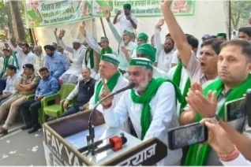

**रुड़की संवाददाता | आसिफ खान**

रुड़की। गन्ना भुगतान में देरी, चीनी मिल की जमीन के मूल्यांकन और किसानों की अनदेखी को लेकर उत्तराखंड किसान मोर्चा ने अब आर-पार की लड़ाई का ऐलान कर दिया है। बुधवार को एसडीएम चौक पर आयोजित किसान महापंचायत में सरकार और संबंधित विभागों की कार्यप्रणाली पर तीखे सवाल उठे। मोर्चा के राष्ट्रीय अध्यक्ष गुलशन रोड ने दोटूक चेतावनी दी कि किसानों को आश्वासन देकर आंदोलन खत्म कराने की कोशिश अब बर्दाश्त नहीं की जाएगी। जब तक चीनी मिल की भूमि का मूल्यांकन नहीं होता और किसानों के बकाया भुगतान की दिशा में ठोस कार्रवाई नहीं होती, तब तक तहसील में चल रहा धरना जारी रहेगा।

62 दिनों से जारी धरना, फिर भी समाधान का इंतजार! किसानों का आरोप है कि गन्ना भुगतान समेत कई समस्याओं को लेकर वे लगातार अधिकारियों और सरकार के दरवाजे खटखटा रहे हैं, लेकिन जमीनी स्तर पर ठोस नतीजे सामने नहीं आए हैं। जिलाधिकारी से लेकर गन्ना मंत्री और मुख्यमंत्री तक अपनी मांगें पहुंचाने के बावजूद भुगतान का रास्ता साफ नहीं होने से किसानों में नाराजगी बढ़ रही है। महापंचायत में बिजली विभाग की छापेमारी, स्मार्ट मीटर, सिंचाई के पानी की कमी, चकबंदी, सड़क निर्माण और एचआरडीए की कार्यप्रणाली जैसे मुद्दों पर भी जमकर आवाज उठाई गई।

**गुलशन रोड का सरकार पर हमला—किसानों को आश्वासन नहीं, उनका पैसा चाहिए**

उत्तराखंड किसान मोर्चा के राष्ट्रीय अध्यक्ष गुलशन रोड ने कहा कि किसान पिछले दो महीने से अधिक समय से धरने पर बैठे हैं। कई स्तरों पर वार्ता हो चुकी है और समस्याओं के समाधान का भरोसा भी दिया गया, लेकिन अब तक किसानों को राहत नहीं मिली। उन्होंने आरोप लगाया कि चीनी मिलों और सरकार की कार्यप्रणाली के चलते किसानों का गन्ना भुगतान वर्षों से अटका हुआ है।

उन्होंने कहा कि किसान अपनी मेहनत से फसल तैयार करता है, लेकिन जब उसी फसल का पैसा पाने के लिए उसे महीनों तक संघर्ष करना पड़े तो यह व्यवस्था पर गंभीर सवाल खड़े करता है। किसानों की आय दोगुनी करने के वादे किए गए, मगर किसान आज भी अपनी उपज का पैसा पाने के लिए अधिकारियों के चक्कर काटने को मजबूर हैं। उन्होंने साफ कहा कि किसान अपना बकाया लेकर रहेंगे और जरूरत पड़ी तो आंदोलन को और व्यापक किया जाएगा।

गुलशन रोड ने युवाओं के आंदोलनों का जिक्र करते हुए कहा कि अपने अधिकारों की मांग करने वालों की आवाज दबाने के बजाय उनकी समस्याओं का समाधान किया जाना चाहिए। किसान और युवा अपने हक की लड़ाई से पीछे हटने वाले नहीं हैं।

**बिजली विभाग की छापेमारी और स्मार्ट मीटर पर उठे सवाल**

महापंचायत में बिजली विभाग की कार्यप्रणाली को लेकर भी तीखा विरोध सामने आया। गुलशन रोड ने आरोप लगाया कि किसानों के घरों पर छापेमारी और कार्रवाई के मामलों में पारदर्शिता सुनिश्चित नहीं की जा रही है। उन्होंने जांच के दौरान वीडियोग्राफी कराने और कथित अनियमितताओं से जुड़े मामलों की सूची उपलब्ध कराने की मांग की।

उन्होंने किसानों के ट्यूबवेल की बिजली मुफ्त करने की मांग उठाते हुए कहा कि खेती की बढ़ती लागत ने पहले ही किसानों की मुश्किलें बढ़ा दी हैं। स्मार्ट मीटर लगाने के मुद्दे पर भी उन्होंने विरोध जताया। इस पर विद्युत विभाग के अधीक्षण अभियंता ने स्पष्ट किया कि प्रीपेड मीटर नहीं लगाए जा रहे हैं।

मोर्चा अध्यक्ष ने चकबंदी विभाग पर किसानों को परेशान करने का आरोप लगाया और नहरों, राजवाहों तथा नालों की सफाई कराकर सिंचाई के लिए पर्याप्त पानी उपलब्ध कराने की मांग की। उन्होंने कहा कि खेती के समय पानी की कमी किसानों की परेशानी बढ़ाती है, इसलिए संबंधित विभागों को समय रहते कार्रवाई करनी चाहिए।

**एचआरडीए की कार्यप्रणाली पर सवाल, छोटे मकानों के नक्शों से पाबंदी हटाने की मांग**

हरिद्वार-रुड़की विकास प्राधिकरण (एचआरडीए) की कार्यप्रणाली को लेकर भी महापंचायत में सवाल उठाए गए। गुलशन रोड ने प्राधिकरण में शिकायतों और कार्रवाई की प्रक्रिया पर सवाल खड़े करते हुए एक हजार वर्गफुट तक के मकानों के नक्शे बनवाने पर लगी पाबंदी हटाने की मांग की।

उन्होंने आरोपों की निष्पक्ष जांच और कार्रवाई में पारदर्शिता सुनिश्चित करने की आवश्यकता जताई। साथ ही मंत्रियों की संपत्तियों की जांच की मांग उठाते हुए कहा कि सार्वजनिक पदों पर बैठे लोगों की संपत्तियों की जांच निष्पक्ष तरीके से होनी चाहिए। उन्होंने किसानों से धर्म और जाति से ऊपर उठकर एकजुट होने तथा अपने हितों को प्राथमिकता देने की अपील भी की।

**सड़क बनेगी, लेकिन नाला भी चाहिए—वरना निर्माण का विरोध करेंगे किसान**

अब्दुल कलाम चौक से कोर तक बनाए जा रहे फोरलेन मार्ग के साथ नालों का निर्माण कराने की मांग भी महापंचायत में जोर-शोर से उठाई गई। गुलशन रोड ने चेतावनी दी कि सड़क के साथ नाले नहीं बनाए गए तो किसान निर्माण कार्य का विरोध करेंगे। इस पर लोक निर्माण विभाग की सहायक अभियंता दीपा सिंह ने सड़क के साथ नालों का निर्माण कराने का आश्वासन दिया।

इसके अलावा चौराहों पर लगे कैमरों के माध्यम से वाहनों के चालान काटे जाने की व्यवस्था पर भी आपत्ति जताई गई और इस पर रोक लगाने की मांग की गई।

**चीनी मिल की जमीन का मूल्यांकन बना आंदोलन का केंद्र**

महापंचायत में सबसे अहम मुद्दा बंद पड़ी चीनी मिल और उसकी भूमि से जुड़ा रहा। जिला गन्ना अधिकारी ने बताया कि चीनी मिल की नीलामी के लिए मूल्यांकन कराने के संबंध में राष्ट्रीय शुगर बोर्ड से पत्राचार किया जा रहा है। मूल्यांकन प्रक्रिया के लिए करीब 1.65 लाख रुपये जमा कराने होंगे। इसके बाद बोर्ड की ओर से लगभग दो सप्ताह में मूल्यांकन जारी किए जाने की बात कही गई।

भगवानपुर के उपजिलाधिकारी देवेंद्र सिंह नेगी ने बताया कि मिल की भूमि बेचने के विकल्प पर भी विचार किया जा रहा है। भूमि को सर्किल रेट के बजाय बाजार मूल्य पर बेचने की प्रक्रिया पर विचार हो रहा है। उन्होंने कहा कि मूल्यांकन के बाद यदि जमीन की बिक्री से मिलने वाली धनराशि से किसानों और बैंकों का बकाया चुकाना संभव होता है, तो इस दिशा में कार्रवाई की जाएगी। उन्होंने एक सप्ताह के भीतर भूमि का मूल्यांकन कराने का आश्वासन दिया।

वहीं, रुड़की के ज्वाइंट मजिस्ट्रेट दीपक रामचंद्र शेट ने कहा कि प्रशासन का प्रयास है कि किसानों का बकाया भुगतान हो और चीनी मिल दोबारा शुरू हो सके, ताकि भविष्य में किसानों को गन्ना बेचने में परेशानी न उठानी पड़े। उन्होंने महापंचायत में उठाई गई मांगों को सरकार तक पहुंचाने की बात कही।

**अधिकारियों की मौजूदगी में फैसला—धरना जारी रहेगा**

महापंचायत में अपर जिलाधिकारी जितेंद्र कुमार, ज्वाइंट मजिस्ट्रेट दीपक रामचंद्र शेट, भगवानपुर के उपजिलाधिकारी देवेंद्र सिंह नेगी, एसपी देहात अभय सिंह, विद्युत विभाग के अधीक्षण अभियंता संदीप चौधरी और विनोद पांडेय, तहसीलदार विकास अवस्थी, एआरटीओ केके पलड़िया, पशु चिकित्सा अधिकारी डॉ. रोहित सिंह सहित विभिन्न विभागों के अधिकारी मौजूद रहे। अधिकारियों ने अपने-अपने विभागों से संबंधित समस्याओं पर पक्ष रखा और मांगों के निस्तारण का आश्वासन दिया।

कार्यक्रम का संचालन दीपक पुंडीर ने किया। इस दौरान जिलाध्यक्ष महकार सिंह, राष्ट्रीय सलाहकार धर्मेंद्र सिंह, पवन त्यागी, समीर आलम, मुनेश त्यागी, संजय और फकरे आलम सहित बड़ी संख्या में किसान मौजूद रहे।

अब निगाहें प्रशासन के आश्वासन पर: महापंचायत के अंत में उत्तराखंड किसान मोर्चा ने स्पष्ट कर दिया कि तहसील में 62 दिनों से चल रहा धरना चीनी मिल की भूमि का मूल्यांकन होने तक जारी रहेगा। मोर्चा ने दोहराया कि किसानों का बकाया भुगतान और अन्य समस्याओं का समाधान केवल आश्वासन से नहीं, बल्कि ठोस कार्रवाई से होगा। अब देखना यह है कि प्रशासन तय समय में मूल्यांकन की प्रक्रिया पूरी कर पाता है या किसानों को अपने हक के लिए आंदोलन और तेज करना पड़ेगा।
