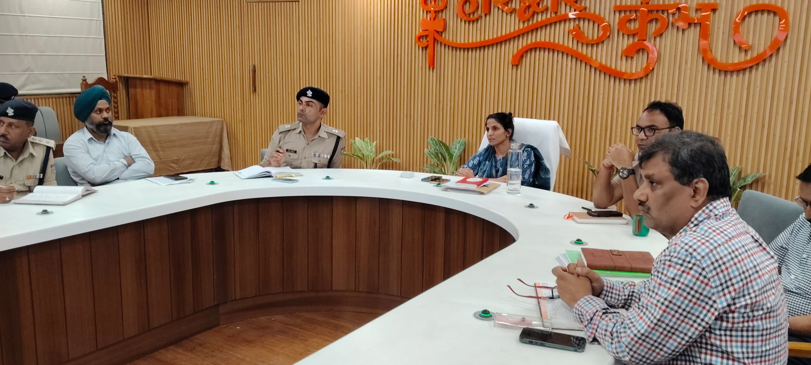
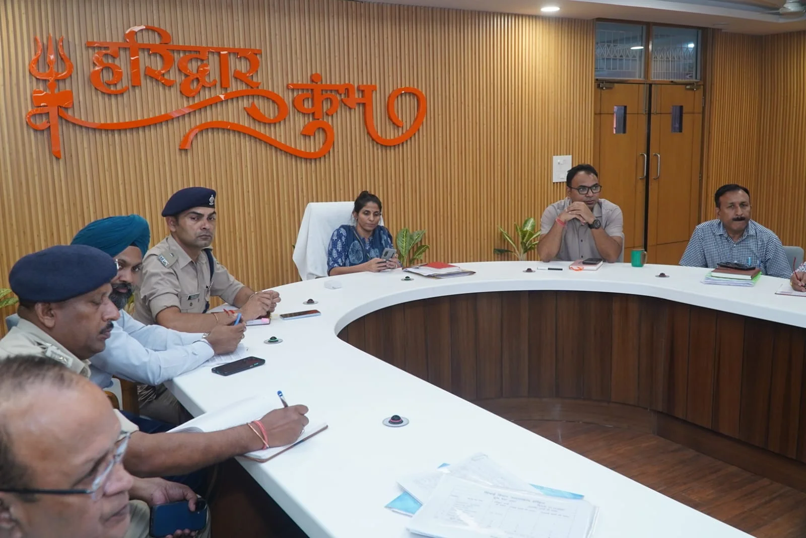

**हरिद्वार संवाददाता | आसिफ खान**

हरिद्वार। कुंभ मेला-2027 की तैयारियों को लेकर मेला प्रशासन अब निर्माण कार्यों में किसी भी तरह की ढिलाई के मूड में नहीं है। कुंभ के सबसे महत्वपूर्ण कोर एरिया में चल रहे निर्माण कार्यों को समयसीमा के भीतर पूरा करने के लिए निगरानी व्यवस्था सख्त कर दी गई है। मेलाधिकारी सोनिका ने स्पष्ट निर्देश दिए हैं कि गंगा नहर बंदी की अवधि का अधिकतम लाभ उठाते हुए हरकी पैड़ी, मालवीय द्वीप, सुभाष घाट और रोड़ी बेलवाला समेत प्रमुख स्थलों पर निर्माण एवं अनुरक्षण कार्य युद्धस्तर पर पूरे किए जाएं। कार्यों की रफ्तार, श्रमिकों की तैनाती और मशीनों से लेकर अन्य संसाधनों की उपलब्धता पर अब लगातार नजर रखी जाएगी।

**कोर एरिया के काम सर्वोच्च प्राथमिकता पर, दिन-रात चलेगा निर्माण**

मेला नियंत्रण भवन (सीसीआर) के सभागार में बुधवार को आयोजित समीक्षा बैठक में मेलाधिकारी सोनिका ने विभिन्न विभागों और कार्यदायी संस्थाओं के अधिकारियों को दो टूक निर्देश दिए कि कुंभ-2027 की तैयारियों में समयसीमा और गुणवत्ता से कोई समझौता नहीं होना चाहिए। उन्होंने कहा कि कोर एरिया में चल रहे कार्यों को सर्वोच्च प्राथमिकता पर रखा जाए और निर्माण की गति बनाए रखने के लिए कार्यस्थलों पर पर्याप्त श्रमिक, मशीनें तथा जरूरी संसाधन उपलब्ध रहें।

यूआईआईडीबी की ओर से हरकी पैड़ी और रोड़ी बेलवाला पुनर्विकास योजना के तहत किए जा रहे कार्यों की समीक्षा करते हुए उन्होंने गंगा नहर बंदी की अवधि में घाटों के निर्माण एवं अनुरक्षण कार्यों को तेजी से पूरा करने के निर्देश दिए। साफ संदेश दिया गया कि उपलब्ध समय का सदुपयोग हो और संसाधनों की कमी अथवा आपसी समन्वय के अभाव में काम की रफ्तार नहीं रुकनी चाहिए।

**सिर्फ बैठक नहीं, कार्यस्थलों पर भी होगी अधिकारियों की परीक्षा**

निर्माण कार्यों की प्रगति सुनिश्चित करने के लिए मेलाधिकारी ने मेला प्रशासन और संबंधित कार्यदायी संस्थाओं के वरिष्ठ अधिकारियों को नियमित स्थलीय निरीक्षण करने के निर्देश दिए। जिला स्तर पर नियुक्त अधिकारियों के साथ तृतीय पक्ष गुणवत्ता जांच एजेंसी को भी लगातार निरीक्षण और परीक्षण करने को कहा गया है, ताकि निर्माण की गति के साथ गुणवत्ता पर भी नजर बनी रहे।

बैठक में यह भी स्पष्ट किया गया कि केवल कागजी प्रगति से काम नहीं चलेगा। कार्यस्थलों पर वास्तविक स्थिति, श्रमिकों की संख्या, मशीनों की उपलब्धता और निर्माण की रफ्तार का आकलन किया जाएगा। जहां भी कमी सामने आएगी, वहां तत्काल आवश्यक कार्रवाई सुनिश्चित करनी होगी।

**आई ट्रिपल-सी के काम भी निगरानी के दायरे में**

कुंभ क्षेत्र की व्यवस्थाओं को आधुनिक और प्रभावी बनाने के लिए इंटीग्रेटेड कमांड एंड कंट्रोल सेंटर (आई ट्रिपल-सी) से जुड़े कार्यों को भी प्राथमिकता दी गई है। मेलाधिकारी ने निर्देश दिए कि गंगा नहर बंदी की अवधि में भूमिगत केबल बिछाने के कार्य तेजी से पूरे किए जाएं। इसके साथ ही सड़कों और पुलों से जुड़े निर्माण कार्यों की गति बनाए रखने पर भी जोर दिया गया।

अब तक स्थायी निर्माण कार्यों की दैनिक प्रगति और संसाधनों की उपलब्धता की समीक्षा की जा रही थी, लेकिन अब अस्थायी कार्यों और आई ट्रिपल-सी से जुड़े कामों की भी प्रतिदिन समीक्षा होगी। अधिकारियों को निर्देश दिए गए हैं कि किसी भी स्तर पर देरी या संसाधनों की कमी सामने आने पर तत्काल समाधान किया जाए।

**समयसीमा और गुणवत्ता पर रहेगा प्रशासन का फोकस**

कुंभ-2027 के आयोजन को देखते हुए हरिद्वार में निर्माण और व्यवस्थागत तैयारियां महत्वपूर्ण चरण में पहुंच रही हैं। ऐसे में मेला प्रशासन का जोर है कि प्रमुख घाटों से लेकर सड़कों, पुलों और तकनीकी व्यवस्थाओं तक सभी कार्य तय समय में पूरे हों। मेलाधिकारी सोनिका के निर्देशों के बाद संबंधित विभागों की जिम्मेदारी और बढ़ गई है। अब निगरानी का दायरा स्थायी निर्माण से आगे बढ़कर अस्थायी व्यवस्थाओं और तकनीकी परियोजनाओं तक विस्तारित कर दिया गया है।

बैठक में अपर मेलाधिकारी दयानंद सरस्वती, एचआरडीए सचिव प्रत्यूष सिंह, अपर पुलिस अधीक्षक (संचार) विपिन कुमार, सीओ (कुंभ) उमेश मलिक, उप मेलाधिकारी मनजीत सिंह, अधीक्षण अभियंता टेक्निकल सेल मनोज कुमार भट्ट, अधीक्षण अभियंता सिंचाई एवं महाप्रबंधक यूपीसीडीसीसी मनोज कुमार सिंह, अधीक्षण अभियंता लोक निर्माण विभाग डीपी सिंह सहित विभिन्न विभागों के अधिकारी उपस्थित रहे।
