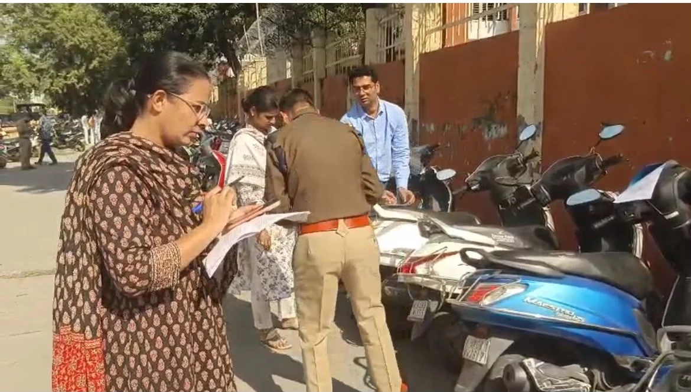
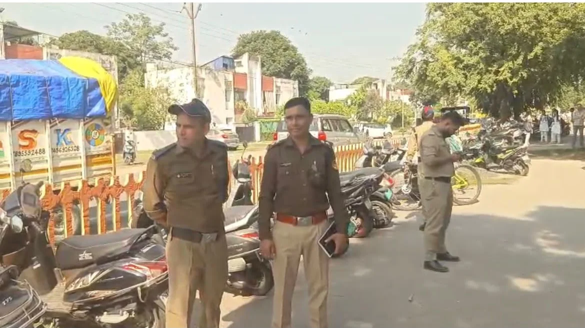
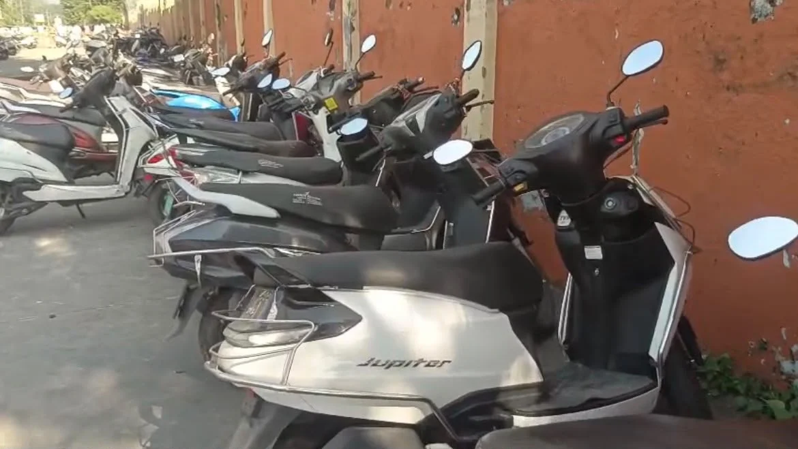

**हरिद्वार संवाददाता | आसिफ खान**

**हरिद्वार।** स्कूल जाने की उम्र में बाइक और स्कूटी लेकर सड़कों पर फर्राटा भरने वाले नाबालिग छात्र-छात्राओं पर अब परिवहन विभाग ने शिकंजा कसना शुरू कर दिया है। जिलाधिकारी मयूर दीक्षित के निर्देश पर परिवहन विभाग ने विद्यालयों के आसपास विशेष प्रवर्तन अभियान चलाकर संदिग्ध दोपहिया वाहनों की जांच की। इस दौरान वाहन स्वामियों को कारण बताओ नोटिस जारी कर तीन दिन के भीतर जवाब और आवश्यक दस्तावेज प्रस्तुत करने के निर्देश दिए गए हैं। विभाग की इस कार्रवाई से उन अभिभावकों और वाहन मालिकों की मुश्किलें बढ़ सकती हैं, जो नाबालिग बच्चों को दोपहिया वाहन उपलब्ध कराते हैं।

**स्कूलों के आसपास जांच, वाहन मालिकों से जवाब तलब**

सहायक संभागीय परिवहन अधिकारी (प्रशासन) निखिल शर्मा के अनुसार, जिलाधिकारी के निर्देश पर चलाए गए इस अभियान का मुख्य उद्देश्य नाबालिगों द्वारा बिना वैध ड्राइविंग लाइसेंस वाहन चलाने पर रोक लगाना और सड़क सुरक्षा सुनिश्चित करना है। अभियान सहायक संभागीय परिवहन अधिकारी (प्रवर्तन) नेहा झा के नेतृत्व में चलाया गया। इसमें एआरटीओ प्रशासन निखिल शर्मा और परिवहन कर अधिकारी वरुणा सैनी भी शामिल रहीं।

अभियान के दौरान विभिन्न विद्यालयों के आसपास की सड़कों, गलियों और पार्किंग स्थलों पर खड़े दोपहिया वाहनों की जांच की गई। ऐसे वाहनों को विशेष रूप से चिह्नित किया गया, जिनका इस्तेमाल नाबालिग छात्र-छात्राओं द्वारा किए जाने की आशंका थी।

**तीन दिन में बताना होगा—वाहन कौन चला रहा था?**

परिवहन विभाग ने संदिग्ध वाहनों के पंजीकृत स्वामियों को कारण बताओ नोटिस जारी किए हैं। उनसे पूछा गया है कि संबंधित वाहन स्कूल के आसपास कौन लेकर आया था, उसे चलाने वाले व्यक्ति की उम्र कितनी थी और क्या उसके पास वैध ड्राइविंग लाइसेंस था।

यदि वाहन किसी नाबालिग के इस्तेमाल में पाया गया, तो यह भी स्पष्ट करना होगा कि उसे वाहन किसने और किन परिस्थितियों में उपलब्ध कराया। वाहन स्वामियों को तीन दिन के भीतर लिखित स्पष्टीकरण और जरूरी अभिलेख जमा करने होंगे। विभाग का कहना है कि जवाब और जांच में सामने आने वाले साक्ष्यों के आधार पर नियमानुसार आगे की कार्रवाई की जाएगी।

**स्कूल प्रबंधन भी जिम्मेदारी से नहीं बच सकेगा**

परिवहन विभाग ने विद्यालय प्रबंधन को भी सख्त निर्देश दिए हैं। स्कूलों से कहा गया है कि नाबालिग छात्र-छात्राओं द्वारा लाए जाने वाले मोटरसाइकिल और स्कूटी जैसे वाहनों के लिए पार्किंग की सुविधा उपलब्ध न कराई जाए।

विद्यालय प्रशासन को ऐसे विद्यार्थियों की पहचान करने, उनके अभिभावकों को सूचित करने और दोबारा ऐसी स्थिति न बने, इसके लिए आवश्यक कदम उठाने को कहा गया है। साथ ही विद्यार्थियों और अभिभावकों को सड़क सुरक्षा नियमों, वाहन चलाने की न्यूनतम वैधानिक आयु तथा बिना वैध लाइसेंस वाहन चलाने के कानूनी परिणामों के प्रति जागरूक करने के निर्देश भी दिए गए हैं।

**नाबालिग को वाहन देना पड़ सकता है भारी**

मोटर वाहन अधिनियम, 1988 की धारा 199A के तहत किशोर द्वारा मोटर वाहन संबंधी अपराध किए जाने की स्थिति में निर्धारित कानूनी शर्तों के अधीन वाहन के पंजीकृत स्वामी अथवा अभिभावक के खिलाफ भी कार्रवाई हो सकती है। कानून में तीन वर्ष तक के कारावास और 25 हजार रुपये के जुर्माने का प्रावधान है।

ऐसे में अभिभावकों के लिए जरूरी है कि वे अपने नाबालिग बच्चों को मोटरसाइकिल या स्कूटी चलाने के लिए न दें। यह लापरवाही बच्चों के साथ-साथ सड़क पर चलने वाले दूसरे लोगों की जान को भी खतरे में डाल सकती है।

**सड़क सुरक्षा पर सख्ती, अभियान रहेगा जारी**

एआरटीओ प्रवर्तन नेहा झा ने बताया कि जिलाधिकारी के निर्देशों के अनुपालन में विद्यालयों के आसपास नाबालिगों द्वारा वाहन संचालन रोकने के लिए नियमित प्रवर्तन अभियान चलाया जाएगा।

वहीं, एआरटीओ प्रशासन निखिल शर्मा ने कहा कि अभियान का उद्देश्य केवल चालान या दंडात्मक कार्रवाई करना नहीं, बल्कि विद्यार्थियों, अभिभावकों और विद्यालय प्रबंधन में सड़क सुरक्षा के प्रति जिम्मेदारी विकसित करना भी है। वाहन स्वामियों से मिले स्पष्टीकरण और उपलब्ध साक्ष्यों के आधार पर विधिसम्मत कार्रवाई की जाएगी।

अब सवाल सिर्फ नियमों के उल्लंघन का नहीं, बल्कि बच्चों और आम लोगों की सुरक्षा का भी है। परिवहन विभाग की इस सख्ती के बीच अभिभावकों और स्कूल प्रबंधन की जिम्मेदारी बढ़ गई है। विभाग की आगामी कार्रवाई से स्पष्ट होगा कि अभियान का असर जमीनी स्तर पर कितना दिखाई देता है।
