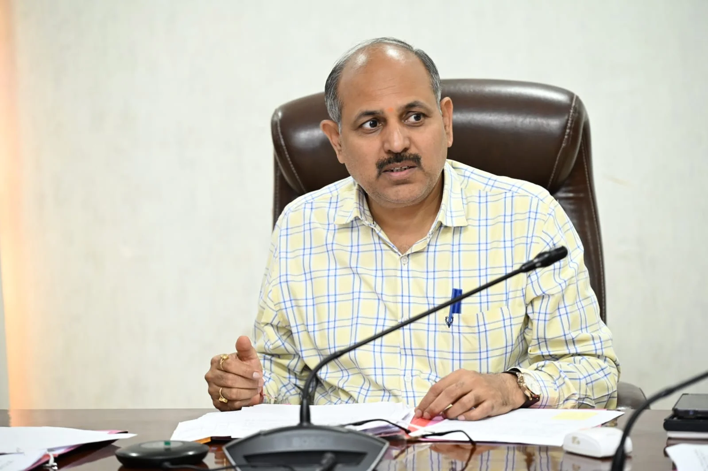

**हरिद्वार संवाददाता | आसिफ खान**

हरिद्वार। अनुसूचित जाति एवं अनुसूचित जनजाति के लोगों के साथ होने वाले अत्याचार और उत्पीड़न के मामलों में पीड़ितों को समय पर न्याय और आर्थिक सहायता उपलब्ध कराने को लेकर प्रशासन ने गंभीरता दिखाई है। प्रभारी जिलाधिकारी एवं मुख्य विकास अधिकारी डॉ. ललित नारायण मिश्र की अध्यक्षता में आयोजित जिला स्तरीय सतर्कता एवं मॉनिटरिंग समिति की बैठक में लंबित प्रकरणों, सहायता राशि की स्वीकृति एवं भुगतान और अत्याचार की घटनाओं पर अंकुश लगाने के उपायों की समीक्षा की गई। बैठक में स्पष्ट किया गया कि पीड़ितों को शासनादेश के अनुरूप समयबद्ध सहायता उपलब्ध कराने के लिए संबंधित विभाग आपसी समन्वय के साथ आवश्यक कार्रवाई सुनिश्चित करें।

**एफआईआर दर्ज होते ही जुटाए जाएं जरूरी दस्तावेज**

बैठक में वित्तीय वर्ष 2025-26 और 2026-27 के दौरान प्राप्त प्रकरणों में आर्थिक सहायता की स्वीकृति और भुगतान की स्थिति पर चर्चा की गई। पीड़ितों को एक सप्ताह के भीतर सहायता उपलब्ध कराने के उद्देश्य से पुलिस विभाग द्वारा एफआईआर दर्ज करते समय आवश्यक दस्तावेज प्राप्त कर समाज कल्याण विभाग को भेजने की प्रक्रिया पर जोर दिया गया।

इसके तहत पीड़ितों के जाति प्रमाण पत्र, आधार कार्ड, आधार से जुड़े बैंक खाते की पासबुक के प्रथम पृष्ठ की छायाप्रति और मोबाइल नंबर प्राप्त कर संबंधित विभाग को प्रेषित किए जाने की व्यवस्था पर चर्चा की गई, ताकि दस्तावेजों की कमी के कारण सहायता प्रक्रिया में अनावश्यक देरी न हो।

**संवेदनशील क्षेत्रों की पहचान कर रोकी जाएं घटनाएं**

समिति की बैठक में जनपद के उन क्षेत्रों को चिह्नित करने पर भी विचार किया गया, जहां इस तरह की घटनाएं अधिक सामने आती हैं। ऐसे क्षेत्रों में प्रभावी निगरानी बढ़ाने, पुलिस की कार्रवाई को मजबूत करने और अत्याचार की घटनाओं में कमी लाने के लिए आवश्यक कदम उठाने पर जोर दिया गया।

अधिकारियों और समिति के सदस्यों से अपेक्षा की गई कि वे अपने स्तर से प्रभावी सुझाव दें, ताकि संवेदनशील क्षेत्रों में समय रहते कार्रवाई की जा सके और पीड़ितों को न्याय दिलाने की प्रक्रिया में किसी प्रकार की बाधा न आए।

**एफआईआर नहीं हुई या सहायता नहीं मिली तो समिति तक पहुंचाएं मामला**

बैठक में समिति के सदस्यों से कहा गया कि यदि उनके संज्ञान में ऐसा कोई मामला आता है, जिसमें अनुसूचित जाति या अनुसूचित जनजाति के किसी पीड़ित की एफआईआर दर्ज नहीं हुई है अथवा उसे समाज कल्याण विभाग से आर्थिक सहायता नहीं मिली है, तो संबंधित प्रकरण समिति के समक्ष प्रस्तुत किया जाए। इससे नियमानुसार मामले की जांच कर आवश्यक कार्रवाई सुनिश्चित की जा सकेगी।

प्रभारी जिलाधिकारी डॉ. ललित नारायण मिश्र ने जिला समाज कल्याण अधिकारी को प्राप्त प्रकरणों का भली-भांति परीक्षण कर नियमानुसार आवश्यक कार्रवाई करने के निर्देश दिए। साथ ही संबंधित विभागों के बीच बेहतर समन्वय स्थापित कर मामलों के प्रभावी निस्तारण और पीड़ितों को समय पर सहायता उपलब्ध कराने पर बल दिया गया।

**समाज कल्याण विभाग ने दी सहायता राशि की जानकारी**

बैठक में जिला समाज कल्याण अधिकारी सुबोध शर्मा ने अनुसूचित जाति एवं अनुसूचित जनजाति के उत्पीड़न से संबंधित प्राप्त आवेदनों और पीड़ितों को उपलब्ध कराई गई आर्थिक सहायता के संबंध में समिति के सदस्यों को जानकारी दी।

बैठक में समिति के सदस्य गोपाल कुमार, ऋषिपाल सिंह, अनूप कुमार, जिला सूचना अधिकारी रती लाल शाह सहित संबंधित विभागों के अधिकारी एवं कर्मचारी उपस्थित रहे।

अब निगरानी और समयबद्ध कार्रवाई पर जोर: बैठक का मुख्य उद्देश्य यह सुनिश्चित करना रहा कि उत्पीड़न के मामलों में पीड़ितों को सरकारी सहायता के लिए अनावश्यक इंतजार न करना पड़े, लंबित प्रकरणों का नियमानुसार निस्तारण हो और अत्याचार की घटनाओं की रोकथाम के लिए प्रशासनिक स्तर पर प्रभावी कदम उठाए जाएं।
