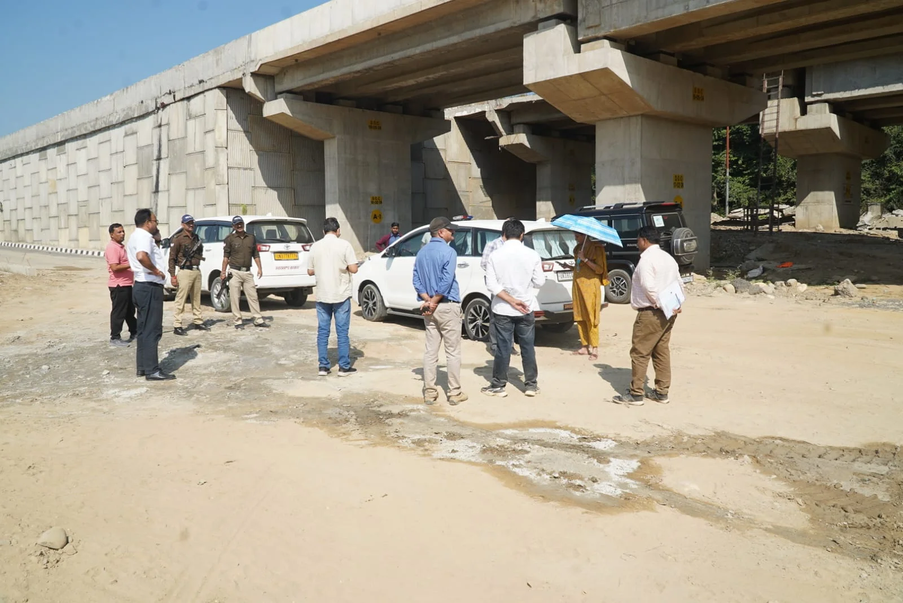
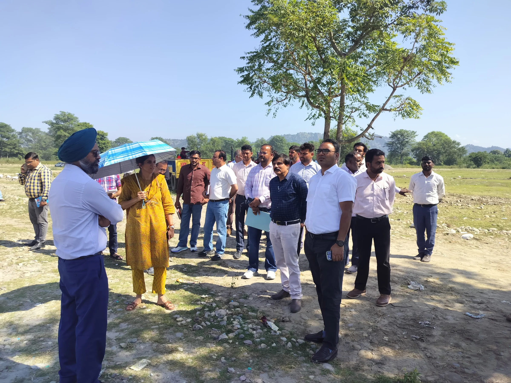
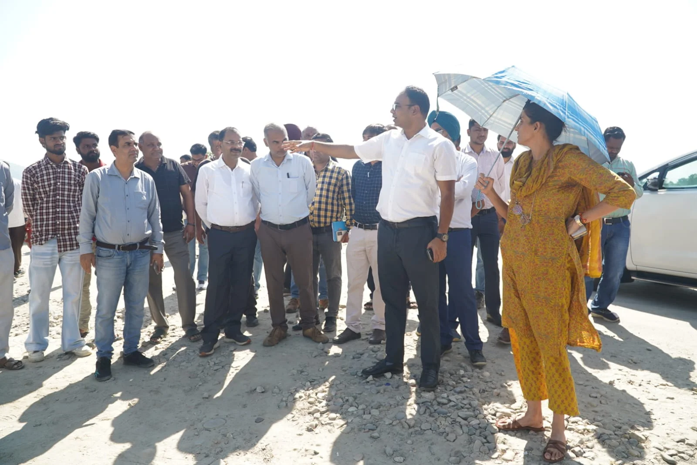
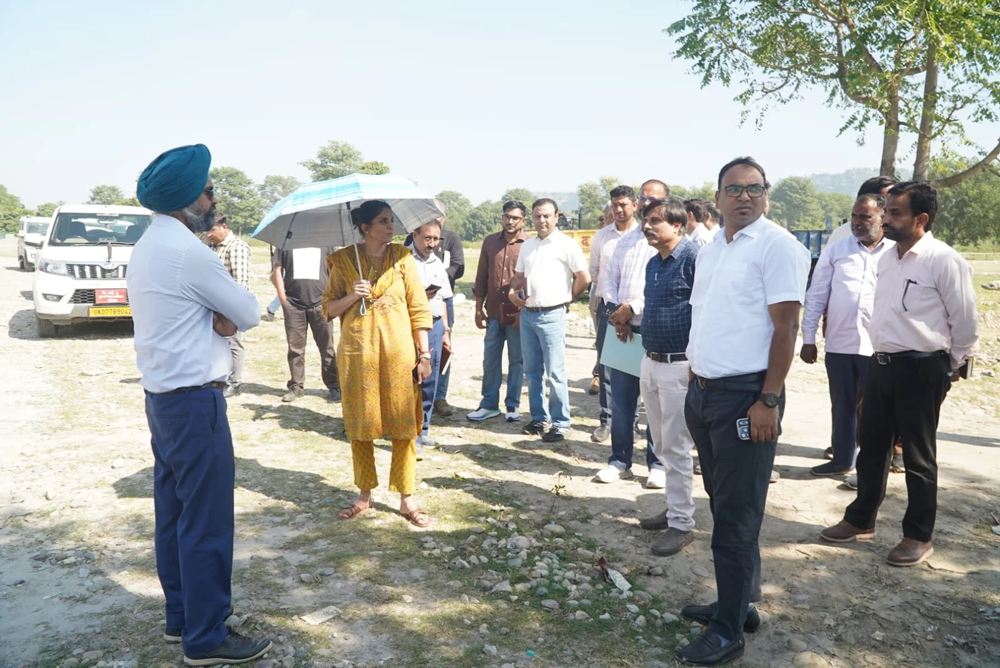

**हरिद्वार संवाददाता | आसिफ खान**

हरिद्वार। कुंभ मेला-2027 को लेकर मेला प्रशासन ने तैयारियों की रफ्तार तेज कर दी है। श्रद्धालुओं की भारी भीड़, यातायात के दबाव और मेला क्षेत्र में सुचारू आवागमन की चुनौती को देखते हुए अब स्थायी निर्माण कार्यों के साथ अस्थायी व्यवस्थाओं को भी समयबद्ध तरीके से पूरा करने पर जोर दिया जा रहा है। इसी कड़ी में मेलाधिकारी सोनिका ने बैरागी कैंप, दक्षद्वीप, हरिद्वार बाईपास और राष्ट्रीय राजमार्ग-74 के विभिन्न स्थलों का निरीक्षण कर निर्माण कार्यों की हकीकत परखी। उन्होंने संबंधित अधिकारियों को स्पष्ट निर्देश दिए कि कुंभ की जरूरतों से जुड़े कार्यों में तेजी लाई जाए और लंबित परियोजनाओं को प्राथमिकता के आधार पर पूरा किया जाए।

**कुंभ से पहले बाईपास चालू करने का लक्ष्य, एनएचएआई को सख्त निर्देश**

निरीक्षण के दौरान हरिद्वार बाईपास परियोजना और एनएच-74 के लंबित कार्य प्रमुखता से सामने रहे। मेलाधिकारी ने एनएचएआई के अधिकारियों को निर्देश दिए कि हरिद्वार बाईपास का निर्माण अविलंब पूरा कर कुंभ से पहले मार्ग को यातायात के लिए चालू कराया जाए। उन्होंने फ्लाईओवर सहित अन्य निर्माण कार्यों की प्रगति का जायजा लेते हुए स्पष्ट किया कि कुंभ के दौरान यातायात व्यवस्था को सुचारू बनाए रखने के लिए संपर्क मार्गों का समय पर तैयार होना बेहद जरूरी है।

एनएच-74 पर चिड़ियापुर तक मार्ग की स्थिति का निरीक्षण करते हुए मेलाधिकारी ने अंजनी चौकी के निकट प्वाइंट 4.2 पर हरिद्वार बाईपास के अंतिम सिरे को शीघ्र व्यवस्थित करने और आवश्यक साइनेज लगाने के निर्देश दिए। इसका उद्देश्य वाहन चालकों को रास्ते की स्पष्ट जानकारी देना और यातायात में संभावित अव्यवस्थाओं को रोकना है।

मेलाधिकारी ने मौके पर मौजूद एनएचएआई अधिकारियों के साथ समीक्षा की। साथ ही परियोजना निदेशक, नजीबाबाद से दूरभाष पर वार्ता कर एनएच-74 पर चल रहे कार्यों को जल्द पूरा कराने के निर्देश दिए। चिड़ियापुर के निकट फ्लाईओवर के अवरुद्ध कार्य को भी कुंभ की जरूरतों के मद्देनजर प्राथमिकता से पूरा करने पर जोर दिया गया।

**बैरागी कैंप और दक्षद्वीप में शिविरों की तैयारियां तेज**

कुंभ के दौरान संतों, अखाड़ों और श्रद्धालुओं से जुड़ी व्यवस्थाओं को सुचारू बनाए रखने के लिए बैरागी कैंप एवं दक्षद्वीप में शिविर स्थलों को तैयार करने का काम तेज किया जा रहा है। मेलाधिकारी ने यहां भूमि की ड्रेसिंग और लेवलिंग, अस्थायी सड़कों के निर्माण तथा बिजली और पेयजल आपूर्ति से संबंधित कार्यों का निरीक्षण किया।

उन्होंने निर्देश दिए कि शिविरों के लिए निर्धारित भूमि को समय रहते तैयार किया जाए और वहां जरूरी जन-सुविधाओं का विकास भी साथ-साथ सुनिश्चित किया जाए। मेला क्षेत्र में केवल जमीन उपलब्ध कराना ही पर्याप्त नहीं होगा, बल्कि शिविरों तक पहुंचने वाले रास्तों और मूलभूत सुविधाओं को भी व्यवस्थित करना होगा, ताकि कुंभ के दौरान अंतिम समय में किसी प्रकार की परेशानी न हो।

**अस्थायी बस अड्डे और पार्किंग पर भी फोकस**

दक्षद्वीप में प्रस्तावित अस्थायी बस अड्डे के निर्माण को शीघ्र पूरा करने के निर्देश देते हुए मेलाधिकारी ने वाहनों के आवागमन और पार्किंग व्यवस्था को व्यवस्थित रखने पर जोर दिया। वहीं, हद्दीपुर में प्रस्तावित पार्किंग स्थल की तैयारियों की समीक्षा करते हुए वहां तक पहुंचने वाले मार्गों और पुलों से संबंधित कार्यवाही भी जल्द पूरी करने को कहा।

कुंभ के दौरान बड़ी संख्या में श्रद्धालुओं और वाहनों के हरिद्वार पहुंचने की संभावना को देखते हुए अस्थायी बस अड्डों और पार्किंग स्थलों की तैयारी को महत्वपूर्ण माना जा रहा है। ऐसे में इन व्यवस्थाओं में देरी होने पर यातायात संचालन प्रभावित हो सकता है। मेला प्रशासन का जोर है कि प्रमुख मार्गों, पार्किंग स्थलों और शिविर क्षेत्रों के बीच संपर्क बेहतर बनाया जाए।

**समयसीमा के भीतर काम पूरा कराने पर जोर**

मेलाधिकारी सोनिका के निरीक्षण से स्पष्ट है कि कुंभ-2027 की तैयारियों में अब सड़क, परिवहन, पार्किंग और शिविर व्यवस्थाओं को एक साथ गति देने पर ध्यान केंद्रित किया जा रहा है। अधिकारियों को निर्देश दिए गए हैं कि निर्माण कार्यों में तेजी लाने के साथ सुरक्षा, जन-सुविधाओं और आवागमन की व्यवस्था को भी प्राथमिकता दी जाए।

निरीक्षण के दौरान अपर मेलाधिकारी दयानंद सरस्वती, उप मेलाधिकारी मनजीत सिंह, टेक्निकल सेल के अधीक्षण अभियंता मनोज भट्ट, पीआईयू के अधिशासी अभियंता प्रवीण कुश, जल निगम के अधिशासी अभियंता राजेश गुप्ता सहित विभिन्न कार्यदायी संस्थाओं के अभियंता और एनएचएआई के अधिकारी मौजूद रहे।

अब निगाहें निर्माण कार्यों की समयबद्ध प्रगति पर हैं। कुंभ से पहले हरिद्वार बाईपास को चालू करना, एनएच-74 के लंबित कार्यों को पूरा कराना और शिविरों से लेकर बस अड्डों व पार्किंग तक बुनियादी व्यवस्थाएं तैयार करना मेला प्रशासन के सामने अहम चुनौती है। इन कार्यों की समय पर पूर्णता ही कुंभ के दौरान यातायात और श्रद्धालुओं की सुविधाओं को सुचारू बनाए रखने में निर्णायक भूमिका निभाएगी।
