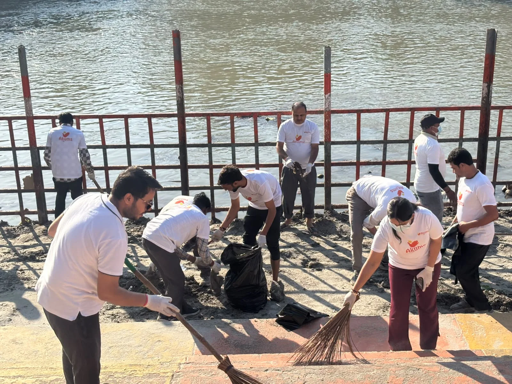
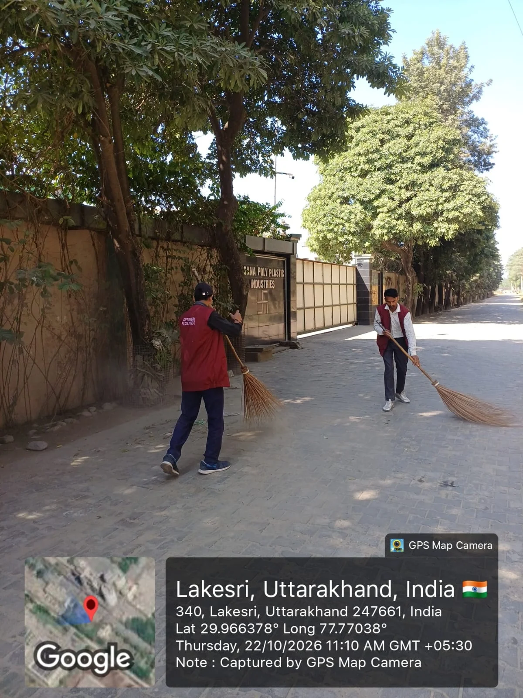
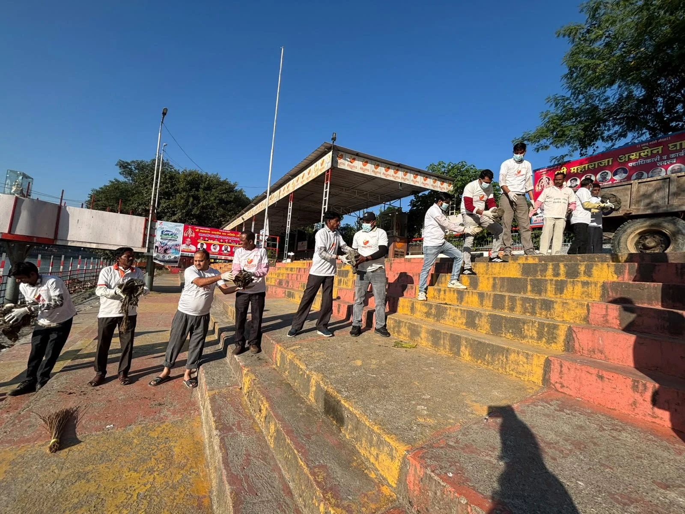

**हरिद्वार संवाददाता | आसिफ खान**

हरिद्वार। गंगा बंदी के दौरान घाटों और रेगुलेटरों पर जमा कूड़े-कचरे की सफाई को लेकर जिला प्रशासन ने अभियान तेज कर दिया है। मुख्यमंत्री के निर्देशों के अनुपालन में मेलाधिकारी कुंभ श्रीमती सोनिका और जिलाधिकारी मयूर दीक्षित के निर्देशन में लगातार दूसरे दिन भी जनपद में विशेष स्वच्छता अभियान चलाया गया। मालवीय घाट से लेकर मायापुर हेड रेगुलेटर तक चले इस अभियान में भारी मात्रा में कूड़ा-कचरा एकत्रित किया गया। नगर निगम की टीम ने करीब 8 टन, जबकि अकुम्स ड्रग्स एंड फार्मास्युटिकल्स लिमिटेड ने लगभग 60 कुंतल कचरा एकत्रित कर निस्तारण के लिए भेजा।

गंगा बंदी के दौरान घाटों, रेगुलेटरों और आसपास के क्षेत्रों में जमा गंदगी को हटाने के लिए नगर निगम, पर्यावरण मित्रों और निजी संस्थानों ने सफाई अभियान में भाग लिया। अभियान ने यह स्पष्ट कर दिया कि गंगा घाटों की स्वच्छता बनाए रखने के लिए नियमित सफाई, कचरे का समय पर उठान और प्रभावी निगरानी बेहद जरूरी है।

**मायापुर हेड रेगुलेटर पर हटाया 8 टन कचरा**

नगर निगम हरिद्वार की टीम ने डाम कोठी के निकट स्थित मायापुर हेड रेगुलेटर पर व्यापक सफाई अभियान चलाया। अभियान के दौरान लगभग 8 टन कूड़ा-कचरा एकत्रित किया गया, जिसे नगर निगम के प्लांट तक पहुंचाकर उचित निस्तारण की व्यवस्था की गई। गंगा क्षेत्र में जमा गंदगी को हटाने के लिए सफाई टीमों ने व्यापक स्तर पर कार्य किया।

नगर आयुक्त नन्दन कुमार ने संबंधित अधिकारियों और सफाई टीमों को निर्देश दिए कि गंगा बंदी की अवधि में घाटों, रेगुलेटरों तथा आसपास के क्षेत्रों की नियमित सफाई सुनिश्चित की जाए। उन्होंने कूड़े का समयबद्ध संग्रहण, उचित निस्तारण और सफाई व्यवस्था की लगातार निगरानी करने पर जोर दिया।

**मालवीय घाट पर अकुम्स कंपनी ने जुटाए 35 कर्मचारी**

जिलाधिकारी के निर्देशों के अनुपालन में अकुम्स ड्रग्स एंड फार्मास्युटिकल्स लिमिटेड की ओर से मालवीय घाट पर विशेष सफाई अभियान चलाया गया। कंपनी के महाप्रबंधक के.डी. शर्मा के अनुसार, अभियान में 35 श्रमिकों और कर्मचारियों ने हिस्सा लिया। टीम ने घाट की सफाई करते हुए लगभग 60 कुंतल कूड़ा-कचरा एकत्रित किया, जिसे उचित निस्तारण के लिए भेजा गया।

**रोडवेज परिसर से औद्योगिक क्षेत्र तक चला अभियान**

स्वच्छता अभियान केवल गंगा घाटों तक सीमित नहीं रहा। एआरएम परिवहन निगम विशाल चंद्र ने बताया कि परिवहन विभाग की ओर से रोडवेज परिसर में भी सफाई अभियान चलाया गया। वहीं, महाप्रबंधक उद्योग उत्तम कुमार तिवारी के अनुसार, भगवानपुर के लोकेश्वरी इंडस्ट्रियल एरिया में विशेष स्वच्छता अभियान के दौरान एक कुंतल सूखा एवं गीला कचरा एकत्रित किया गया।

**स्वच्छता के दावों के साथ नियमित निगरानी भी जरूरी**

जिला प्रशासन ने संबंधित विभागों और संस्थानों से अभियान में निरंतर सहयोग करने तथा अपने आसपास के क्षेत्रों में स्वच्छता बनाए रखने की अपील की है। गंगा घाटों की स्वच्छता, पर्यावरण संरक्षण और कचरे के उचित निस्तारण को लेकर प्रशासन की ओर से विशेष जोर दिया जा रहा है।

हालांकि, ऐसे अभियानों की वास्तविक सफलता तभी सुनिश्चित होगी, जब सफाई व्यवस्था केवल विशेष अभियान तक सीमित न रहकर नियमित रूप से जारी रहे और घाटों, रेगुलेटरों तथा औद्योगिक क्षेत्रों में कूड़ा जमा होने की समस्या पर लगातार निगरानी रखी जाए।
