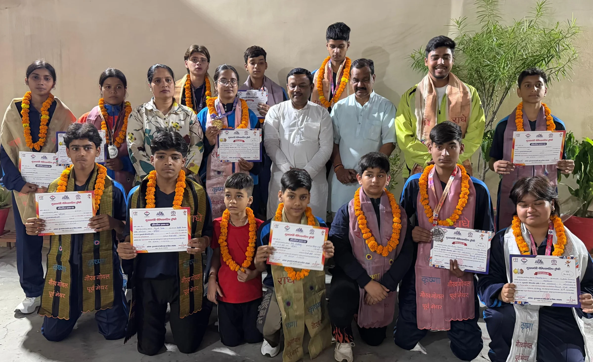
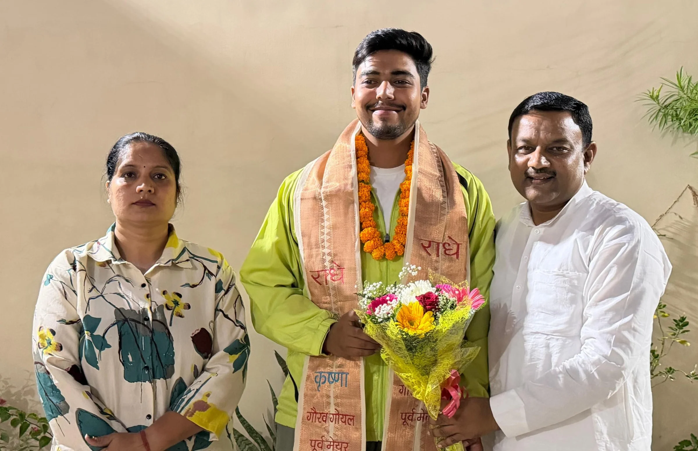
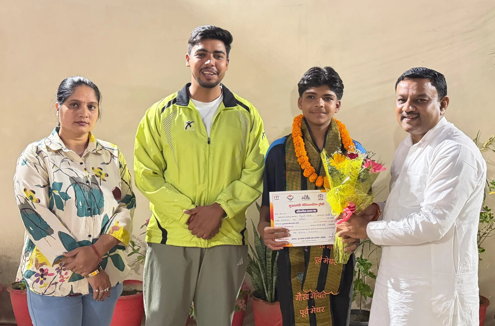

**रुड़की संवाददाता | आसिफ खान**

रुड़की। मुख्यमंत्री चैंपियनशिप ट्रॉफी खेल महाकुंभ-2026 में शानदार प्रदर्शन कर स्वर्ण, रजत और कांस्य पदक जीतने वाले जनपद हरिद्वार के युवा खिलाड़ियों का उत्साह बढ़ाने के लिए पूर्व मेयर गौरव गोयल ने अपने कैंप कार्यालय पर सम्मान समारोह आयोजित किया। वॉरियर्स एकेडमी के पदक विजेता खिलाड़ियों को सम्मानित कर उनकी उपलब्धियों की सराहना की गई। खिलाड़ियों की इस सफलता ने जिले की खेल प्रतिभाओं और युवाओं की मेहनत को एक बार फिर सामने लाने का काम किया।

पूर्व मेयर गौरव गोयल ने खिलाड़ियों को बधाई देते हुए कहा कि खेल के मैदान में मेहनत, अनुशासन और दृढ़ संकल्प ही सफलता की असली पहचान हैं। राज्य स्तर पर पदक जीतना खिलाड़ियों की प्रतिभा और कठिन परिश्रम का प्रमाण है। उन्होंने उम्मीद जताई कि ये युवा खिलाड़ी भविष्य में राष्ट्रीय और अंतरराष्ट्रीय प्रतियोगिताओं में भी शानदार प्रदर्शन कर प्रदेश और देश का नाम रोशन करेंगे।

उन्होंने कहा कि प्रतिभाशाली खिलाड़ियों को आगे बढ़ने के लिए बेहतर प्रशिक्षण, पर्याप्त संसाधन और प्रतियोगिताओं में भाग लेने के अधिक अवसर मिलने चाहिए। खेलों में युवाओं की बढ़ती भागीदारी न केवल उनकी प्रतिभा को निखारती है, बल्कि उनमें आत्मविश्वास, अनुशासन और नेतृत्व क्षमता भी विकसित करती है।

गौरव गोयल ने पदक विजेताओं का उत्साहवर्धन करते हुए कहा कि खिलाड़ियों को अपनी उपलब्धियों से संतुष्ट होकर रुकना नहीं चाहिए, बल्कि बड़े लक्ष्य निर्धारित कर उन्हें हासिल करने के लिए लगातार प्रयास करना चाहिए। उन्होंने कहा कि आज की यही युवा प्रतिभाएं भविष्य में प्रदेश और देश के लिए गौरव बन सकती हैं।

सम्मान समारोह में रुड़की व्यापार मंडल के अध्यक्ष अरविंद कश्यप, राजेश सैनी और सोनी जोशी सहित अन्य लोग मौजूद रहे। इस दौरान युवा खिलाड़ी शैल्वीय शर्मा, आकांक्षा सैनी, अभिनव चौधरी, अक्षिता सैनी, वेदांत सुयाल और रुद्र कुमार सहित अन्य खिलाड़ियों को सम्मानित कर उनका हौसला बढ़ाया गया।

पदक जीतकर लौटे इन युवा खिलाड़ियों का सम्मान खेल प्रतिभाओं को प्रोत्साहित करने और उन्हें भविष्य में नई ऊंचाइयां हासिल करने के लिए प्रेरित करने की दिशा में महत्वपूर्ण कदम रहा।
