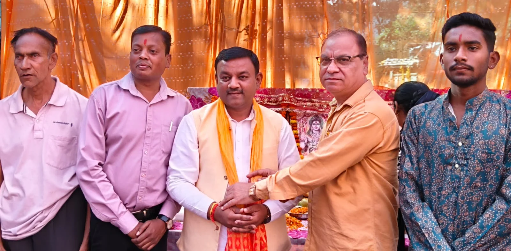
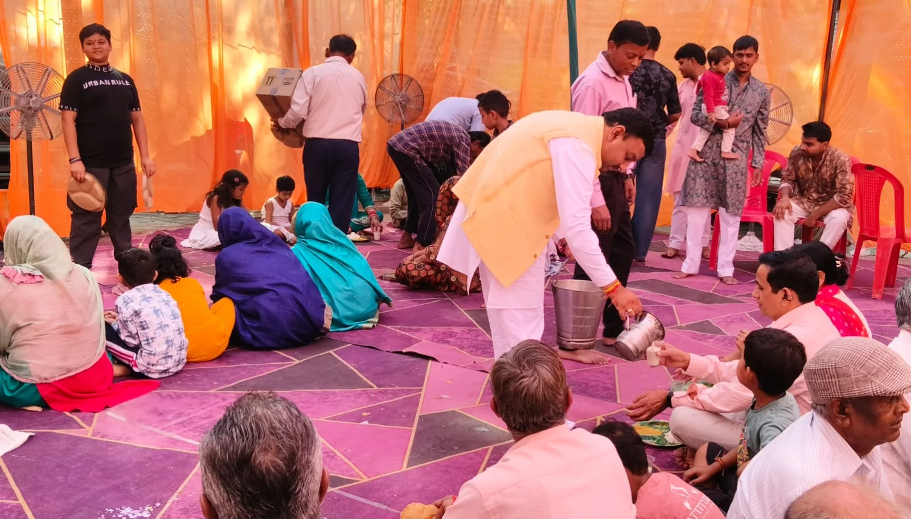

**रुड़की संवाददाता | आसिफ खान**

रुड़की। नवरात्र के पावन अवसर पर लालकुर्ती में भक्ति और आस्था का अद्भुत संगम देखने को मिला। यूनाइटेड परिवार की ओर से आयोजित मां अन्नपूर्णा के विशाल भंडारे में बड़ी संख्या में श्रद्धालु पहुंचे और मां के दरबार में शीश नवाकर प्रसाद ग्रहण किया। धार्मिक आयोजन के दौरान पूरा क्षेत्र भक्तिमय माहौल में नजर आया और श्रद्धालुओं ने पूजा-अर्चना कर परिवार एवं समाज की सुख-समृद्धि की कामना की।

भंडारे में पूर्व मेयर गौरव गोयल ने पहुंचकर मां अन्नपूर्णा के समक्ष पूजा-अर्चना की तथा श्रद्धालुओं को प्रसाद वितरित किया। उन्होंने स्वयं भी प्रसाद ग्रहण कर मां का आशीर्वाद लिया। इस अवसर पर गौरव गोयल ने कहा कि मां दुर्गा समस्त संसार का कल्याण करने वाली हैं। नवरात्र के पावन दिनों में मां की आराधना से श्रद्धालुओं को आध्यात्मिक ऊर्जा और सकारात्मकता मिलती है। ऐसे धार्मिक आयोजन समाज में आपसी प्रेम, सद्भाव और सेवा की भावना को मजबूत करते हैं।

**यूनाइटेड परिवार ने किया पूर्व मेयर का स्वागत**

आयोजन के दौरान यूनाइटेड परिवार के अध्यक्ष नीरज राव ने पूर्व मेयर गौरव गोयल को पटका पहनाकर स्वागत किया। भंडारे में पहुंचे श्रद्धालुओं ने विधिवत पूजा-अर्चना के बाद प्रसाद ग्रहण किया। आयोजन में परिवार के सदस्यों और सहयोगियों ने व्यवस्थाओं में सक्रिय भूमिका निभाई।

**ये रहे मौजूद**

इस अवसर पर यूनाइटेड परिवार के संरक्षक वीरेंद्र पांडे, मोनू गुप्त, अंकुश कटारिया, सोनू कुमार, आशीष कनौजिया, प्रदीप कुमार, प्रकाश सिंह बिष्ट, हर्षित, अमन, सागर, नीरज गगनेजा, आशीष, कन्हैया, खंडेलवाल, आकाश कनौजिया, सुमित साहू, विशेष त्यागी, रोनित कनौजिया, नितिन दुआ, नवीन कुमार, अभिषेक, संदीप कुमार और गौतम कनौजिया सहित अनेक गणमान्य लोग मौजूद रहे।
