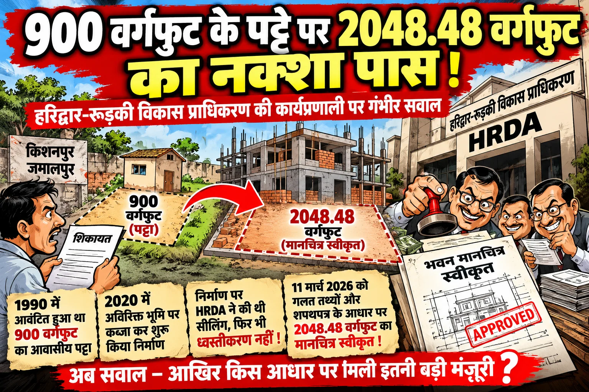

**रुड़की संवाददाता | आसिफ खान**

हरिद्वार। हरिद्वार-रुड़की विकास प्राधिकरण (HRDA) की कार्यप्रणाली एक बार फिर गंभीर सवालों के घेरे में है। किशनपुर-जमालपुर में भूमि के आवासीय पट्टे और भवन मानचित्र की स्वीकृति को लेकर ऐसा मामला सामने आया है, जिसने प्राधिकरण की जांच प्रक्रिया, दस्तावेजों के सत्यापन और अवैध निर्माण के विरुद्ध कार्रवाई पर सवाल खड़े कर दिए हैं। शिकायतकर्ता तहसीन ने आरोप लगाया है कि करीब 900 वर्गफुट भूमि के आवासीय पट्टे के बावजूद 2048.48 वर्गफुट भूमि का भवन मानचित्र स्वीकृत करा लिया गया। मामले में संयुक्त सचिव को शिकायत देकर मानचित्र निरस्त करने और निर्माण ध्वस्त कराने की मांग की गई है।

सबसे बड़ा सवाल यह है कि जब मूल पट्टे का क्षेत्रफल लगभग 900 वर्गफुट बताया जा रहा है, तो उससे कहीं अधिक क्षेत्रफल का मानचित्र किन दस्तावेजों के आधार पर स्वीकृत हुआ? क्या मानचित्र जारी करने से पहले भूमि के स्वामित्व, राजस्व अभिलेखों और वास्तविक क्षेत्रफल का समुचित सत्यापन किया गया था? यदि सभी दस्तावेजों की नियमानुसार जांच हुई थी, तो शिकायत में उठाए गए सवालों का जवाब सामने आना चाहिए। और यदि जांच प्रक्रिया में कोई चूक हुई है, तो उसकी जिम्मेदारी तय करना भी जरूरी है।

**पहले सीलिंग की कार्रवाई, फिर ध्वस्तीकरण पर चुप्पी क्यों?**

शिकायत के अनुसार, वर्ष 1990 में ग्रामसभा किशनपुर-जमालपुर में संबंधित व्यक्ति को लगभग 900 वर्गफुट भूमि का आवासीय पट्टा आवंटित किया गया था। आरोप है कि पट्टे की भूमि लंबे समय तक खाली रही और वर्ष 2020 में इसके आसपास की अतिरिक्त भूमि पर भी कब्जा कर निर्माण शुरू कर दिया गया। शिकायतकर्ता का कहना है कि उस समय HRDA ने निर्माण को सील किया था, लेकिन इसके बाद ध्वस्तीकरण की कार्रवाई नहीं हुई।

यहीं से प्राधिकरण की कार्यप्रणाली पर गंभीर सवाल खड़े होते हैं। यदि निर्माण नियमों के विपरीत था और इसी कारण सीलिंग की कार्रवाई की गई थी, तो उसके बाद मामले में क्या कार्रवाई हुई? क्या प्रकरण की नियमित समीक्षा की गई? क्या निर्माण की वैधता और भूमि के स्वामित्व की दोबारा जांच हुई? इन सवालों पर स्थिति स्पष्ट होना आवश्यक है। सीलिंग के बाद कार्रवाई की स्थिति सार्वजनिक न होने से प्राधिकरण की निगरानी व्यवस्था पर भी सवाल उठ रहे हैं।

**11 मार्च 2026 की मानचित्र स्वीकृति जांच के दायरे में**

शिकायत में आरोप लगाया गया है कि 11 मार्च 2026 को कथित रूप से गलत तथ्यों और शपथपत्र के आधार पर 2048.48 वर्गफुट भूमि का भवन मानचित्र स्वीकृत कराया गया। शिकायतकर्ता ने मूल पट्टे और मानचित्र में दर्शाए गए क्षेत्रफल के बीच अंतर का मुद्दा उठाया है। भूमि के मालिकाना हक से जुड़े राजस्व अभिलेखों तथा तहसील की अनापत्ति रिपोर्ट को लेकर भी सवाल किए गए हैं।

यदि शिकायत में बताए गए तथ्य सही पाए जाते हैं, तो यह केवल भूमि के क्षेत्रफल का विवाद नहीं रहेगा, बल्कि मानचित्र स्वीकृति के दौरान अपनाई गई प्रक्रिया की भी जांच करनी होगी। यह पता लगाना जरूरी होगा कि आवेदन के साथ कौन-कौन से दस्तावेज प्रस्तुत किए गए, उनका सत्यापन किस स्तर पर हुआ और मानचित्र स्वीकृति के लिए किन तथ्यों को आधार बनाया गया।

**HRDA की जांच व्यवस्था पर उठे सवाल, जवाबदेही तय करना जरूरी**

हरिद्वार-रुड़की विकास प्राधिकरण का दायित्व है कि भवन मानचित्रों की स्वीकृति नियमानुसार हो और अवैध निर्माण के मामलों में निर्धारित प्रक्रिया के तहत कार्रवाई की जाए। ऐसे में जब एक ही प्रकरण में पहले सीलिंग और बाद में बड़े क्षेत्रफल के मानचित्र की स्वीकृति को लेकर शिकायत सामने आती है, तो प्राधिकरण की कार्यप्रणाली पर सवाल उठना स्वाभाविक है।

अब सवाल यह भी है कि क्या प्राधिकरण इस मामले में अपने पुराने रिकॉर्ड की जांच करेगा? क्या वर्ष 2020 की सीलिंग कार्रवाई और 11 मार्च 2026 की मानचित्र स्वीकृति के दस्तावेजों का मिलान किया जाएगा? क्या संबंधित अधिकारियों और कर्मचारियों की भूमिका की भी जांच होगी? इन बिंदुओं पर स्पष्ट जवाब मिलने से ही पूरे मामले की वास्तविक स्थिति सामने आ सकेगी।

**शिकायत पर कार्रवाई होगी या मामला फाइलों में ही उलझा रहेगा?**

शिकायतकर्ता तहसीन ने संयुक्त सचिव से पूरे प्रकरण की निष्पक्ष जांच कराने, स्वीकृत मानचित्र निरस्त करने और नियमों के विपरीत पाए जाने वाले निर्माण को ध्वस्त कराने की मांग की है। अब निगाहें HRDA पर टिकी हैं कि वह शिकायत पर क्या कदम उठाता है और उठाए गए सवालों का तथ्यात्मक जवाब देता है या नहीं।

फिलहाल, आरोपों की स्वतंत्र पुष्टि और HRDA का आधिकारिक पक्ष सामने आना बाकी है। यदि जांच में गलत तथ्यों के आधार पर मानचित्र स्वीकृति या अन्य अनियमितता की पुष्टि होती है, तो नियमानुसार जिम्मेदारी तय कर कार्रवाई की जानी चाहिए। इस मामले में निष्पक्ष जांच ही स्पष्ट कर सकेगी कि मानचित्र स्वीकृति की प्रक्रिया में कोई चूक हुई या नहीं और वर्ष 2020 की सीलिंग कार्रवाई के बाद आगे की कार्रवाई क्यों नहीं हुई।
