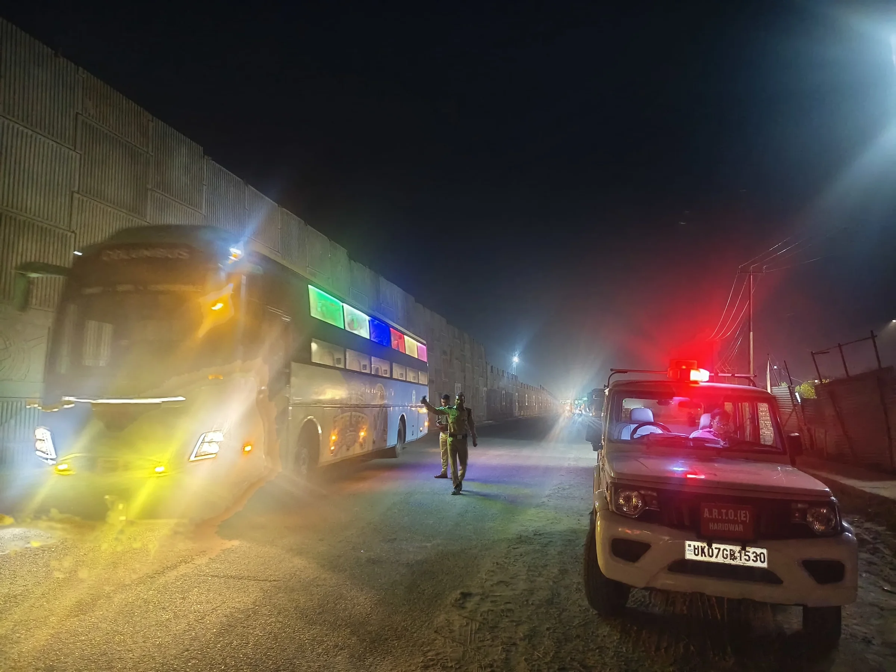
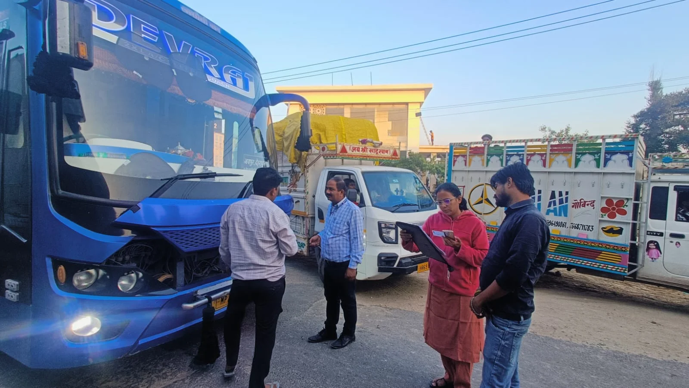

**हरिद्वार संवाददाता | आसिफ खान** 

**हरिद्वार।** यात्रियों की सुरक्षा से खिलवाड़ करने वाली स्लीपर और लग्जरी बसों के खिलाफ हरिद्वार में परिवहन विभाग ने सख्त रुख अपनाया है। जिलाधिकारी मयूर दीक्षित के निर्देश पर शुक्रवार तड़के सुबह 4 बजे से चलाए गए विशेष प्रवर्तन अभियान में विभागीय टीम ने 50 से अधिक वाहनों के चालान किए, जबकि 5 बसों को सीज कर दिया गया। गंभीर तकनीकी एवं सुरक्षा संबंधी अनियमितताओं के मद्देनजर 5 बसों के फिटनेस प्रमाणपत्र निरस्त करने की संस्तुति भी की गई है।

इस कार्रवाई ने बस संचालकों को स्पष्ट संदेश दिया है कि यात्रियों की जान से जुड़े सुरक्षा मानकों की अनदेखी करने पर अब सख्त कानूनी कार्रवाई का सामना करना पड़ सकता है।

**स्वीकृत ढांचे से छेड़छाड़ पर विशेष निगरानी**

सहायक संभागीय परिवहन अधिकारी निखिल शर्मा के अनुसार, अभियान का उद्देश्य स्लीपर एवं लग्जरी बसों की तकनीकी स्थिति, सुरक्षा व्यवस्था और परमिट शर्तों के अनुपालन की जांच करना था। सहायक संभागीय परिवहन अधिकारी (प्रवर्तन) नेहा झा के नेतृत्व में चले अभियान में संभागीय निरीक्षक (प्राविधिक) आनंद वर्धन भी शामिल रहे।

टीम ने बसों की स्वीकृत संरचना, आपातकालीन निकास, सुरक्षा उपकरणों और अन्य तकनीकी मानकों की बारीकी से जांच की। अभियान के दौरान ऐसे मामलों पर विशेष ध्यान दिया गया, जिनमें बसों के मूल ढांचे में कथित तौर पर अनधिकृत बदलाव किए गए हों या परमिट की शर्तों का उल्लंघन किया जा रहा हो।

**कहीं इमरजेंसी एग्जिट में खामी, कहीं दस्तावेजों का सवाल**

जांच के दौरान सामने आई अनियमितताओं में वाहनों की स्वीकृत संरचना में अनधिकृत परिवर्तन, परमिट शर्तों का उल्लंघन, पर्यटक वाहनों का निर्धारित प्रयोजन से अलग इस्तेमाल, आपातकालीन निकास व्यवस्था में कमियां और सड़क सुरक्षा मानकों का अनुपालन नहीं किया जाना शामिल रहा।

इसके अलावा, कुछ मामलों में वैध ड्राइविंग लाइसेंस एवं अन्य आवश्यक अभिलेख प्रस्तुत नहीं किए जाने, रिफ्लेक्टर और ध्वनि नियंत्रण संबंधी मानकों के उल्लंघन तथा कर संबंधी दस्तावेजों में अनियमितताओं की भी जांच की गई।

परिवहन विभाग के लिए यह जांच इसलिए भी महत्वपूर्ण है, क्योंकि बसों में आग लगने या दुर्घटना जैसी आपात स्थिति में सुरक्षित निकास और निर्धारित सुरक्षा उपकरण यात्रियों की जान बचाने में निर्णायक भूमिका निभाते हैं।

**फिटनेस पर भी कार्रवाई की तैयारी**

अभियान के दौरान सीज की गई पांच बसों के अतिरिक्त पांच बसों के फिटनेस प्रमाणपत्र निरस्त करने की संस्तुति की गई है। विभागीय स्तर पर आगे की कार्रवाई नियमानुसार की जाएगी। फिटनेस और परमिट से संबंधित नियमों का उल्लंघन पाए जाने पर संबंधित वाहन संचालकों के खिलाफ आवश्यक कार्रवाई की जा सकती है।

**अब हरिद्वार की सीमा में आने वाली बसों पर नजर**

सहायक संभागीय परिवहन अधिकारी (प्रवर्तन) नेहा झा के अनुसार, यह अभियान केवल एक दिन की कार्रवाई तक सीमित नहीं रहेगा। आगामी दिनों में भी अलग-अलग मार्गों और प्रवेश स्थलों पर आकस्मिक जांच की जाएगी।

जांच का समय और स्थान बदलते हुए सुबह, रात और अन्य समयावधियों में भी कार्रवाई की जाएगी। विशेष रूप से दूसरे राज्यों से हरिद्वार आने वाली स्लीपर एवं लग्जरी बसों की तकनीकी स्थिति, परमिट और यात्री सुरक्षा व्यवस्था पर निगरानी रखी जाएगी।

विभाग का लक्ष्य जनपद की सीमा में प्रवेश करने वाली प्रत्येक स्लीपर एवं लग्जरी बस की जांच सुनिश्चित करना है, ताकि नियमों का उल्लंघन करने वाले वाहन कार्रवाई से बच न सकें।

**बस संचालकों को दो टूक हिदायत**

परिवहन विभाग ने बस संचालकों को स्वीकृत संरचना से छेड़छाड़ नहीं करने, फिटनेस प्रमाणपत्र वैध रखने, परमिट की शर्तों का पालन करने और सभी आवश्यक सुरक्षा मानक पूरे करने के निर्देश दिए हैं।

संदेश साफ है—सड़क पर यात्रियों की सुरक्षा से समझौता बर्दाश्त नहीं किया जाएगा। जिलाधिकारी मयूर दीक्षित के निर्देशों के क्रम में परिवहन विभाग ने स्पष्ट किया है कि नियमों का उल्लंघन करने वाले वाहनों के विरुद्ध चालान, सीज करने और फिटनेस या परमिट संबंधी कार्रवाई की संस्तुति सहित नियमानुसार कदम उठाए जाते रहेंगे।
