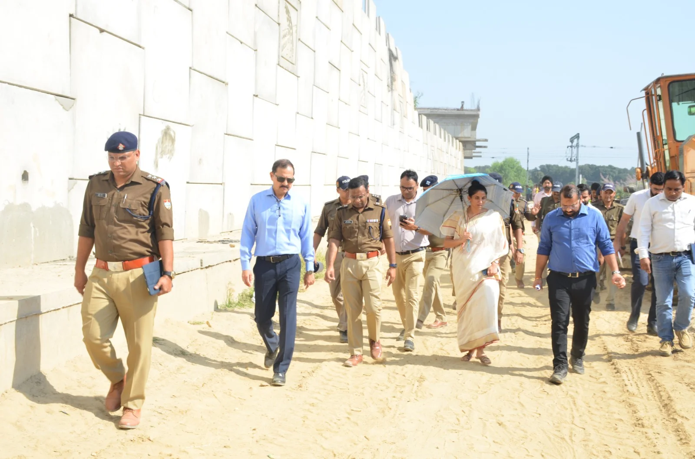
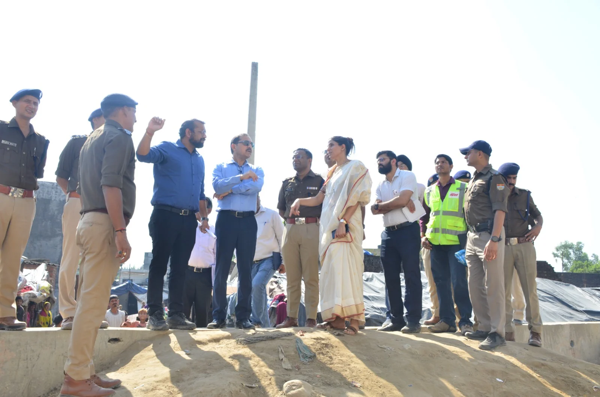
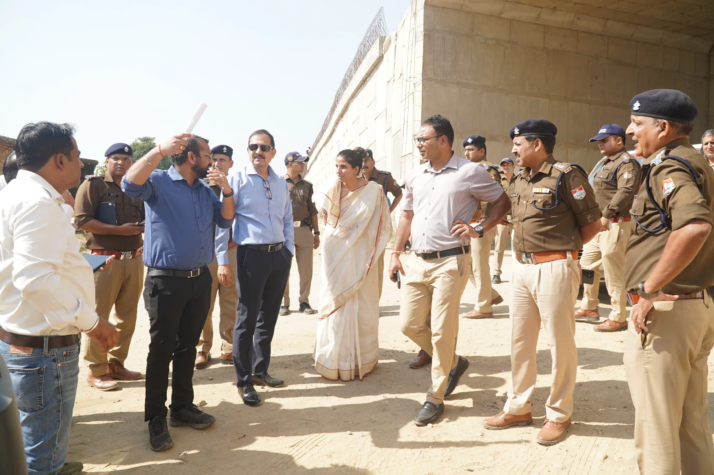

**हरिद्वार संवाददाता | आसिफ खान**

हरिद्वार। कुंभ मेला-2027 की तैयारियों में अब ढिलाई की गुंजाइश नहीं! लाखों श्रद्धालुओं की सुगम आवाजाही और हरिद्वार को जाम से राहत दिलाने की चुनौती के बीच मेला प्रशासन ने राष्ट्रीय राजमार्गों से जुड़ी निर्माण परियोजनाओं की रफ्तार बढ़ाने के लिए सख्त रुख अपना लिया है। हरिद्वार बाईपास परियोजना के लंबित कार्यों को लेकर मेलाधिकारी श्रीमती सोनिका ने स्पष्ट निर्देश दिए हैं कि निर्माण कार्यों में तेजी लाई जाए, संसाधन और श्रमिक बढ़ाए जाएं तथा जरूरत के अनुसार दिन-रात काम कराकर परियोजना को निर्धारित समयसीमा में पूरा किया जाए।

शुक्रवार को मेलाधिकारी सोनिका ने आईजी कुंभ डॉ. योगेंद्र सिंह रावत तथा मेला प्रशासन, पुलिस और भारतीय राष्ट्रीय राजमार्ग प्राधिकरण (एनएचएआई) के अधिकारियों के साथ हरिद्वार बाईपास परियोजना के पैकेज-1 का स्थलीय निरीक्षण किया। बहादराबाद से सराय होते हुए जगजीतपुर तक निर्माणाधीन हिस्से का जायजा लेकर अधिकारियों ने कार्यों की प्रगति, लंबित निर्माण और कुंभ के दौरान यातायात संचालन की तैयारियों की समीक्षा की।

**लंबित कार्यों पर तेजी लाने का दबाव, दिन-रात निर्माण के निर्देश**

कुंभ के दौरान हरिद्वार में देशभर से श्रद्धालुओं के पहुंचने की संभावना को देखते हुए सड़क संपर्क और यातायात प्रबंधन सबसे अहम तैयारियों में शामिल हैं। ऐसे में बाईपास परियोजना के कार्य समय पर पूरे हों, इसके लिए मेलाधिकारी ने कार्यदायी संस्था को कार्यस्थल पर पर्याप्त संसाधन उपलब्ध कराने और श्रमिकों की संख्या बढ़ाने के निर्देश दिए।

उन्होंने स्पष्ट किया कि परियोजना में किसी भी स्तर पर अनावश्यक देरी नहीं होनी चाहिए। निर्माण कार्यों को प्राथमिकता के आधार पर पूरा किया जाए, ताकि कुंभ शुरू होने से पहले यातायात व्यवस्था को मजबूत बनाया जा सके। निर्माण के दौरान आने वाली समस्याओं के समाधान के लिए मेला प्रशासन की ओर से आवश्यक सहयोग उपलब्ध कराने की बात भी कही गई।

**दक्षद्वीप पार्किंग तक कैसे पहुंचेंगे वाहन? प्रवेश और निकास व्यवस्था पर मंथन**

निरीक्षण के दौरान केवल सड़क निर्माण की प्रगति ही नहीं, बल्कि कुंभ के समय इस मार्ग के व्यावहारिक उपयोग पर भी चर्चा की गई। बहादराबाद से सराय होते हुए जगजीतपुर तक बाईपास की उपयोगिता, दक्षद्वीप पार्किंग तक वाहनों की आवाजाही और प्रवेश तथा निकास मार्गों की व्यवस्था की समीक्षा की गई।

प्रशासन की प्राथमिकता है कि कुंभ के दौरान पार्किंग स्थलों तक पहुंचने वाले वाहनों को अनावश्यक जाम का सामना न करना पड़े और श्रद्धालुओं की आवाजाही व्यवस्थित बनी रहे। इसके लिए निर्माण कार्यों को यातायात प्रबंधन की जरूरतों के अनुरूप पूरा करने पर जोर दिया गया।

**अब सीसीटीवी से भी रखी जाएगी नजर**

निर्माण कार्यों की प्रगति पर लगातार निगरानी रखने के लिए मेलाधिकारी ने कार्यस्थलों पर सीसीटीवी कैमरों के माध्यम से मॉनिटरिंग की व्यवस्था करने के निर्देश दिए। इसका उद्देश्य निर्माण कार्यों की स्थिति पर नजर रखना और परियोजना की प्रगति की नियमित समीक्षा करना है।

मेलाधिकारी ने कहा कि हरिद्वार बाईपास सहित एनएचएआई की अन्य परियोजनाएं कुंभ के सफल और सुव्यवस्थित आयोजन के लिए महत्वपूर्ण हैं। इनकी प्रगति की मेला प्रशासन के स्तर से नियमित समीक्षा की जाएगी, ताकि निर्धारित समयसीमा में काम पूरा कराने की दिशा में प्रभावी कदम उठाए जा सकें।

**दिल्ली-देहरादून कॉरिडोर से जुड़ाव पर भी जोर**

मेलाधिकारी ने दिल्ली-देहरादून इकोनॉमिक कॉरिडोर से हरिद्वार को जोड़ने वाली निर्माणाधीन हरिद्वार स्पर परियोजना समेत राष्ट्रीय राजमार्ग से संबंधित अन्य कार्यों को भी समय पर पूरा करने के निर्देश दिए। सड़क संपर्क मजबूत होने से कुंभ के दौरान यातायात के दबाव को कम करने, वाहनों की आवाजाही व्यवस्थित रखने और श्रद्धालुओं को सुविधाजनक मार्ग उपलब्ध कराने में मदद मिलने की उम्मीद है।

**कुंभ से पहले तैयारियों की नियमित होगी समीक्षा**

कुंभ-2027 के आयोजन को लेकर मेला प्रशासन का जोर अब निर्माण कार्यों की गति, यातायात व्यवस्था और पार्किंग प्रबंधन को समय रहते दुरुस्त करने पर है। निरीक्षण के दौरान अधिकारियों को स्पष्ट संदेश दिया गया कि सड़क परियोजनाओं में तेजी के साथ उनकी गुणवत्ता और समयबद्धता पर भी ध्यान रखा जाए। अब इन परियोजनाओं की प्रगति पर नियमित निगरानी रहेगी, ताकि कुंभ के दौरान हरिद्वार की सड़कों पर यातायात संचालन को सुचारु बनाए रखने की तैयारियां अधूरी न रह जाएं।

**निरीक्षण में ये अधिकारी रहे मौजूद**

इस दौरान एसएसपी कुंभ श्री आयुष अग्रवाल, अपर मेलाधिकारी श्री दयानंद सरस्वती, एनएचएआई के रुड़की खंड के परियोजना निदेशक श्री पुनीत गर्ग, सीओ कुंभ श्री उमेश कुमार मलिक, यातायात निरीक्षक श्री हितेश कुमार सहित संबंधित विभागों के अधिकारी उपस्थित रहे।
