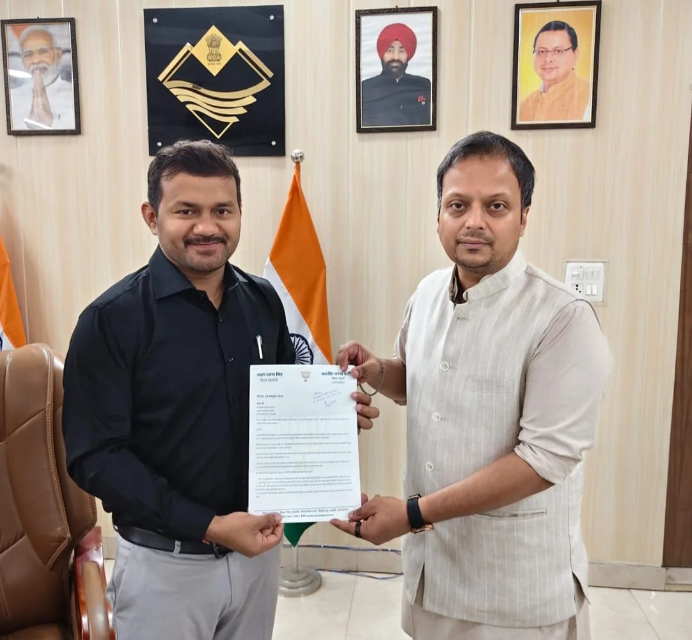
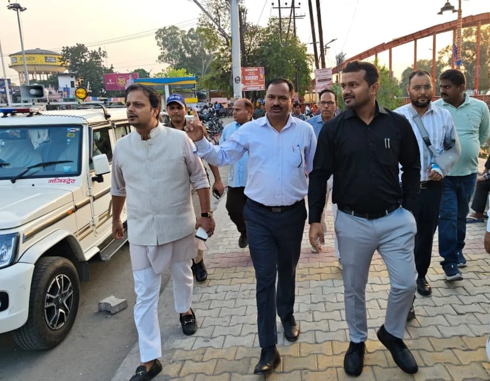
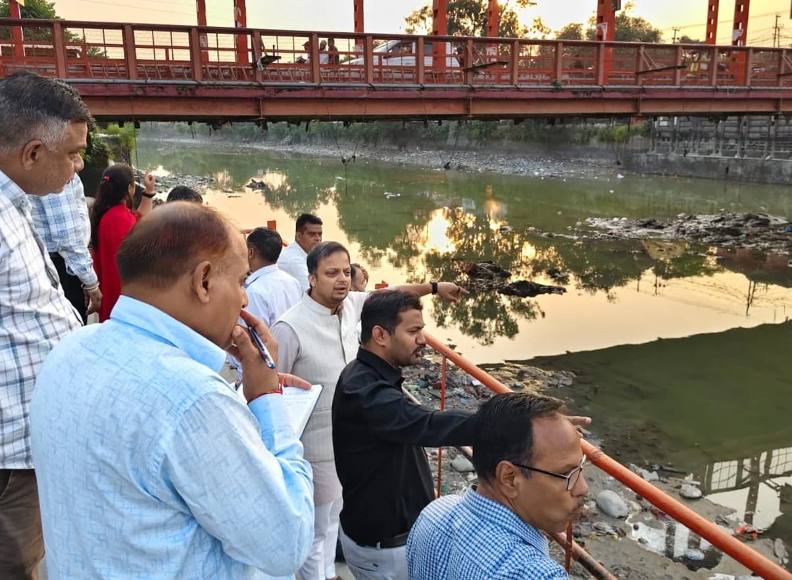

रुड़की स्टार न्यूज़ 11 संवाददाता | आसिफ खान 

रुड़की। नगर के बीचोंबीच बहने वाली सोलानी नदी के घाटों पर सुरक्षा व्यवस्था को लेकर उठी आवाज के बाद प्रशासन हरकत में आ गया है। घाटों पर सुरक्षा इंतजामों की कमी और दुर्घटनाओं की आशंका को देखते हुए भाजपा जिला महामंत्री अक्षय प्रताप सिंह ने संयुक्त मजिस्ट्रेट, रुड़की को ज्ञापन सौंपकर तत्काल ठोस कदम उठाने की मांग की। इसका असर यह रहा कि ज्ञापन सौंपे जाने के कुछ ही घंटों बाद संयुक्त मजिस्ट्रेट ने संबंधित विभागों के अधिकारियों के साथ मौके पर पहुंचकर स्थलीय निरीक्षण किया।

**सुबह ज्ञापन, शाम को मौके पर पहुंचा प्रशासन**

सोलानी नदी के घाटों पर सुरक्षा रेलिंग, मजबूत लोहे की चेन, चेतावनी बोर्ड और अन्य जरूरी इंतजामों की कमी लंबे समय से चिंता का विषय बनी हुई है। नदी के घाटों पर दुर्घटनाओं की रोकथाम के लिए प्रभावी कदम उठाने की मांग के बीच संयुक्त मजिस्ट्रेट ने तत्परता दिखाते हुए तहसीलदार, नगर निगम रुड़की के मुख्य नगर आयुक्त (एमएनए), लोक निर्माण विभाग और सिंचाई विभाग सहित संबंधित अधिकारियों को मौके पर बुलाया। संयुक्त निरीक्षण के दौरान दुर्घटना संभावित स्थानों का जायजा लिया गया और जरूरी सुधार कार्यों पर चर्चा की गई।

**सुरक्षा रेलिंग से लेकर लोहे की चेन तक, कई व्यवस्थाओं के निर्देश**

निरीक्षण के दौरान संयुक्त मजिस्ट्रेट ने घाटों पर मजबूत सुरक्षा रेलिंग लगाने, पुलों से नीचे तक मजबूत लोहे की चेन लगाने की व्यवस्था पर काम करने, नियमित सफाई और सौंदर्यीकरण सुनिश्चित करने के निर्देश दिए। इसके साथ ही लोगों को सतर्क करने के लिए लाउडस्पीकर, चेतावनी बोर्ड, सुरक्षा संबंधी मार्किंग और अन्य आवश्यक व्यवस्थाओं को लेकर भी निर्देश एवं स्वीकृति प्रदान की गई।

इन व्यवस्थाओं का उद्देश्य नदी के किनारे आने वाले लोगों को दुर्घटनाओं से बचाना और किसी आपात स्थिति में उन्हें सुरक्षित रहने के लिए जरूरी सहारा उपलब्ध कराना है।

**पहले हो चुकी हैं दुखद घटनाएं, अब स्थायी सुरक्षा व्यवस्था की मांग**

भाजपा जिला महामंत्री अक्षय प्रताप सिंह ने कहा कि सोलानी नदी के विभिन्न घाटों पर सुरक्षा इंतजामों के अभाव में पहले भी कई दुखद दुर्घटनाएं हो चुकी हैं, जिनमें लोगों को अपनी जान गंवानी पड़ी है। ऐसे में केवल औपचारिक कार्रवाई पर्याप्त नहीं होगी, बल्कि घाटों पर स्थायी और प्रभावी सुरक्षा व्यवस्था विकसित करना जरूरी है।

उन्होंने विशेष रूप से पुलों से मजबूत लोहे की चेन नीचे तक लटकाने का सुझाव दिया, ताकि दुर्घटनावश नदी में गिरने वाले किसी व्यक्ति को आपात स्थिति में सहारा मिल सके। उन्होंने कहा कि वर्तमान में नदी की सफाई और रखरखाव के लिए जल प्रवाह रोके जाने की अवधि सुरक्षा संबंधी निर्माण एवं सुधार कार्यों के लिए उपयोगी अवसर है। ऐसे में संबंधित विभागों को आपसी समन्वय से कार्यों को गति देनी चाहिए।

**प्रशासन की तत्परता की सराहना, अब धरातल पर काम का इंतजार**

अक्षय प्रताप सिंह ने कहा कि जनता की सुरक्षा सर्वोच्च प्राथमिकता है। इस विषय पर संयुक्त मजिस्ट्रेट का पहले से ही सहयोग मिलता रहा है। उन्होंने बताया कि पूर्व में भी संबंधित विभागों की बैठक आयोजित की गई थी और अब ज्ञापन सौंपे जाने के कुछ ही घंटों के भीतर संयुक्त मजिस्ट्रेट स्वयं अधिकारियों के साथ घाटों पर पहुंचे और आवश्यक व्यवस्थाओं के लिए निर्देश दिए।

उन्होंने प्रशासन की तत्परता, संवेदनशीलता और सकारात्मक सहयोग के लिए आभार जताया। साथ ही उम्मीद व्यक्त की कि सभी संबंधित विभाग समन्वय बनाकर सुरक्षा संबंधी कार्यों को समयबद्ध तरीके से पूरा करेंगे।

**सिर्फ सौंदर्यीकरण नहीं, लोगों की जान बचाने की चुनौती**

सोलानी नदी के घाटों को सुरक्षित और सुव्यवस्थित बनाना अब स्थानीय स्तर पर महत्वपूर्ण मुद्दा बन गया है। जरूरत इस बात की है कि निरीक्षण और निर्देशों के बाद सुरक्षा संबंधी कार्यों को धरातल पर उतारा जाए तथा रेलिंग, चेन, चेतावनी संकेतक और सफाई व्यवस्था की नियमित निगरानी हो।

अक्षय प्रताप सिंह ने कहा कि उद्देश्य केवल घाटों का सौंदर्यीकरण करना नहीं, बल्कि ऐसी स्थायी सुरक्षा व्यवस्था तैयार करना है, जिससे भविष्य में किसी परिवार को नदी में हुई दुर्घटना के कारण अपने प्रियजन को न खोना पड़े। अब निगाहें संबंधित विभागों की कार्रवाई पर रहेंगी कि सुरक्षा के लिए दिए गए निर्देश कितनी तेजी से जमीन पर उतरते हैं।
