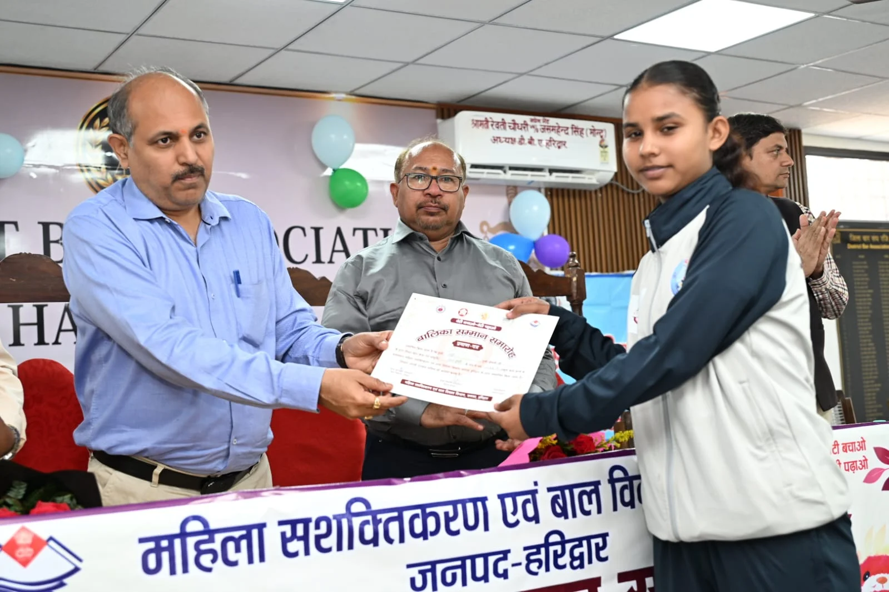
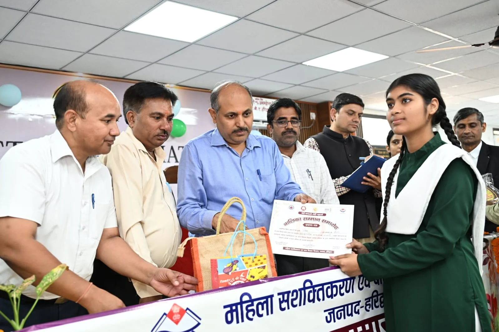
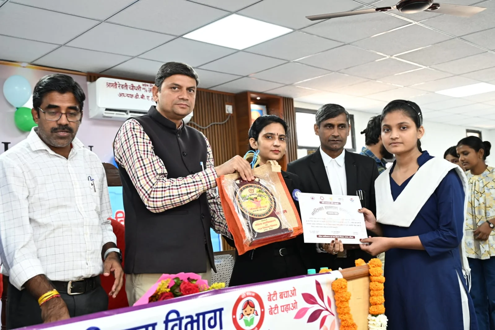

**हरिद्वार संवाददाता | आसिफ खान**

हरिद्वार। बेटियां आज शिक्षा से लेकर खेल के मैदान तक अपनी प्रतिभा का लोहा मनवा रही हैं। उनकी इसी उपलब्धि और मेहनत को प्रोत्साहित करने के उद्देश्य से महिला सशक्तिकरण एवं बाल विकास विभाग, हरिद्वार की ओर से बेटी बचाओ, बेटी पढ़ाओ योजना के अंतर्गत बालिका सम्मान समारोह आयोजित किया गया। रोशनाबाद स्थित जिला बार एसोसिएशन के सभागार में आयोजित समारोह में हाईस्कूल की परीक्षा में उच्च स्थान प्राप्त करने वाली और विभिन्न खेल प्रतियोगिताओं में उत्कृष्ट प्रदर्शन करने वाली 60 होनहार बालिकाओं को सम्मानित किया गया।

कार्यक्रम का शुभारंभ मुख्य अतिथि मुख्य विकास अधिकारी डॉ. ललित नारायण मिश्र ने दीप प्रज्वलित कर किया। इस दौरान मेधावी एवं प्रतिभाशाली बालिकाओं को प्रशस्ति पत्र, स्मृति चिह्न, पोषण किट और स्मार्ट वॉच प्रदान कर उनकी उपलब्धियों की सराहना की गई।

**‘जिस शिखर पर पहुंचीं, उसे बनाए रखना भी बड़ी चुनौती’**

समारोह को संबोधित करते हुए मुख्य विकास अधिकारी डॉ. ललित नारायण मिश्र ने बालिकाओं की उपलब्धियों की प्रशंसा करते हुए कहा कि किसी मुकाम तक पहुंचना जितना महत्वपूर्ण है, उस मुकाम को बरकरार रखना भी उतना ही जरूरी है। इसके लिए समय का सदुपयोग, निरंतर अभ्यास और अनुशासन को जीवन का हिस्सा बनाना होगा।

उन्होंने कहा कि कड़ी मेहनत, लगन और दृढ़ संकल्प के बिना किसी भी लक्ष्य को हासिल करना आसान नहीं है। बालिकाओं को अपनी प्रतिभा पहचानकर आगे बढ़ना चाहिए और शिक्षा तथा खेल के क्षेत्र में लगातार बेहतर प्रदर्शन करने के लिए प्रयासरत रहना चाहिए।

सीडीओ ने कहा कि आज उत्कृष्ट प्रदर्शन करने वाली बालिकाएं दूसरी बेटियों के लिए प्रेरणा बन रही हैं। उनकी सफलता यह संदेश देती है कि अवसर, मेहनत और आत्मविश्वास के सहारे बेटियां हर क्षेत्र में अपनी अलग पहचान बना सकती हैं।

**शिक्षा और खेल में उत्कृष्ट प्रदर्शन करने वाली बेटियों को प्रोत्साहन**

कार्यक्रम में जनपद के विभिन्न शिक्षण संस्थानों की उन छात्राओं को सम्मानित किया गया, जिन्होंने हाईस्कूल की परीक्षा में उच्च स्थान हासिल किया और खेल प्रतियोगिताओं में उल्लेखनीय प्रदर्शन किया। सम्मान पाकर बालिकाओं का उत्साह बढ़ा। समारोह का उद्देश्य प्रतिभाशाली बालिकाओं की उपलब्धियों को पहचान देना, उनका मनोबल बढ़ाना और अन्य छात्राओं को भी आगे बढ़ने के लिए प्रेरित करना रहा।

वक्ताओं ने कहा कि बेटियों को शिक्षा, खेल और अन्य क्षेत्रों में आगे बढ़ने के समान अवसर मिलना आवश्यक है। ऐसे कार्यक्रम बालिकाओं में आत्मविश्वास बढ़ाने के साथ-साथ उनके उज्ज्वल भविष्य की दिशा में सकारात्मक भूमिका निभाते हैं।

**अधिकारियों और बार एसोसिएशन के पदाधिकारियों ने बढ़ाया उत्साह**

समारोह में मुख्य चिकित्साधिकारी डॉ. आर.के. सिंह, मुख्य शिक्षा अधिकारी अमित चन्द, बार एसोसिएशन के अध्यक्ष जसमद्र सिंह, सचिव विपिन चतुर्वेदी तथा जिला विधिक सेवा प्राधिकरण के सचिव के प्रतिनिधि काजल ने भी अपने विचार रखे। उन्होंने सम्मानित बालिकाओं को उत्कृष्ट प्रदर्शन के लिए बधाई दी और उनके उज्ज्वल भविष्य की कामना करते हुए निरंतर आगे बढ़ने के लिए प्रेरित किया।

कार्यक्रम के अंत में जिला कार्यक्रम अधिकारी अविनाश भदौरिया ने उपस्थित अतिथियों, प्रतिभागियों और आयोजन में सहयोग करने वाले सभी लोगों का आभार व्यक्त किया।

इस अवसर पर बार एसोसिएशन के अधिवक्ता, विभिन्न विद्यालयों के शिक्षक, सम्मानित बालिकाएं, उनके अभिभावक तथा महिला सशक्तिकरण एवं बाल विकास विभाग के अधिकारी और कर्मचारी मौजूद रहे।

**संदेश साफ है—बेटियों को अवसर और प्रोत्साहन मिले, तो वे अपनी मेहनत और प्रतिभा से सफलता के नए शिखर छू सकती हैं।**
