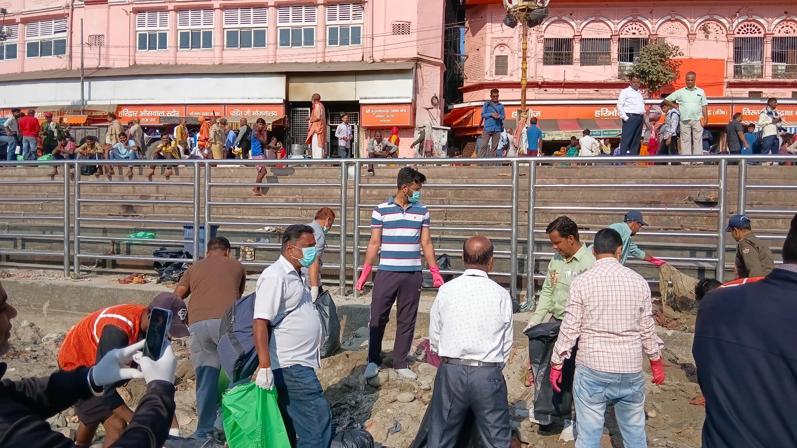
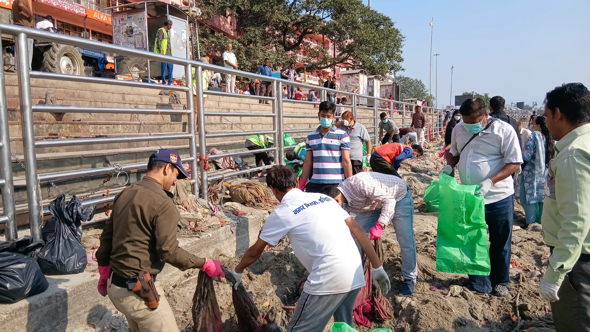

**हरिद्वार संवाददाता | आसिफ खान**

हरिद्वार। तीर्थनगरी हरिद्वार को स्वच्छ, सुंदर और प्रदूषणमुक्त बनाने के लिए प्रशासन ने सफाई अभियान तेज कर दिया है। मुख्यमंत्री पुष्कर सिंह धामी के निर्देशों पर मेलाधिकारी कुंभ श्रीमती सोनिका और जिलाधिकारी मयूर दीक्षित के निर्देशन में लगातार चौथे दिन भी विशेष स्वच्छता अभियान चलाया गया। अभियान के दौरान गंगा घाटों, सार्वजनिक स्थलों और ग्रामीण क्षेत्रों में व्यापक साफ-सफाई करते हुए करीब 10 टन गीले एवं सूखे कूड़े का एकत्रीकरण किया गया।

मां गंगा की निर्मलता और धार्मिक स्थलों की स्वच्छता को लेकर चलाए जा रहे इस अभियान की मुख्यमंत्री स्वयं मॉनिटरिंग कर रहे हैं। प्रशासन का उद्देश्य हरिद्वार पहुंचने वाले श्रद्धालुओं को स्वच्छ वातावरण उपलब्ध कराने के साथ-साथ स्थानीय नागरिकों में भी स्वच्छता के प्रति जागरूकता बढ़ाना है।

**घाटों पर सफाई की मुहिम, संस्थाओं ने बढ़ाए हाथ**

विशेष स्वच्छता अभियान के तहत नगर निगम, आईटीसी मिशन सुनहरा कल और श्री भुवनेश्वरी महिला आश्रम की ओर से सुभाष घाट एवं आसपास के क्षेत्रों में सफाई अभियान चलाया गया। नेचर फाउंडेशन सोसाइटी ने अलकनंदा घाट पर स्वच्छता की जिम्मेदारी संभाली, जबकि जिला पंचायत की ओर से नमामि गंगे घाट, चंडी देवी क्षेत्र में सफाई अभियान संचालित किया गया।

इसी क्रम में आदर्श युवा समिति ने राम घाट और परशुराम संस्था ने शीतला माता मंदिर घाट पर साफ-सफाई की। विभिन्न संस्थाओं और विभागों के प्रतिनिधियों ने मिलकर घाटों एवं सार्वजनिक स्थानों से गीले और सूखे कचरे को एकत्र किया तथा आसपास के क्षेत्रों को स्वच्छ रखने के प्रयास किए।

**10 टन कूड़ा एकत्र, स्वच्छता को लेकर प्रशासन की मुहिम जारी**

अभियान के दौरान बड़ी मात्रा में कूड़ा एकत्र किया जाना इस बात को रेखांकित करता है कि धार्मिक स्थलों और सार्वजनिक क्षेत्रों में नियमित सफाई के साथ-साथ जनसहभागिता भी बेहद जरूरी है। स्वच्छता अभियान में जुटी संस्थाओं और विभागों ने सफाई के साथ लोगों को भी स्वच्छता बनाए रखने के प्रति जागरूक करने पर जोर दिया।

प्रशासन की ओर से गंगा घाटों, धार्मिक स्थलों और आसपास के क्षेत्रों में स्वच्छता व्यवस्था बेहतर बनाए रखने के लिए अभियान लगातार जारी रखा जा रहा है। इसका उद्देश्य केवल कूड़ा हटाना ही नहीं, बल्कि हरिद्वार की धार्मिक गरिमा, गंगा की स्वच्छता और श्रद्धालुओं के लिए बेहतर वातावरण सुनिश्चित करना भी है।

**मुख्यमंत्री की निगरानी में स्वच्छ हरिद्वार पर फोकस**

मुख्यमंत्री पुष्कर सिंह धामी के निर्देशों के अनुपालन में चल रही इस मुहिम में प्रशासनिक अधिकारियों, नगर निगम, जिला पंचायत और स्वयंसेवी संस्थाओं की सहभागिता महत्वपूर्ण मानी जा रही है। लगातार चौथे दिन अभियान जारी रहने से स्वच्छता व्यवस्था को गति मिली है।

हालांकि, अभियान की वास्तविक सफलता इस बात पर भी निर्भर करेगी कि सफाई के बाद घाटों और सार्वजनिक स्थलों पर नियमित निगरानी बनी रहे तथा कूड़ा दोबारा जमा न होने दिया जाए। मां गंगा को स्वच्छ एवं निर्मल बनाए रखने के लिए प्रशासन के साथ आमजन और श्रद्धालुओं की जिम्मेदारी भी उतनी ही महत्वपूर्ण है।

**स्वच्छ हरिद्वार, निर्मल गंगा—यही अभियान का संकल्प।**
