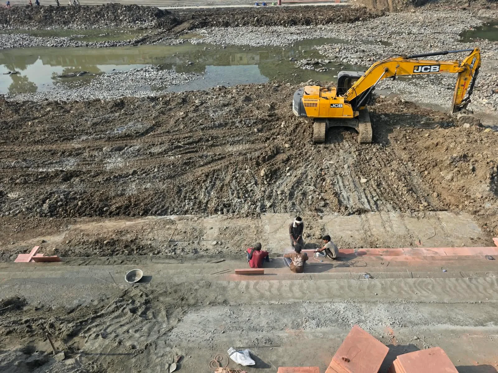

**हरिद्वार संवाददाता | आसिफ खान**

हरिद्वार। कुंभ मेला-2027 को लेकर हरिद्वार में तैयारियों ने रफ्तार पकड़ ली है। श्रद्धालुओं को सुगम, सुरक्षित और व्यवस्थित स्नान सुविधाएं उपलब्ध कराने के लिए गंगा और गंग नहर के किनारे नए घाटों का निर्माण युद्धस्तर पर किया जा रहा है। विभिन्न स्थानों पर तीन किलोमीटर से अधिक लंबाई में घाट विकसित किए जा रहे हैं। गंग नहर बंदी की अवधि को निर्माण कार्यों में तेजी लाने के अवसर के रूप में इस्तेमाल करते हुए मेला प्रशासन ने पूरी ताकत झोंक दी है। कहीं श्रमिक निर्माण में जुटे हैं तो कहीं भारी मशीनों की मदद से कार्य आगे बढ़ाया जा रहा है। लक्ष्य स्पष्ट है—कुंभ से पहले घाट तैयार हों और श्रद्धालुओं को स्नान के लिए पर्याप्त स्थान मिल सके।

निर्माण कार्यों की रफ्तार परखने के लिए मेलाधिकारी श्रीमती सोनिका ने बीती रात अपर मेलाधिकारी श्री दयानंद सरस्वती के साथ विभिन्न घाटों का स्थलीय निरीक्षण किया। रात के समय किए गए इस निरीक्षण में निर्माण कार्यों की प्रगति का जायजा लिया गया। अधिकारियों ने कार्यों को निर्धारित समयसीमा में पूरा करने तथा निर्माण की गुणवत्ता बनाए रखने पर जोर दिया। मेला प्रशासन की निगरानी का उद्देश्य साफ है कि कुंभ जैसे विशाल आयोजन से पहले जरूरी बुनियादी सुविधाओं को समय रहते तैयार किया जाए।

**2,966 मीटर लंबाई में नौ घाटों का निर्माण**

कुंभ मेला-2027 की तैयारियों के तहत सिंचाई विभाग के माध्यम से हरिद्वार से बहादराबाद के बीच नौ घाटों का निर्माण कराया जा रहा है। इनकी कुल लंबाई 2,966 मीटर बताई गई है। इन परियोजनाओं के पूरा होने से स्नान के लिए उपलब्ध स्थानों का विस्तार होगा और प्रमुख घाटों पर श्रद्धालुओं का दबाव कम करने में मदद मिल सकती है।

अपर गंग नहर के बाएं तट पर शहीद भगत सिंह घाट से सिंहद्वार के बीच 321 मीटर लंबे कामधेनु घाट का निर्माण किया जा रहा है। वहीं, अमरापुर घाट से ऋषिकुल पुल, शंकराचार्य चौक और तुलसी घाट क्षेत्र में कुल 770 मीटर लंबाई में निर्माण कार्य चल रहे हैं।

इसके अलावा ऋषिकुल पुल से साक्षी सतनाम घाट के बीच 735 मीटर लंबाई में घाट विकसित किए जा रहे हैं। इस परियोजना में जानकी घाट, लक्ष्मण घाट और भरत घाट के तीन हिस्से शामिल हैं। अपर गंग नहर के दाएं तट पर नगर निगम कार्यालय के निकट 275 मीटर लंबे घाट का निर्माण भी जारी है।

**बैरागी कैंप से खड़खड़ी तक घाटों का विस्तार**

हरिद्वार के दूसरे क्षेत्रों में भी स्नान सुविधाओं को मजबूत करने की तैयारी है। बैरागी कैंप क्षेत्र में स्केप चैनल पर 260 मीटर लंबे स्नान घाट का निर्माण कराया जा रहा है। खड़खड़ी के निकट 75 मीटर लंबे वेदनिकेतन घाट का निर्माण कार्य भी किया जा रहा है।

बहादराबाद में बैरियर संख्या छह के निकट 200 मीटर लंबे छठ पूजा घाट का निर्माण प्रस्तावित कार्यों में शामिल है। ज्वालापुर में जटवाड़ा पुल के अपस्ट्रीम क्षेत्र में 300 मीटर लंबे घाट तथा दुर्गा मंदिर के निकट 30 मीटर लंबे घाट का निर्माण भी योजना का हिस्सा है।

इसके साथ ही यूआईआईडीबी की हरकी पैड़ी क्षेत्र पुनर्विकास योजना के अंतर्गत सीसीआर भवन के निकट से धनुष पुल के बीच 82 मीटर लंबे घाट का निर्माण कार्य भी जारी है।

**भीड़ प्रबंधन की चुनौती से निपटने की तैयारी**

कुंभ मेले में देश-विदेश से बड़ी संख्या में श्रद्धालुओं के पहुंचने की संभावना रहती है। ऐसे में पर्याप्त स्नान घाट, सुगम आवागमन और भीड़ का व्यवस्थित संचालन मेला प्रशासन के सामने बड़ी जिम्मेदारी है। नए घाट तैयार होने से स्नान के लिए अतिरिक्त स्थान उपलब्ध होंगे। इससे प्रमुख घाटों पर भीड़ का दबाव कम करने और श्रद्धालुओं को अलग-अलग क्षेत्रों में स्नान की सुविधा उपलब्ध कराने में मदद मिलने की उम्मीद है।

**गंग नहर बंदी में काम पूरा करने की बड़ी चुनौती**

वर्तमान में गंग नहर बंदी की अवधि का उपयोग निर्माण कार्यों में तेजी लाने के लिए किया जा रहा है। विभिन्न स्थलों पर श्रमिकों और मशीनों को लगाया गया है तथा अलग-अलग घाटों पर अभियंताओं की तैनाती कर कार्यों की निगरानी की जा रही है। दिन-रात चल रहे निर्माण के बीच प्रशासन के सामने सबसे बड़ी चुनौती तय समयसीमा के भीतर काम पूरा करने के साथ गुणवत्ता बनाए रखने की है।

कुंभ-2027 की सफलता के लिए घाट निर्माण की समयबद्धता बेहद अहम है। अब निगाहें इस बात पर रहेंगी कि निर्माण कार्य निर्धारित समय पर कितनी तेजी और गुणवत्ता के साथ पूरे होते हैं। मेला प्रशासन का जोर इन सुविधाओं को समय रहते तैयार करने पर है, ताकि कुंभ के दौरान श्रद्धालुओं को बेहतर स्नान व्यवस्था मिले और हरिद्वार में भीड़ प्रबंधन अधिक प्रभावी बनाया जा सके।
