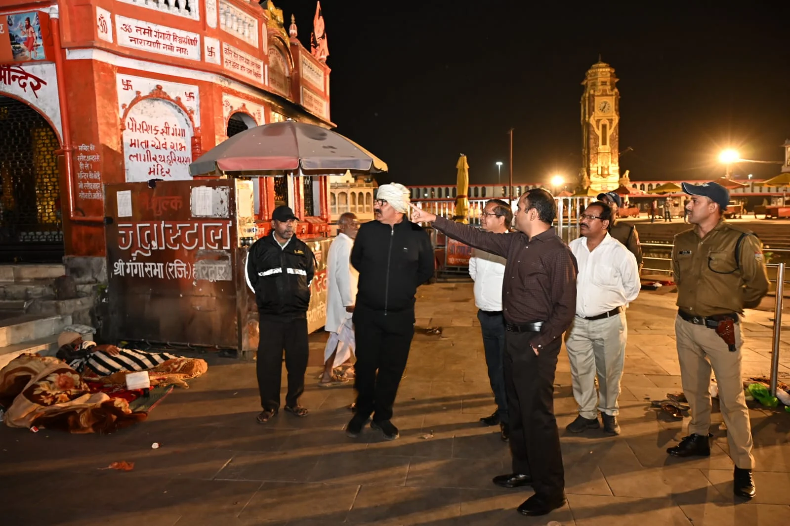
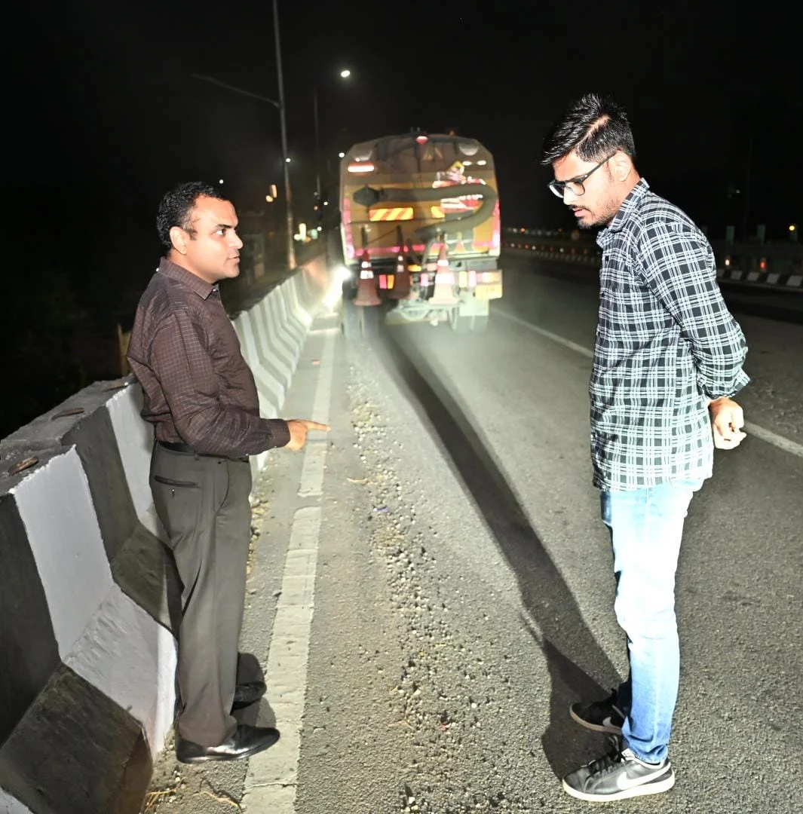
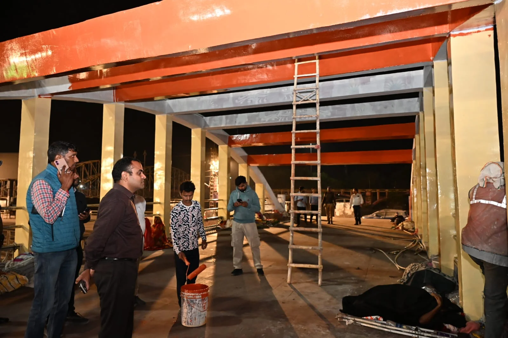

**हरिद्वार संवाददाता | आसिफ खान**

हरिद्वार। कुंभ मेला-2027 की तैयारियों को लेकर जिला प्रशासन अब एक्शन मोड में नजर आ रहा है। मुख्यमंत्री पुष्कर सिंह धामी के निर्देशों के बाद सड़कों को गड्ढामुक्त करने से लेकर हरकी पैड़ी और अन्य घाटों के सौंदर्यीकरण तक चल रहे कार्यों की रफ्तार और गुणवत्ता पर प्रशासन ने निगरानी तेज कर दी है। इसी कड़ी में जिलाधिकारी मयूर दीक्षित शनिवार देर रात अधिकारियों के साथ सड़कों पर उतरे और विभिन्न स्थानों पर चल रहे निर्माण, पेंटिंग तथा सौंदर्यीकरण कार्यों का स्थलीय निरीक्षण किया।

रात के समय चल रहे कार्यों का जायजा लेते हुए जिलाधिकारी ने साफ निर्देश दिए कि कुंभ की तैयारियों से जुड़े किसी भी कार्य में अनावश्यक देरी और लापरवाही बर्दाश्त नहीं की जाएगी। अधिकारियों और कार्यदायी संस्थाओं को निर्धारित समयसीमा के भीतर काम पूरा करने के निर्देश दिए गए हैं।

**चंडी घाट से सिंह द्वार तक निर्माण कार्यों की पड़ताल**

जिलाधिकारी ने चंडी घाट चौक से शंकराचार्य चौक, प्रेम नगर चौक, सिंह द्वार, गुरुकुल कांगड़ी हाईवे और हरकी पैड़ी क्षेत्र में चल रहे कार्यों की प्रगति का जायजा लिया। उन्होंने संबंधित अधिकारियों से कार्यों की मौजूदा स्थिति की जानकारी ली और समयबद्ध तरीके से काम पूरा करने पर जोर दिया।

निरीक्षण के दौरान स्पष्ट किया गया कि निर्माण कार्य केवल कागजों में पूरे दिखाने के बजाय धरातल पर गुणवत्ता के साथ पूरे होने चाहिए। इसके लिए विभागों को आपसी समन्वय बनाकर कार्यों में तेजी लाने के निर्देश दिए गए।

**गड्ढामुक्त सड़कों के साथ गुणवत्ता की भी परीक्षा**

राष्ट्रीय राजमार्ग के अधिकारियों को डामरीकरण कार्य निर्धारित मानकों के अनुरूप पूरा करने के निर्देश दिए गए। जिलाधिकारी ने सड़क निर्माण और मरम्मत में गुणवत्ता पर विशेष ध्यान देने को कहा, ताकि आमजन और श्रद्धालुओं को आवागमन के दौरान परेशानी का सामना न करना पड़े।

कुंभ मेले के दौरान श्रद्धालुओं की भारी आवाजाही को देखते हुए सड़कों की स्थिति महत्वपूर्ण है। ऐसे में सड़क मरम्मत और डामरीकरण के कार्यों में समयसीमा के साथ गुणवत्ता बनाए रखना प्रशासन की प्राथमिकताओं में शामिल है।

**हरकी पैड़ी के सौंदर्यीकरण पर विशेष फोकस, दीपावली तक पूरा करने के निर्देश**

धर्मनगरी हरिद्वार की पहचान माने जाने वाले हरकी पैड़ी क्षेत्र में मंदिरों, घाटों और पुलों के सौंदर्यीकरण कार्यों का भी जिलाधिकारी ने निरीक्षण किया। उन्होंने निर्देश दिए कि दीपावली से पहले संबंधित कार्य हर हाल में पूरे किए जाएं।

जिलाधिकारी ने कार्यों में तेजी लाने के लिए श्रमिकों की संख्या बढ़ाने और आवश्यक संसाधनों की पर्याप्त उपलब्धता सुनिश्चित करने को कहा। साथ ही रात के समय संचालित निर्माण कार्यों की प्रभावी निगरानी करने के निर्देश भी दिए, ताकि निर्धारित समयसीमा में लक्ष्य हासिल किया जा सके।

**अधिकारियों और कार्यदायी संस्थाओं की बढ़ी जिम्मेदारी**

जिलाधिकारी मयूर दीक्षित ने सभी संबंधित विभागों को मुख्यमंत्री के निर्देशों के अनुरूप निर्माण, सड़क मरम्मत और सौंदर्यीकरण कार्यों को गुणवत्ता के साथ समय पर पूरा करने को कहा। उन्होंने स्पष्ट किया कि कार्यों की प्रगति की लगातार समीक्षा की जाएगी और सभी विभाग आपसी समन्वय से काम करेंगे।

कुंभ-2027 की तैयारियों के बीच देर रात तक चल रहा निरीक्षण इस बात का संकेत है कि प्रशासन प्रमुख निर्माण कार्यों को लेकर समयसीमा पर विशेष जोर दे रहा है। अब संबंधित विभागों और कार्यदायी संस्थाओं के सामने चुनौती है कि वे तय समय में काम पूरा करने के साथ गुणवत्ता के मानकों पर भी खरे उतरें।

निरीक्षण के दौरान सिटी मजिस्ट्रेट हर गिरी, राष्ट्रीय राजमार्ग के डिप्टी मैनेजर प्रज्वल, जिला सूचना अधिकारी रती लाल शाह सहित संबंधित संस्थाओं के अधिकारी और कॉन्ट्रैक्टर मौजूद रहे।
