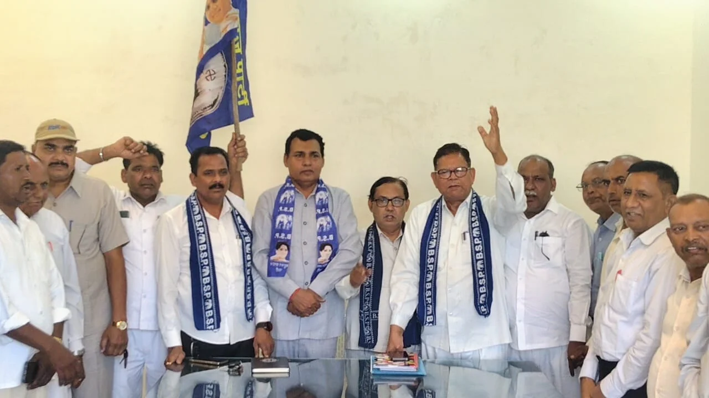
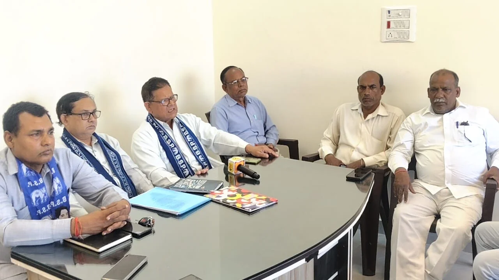
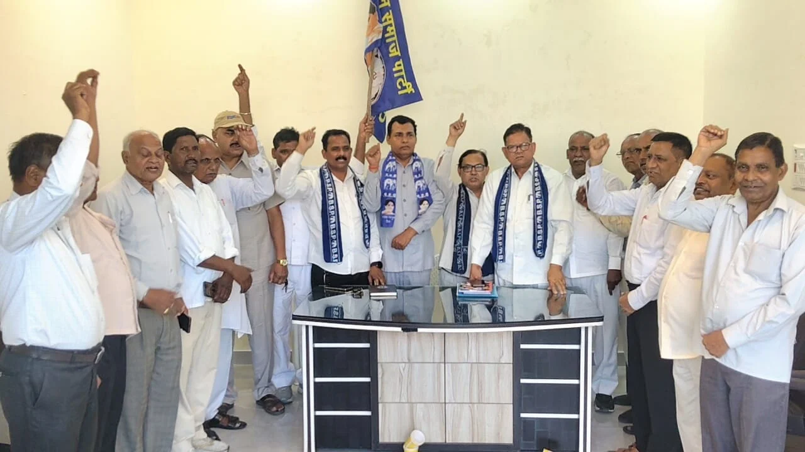

**हरिद्वार/रूडकी संवाददाता | आसिफ खान** 

**रुड़की।** बहुजन समाज पार्टी (बसपा) में नेताओं के पार्टी छोड़ने और संगठन में पदों को लेकर मीडिया में चल रही खबरों के बीच पार्टी के वरिष्ठ पदाधिकारियों ने सामने आकर अपना पक्ष रखा। 24 अक्टूबर को प्रीत विहार कॉलोनी, रुड़की में आयोजित कार्यक्रम में जिला अध्यक्ष मदन पाल, प्रदेश कोषाध्यक्ष सूरज मल गौतम और प्रदेश महासचिव प्रदीप चौधरी ने संगठन की स्थिति, पार्टी से जुड़े विवादों और आगामी विधानसभा चुनाव की तैयारियों पर विस्तार से बात रखी।

**‘कुछ लोगों के जाने से संगठन की स्थिति तय नहीं होती’**

हरिद्वार जिला अध्यक्ष मदन पाल ने कहा कि बहुजन समाज पार्टी का मिशन और महापुरुषों के विचारों से जुड़ा कार्यकर्ता संगठन के साथ खड़ा रहेगा। उन्होंने कहा कि कुछ लोगों के पार्टी छोड़ने की घटनाओं को पूरे संगठन की स्थिति से जोड़कर देखना उचित नहीं है। उनके अनुसार, बसपा का आधार उसके मिशन, विचारधारा और कार्यकर्ताओं की प्रतिबद्धता है।

मदन पाल ने दावा किया कि वर्ष 2022 में उत्तराखंड में बसपा के आठ जिला पंचायत सदस्य चुने गए थे। उन्होंने विपक्ष पर पार्टी के आंदोलन और राष्ट्रीय नेतृत्व को कमजोर करने की कोशिश करने का आरोप भी लगाया।

**नाथीराम के पदों को लेकर प्रदेश कोषाध्यक्ष का दावा**

प्रदेश कोषाध्यक्ष सूरज मल गौतम ने कहा कि कार्यक्रम का उद्देश्य मीडिया में प्रकाशित खबरों के संबंध में पार्टी का पक्ष स्पष्ट करना था। उन्होंने नाथीराम के पूर्व पदों को लेकर दावा किया कि वे कभी प्रदेश अध्यक्ष या प्रदेश प्रभारी नहीं रहे। गौतम के अनुसार, नाथीराम को वर्ष 2005 में पार्टी से निष्कासित किया गया था। बाद में माफी मांगने पर उन्हें दोबारा काम करने का अवसर मिला और उन्होंने जिलाध्यक्ष तथा लोकसभा प्रभारी सहित विभिन्न जिम्मेदारियां निभाईं।

गौतम ने कहा कि संबंधित व्यक्ति स्वयं इस्तीफा देकर पार्टी से गए हैं। उन्होंने मीडिया से अपील की कि किसी भी खबर को प्रकाशित करने से पहले तथ्यों की पुष्टि की जाए, ताकि संगठन से जुड़ी खबरों में स्थिति स्पष्ट रूप से सामने आ सके।

2027 के चुनाव पर नजर, संगठन को मजबूत करने पर जोर

प्रदेश महासचिव प्रदीप चौधरी ने कहा कि बसपा बाबा साहब डॉ. भीमराव आंबेडकर के विचारों पर चलते हुए सभी वर्गों के अधिकारों के लिए संघर्ष जारी रखेगी। उन्होंने कहा कि वर्ष 2027 के विधानसभा चुनाव में उत्तराखंड में बेहतर प्रदर्शन करना पार्टी का लक्ष्य है। इसके लिए संगठन को मजबूत करने और कार्यकर्ताओं को सक्रिय रखने पर जोर दिया जा रहा है।

**छह दिसंबर के कार्यक्रम की तैयारियों पर भी चर्चा**

बैठक में छह दिसंबर को डॉ. भीमराव आंबेडकर के महापरिनिर्वाण दिवस पर आयोजित होने वाले कार्यक्रम की तैयारियों पर भी चर्चा की गई। इस दौरान पार्टी के कई पदाधिकारी और कार्यकर्ता मौजूद रहे।

फिलहाल बसपा पदाधिकारियों ने पार्टी छोड़ने से जुड़ी खबरों पर अपना पक्ष रखते हुए संगठन की एकजुटता और आगामी चुनावी तैयारियों को प्राथमिकता देने की बात कही। नाथीराम के पदों और पार्टी से निष्कासन से संबंधित दावों की स्वतंत्र पुष्टि उपलब्ध जानकारी के आधार पर नहीं हुई है।
