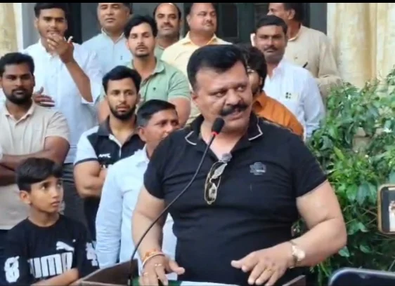
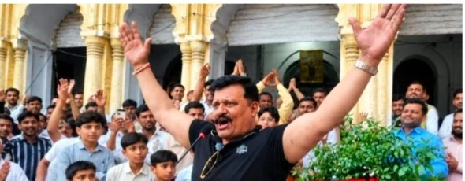
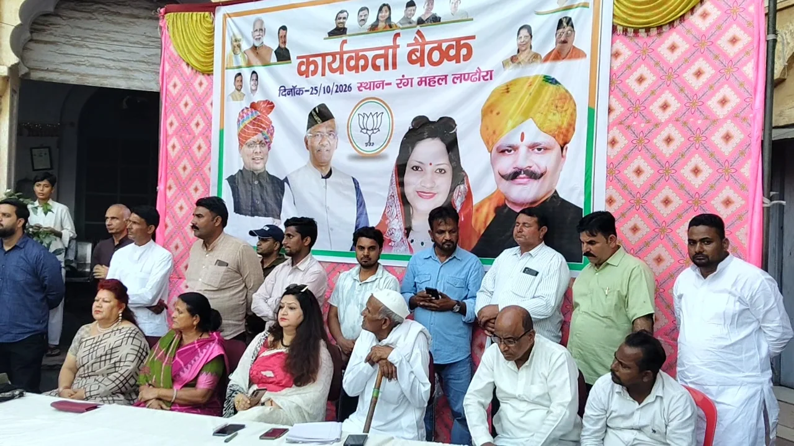
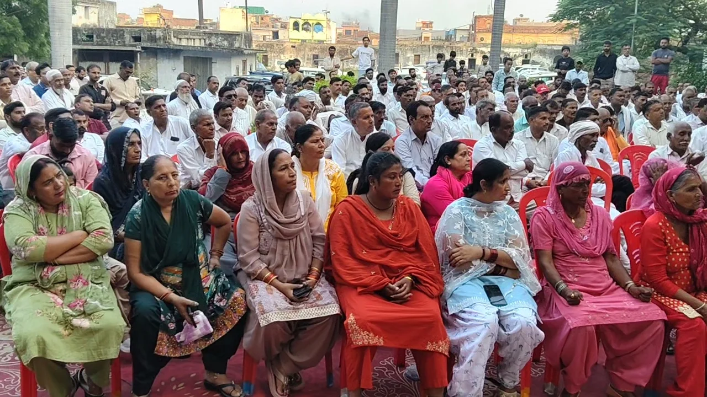

**हरिद्वार/रूडकी संवाददाता | आसिफ खान** 

**हरिद्वार/लंढौरा ।** उत्तराखंड विधानसभा चुनाव 2027 से पहले खानपुर और लक्सर की सियासत में अभी से हलचल मच गई है। लंढौरा के ऐतिहासिक रंगमहल में आयोजित कार्यकर्ता बैठक से भाजपा के निवर्तमान विधायक कुंवर प्रणव सिंह चैंपियन ने ऐसा राजनीतिक दांव चला है, जिसने दोनों विधानसभा क्षेत्रों के सियासी गलियारों में चर्चाओं का बाजार गर्म कर दिया है। चैंपियन ने दो टूक ऐलान किया कि वह आगामी विधानसभा चुनाव में खानपुर और लक्सर—दोनों सीटों से भाजपा का टिकट मांगेंगे और मजबूती के साथ अपनी दावेदारी पेश करेंगे।

चैंपियन के इस बयान के बाद अब निगाहें भाजपा नेतृत्व पर टिक गई हैं। सवाल उठ रहा है कि क्या पार्टी दोनों सीटों पर उनकी दावेदारी को गंभीरता से लेगी या टिकट के लिए नए सियासी समीकरण सामने आएंगे? फिलहाल, चैंपियन की घोषणा ने चुनाव से काफी पहले ही खानपुर और लक्सर की राजनीति में नई बहस छेड़ दी है।

**दो सीटों पर दावेदारी, भाजपा में टिकट के समीकरण होंगे दिलचस्प!**

रंगमहल में आयोजित बैठक में विभिन्न गांवों और क्षेत्रों से बड़ी संख्या में कार्यकर्ता एवं समर्थक पहुंचे। कार्यकर्ताओं के बीच चैंपियन ने दोनों विधानसभा क्षेत्रों में सक्रियता बढ़ाने और जनता की समस्याओं को प्रमुखता से उठाने की बात कही। उन्होंने अपने कार्यकाल में कराए गए विकास कार्यों का उल्लेख किया और दल्लावाला कन्या डिग्री कॉलेज की मंजूरी का भी जिक्र किया।

चैंपियन ने आरोप लगाया कि पिछले कुछ वर्षों में क्षेत्र विकास के मामले में पिछड़ गया है। उन्होंने सामाजिक भाईचारे को मजबूत करने और सभी समाजों को साथ लेकर चलने पर जोर दिया। उनका कहना था कि विभिन्न समुदायों के लोग उनसे अपनी समस्याओं के समाधान की अपेक्षा कर रहे हैं।

**खानपुर से लक्सर तक सियासी हलचल, अब भाजपा नेतृत्व की परीक्षा!**

चैंपियन का दोनों सीटों से टिकट मांगने का ऐलान केवल चुनावी बयान तक सीमित नहीं है, बल्कि इससे दोनों विधानसभा क्षेत्रों में संभावित दावेदारियों और राजनीतिक रणनीति को लेकर चर्चाएं तेज होना स्वाभाविक है। हालांकि, टिकट का अंतिम फैसला भाजपा नेतृत्व ही करेगा। ऐसे में आने वाले समय में पार्टी के भीतर क्या समीकरण बनते हैं, यह देखना अहम होगा।

चैंपियन ने अपनी मंशा साफ कर दी है—दोनों सीटों पर दावेदारी होगी, लेकिन अंतिम मुहर भाजपा नेतृत्व की लगेगी। अब राजनीतिक निगाहें इस बात पर हैं कि पार्टी उनकी इस मांग पर क्या रुख अपनाती है।

**रानी देवयानी ने भी ठोकी ताल, चुनावी तैयारी का किया आगाज!**

बैठक में रानी देवयानी ने भी आगामी विधानसभा चुनाव की तैयारियां शुरू करने और भाजपा से टिकट मांगने की बात कही। उन्होंने कार्यकर्ताओं से भविष्य की योजनाओं और चुनावी रणनीति को लेकर सुझाव लिए।

एक ही बैठक में चैंपियन और रानी देवयानी की चुनावी दावेदारी से राजनीतिक चर्चाओं को नया मुद्दा मिल गया है। अब देखना होगा कि आने वाले दिनों में खानपुर और लक्सर में टिकट की दौड़ किस दिशा में आगे बढ़ती है और भाजपा नेतृत्व किन चेहरों पर भरोसा जताता है।

**रंगमहल की बैठक से निकले कई सियासी संकेत**

बैठक में ढडेरा नगर पंचायत अध्यक्ष सतीश नेगी, खानपुर मंडल अध्यक्ष भगत सिंह, राव फुरकान, प्रधान प्रेम गिरी, डॉ. रणवीर सिंह, रामकुमार, तेजपाल सिंह, मयंक चौधरी, ममता भटनागर, चौधरी नकली सिंह, कुंदन विजय सिंह, अजब सिंह, सरदार अरविंदर सिंह, रिशपाल हैसन, सुरेश चौहान, समन सलेतला, रेखा नेगी, किरण सिंह और नीतू सिंह सहित अन्य लोग मौजूद रहे।

**2027 का चुनावी रण अभी दूर, लेकिन दावेदारों ने बढ़ाई सरगर्मी!**

खानपुर और लक्सर में चुनावी मुकाबले की जमीन अभी से तैयार होती दिखाई दे रही है। चैंपियन की दो सीटों पर टिकट मांगने की घोषणा और रानी देवयानी की दावेदारी ने भाजपा के संभावित चुनावी समीकरणों पर नई बहस छेड़ दी है। अब सवाल यही है—क्या भाजपा दोनों दावेदारियों को जगह देगी, या टिकट के फैसले से किसी नए सियासी चेहरे को मिलेगा मौका?

फिलहाल, रंगमहल की बैठक ने इतना जरूर साफ कर दिया है कि 2027 के विधानसभा चुनाव से पहले खानपुर और लक्सर की राजनीति में दावेदारी, रणनीति और टिकट की जंग तेज होने के संकेत मिलने लगे हैं।
