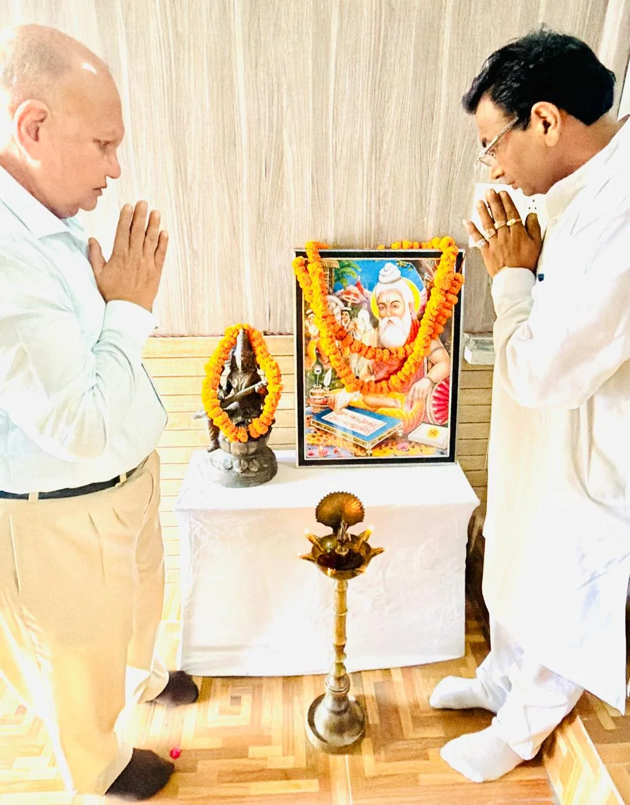

**रुड़की संवाददाता | आसिफ खान**

रुड़की। महर्षि वाल्मीकि जयंती के पावन अवसर पर श्री सनातन धर्म प्रकाश चंद्र कन्या स्नातकोत्तर महाविद्यालय, रुड़की में भारतीय संस्कृति, रामायण की गौरवशाली परंपरा और महर्षि वाल्मीकि के महान आदर्शों का भव्य संगम देखने को मिला। बी.एससी. एवं एम.ए. विभाग की ओर से आयोजित रंगारंग सांस्कृतिक कार्यक्रम में छात्राओं ने अपनी प्रतिभा, रचनात्मकता और शानदार प्रस्तुतियों से ऐसा समां बांधा कि पूरा महाविद्यालय आध्यात्मिकता, संस्कृति और उत्साह के रंग में रंग गया।

कार्यक्रम का उद्देश्य छात्राओं को महर्षि वाल्मीकि के महान व्यक्तित्व, उनके जीवन संघर्षों, आदर्शों तथा भारतीय संस्कृति की समृद्ध विरासत से रूबरू कराना रहा। छात्राओं ने नृत्य, नाटक और दोहों की भावपूर्ण प्रस्तुतियों के माध्यम से यह संदेश दिया कि महर्षि वाल्मीकि की शिक्षाएं और भगवान श्रीराम के आदर्श आज भी समाज के लिए प्रेरणास्रोत हैं।

**दीप प्रज्वलन के साथ हुआ भव्य कार्यक्रम का शुभारंभ**

कार्यक्रम में मुख्य अतिथि के रूप में आदरणीय श्री अरविंद कुमार गुप्ता जी एवं महाविद्यालय के सचिव श्री सौरभ भूषण शर्मा जी उपस्थित रहे। मुख्य अतिथि एवं सचिव ने फीता काटकर कार्यक्रम का शुभारंभ किया। इसके उपरांत महर्षि वाल्मीकि जी एवं मां सरस्वती के चित्र के समक्ष दीप प्रज्वलित कर माल्यार्पण किया गया।

**छात्राओं की प्रस्तुतियों ने जीवंत किए रामायण के प्रसंग**

सांस्कृतिक कार्यक्रम के दौरान छात्राओं ने भगवान श्रीरामचंद्र जी के जीवन चरित्र एवं रामायण की विभिन्न घटनाओं पर आधारित मनमोहक नृत्य प्रस्तुत किए। महर्षि वाल्मीकि जी के संपूर्ण जीवनवृत्त पर आधारित लघु नाटिका ने उनके व्यक्तित्व और जीवन से जुड़े प्रेरणादायक प्रसंगों को प्रभावशाली ढंग से प्रस्तुत किया।

छात्राओं ने अपनी शानदार अभिनय क्षमता के माध्यम से वाल्मीकि रामायण और भगवान श्रीराम के आदर्शों को जीवंत कर दिया। वहीं संत रहीमदास जी एवं कबीरदास जी के सुंदर दोहों की भावपूर्ण प्रस्तुतियों ने कार्यक्रम को ज्ञानवर्धक और प्रेरणादायक बना दिया।

**सचिव सौरभ भूषण शर्मा ने छात्राओं को दिया संस्कारों का संदेश**

महाविद्यालय के सचिव श्री सौरभ भूषण शर्मा जी ने महर्षि वाल्मीकि जयंती की शुभकामनाएं देते हुए छात्राओं को उनके आदर्शों एवं शिक्षाओं को अपने जीवन में आत्मसात करने के लिए प्रेरित किया।

उन्होंने कहा कि महाविद्यालय में समय-समय पर ऐसे सांस्कृतिक एवं शैक्षिक कार्यक्रमों का आयोजन होना चाहिए, जिससे छात्राओं को देश के महान महापुरुषों के जीवन, संघर्षों और आदर्शों से प्रेरणा मिल सके। उन्होंने भारतीय संस्कृति, नैतिक मूल्यों एवं महान व्यक्तित्वों की शिक्षाओं को जीवन का अभिन्न अंग बनाने का संदेश दिया।

**श्रीराम के आदर्शों को अपनाने की अपील**

मुख्य अतिथि श्री अरविंद कुमार गुप्ता जी ने अपने संबोधन में भगवान श्रीरामचंद्र जी के जीवन चरित्र एवं उनके आदर्शों पर प्रकाश डाला। उन्होंने छात्राओं को सत्य, मर्यादा, कर्तव्यनिष्ठा एवं सदाचार जैसे गुणों को अपने जीवन में अपनाने के लिए प्रेरित किया।

उन्होंने कहा कि भगवान श्रीराम का जीवन प्रत्येक व्यक्ति के लिए प्रेरणा का स्रोत है। उनके आदर्शों पर चलकर समाज में नैतिकता, सद्भाव और सकारात्मकता को मजबूत किया जा सकता है।

**डॉ. मधु मेहरा ने छात्राओं की प्रतिभा को सराहा**

महाविद्यालय की स्ववित्त पोषित प्रभारी डॉ. मधु मेहरा जी ने सभी छात्राओं को महर्षि वाल्मीकि जयंती की हार्दिक शुभकामनाएं दीं। उन्होंने छात्राओं द्वारा प्रस्तुत रंगारंग कार्यक्रम की सराहना करते हुए कहा कि इस प्रकार की गतिविधियां छात्राओं के व्यक्तित्व विकास, रचनात्मकता और सांस्कृतिक चेतना को मजबूत करती हैं।

उन्होंने छात्राओं को भविष्य में भी उत्साह, लगन एवं रचनात्मकता के साथ शैक्षिक और सांस्कृतिक गतिविधियों में सहभागिता करने के लिए प्रेरित किया। साथ ही कार्यक्रम को सफल बनाने में योगदान देने वाली सभी छात्राओं, प्राध्यापिकाओं, शिक्षकों एवं महाविद्यालय के कर्मचारियों का आभार व्यक्त किया।

**महाविद्यालय परिवार की रही गरिमामयी उपस्थिति**

इस अवसर पर महाविद्यालय की प्राध्यापिकाएं श्रीमती संदीपा, श्रीमती प्रियंका, श्रीमती राधा, सुश्री अंजलि, सुश्री शिवानी, सुश्री आँचल, सुश्री तनु, श्रीमती अमिता, श्रीमती काजल, सुश्री ज्योति सहित अन्य प्राध्यापिकाएं उपस्थित रहीं।

समग्र रूप से महर्षि वाल्मीकि जयंती पर आयोजित यह सांस्कृतिक कार्यक्रम अत्यंत प्रेरणादायक, ज्ञानवर्धक एवं सफल रहा। कार्यक्रम ने छात्राओं को भारतीय संस्कृति, रामायण की महत्ता और महर्षि वाल्मीकि के महान आदर्शों को समझने का अवसर प्रदान किया। छात्राओं की शानदार प्रस्तुतियों ने यह संदेश दिया कि भारतीय संस्कृति की गौरवशाली परंपरा और महापुरुषों की शिक्षाएं आज भी नई पीढ़ी के लिए प्रेरणा का आधार हैं।
