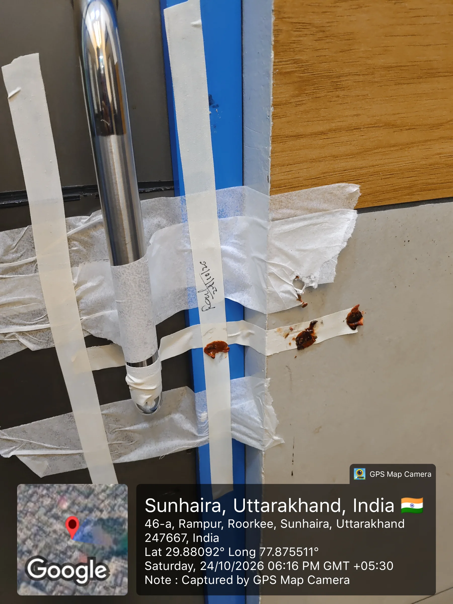

**हरिद्वार/रूडकी संवाददाता | आसिफ खान** 

**रुड़की/हरिद्वार।** स्वास्थ्य विभाग की कार्रवाई और सीलिंग के बावजूद यदि किसी अस्पताल में ऑपरेशन थिएटर दोबारा संचालित होने लगे, तो सवाल उठना लाजिमी है। रुड़की के ईदगाह के पास स्थित कैलाश नर्सिंग होम में सामने आए इस मामले ने स्वास्थ्य विभाग की सख्ती और निजी अस्पतालों में नियमों के पालन को लेकर एक बार फिर गंभीर सवाल खड़े कर दिए हैं। पूर्व में सील किए गए ऑपरेशन थिएटर के दोबारा संचालित होने की शिकायतों पर स्वास्थ्य विभाग ने अस्पताल पर शिकंजा कस दिया। टीम ने मौके पर पहुंचकर ओटी को फिर सील कर दिया और अस्पताल प्रबंधन पर दोगुना जुर्माना भी लगाया।

**पहले सीलिंग, फिर दोबारा संचालन! आखिर किसके भरोसे चल रहा था ओटी?**

जानकारी के अनुसार, कैलाश नर्सिंग होम के ऑपरेशन थिएटर को लेकर स्वास्थ्य विभाग को लगातार शिकायतें मिल रही थीं। आरोप था कि पूर्व में सील किए गए ओटी को दोबारा संचालित किया जा रहा है। शिकायतों को गंभीरता से लेते हुए स्वास्थ्य विभाग की टीम अस्पताल पहुंची।

जांच के दौरान ऑपरेशन थिएटर संचालित पाया गया। इसके बाद अधिकारियों ने बिना देरी किए ओटी को दोबारा सील कर दिया। कार्रवाई के साथ ही अस्पताल प्रबंधन पर दोगुना जुर्माना भी लगाया गया। विभाग की इस कार्रवाई से अस्पताल प्रबंधन में हड़कंप मच गया।

**दो महीने पहले भी हुई थी कार्रवाई, फिर कैसे शुरू हुआ संचालन?**

एसीएमओ रमेश कुंवर ने बताया कि करीब दो महीने पहले भी कैलाश नर्सिंग होम के ऑपरेशन थिएटर में अनियमितताएं मिलने पर कार्रवाई की गई थी। उस दौरान ओटी को सील कर दिया गया था।

बताया गया कि अस्पताल संचालक ने ओटी से सामान बाहर निकालने के लिए अधिकारियों से कुछ समय मांगा था। लेकिन इसके बाद ओटी में दोबारा ऑपरेशन किए जाने की शिकायतें सामने आने लगीं।

स्वास्थ्य विभाग की टीम ने जब मौके पर पहुंचकर जांच की तो ऑपरेशन थिएटर संचालित पाया गया। इसके बाद विभाग ने फिर से सीलिंग की कार्रवाई की।

**स्वास्थ्य विभाग की दो टूक—अब दोबारा ओटी चला तो खैर नहीं!**

एसीएमओ रमेश कुंवर ने स्पष्ट किया कि अस्पताल प्रबंधन पर दोगुना जुर्माना लगाया गया है। साथ ही सख्त चेतावनी दी गई है कि भविष्य में यदि ऑपरेशन थिएटर दोबारा संचालित होता पाया गया तो नियमानुसार आवश्यक कार्रवाई की जाएगी।

**इस कार्रवाई में स्वास्थ्य विभाग की टीम के सदस्य राव अकरम, सुहैल और तोमर शामिल रहे।**

**निजी अस्पतालों में मचा हड़कंप, नियमों की अनदेखी पर विभाग का कड़ा संदेश**

कैलाश नर्सिंग होम पर हुई इस कार्रवाई ने क्षेत्र के निजी अस्पतालों में हलचल बढ़ा दी है। स्वास्थ्य विभाग की सीलिंग के बाद भी ओटी के दोबारा संचालन का मामला सामने आने से निगरानी व्यवस्था और अस्पतालों की जवाबदेही को लेकर सवाल उठ रहे हैं।

अब बड़ा सवाल यह है कि पूर्व में सील किए गए ऑपरेशन थिएटर में दोबारा संचालन कैसे शुरू हुआ? क्या अस्पताल प्रबंधन ने विभागीय कार्रवाई को हल्के में लिया? और क्या क्षेत्र के अन्य निजी अस्पतालों में भी इसी तरह नियमों की अनदेखी हो रही है?

स्वास्थ्य विभाग की इस कार्रवाई ने साफ संदेश दिया है कि मरीजों की सुरक्षा से जुड़े नियमों को ताक पर रखने वालों के खिलाफ सख्ती जारी रहेगी। सीलिंग के बाद दोबारा संचालन का मामला अब स्वास्थ्य विभाग की निगरानी और निजी अस्पतालों की जवाबदेही के केंद्र में आ गया है।
