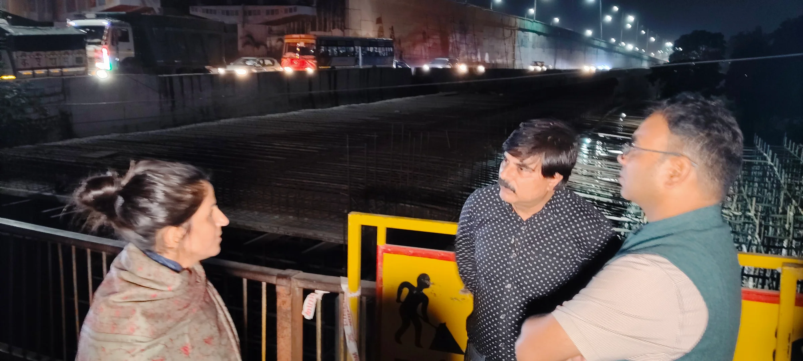
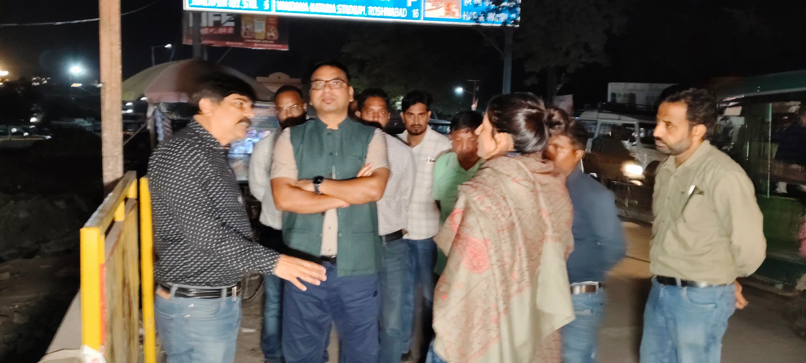
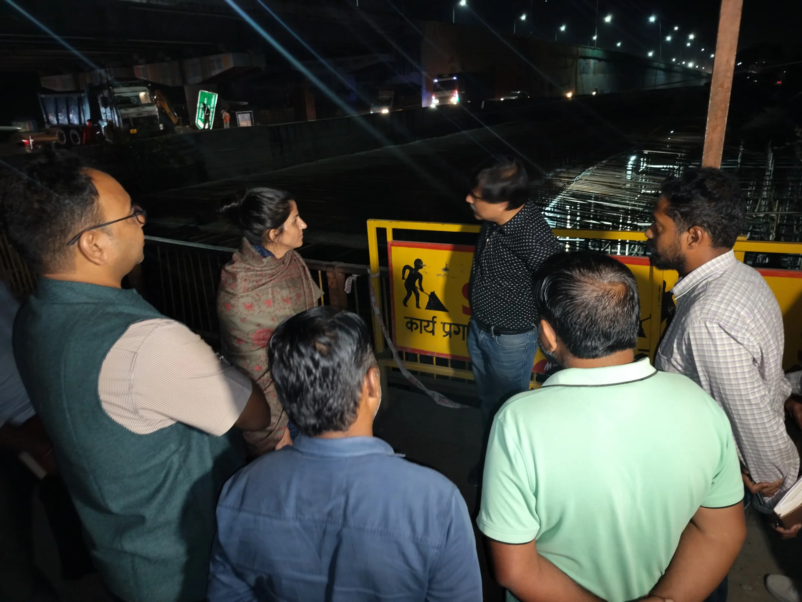

**हरिद्वार संवाददाता | आसिफ खान**

**हरिद्वार।** कुंभ मेला-2027 की तैयारियों में किसी भी तरह की लापरवाही और निर्माण कार्यों में देरी बर्दाश्त नहीं की जाएगी। श्रद्धालुओं की सुविधा, यातायात व्यवस्था और कुंभ मेले के सफल संचालन को लेकर मेला प्रशासन ने निर्माण कार्यों की निगरानी तेज कर दी है। मेलाधिकारी श्रीमती सोनिका ने विभिन्न निर्माण स्थलों का स्थलीय निरीक्षण कर अधिकारियों को स्पष्ट निर्देश दिए कि सभी परियोजनाएं निर्धारित समयसीमा के भीतर गुणवत्ता के साथ पूरी की जाएं। खास तौर पर प्रशासनिक रोड और चंडी चौक के निकट बन रहे डबल लेन अंडरपास के निर्माण कार्य को तेजी से पूरा करने पर जोर दिया गया।

मंगलवार को मेलाधिकारी सोनिका ने कुंभ क्षेत्र के विभिन्न स्थानों पर चल रहे अवस्थापना विकास कार्यों का निरीक्षण किया। इस दौरान उन्होंने शंकराचार्य चौक, कनखल सहित विभिन्न क्षेत्रों में सड़क सुधार, चौराहों के सौंदर्यीकरण, फुटपाथ निर्माण, पेयजल व्यवस्था और घाटों से जुड़े निर्माण कार्यों की जमीनी हकीकत परखी। अधिकारियों से कार्यों की प्रगति की जानकारी लेते हुए उन्होंने निर्देश दिए कि निर्माण कार्यों में गुणवत्ता से कोई समझौता न किया जाए और तय समयसीमा का सख्ती से पालन सुनिश्चित किया जाए।

**प्रशासनिक रोड और डबल लेन अंडरपास पर मेलाधिकारी की सख्ती**

कुंभ मेले के दौरान प्रशासनिक गतिविधियों और यातायात संचालन की दृष्टि से महत्वपूर्ण प्रशासनिक रोड परियोजना का मेलाधिकारी ने देर शाम निरीक्षण किया। इसके साथ ही चंडी चौक के निकट निर्माणाधीन डबल लेन अंडरपास की प्रगति भी जांची गई।

मेलाधिकारी ने स्पष्ट किया कि इन महत्वपूर्ण परियोजनाओं में किसी भी स्तर पर अनावश्यक देरी नहीं होनी चाहिए। निर्माण कार्यों को गति देने के लिए अधिकारियों को आपसी समन्वय के साथ काम करने और निर्धारित लक्ष्य के अनुरूप प्रगति सुनिश्चित करने के निर्देश दिए गए।

**प्रतिदिन के काम का बनेगा चार्ट, हर गतिविधि पर रहेगी नजर**

निर्माण कार्यों की समयबद्धता सुनिश्चित करने के लिए मेलाधिकारी ने संबंधित अधिकारियों को आगामी अवधि में प्रतिदिन किए जाने वाले कार्यों की विस्तृत कार्ययोजना तैयार करने के निर्देश दिए। उन्होंने कहा कि परियोजना का पर्ट चार्ट तैयार कर प्रस्तुत किया जाए, ताकि प्रत्येक दिन के कार्यों की प्रगति का आकलन किया जा सके।

उन्होंने निर्देश दिए कि निर्माण कार्यों की नियमित समीक्षा की जाए और तय समयसीमा के अनुरूप कार्यों को आगे बढ़ाया जाए। कुंभ मेले से जुड़ी महत्वपूर्ण परियोजनाओं को निर्धारित समय पर पूरा करना प्रशासन की प्राथमिकता है।

**चंडी चौक और एनएच की सर्विस लेन चौड़ीकरण पर भी जोर**

मेलाधिकारी ने चंडी चौक के सुधार कार्यों के साथ ही इस क्षेत्र से गुजरने वाले राष्ट्रीय राजमार्ग की सर्विस लेन के चौड़ीकरण की प्रगति की भी समीक्षा की। उन्होंने एनएचएआई के अधिकारियों को निर्देश दिए कि सड़क सुधार और चौड़ीकरण के कार्यों में तेजी लाते हुए उन्हें शीघ्र पूरा किया जाए।

उन्होंने कहा कि कुंभ-2027 के दौरान लाखों श्रद्धालुओं की आवाजाही को देखते हुए यातायात व्यवस्था को सुचारु बनाए रखना बेहद महत्वपूर्ण है। सड़क सुधार, अंडरपास निर्माण और अन्य अवस्थापना विकास कार्यों में समयबद्धता से ही श्रद्धालुओं को बेहतर सुविधाएं उपलब्ध कराई जा सकेंगी।

मेलाधिकारी सोनिका ने अधिकारियों को निर्देशित किया कि निर्माण कार्यों के दौरान श्रद्धालुओं की सुविधा और आवागमन का विशेष ध्यान रखा जाए। कुंभ क्षेत्र में बेहतर व्यवस्थाएं विकसित करने के लिए सभी संबंधित विभाग जिम्मेदारी के साथ कार्य करें।

निरीक्षण के दौरान अपर मेलाधिकारी श्री दयानंद सरस्वती सहित संबंधित विभागों के अधिकारी उपस्थित रहे।

कुंभ-2027 की तैयारियों को लेकर मेला प्रशासन का स्पष्ट संदेश है—निर्माण कार्यों में तेजी, गुणवत्ता में सख्ती और निर्धारित समयसीमा का पालन हर हाल में सुनिश्चित किया जाए।
