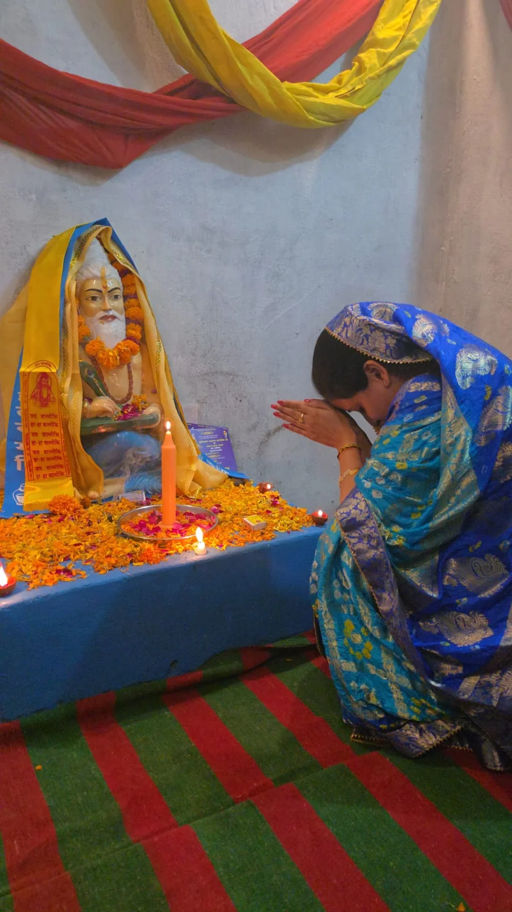
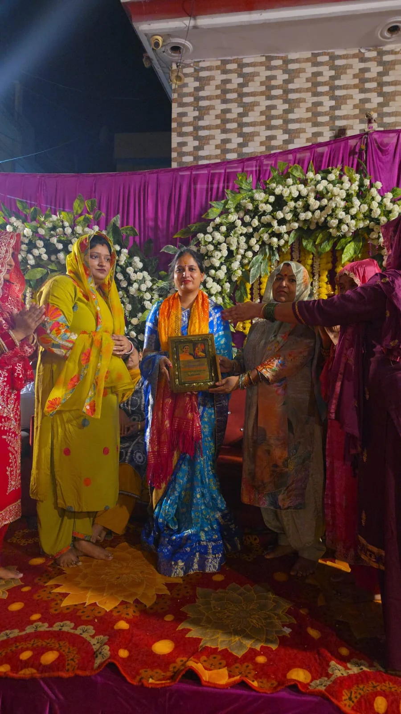
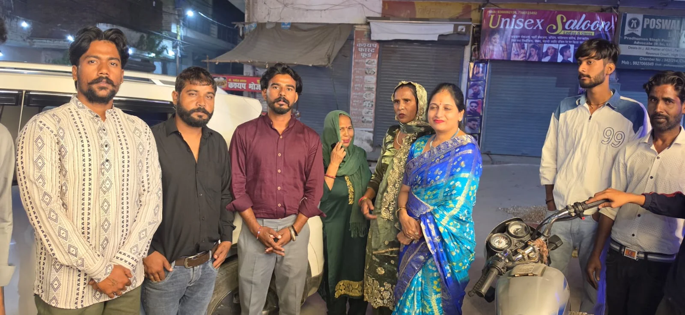

**रूडकी संवाददाता | आसिफ खान** 

**रुड़की।** महर्षि वाल्मीकि प्रकटोत्सव के पावन अवसर पर क्षेत्र में श्रद्धा, भक्ति और सामाजिक एकता का माहौल देखने को मिला। पूर्व मेयर प्रत्याशी पूजा गुप्ता ने पुरानी तहसील, नई बस्ती, रामनगर और सैनिक कॉलोनी गणेशपुर पहुंचकर महर्षि वाल्मीकि जी को श्रद्धापूर्वक नमन किया। उन्होंने महर्षि वाल्मीकि की प्रतिमा पर पुष्प अर्पित कर माल्यार्पण किया और उनके आदर्शों को आत्मसात करने का संकल्प लिया। इस दौरान वाल्मीकि समाज के लोगों ने पूजा गुप्ता का गर्मजोशी से स्वागत किया और कमेटी की ओर से उन्हें मोमेंटो भेंट कर सम्मानित किया।

महर्षि वाल्मीकि प्रकटोत्सव के अवसर पर आयोजित कार्यक्रमों में पूजा गुप्ता ने कहा कि महर्षि वाल्मीकि जी का जीवन समाज को सत्य, ज्ञान, समानता और सदाचार का मार्ग दिखाता है। उन्होंने रामायण जैसे महान ग्रंथ की रचना कर भारतीय संस्कृति और सभ्यता को अमूल्य धरोहर प्रदान की। उनके विचार आज भी समाज को एकजुट करने और मानवता की भावना को मजबूत करने की प्रेरणा देते हैं।

उन्होंने कहा कि महर्षि वाल्मीकि जी के आदर्श केवल किसी एक समाज तक सीमित नहीं हैं, बल्कि उनका संदेश संपूर्ण मानव समाज के लिए प्रेरणास्रोत है। उनके बताए मार्ग पर चलकर समाज में आपसी भाईचारे, सम्मान और सद्भावना को और अधिक मजबूत किया जा सकता है। ऐसे महापुरुषों के जीवन से प्रेरणा लेकर नई पीढ़ी को संस्कारवान और जागरूक बनाने की आवश्यकता है।

**जनसेवा और सामाजिक सरोकारों में सक्रिय हैं पूजा गुप्ता**

पूर्व मेयर प्रत्याशी पूजा गुप्ता क्षेत्र में जनसंपर्क और सामाजिक गतिविधियों के माध्यम से अपनी सक्रिय उपस्थिति दर्ज कराती रही हैं। विभिन्न सामाजिक एवं धार्मिक आयोजनों में सहभागिता के जरिए वह लोगों के बीच संवाद स्थापित करने और सामाजिक एकता को बढ़ावा देने का प्रयास करती हैं। महर्षि वाल्मीकि प्रकटोत्सव पर विभिन्न क्षेत्रों में पहुंचकर उन्होंने समाज के लोगों के साथ अपनी सहभागिता निभाई और महर्षि वाल्मीकि जी के प्रति श्रद्धा व्यक्त की।

इस दौरान वाल्मीकि समाज की कमेटी ने पूजा गुप्ता को मोमेंटो देकर सम्मानित किया। कमेटी के सदस्यों ने उनके आगमन पर आभार व्यक्त किया। कार्यक्रम में मौजूद लोगों ने महर्षि वाल्मीकि जी के आदर्शों पर चलने और समाज में भाईचारे की भावना को मजबूत करने का संदेश दिया।

महर्षि वाल्मीकि प्रकटोत्सव के इस अवसर पर श्रद्धालुओं ने महर्षि वाल्मीकि जी के जीवन और उनके योगदान को याद करते हुए उन्हें नमन किया। कार्यक्रम ने सामाजिक समरसता, आपसी सद्भाव और एकजुटता का संदेश दिया।

इस दौरान सागर, रवि, राजू, हेमराज, राहुल, कमल, सूरज, संजीव सहित अनेक लोग मौजूद रहे।
