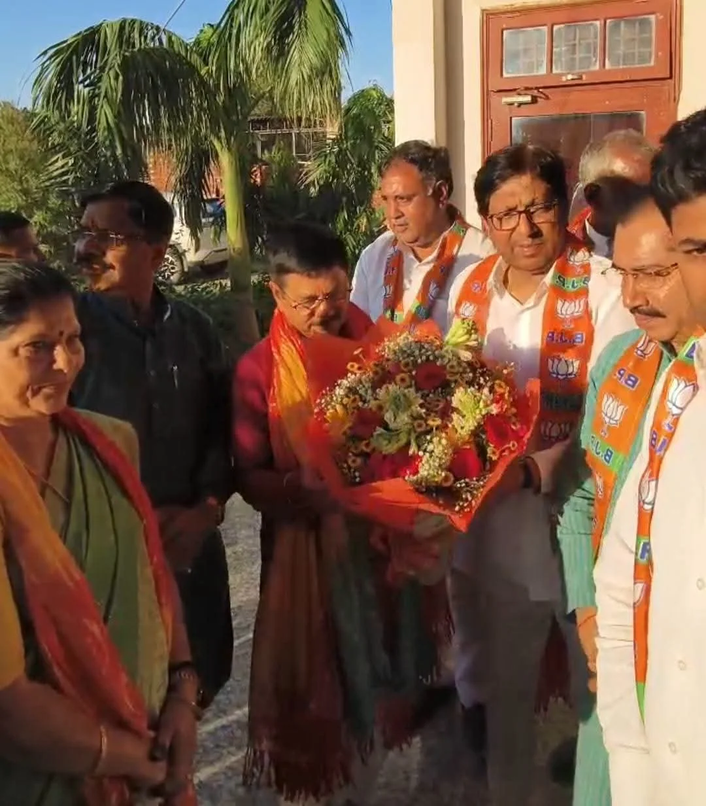
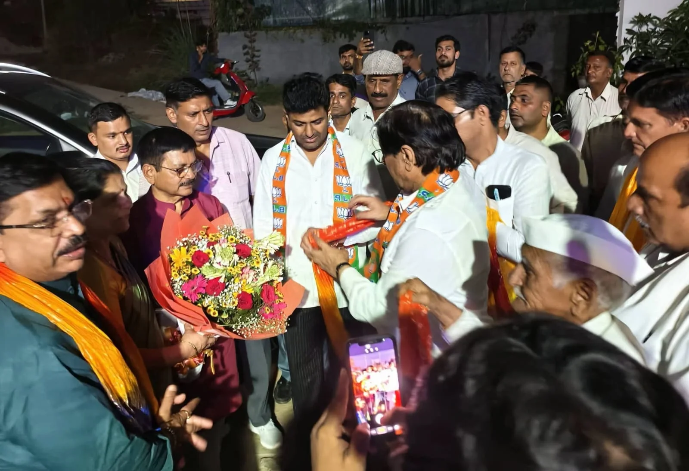
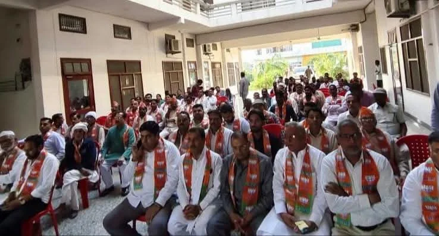

**रूडकी संवाददाता | आसिफ खान** 

**रूडकी/मंगलौर ।** मंगलौर विधानसभा क्षेत्र में भारतीय जनता पार्टी ने संगठन को मजबूत करने और आगामी राजनीतिक चुनौतियों के लिए कार्यकर्ताओं को सक्रिय करने की दिशा में संगठनात्मक गतिविधियां तेज कर दी हैं। इसी क्रम में आयोजित महत्वपूर्ण संगठनात्मक बैठक में भाजपा के संगठन महामंत्री फणीन्द्र नाथ शर्मा पहुंचे। बैठक में पूर्व कैबिनेट मंत्री करतार सिंह बढ़ाना ने बुके भेंट कर उनका जोरदार स्वागत किया। इस दौरान संगठन की मजबूती, कार्यकर्ताओं की सक्रियता और पार्टी की नीतियों को जन-जन तक पहुंचाने को लेकर व्यापक मंथन किया गया।

बैठक में संगठन को अधिक सशक्त, सक्रिय और प्रभावी बनाने के साथ ही कार्यकर्ताओं की जिम्मेदारियों को लेकर विस्तार से चर्चा हुई। पार्टी पदाधिकारियों ने संगठनात्मक ढांचे को मजबूत करने, आपसी समन्वय बढ़ाने और जमीनी स्तर पर पार्टी की पकड़ को और मजबूत करने पर जोर दिया।

**संगठन को मजबूत बनाने का मंत्र, कार्यकर्ताओं की भूमिका पर विशेष जोर**

संगठन महामंत्री फणीन्द्र नाथ शर्मा ने बैठक में मौजूद पदाधिकारियों और कार्यकर्ताओं को संगठनात्मक कार्यों को प्रभावी ढंग से आगे बढ़ाने के लिए मार्गदर्शन दिया। उन्होंने संगठन के विभिन्न स्तरों पर बेहतर तालमेल, कार्यकर्ताओं की सक्रिय भागीदारी और निर्धारित जिम्मेदारियों के प्रभावी निर्वहन जैसे महत्वपूर्ण विषयों पर विचार-विमर्श किया।

बैठक में स्पष्ट रूप से संगठनात्मक गतिविधियों को गति देने और कार्यकर्ताओं को अधिक जिम्मेदारी के साथ मैदान में सक्रिय रहने के लिए प्रेरित करने पर जोर दिया गया। पार्टी की नीतियों और कार्यक्रमों को आम जनता तक पहुंचाने तथा जनसेवा के कार्यों में कार्यकर्ताओं की भागीदारी बढ़ाने को भी महत्वपूर्ण बताया गया।

**बूथ स्तर तक संगठन की मजबूती पर मंथन**

बैठक में जिला पदाधिकारियों, मंडल अध्यक्षों, मंडल महामंत्रियों और शक्ति केंद्र संयोजकों ने प्रतिभाग किया। संगठन की कार्यप्रणाली को अधिक प्रभावी बनाने और कार्यकर्ताओं के बीच बेहतर समन्वय स्थापित करने को लेकर चर्चा की गई।

पार्टी के कार्यक्रमों को जन-जन तक पहुंचाने, संगठनात्मक जिम्मेदारियों का बेहतर निर्वहन करने और जमीनी स्तर पर कार्यकर्ताओं की सक्रियता बढ़ाने पर विशेष ध्यान दिया गया। बैठक में संगठन की मजबूती को पार्टी की प्राथमिकता बताते हुए सभी पदाधिकारियों और कार्यकर्ताओं से एकजुट होकर कार्य करने का आह्वान किया गया।

**वरिष्ठ पदाधिकारियों की मौजूदगी में संगठनात्मक रणनीति पर चर्चा**

इस महत्वपूर्ण बैठक में प्रदेश महामंत्री तरुण बंसल, जिला प्रभारी आदित्य चौहान, जिलाध्यक्ष डॉ. मधु सिंह और मंगलौर विधानसभा प्रभारी श्यामवीर सैनी सहित अन्य पदाधिकारी एवं कार्यकर्ता मौजूद रहे।

वरिष्ठ पदाधिकारियों की मौजूदगी में संगठनात्मक गतिविधियों को गति देने, कार्यकर्ताओं के बीच बेहतर तालमेल स्थापित करने और पार्टी के उद्देश्यों को जन-जन तक पहुंचाने को लेकर विचार-विमर्श किया गया।

**संगठन की एकजुटता का संकल्प**

बैठक के दौरान भाजपा संगठन को और अधिक मजबूत बनाने, आपसी समन्वय बढ़ाने और जनसेवा के संकल्प को आगे बढ़ाने पर जोर दिया गया। पार्टी पदाधिकारियों और कार्यकर्ताओं ने संगठन के प्रति अपनी प्रतिबद्धता दोहराते हुए निरंतर सक्रियता के साथ कार्य करने का संकल्प लिया।

मंगलौर विधानसभा में आयोजित इस बैठक को संगठनात्मक मजबूती की दिशा में महत्वपूर्ण कदम माना जा रहा है। बैठक के माध्यम से कार्यकर्ताओं को स्पष्ट संदेश दिया गया कि संगठन की ताकत उसकी सक्रियता, एकजुटता और जमीनी स्तर पर किए जाने वाले कार्यों में निहित है।
