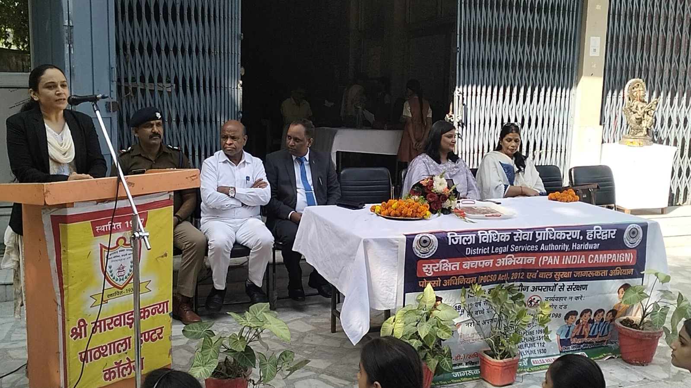
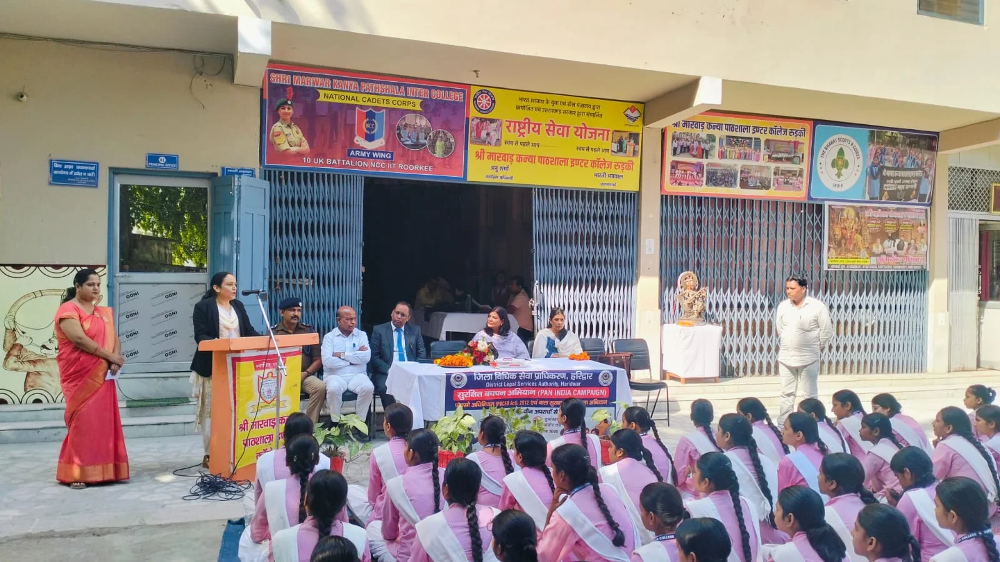
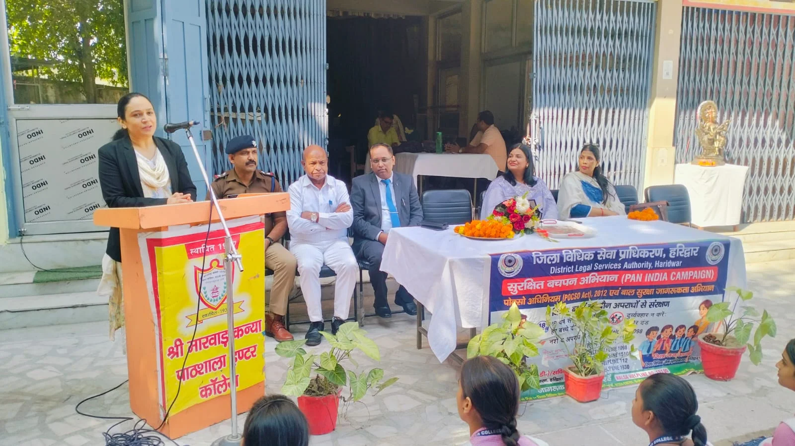

**रूडकी संवाददाता | आसिफ खान** 

**रुड़की ।** बच्चों के सुरक्षित भविष्य और उनके कानूनी अधिकारों की रक्षा के लिए जिला विधिक सेवा प्राधिकरण हरिद्वार ने जागरूकता की मुहिम तेज कर दी है। राष्ट्रीय विधिक सेवा प्राधिकरण, नई दिल्ली एवं उत्तराखंड राज्य विधिक सेवा प्राधिकरण, नैनीताल के निर्देशों के क्रम में मंगलवार को श्री मारवाड़ कन्या इंटर कॉलेज, रुड़की छावनी में ‘सुरक्षित बचपन अभियान’ के तहत विशेष जागरूकता कार्यक्रम आयोजित किया गया।

जिला विधिक सेवा प्राधिकरण, हरिद्वार के तत्वावधान तथा तहसील विधिक सेवा समिति, रुड़की के सहयोग से आयोजित इस कार्यक्रम में छात्राओं को उनके कानूनी अधिकारों, व्यक्तिगत सुरक्षा, पॉक्सो अधिनियम और साइबर अपराधों से बचाव के प्रति जागरूक किया गया। कार्यक्रम में स्पष्ट संदेश दिया गया कि बच्चों के साथ होने वाले किसी भी प्रकार के दुर्व्यवहार पर चुप्पी नहीं, बल्कि जागरूकता और कानूनी कार्रवाई जरूरी है।

**न्यायिक अधिकारियों ने समझाए अधिकार, पॉक्सो एक्ट के प्रावधानों पर किया जागरूक**

कार्यक्रम का शुभारंभ विद्यालय की प्रधानाचार्या भारती अग्रवाल एवं सहायक प्रबंधक अशोक कुमार अग्रवाल द्वारा अतिथियों के स्वागत के साथ हुआ। कार्यक्रम में मुख्य अतिथि द्वितीय न्यायिक मजिस्ट्रेट श्रीमती दीप्ति पंत उपस्थित रहीं।

प्रधानाचार्या ने द्वितीय न्यायिक मजिस्ट्रेट दीप्ति पंत, प्रथम अपर सिविल जज (जू. डि.) रुड़की विनीत श्रीवास्तव तथा रुड़की खंड शिक्षा अधिकारी आकांक्षा राठौर का स्वागत किया।

इस दौरान रुड़की सिविल लाइंस थाना प्रभारी के प्रतिनिधि उपनिरीक्षक चंद्रमोहन सिंह बिष्ट, मुख्य प्रशासनिक अधिकारी, उप शिक्षा अधिकारी अर्चना शुक्ला तथा जिला विधिक सेवा प्राधिकरण के अधिकार मित्र बालेंदर कुमार एवं अनिल कश्यप को माला पहनाकर सम्मानित किया गया।

जागरूकता कार्यक्रम में न्यायिक मजिस्ट्रेट दीप्ति पंत, प्रथम अपर सिविल जज विनीत श्रीवास्तव और खंड शिक्षा अधिकारी आकांक्षा राठौर ने छात्राओं को उनके अधिकारों तथा कानून के महत्वपूर्ण प्रावधानों की जानकारी दी। वक्ताओं ने पॉक्सो अधिनियम (POCSO Act) के बारे में विस्तार से बताते हुए कहा कि यह कानून बच्चों को यौन अपराधों से सुरक्षा प्रदान करने के लिए बनाया गया है।

उन्होंने छात्राओं को स्पष्ट रूप से समझाया कि किसी भी प्रकार का दुर्व्यवहार, उत्पीड़न या असुरक्षित स्थिति सामने आने पर चुप रहना समाधान नहीं है। बच्चों को अपने अभिभावकों, शिक्षकों अथवा संबंधित अधिकारियों को तत्काल जानकारी देनी चाहिए, ताकि समय रहते उचित सहायता और कानूनी कार्रवाई सुनिश्चित की जा सके।

**साइबर अपराधियों से सतर्क रहें छात्राएं, सोशल मीडिया पर बरतें सावधानी**

कार्यक्रम में पुलिस की भूमिका पर प्रकाश डालते हुए उपनिरीक्षक चंद्रमोहन सिंह बिष्ट ने छात्राओं को कानून-व्यवस्था और सुरक्षा से जुड़ी महत्वपूर्ण जानकारियां दीं। उन्होंने बताया कि आपातकालीन परिस्थितियों में पुलिस की सहायता कैसे प्राप्त की जा सकती है।

साथ ही छात्राओं को इंटरनेट और सोशल मीडिया का इस्तेमाल करते समय विशेष सावधानी बरतने की सलाह दी गई। अधिकारियों ने साइबर अपराध, ऑनलाइन धोखाधड़ी तथा संदिग्ध गतिविधियों से बचाव के उपाय बताते हुए कहा कि किसी भी परेशानी की स्थिति में संबंधित हेल्पलाइन पर शिकायत दर्ज कराई जा सकती है।

**नैतिक मूल्यों और अनुशासन के साथ सुरक्षा के प्रति सजग रहने का आह्वान**

विद्यालय की प्रधानाचार्या भारती अग्रवाल एवं सहायक प्रबंधक अशोक कुमार अग्रवाल ने छात्राओं को नैतिक मूल्यों को अपनाने, अनुशासन बनाए रखने और अपने आसपास की गतिविधियों के प्रति सतर्क रहने के लिए प्रेरित किया।

उन्होंने कहा कि बच्चों का सुरक्षित भविष्य केवल विद्यालय या प्रशासन की जिम्मेदारी नहीं, बल्कि अभिभावकों, समाज और प्रत्येक नागरिक की सामूहिक जिम्मेदारी है। बच्चों को सुरक्षित वातावरण उपलब्ध कराने के लिए सभी को मिलकर प्रयास करने होंगे।

**आपात स्थिति में इन हेल्पलाइन नंबरों पर लें सहायता**

कार्यक्रम के दौरान छात्राओं को विभिन्न सहायता सेवाओं के हेल्पलाइन नंबरों की जानकारी दी गई, ताकि किसी भी आपात स्थिति में वे बिना देर किए सहायता प्राप्त कर सकें।

चाइल्ड हेल्पलाइन — 1098
नालसा विधिक सहायता हेल्पलाइन — 15100
पुलिस आपातकालीन हेल्पलाइन — 112
साइबर अपराध हेल्पलाइन — 1930
बाल अपराधों के खिलाफ जागरूकता ही सुरक्षा की मजबूत ढाल

कार्यक्रम में संदेश दिया गया कि 18 वर्ष से कम आयु के बच्चों की सुरक्षा सुनिश्चित करना समाज की सामूहिक जिम्मेदारी है। बच्चों के साथ होने वाले दुर्व्यवहार और यौन अपराधों के मामलों में कानून के तहत कठोर दंड का प्रावधान है। ऐसे में बच्चों को उनके अधिकारों की जानकारी देना और उन्हें सहायता प्राप्त करने के तरीकों से परिचित कराना बेहद आवश्यक है।

कार्यक्रम के अंत में जिला विधिक सेवा प्राधिकरण के अधिकार मित्र बालेंदर कुमार एवं अनिल कश्यप ने जिला विधिक सेवा प्राधिकरण, हरिद्वार परिवार की ओर से उपस्थित अतिथियों, अधिकारियों तथा विद्यालय प्रबंधन का आभार व्यक्त किया।

इस अवसर पर बच्चों को कानूनी अधिकारों के प्रति जागरूक करने और उन्हें सुरक्षित वातावरण उपलब्ध कराने के लिए ऐसे कार्यक्रमों को महत्वपूर्ण बताया गया। सुरक्षित बचपन अभियान ने छात्राओं को यह संदेश दिया कि जागरूकता, सतर्कता और समय पर सहायता बच्चों के अधिकारों की रक्षा का सबसे मजबूत आधार हैं।
