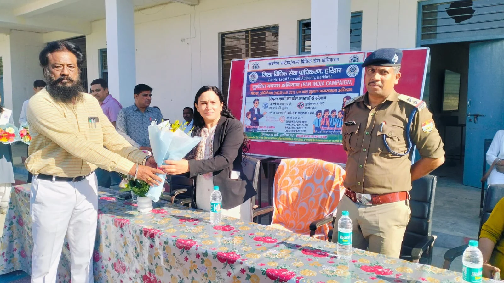
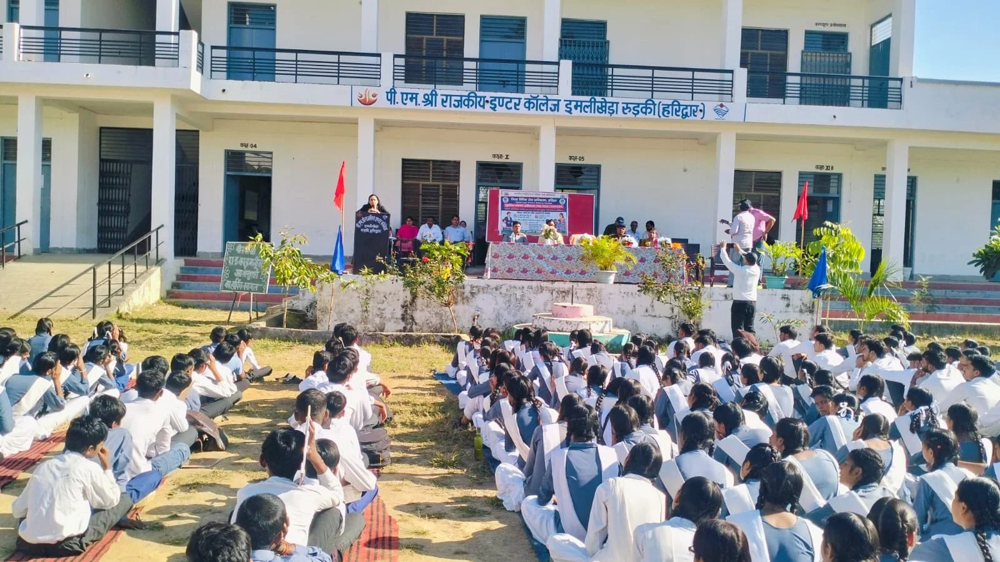

**हरिद्वार संवाददाता | आसिफ खान**

**रुड़की।** बच्चों की सुरक्षा, उनके अधिकारों और डिजिटल दुनिया में बढ़ते खतरों को लेकर पी.एम.श्री. राजकीय इंटर कॉलेज में सुरक्षित बचपन अभियान के तहत विशेष जागरूकता कार्यक्रम आयोजित किया गया। जिला विधिक सेवा प्राधिकरण, हरिद्वार के तत्वावधान तथा तहसील विधिक सेवा समिति, रुड़की के सहयोग से आयोजित इस कार्यक्रम में छात्र-छात्राओं को पॉक्सो एक्ट, गुड टच-बैड टच, साइबर फ्रॉड और आर्टिफिशियल इंटेलिजेंस (एआई) के सुरक्षित इस्तेमाल की महत्वपूर्ण जानकारी दी गई।

कार्यक्रम में वक्ताओं ने स्पष्ट संदेश दिया कि बच्चों की सुरक्षा केवल परिवार की जिम्मेदारी नहीं, बल्कि पूरे समाज का दायित्व है। बच्चों को अपने अधिकारों की जानकारी होना बेहद जरूरी है, ताकि वे किसी भी अनुचित व्यवहार, शोषण या उत्पीड़न के खिलाफ बिना डर के आवाज उठा सकें। जागरूकता के अभाव में बच्चे कई बार ऐसी परिस्थितियों का सामना करते हैं, जिनमें उन्हें सहायता लेने का सही तरीका तक मालूम नहीं होता। इसी को ध्यान में रखते हुए विद्यार्थियों को कानून और सुरक्षा के विभिन्न पहलुओं से अवगत कराया गया।

राष्ट्रीय विधिक सेवा प्राधिकरण, नई दिल्ली एवं उत्तराखंड राज्य विधिक सेवा प्राधिकरण, नैनीताल के निर्देशों के क्रम में आयोजित इस कार्यक्रम का उद्देश्य बच्चों एवं युवाओं को कानूनी अधिकारों के प्रति जागरूक करना तथा उन्हें शोषण, उत्पीड़न और साइबर अपराधों से बचाव के लिए सक्षम बनाना रहा।

**पॉक्सो एक्ट की जानकारी, अनुचित व्यवहार पर चुप्पी तोड़ने का आह्वान**

कार्यक्रम के दौरान बच्चों को पॉक्सो (POCSO) अधिनियम के बारे में विस्तार से जानकारी दी गई। वक्ताओं ने बताया कि यह कानून बच्चों को लैंगिक अपराधों से सुरक्षा प्रदान करने के लिए बनाया गया है। बच्चों को उनके संरक्षण और सुरक्षा से जुड़े कानूनी प्रावधानों के बारे में समझाया गया।

गुड टच-बैड टच के विषय पर विशेष जोर देते हुए विद्यार्थियों को बताया गया कि यदि कोई व्यक्ति उनके साथ अनुचित व्यवहार करता है या उन्हें असहज महसूस कराता है, तो ऐसी स्थिति में चुप रहना जरूरी नहीं है। उन्हें अपने माता-पिता, शिक्षक अथवा किसी भरोसेमंद व्यक्ति को इसकी जानकारी देनी चाहिए। जरूरत पड़ने पर संबंधित अधिकारियों से सहायता लेने के लिए भी प्रेरित किया गया।

वक्ताओं ने कहा कि बच्चों को भय, दबाव और संकोच से बाहर निकलकर अपनी बात रखने का साहस करना चाहिए। किसी भी प्रकार का अनुचित व्यवहार बर्दाश्त करने के बजाय समय पर शिकायत करना उनकी सुरक्षा की दिशा में महत्वपूर्ण कदम है।

**साइबर ठगों से सावधान! मोबाइल और इंटरनेट के इस्तेमाल में बरतें सतर्कता**

डिजिटल युग में बच्चों की ऑनलाइन सुरक्षा को लेकर भी कार्यक्रम में गंभीर चर्चा हुई। विद्यार्थियों को साइबर फ्रॉड के विभिन्न तरीकों और उनसे बचाव के उपायों की जानकारी दी गई।

उन्हें बताया गया कि इंटरनेट और सोशल मीडिया का इस्तेमाल करते समय किसी अनजान व्यक्ति के साथ निजी जानकारी, पासवर्ड, ओटीपी या अन्य गोपनीय विवरण साझा नहीं करना चाहिए। अनजान लिंक पर क्लिक करने, संदिग्ध संदेशों पर भरोसा करने और ऑनलाइन किसी भी व्यक्ति से बिना जांच-पड़ताल के संपर्क बढ़ाने से बचना चाहिए।

वक्ताओं ने कहा कि साइबर अपराधी कई बार बच्चों की मासूमियत और जानकारी के अभाव का फायदा उठाते हैं। ऐसे में सतर्कता ही डिजिटल सुरक्षा का सबसे मजबूत हथियार है।

**एआई का इस्तेमाल जिम्मेदारी से करें विद्यार्थी**

कार्यक्रम में आर्टिफिशियल इंटेलिजेंस (एआई) के बढ़ते प्रभाव और उसके सुरक्षित इस्तेमाल पर भी चर्चा की गई। विद्यार्थियों को बताया गया कि एआई तकनीक शिक्षा और ज्ञान प्राप्त करने के नए अवसर प्रदान करती है, लेकिन इसका इस्तेमाल जिम्मेदारी और सावधानी के साथ किया जाना चाहिए।

ऑनलाइन उपलब्ध सामग्री की सत्यता जांचने, निजी जानकारी साझा करने से बचने और डिजिटल प्लेटफॉर्म पर संदिग्ध गतिविधियों को पहचानने के लिए विद्यार्थियों को जागरूक किया गया। वक्ताओं ने कहा कि तकनीक का सही इस्तेमाल विकास का माध्यम बन सकता है, लेकिन लापरवाही बच्चों को साइबर अपराध और डिजिटल धोखाधड़ी का शिकार भी बना सकती है।

**न्यायिक अधिकारियों की मौजूदगी में बच्चों को मिला कानूनी मार्गदर्शन**

कार्यक्रम में द्वितीय न्यायिक मजिस्ट्रेट श्रीमती दीप्ति पंत एवं प्रथम अपर सिविल जज, रुड़की विनीत श्रीवास्तव ने प्रतिभाग किया। मुख्य शिक्षा अधिकारी के प्रतिनिधि के रूप में अंजली बिजलवान तथा कोतवाली कलियर के प्रभारी निरीक्षक के प्रतिनिधि उपनिरीक्षक योगेश कुमार भी मौजूद रहे।

इसके अतिरिक्त कॉलेज के प्रधानाचार्य सुरेंद्र कुमार निरंजन, शिक्षक संजय कुमार, संजीव सिंह सहित अन्य शिक्षकगण उपस्थित रहे। अतिथियों ने विद्यार्थियों को उनके कानूनी अधिकारों और सुरक्षा से संबंधित महत्वपूर्ण जानकारियां देते हुए जागरूक एवं सतर्क रहने का संदेश दिया।

**अतिथियों का सम्मान, विधिक सहायता की कार्यप्रणाली से कराया परिचित**

कार्यक्रम के दौरान पी.एम.श्री. राजकीय इंटर कॉलेज के प्रधानाचार्य सुरेंद्र कुमार निरंजन ने उपस्थित अतिथियों को बुके भेंट कर सम्मानित किया। उन्होंने कहा कि विद्यार्थियों को शिक्षा के साथ-साथ कानून, सुरक्षा और अपने अधिकारों की जानकारी होना भी आवश्यक है। ऐसे जागरूकता कार्यक्रम बच्चों को आत्मविश्वासी और जिम्मेदार नागरिक बनाने में महत्वपूर्ण भूमिका निभाते हैं।

इस अवसर पर अधिकार मित्र बालेंद्र कुमार एवं अनिल कश्यप ने जिला विधिक सेवा प्राधिकरण परिवार की ओर से कॉलेज प्रबंधन, शिक्षकगण और उपस्थित अतिथियों का आभार व्यक्त करते हुए उनका अभिनंदन किया।

कार्यक्रम में विद्यार्थियों को जिला विधिक सेवा प्राधिकरण, हरिद्वार एवं तहसील विधिक सेवा समिति, रुड़की की कार्यप्रणाली के बारे में भी जानकारी दी गई। उन्हें बताया गया कि जरूरतमंद लोगों को विधिक सहायता उपलब्ध कराने में ये संस्थाएं महत्वपूर्ण भूमिका निभाती हैं। विद्यार्थियों को आवश्यकता पड़ने पर उपलब्ध विधिक सहायता का लाभ उठाने के लिए प्रेरित किया गया।

**सुरक्षित बचपन के लिए जागरूकता जरूरी**

कार्यक्रम के माध्यम से बच्चों को यह संदेश दिया गया कि अपने अधिकारों को पहचानना, गलत और सही व्यवहार के बीच अंतर समझना तथा किसी भी खतरे की स्थिति में सहायता लेना बेहद जरूरी है।

सुरक्षित बचपन अभियान ने बच्चों को यह भरोसा दिलाने का प्रयास किया कि कानून उनकी सुरक्षा के लिए है और किसी भी अनुचित परिस्थिति में उन्हें अकेले संघर्ष करने की जरूरत नहीं है। जागरूकता, सतर्कता और समय पर सहायता ही बच्चों को सुरक्षित भविष्य की दिशा में आगे बढ़ाने का मजबूत आधार है।
