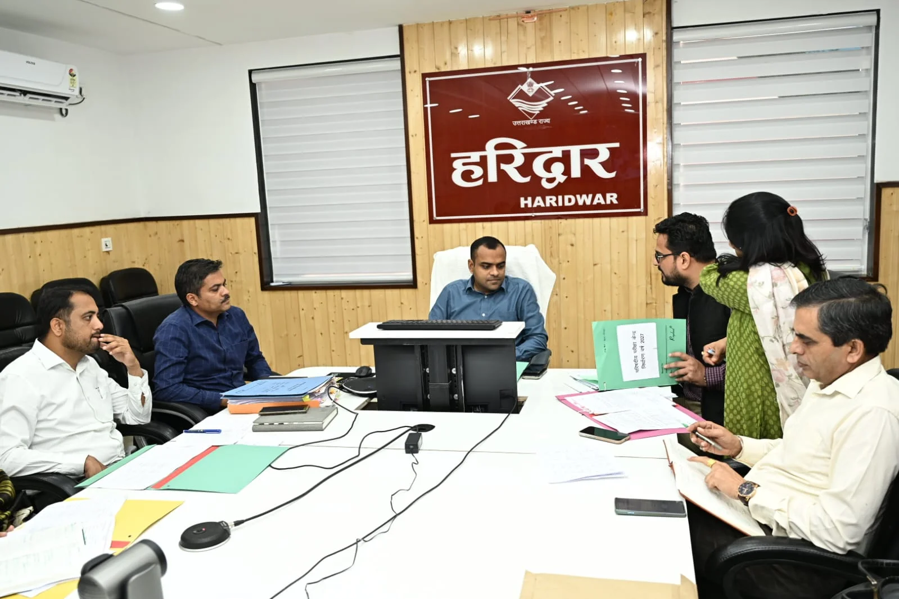
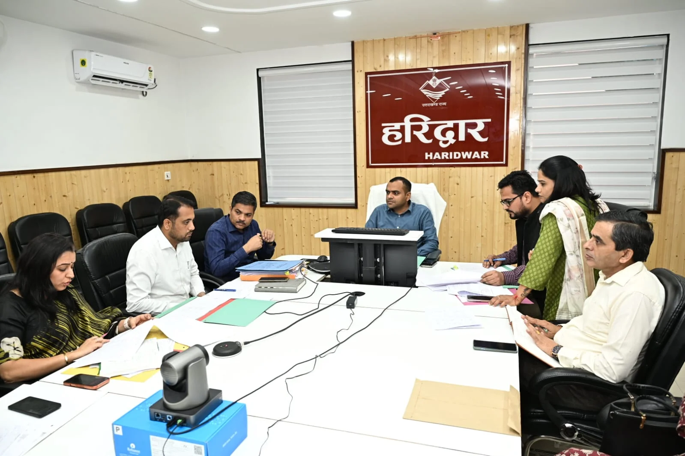
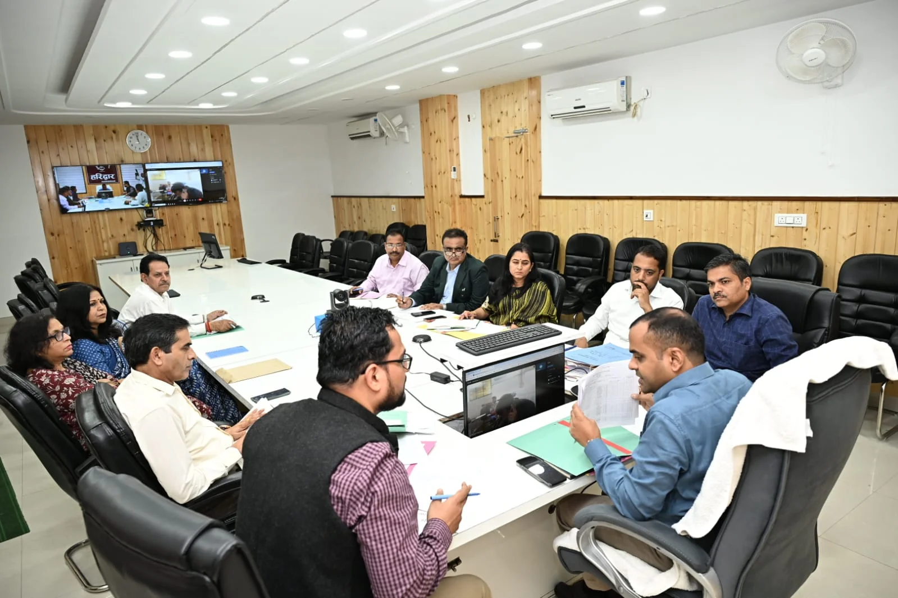

**हरिद्वार संवाददाता | आसिफ खान

हरिद्वार।** उत्तराखंड विद्यालयी शिक्षा परिषद की वर्ष 2027 की हाईस्कूल एवं इंटरमीडिएट बोर्ड परीक्षाओं को लेकर जिला प्रशासन ने तैयारियां तेज कर दी हैं। जनपद में इस बार 48,320 छात्र-छात्राएं बोर्ड परीक्षा में शामिल होंगे। परीक्षाओं को नकलविहीन, पारदर्शी एवं शांतिपूर्ण ढंग से संपन्न कराने के लिए जिलाधिकारी मयूर दीक्षित की अध्यक्षता में परीक्षा केंद्रों के निर्धारण एवं व्यवस्थाओं को लेकर महत्वपूर्ण बैठक आयोजित की गई। बैठक में परीक्षा संचालन की तैयारियों की समीक्षा करते हुए जिलाधिकारी ने अधिकारियों को स्पष्ट निर्देश दिए कि परीक्षा केंद्रों पर व्यवस्थाओं में किसी भी प्रकार की लापरवाही बर्दाश्त नहीं की जाएगी।

**126 परीक्षा केंद्रों पर होगी बोर्ड परीक्षा**

जिला शिक्षा अधिकारी माध्यमिक अभिषेक शुक्ला ने बैठक में जानकारी दी कि वर्ष 2027 की बोर्ड परीक्षाओं के लिए जनपद हरिद्वार में कुल 126 परीक्षा केंद्र निर्धारित किए गए हैं। इनमें 17 एकल परीक्षा केंद्र तथा 109 मिश्रित परीक्षा केंद्र शामिल हैं।

जनपद में हाईस्कूल के 25,239 और इंटरमीडिएट के 23,081 परीक्षार्थी परीक्षा देंगे। इतनी बड़ी संख्या में छात्र-छात्राओं के परीक्षा में शामिल होने को देखते हुए प्रशासन ने परीक्षा केंद्रों पर व्यवस्थाओं को समय से पूरा करने की तैयारी शुरू कर दी है।

**हाईस्कूल में 25,239 परीक्षार्थी देंगे परीक्षा**

हाईस्कूल परीक्षा में कुल 25,239 छात्र-छात्राएं सम्मिलित होंगे। इनमें संस्थागत श्रेणी के 12,485 बालक एवं 11,952 बालिकाएं शामिल हैं। वहीं व्यक्तिगत श्रेणी में 550 बालक और 252 बालिकाएं परीक्षा देंगी।

इसी प्रकार इंटरमीडिएट परीक्षा में कुल 23,081 परीक्षार्थी शामिल होंगे। इनमें संस्थागत श्रेणी के 11,218 बालक एवं 10,406 बालिकाएं तथा व्यक्तिगत श्रेणी के 937 बालक एवं 520 बालिकाएं परीक्षा में सम्मिलित होंगी।

**परीक्षा केंद्रों पर व्यवस्थाओं को लेकर डीएम सख्त**

जिलाधिकारी मयूर दीक्षित ने संबंधित अधिकारियों को निर्देश दिए कि सभी निर्धारित परीक्षा केंद्रों पर पर्याप्त सुरक्षा व्यवस्था सुनिश्चित की जाए। परीक्षा केंद्रों पर बिजली, पेयजल, शौचालय और छात्र-छात्राओं के बैठने की उचित व्यवस्था समय से पूरी की जाए, ताकि परीक्षा के दौरान किसी भी परीक्षार्थी को असुविधा का सामना न करना पड़े।

उन्होंने कहा कि परीक्षा केंद्रों पर मूलभूत सुविधाओं की उपलब्धता सुनिश्चित करने के साथ ही सभी व्यवस्थाओं की समय रहते समीक्षा की जाए। परीक्षा के दौरान किसी भी प्रकार की अव्यवस्था सामने न आए, इसके लिए संबंधित विभागों को अभी से गंभीरता के साथ कार्य करना होगा।

**नकलविहीन परीक्षा प्रशासन की प्राथमिकता**

जिलाधिकारी ने स्पष्ट किया कि बोर्ड परीक्षाओं को नकलविहीन, पारदर्शी एवं शांतिपूर्ण वातावरण में संपन्न कराना प्रशासन की प्राथमिकता है। इसके लिए सभी संबंधित विभाग आपसी समन्वय के साथ कार्य करें और परीक्षा केंद्रों पर सुरक्षा सहित सभी आवश्यक व्यवस्थाएं प्रभावी रूप से सुनिश्चित करें।

उन्होंने अधिकारियों को निर्देशित किया कि परीक्षा की तैयारियों में किसी भी प्रकार की लापरवाही न बरती जाए। सभी व्यवस्थाएं निर्धारित समयसीमा के भीतर पूर्ण की जाएं, ताकि बोर्ड परीक्षाओं का संचालन सुचारू एवं व्यवस्थित ढंग से किया जा सके।

**बैठक में ये अधिकारी रहे मौजूद**

बैठक में अपर जिलाधिकारी जितेंद्र कुमार, उपजिलाधिकारी योगेश मेहरा, खंड शिक्षा अधिकारी लक्सर विनोद कुमार, रुड़की आकांक्षा राठौर, खानपुर शानै करीम सिद्दीकी, प्रधानाचार्य राजकीय इंटर कॉलेज गैण्डीखाता भानु प्रताप शर्मा, प्रधानाचार्य राजकीय कन्या इंटर कॉलेज रुड़की नीलम कटियार तथा प्रशासनिक अधिकारी रश्मि गुप्ता मौजूद रहे।

वर्चुअल माध्यम से ज्वाइंट मजिस्ट्रेट रुड़की दीपक रामचंद्र सेठ, उपजिलाधिकारी लक्सर अनिल शुक्ला एवं उपजिलाधिकारी भगवानपुर देवेंद्र सिंह नेगी भी बैठक में शामिल हुए।

**प्रशासन का साफ संदेश: परीक्षा व्यवस्था में लापरवाही नहीं होगी बर्दाश्त**

जनपद में 48,320 परीक्षार्थियों के लिए 126 परीक्षा केंद्र निर्धारित किए जाने के साथ ही बोर्ड परीक्षाओं की तैयारियों को लेकर प्रशासन ने अपनी सक्रियता बढ़ा दी है। जिलाधिकारी के निर्देशों के बाद अब संबंधित विभागों की जिम्मेदारी है कि परीक्षा केंद्रों पर सुरक्षा, सुविधाओं और व्यवस्थाओं को समय रहते दुरुस्त किया जाए, जिससे परीक्षार्थी बिना किसी परेशानी के परीक्षा दे सकें और बोर्ड परीक्षाएं निष्पक्ष एवं शांतिपूर्ण ढंग से संपन्न हों।
