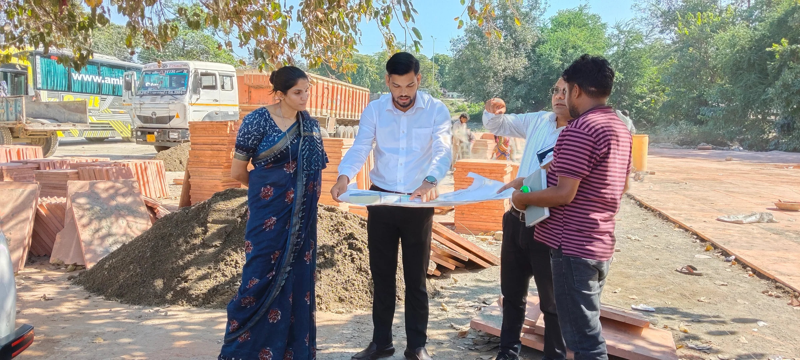
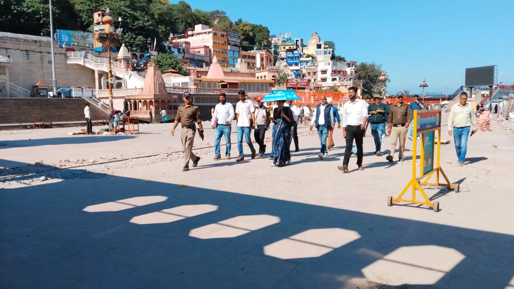
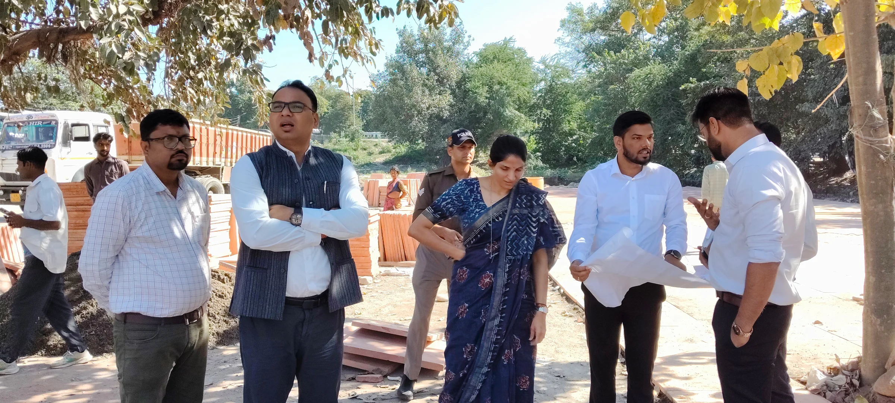
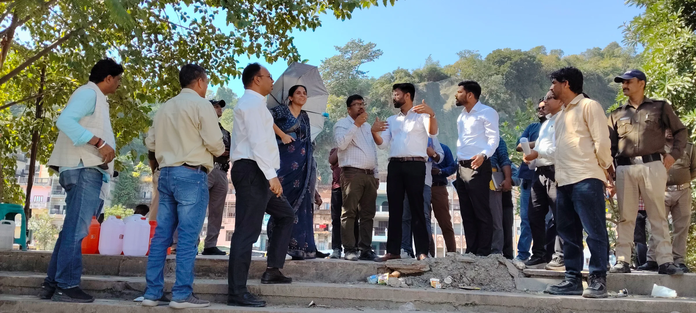

**हरिद्वार संवाददाता | आसिफ खान

हरिद्वार।** कुंभ मेला-2027 को लेकर हरिद्वार में तैयारियों ने रफ्तार पकड़ ली है। करोड़ों श्रद्धालुओं की आस्था के केंद्र हरिद्वार को कुंभ से पहले व्यवस्थित और सुविधाजनक बनाने के लिए मेला प्रशासन ने निर्माण कार्यों पर निगरानी तेज कर दी है। इसी क्रम में मेलाधिकारी श्रीमती सोनिका ने बुधवार को पंतद्वीप, कांगड़ा घाट और मालवीय द्वीप क्षेत्र का सघन स्थलीय निरीक्षण कर विकास कार्यों की प्रगति और गुणवत्ता का जायजा लिया। निरीक्षण के दौरान उन्होंने साफ निर्देश दिए कि कुंभ से जुड़े महत्वपूर्ण निर्माण कार्य हर हाल में समयबद्ध तरीके से पूरे किए जाएं और गुणवत्ता के मामले में किसी भी तरह की लापरवाही बर्दाश्त नहीं की जाएगी।

उत्तराखंड इंफ्रास्ट्रक्चर एंड इन्वेस्टमेंट डेवलपमेंट बोर्ड (यूआईआईडीबी) की ओर से हरकी पैड़ी के उत्तरवर्ती क्षेत्र के विकास के लिए संचालित परियोजना के तहत पंतद्वीप में विभिन्न कार्य कराए जा रहे हैं। मेलाधिकारी ने मौके पर पहुंचकर घाटों के निर्माण एवं अनुरक्षण, पार्किंग, वॉक-वे, वेंडिंग जोन, शौचालय, प्रकाश व्यवस्था, ड्रेनेज और सौंदर्यीकरण से जुड़े कार्यों की समीक्षा की। उन्होंने कार्यदायी संस्था यूपीडीसीसी के अधिकारियों को निर्देशित किया कि कुंभ मेला शुरू होने से पहले सभी आवश्यक कार्य पूरे कर लिए जाएं, ताकि श्रद्धालुओं को किसी भी प्रकार की परेशानी का सामना न करना पड़े।

**निर्माण कार्यों की गुणवत्ता पर मेलाधिकारी की पैनी नजर**

निरीक्षण के दौरान मेलाधिकारी ने वॉक-वे और वेंडिंग जोन के निर्माण में इस्तेमाल हो रहे सैंडस्टोन सहित अन्य निर्माण सामग्री की गुणवत्ता को परखा। टाइलिंग और फिनिशिंग के कार्यों का भी जायजा लिया गया। उन्होंने अधिकारियों को निर्देश दिए कि निर्माण सामग्री निर्धारित मानकों के अनुरूप होनी चाहिए और प्रत्येक कार्य की गुणवत्ता सुनिश्चित की जाए।

उन्होंने स्पष्ट किया कि निर्माण कार्यों में गुणवत्ता और समयबद्धता दोनों सर्वोच्च प्राथमिकता हैं। यदि कहीं भी कमी सामने आती है तो उसे तत्काल दूर किया जाए। कुंभ जैसे विशाल आयोजन में निर्माण की गुणवत्ता से जुड़ी लापरवाही श्रद्धालुओं की सुविधाओं और सुरक्षा पर भारी पड़ सकती है।

**भीड़ का दबाव बढ़ेगा, पहले से तैयार रहें अधिकारी**

कुंभ के दौरान पंतद्वीप क्षेत्र में श्रद्धालुओं की भारी भीड़ उमड़ने की संभावना को देखते हुए मेलाधिकारी ने भीड़ प्रबंधन और सुगम आवागमन पर विशेष जोर दिया। उन्होंने कहा कि वॉक-वे और एक-दूसरे से जुड़े घाटों पर श्रद्धालुओं की आवाजाही निर्बाध रहनी चाहिए।

घाटों पर सुरक्षा के पुख्ता इंतजाम, पर्याप्त प्रकाश व्यवस्था और गंगा तटों की दूर से स्पष्ट दृश्यता सुनिश्चित करने के निर्देश दिए गए। मेलाधिकारी ने कहा कि श्रद्धालुओं को घाटों तक पहुंचने में किसी प्रकार की अनावश्यक परेशानी नहीं होनी चाहिए। इसके लिए सभी व्यवस्थाएं पहले से सुविचारित और व्यवस्थित तरीके से विकसित की जाएं।

पंतद्वीप क्षेत्र को अतिक्रमणमुक्त बनाए रखने, नियमित साफ-सफाई और सौंदर्यीकरण पर भी विशेष ध्यान देने के निर्देश दिए गए। अधिकारियों को स्पष्ट किया गया कि कुंभ के दौरान भीड़ का दबाव बढ़ने से पहले सभी व्यवस्थाएं दुरुस्त होनी चाहिए।

**कांगड़ा घाट और मालवीय द्वीप पर भी सुरक्षा व्यवस्था मजबूत करने के निर्देश**

मेलाधिकारी सोनिका ने पंतद्वीप के साथ कांगड़ा घाट और मालवीय द्वीप क्षेत्र का भी निरीक्षण किया। इस दौरान घाटों, पुलों और संपर्क मार्गों की स्थिति का जायजा लेते हुए उन्होंने भीड़ प्रबंधन के लिए प्रभावी व्यवस्थाएं विकसित करने के निर्देश दिए।

घाटों पर रेलिंग, चेन और अन्य आवश्यक सुरक्षा उपाय सुनिश्चित करने के साथ ही पूर्व में निर्मित घाटों के बेहतर अनुरक्षण पर भी जोर दिया गया। उन्होंने कहा कि पुराने निर्माणों की मरम्मत और रखरखाव भी कुंभ की तैयारियों का महत्वपूर्ण हिस्सा है। केवल नए निर्माण ही नहीं, बल्कि पहले से मौजूद सुविधाओं को भी दुरुस्त करना जरूरी है।

**गंग नहर बंदी के दौरान होगी घाटों और पुलों की मरम्मत**

गंग नहर की प्रस्तावित बंदी की अवधि को महत्वपूर्ण मानते हुए मेलाधिकारी ने अधिकारियों को निर्देश दिए कि इस दौरान घाटों और पुलों के उन हिस्सों की मरम्मत एवं पेंटिंग तत्काल कराई जाए, जो सामान्य परिस्थितियों में पानी में डूबे रहते हैं।

इसके साथ ही गंगा तटवर्ती भवनों और आश्रमों में फसाड योजना के अनुरूप रंग-रोगन कराने के निर्देश भी दिए गए। उद्देश्य है कि कुंभ से पहले गंगा तट के आसपास के क्षेत्र को सुव्यवस्थित, स्वच्छ और आकर्षक स्वरूप दिया जा सके।

**यूआईआईडीबी की परियोजनाओं पर लगातार निगरानी**

कुंभ मेला-2027 के लिए हरिद्वार में व्यापक स्तर पर अवस्थापना विकास के कार्य किए जा रहे हैं। यूआईआईडीबी की ओर से हरकी पैड़ी-रोड़ी बेलवाला क्षेत्र के पुनर्विकास और हरकी पैड़ी के उत्तरवर्ती क्षेत्र के विकास की महत्वपूर्ण परियोजनाएं संचालित की जा रही हैं।

इन परियोजनाओं के तहत विकसित होने वाली सुविधाएं कुंभ के दौरान श्रद्धालुओं के आवागमन, ठहराव, सुरक्षा और सुविधा के लिहाज से बेहद महत्वपूर्ण हैं। ऐसे में मेला प्रशासन की ओर से निर्माण कार्यों की प्रगति और गुणवत्ता की लगातार निगरानी की जा रही है।

कुंभ-2027 की तैयारियों में किसी भी स्तर पर ढिलाई की गुंजाइश नहीं है। मेला प्रशासन का लक्ष्य है कि समय से पहले सभी महत्वपूर्ण कार्य पूरे हों और हरिद्वार पहुंचने वाले श्रद्धालुओं को बेहतर सुविधाएं उपलब्ध कराई जा सकें।

निरीक्षण के दौरान नगर आयुक्त नंदन कुमार, अपर मेलाधिकारी दयानंद सरस्वती, उप मेलाधिकारी मनजीत सिंह, यूपीडीसीसी के परियोजना प्रबंधक आशीष भट्ट सहित अन्य अधिकारी उपस्थित रहे।
