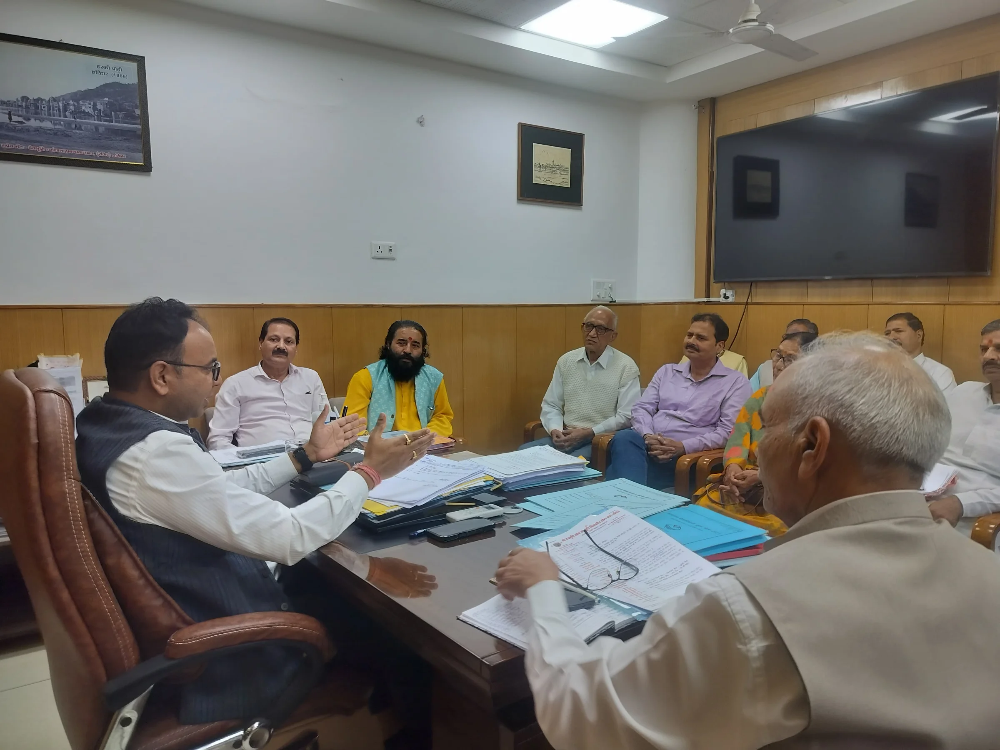
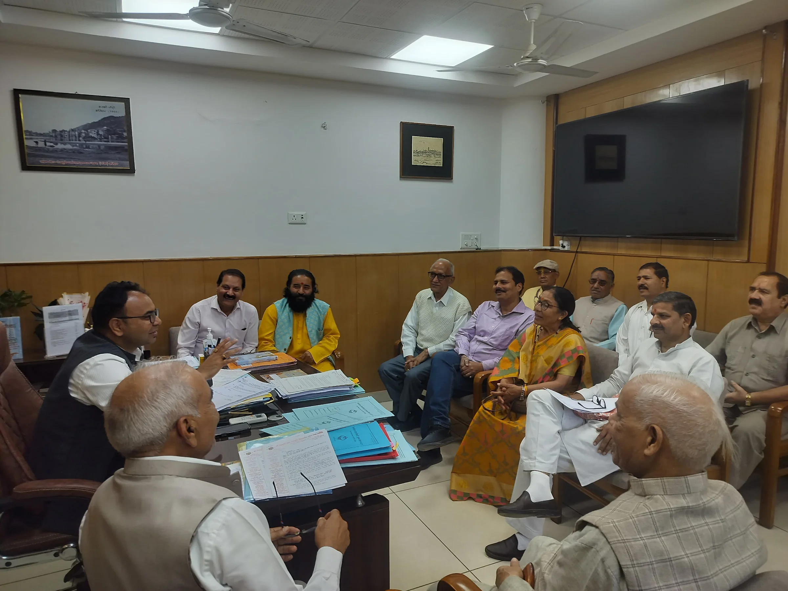

**हरिद्वार संवाददाता | आसिफ खान

हरिद्वार।** कुंभ मेला-2027 में इस बार देवभूमि उत्तराखंड की आस्था, लोक संस्कृति और सदियों पुरानी धार्मिक परंपराओं का भव्य संगम देखने को मिलेगा। प्रदेश के विभिन्न क्षेत्रों से आने वाली देव डोलियों की दिव्य शोभायात्रा और गंगा में अमृत स्नान कुंभ के प्रमुख आकर्षणों में शामिल होंगे। 15 मार्च 2027 को हरिद्वार में होने वाला देव डोलियों का अमृत स्नान देश-दुनिया के श्रद्धालुओं को देवभूमि की समृद्ध सांस्कृतिक विरासत से रूबरू कराएगा। इस ऐतिहासिक धार्मिक आयोजन को भव्य और व्यवस्थित स्वरूप देने के लिए मेला प्रशासन ने तैयारियों को तेज कर दिया है।

देवभूमि की लोक संस्कृति को वैश्विक पहचान दिलाने वाले इस आयोजन को लेकर शुक्रवार को मेला नियंत्रण भवन, हरिद्वार में अपर मेलाधिकारी श्री दयानंद सरस्वती की अध्यक्षता में देवभूमि लोक संस्कृति विरासत शोभायात्रा समिति के पदाधिकारियों के साथ महत्वपूर्ण बैठक आयोजित की गई। बैठक में देव डोलियों की शोभायात्रा, आवागमन मार्ग, ठहराव स्थलों, गंगा स्नान और श्रद्धालुओं की सुविधाओं को लेकर व्यापक मंथन किया गया।

**देव डोलियों की भव्यता और परंपरा पर रहेगा विशेष जोर**

कुंभ-2027 में देव डोलियों की शोभायात्रा को केवल धार्मिक आयोजन ही नहीं, बल्कि उत्तराखंड की सांस्कृतिक पहचान के भव्य प्रदर्शन के रूप में भी देखा जा रहा है। बैठक में शोभायात्रा के पारंपरिक स्वरूप को बनाए रखने, देव डोलियों के आवागमन को सुगम बनाने और श्रद्धालुओं के लिए बेहतर व्यवस्थाएं सुनिश्चित करने पर जोर दिया गया।

आयोजन में प्रदेश के विभिन्न क्षेत्रों से देव डोलियों के साथ बड़ी संख्या में श्रद्धालुओं और प्रतिनिधियों के पहुंचने की संभावना को देखते हुए व्यवस्थाओं को मजबूत बनाने पर चर्चा हुई। संबंधित विभागों के बीच बेहतर समन्वय स्थापित कर आयोजन को व्यवस्थित ढंग से संपन्न कराने की रणनीति पर भी विचार किया गया।

**अपर मेलाधिकारी बोले—धार्मिक गरिमा के साथ होगा भव्य आयोजन**

अपर मेलाधिकारी श्री दयानंद सरस्वती ने कहा कि कुंभ मेला-2027 में देव डोलियों की शोभायात्रा और अमृत स्नान उत्तराखंड की समृद्ध लोक संस्कृति, धार्मिक मान्यताओं और प्राचीन परंपराओं को व्यापक पहचान दिलाने का महत्वपूर्ण अवसर होगा। इस आयोजन के माध्यम से देश-विदेश से हरिद्वार पहुंचने वाले श्रद्धालुओं को देवभूमि की विशिष्ट सांस्कृतिक विरासत और लोक आस्था को करीब से जानने का अवसर मिलेगा।

उन्होंने कहा कि देव डोलियों की शोभायात्रा और अमृत स्नान को पूरी भव्यता के साथ संपन्न कराया जाएगा। आयोजन की धार्मिक गरिमा और पारंपरिक स्वरूप को बनाए रखते हुए देव डोलियों के आवागमन, ठहराव, स्नान तथा श्रद्धालुओं की सुविधा और सुरक्षा के लिए समुचित व्यवस्थाएं सुनिश्चित की जाएंगी। मेला प्रशासन आयोजन समिति और संबंधित विभागों के साथ समन्वय स्थापित कर तैयारियों को आगे बढ़ा रहा है।

**14 मार्च को ऋषिकेश, 15 मार्च को हरिद्वार में होगा आयोजन**

देवभूमि लोक संस्कृति विरासत शोभायात्रा समिति के पदाधिकारियों ने बैठक में बताया कि देव डोलियों के आगमन और उनके साथ आने वाले प्रतिनिधियों एवं श्रद्धालुओं की व्यवस्थाओं को लेकर तैयारियां की जा रही हैं।

समिति के अनुसार, 14 मार्च 2027 को ऋषिकेश में देव डोलियों की भव्य शोभायात्रा आयोजित की जाएगी, जबकि 15 मार्च 2027 को हरिद्वार में देव डोलियों का अमृत स्नान होगा। इस आयोजन के माध्यम से उत्तराखंड की धार्मिक परंपराओं और लोक संस्कृति को कुंभ के वैश्विक मंच पर विशेष पहचान दिलाने का प्रयास किया जाएगा।

**बैठक में ये रहे मौजूद**

बैठक में देवभूमि लोक संस्कृति विरासत शोभायात्रा समिति के कार्यकारी अध्यक्ष श्री हर्षमणि व्यास, श्री विपिन जोशी, श्री बंशीधर पोखरियाल, श्री द्वारिका भट्ट, श्री रमेश पैन्यूली, श्री गजेंद्र सिंह कंडियाल, श्री भगवान सिंह रांगड़, श्री प्रमोद डोभाल, श्री जसराम ढोंढियाल, श्री मुकेश जोशी और आचार्य भवानी दत्त मैंदोलिया सहित समिति के सदस्य एवं संबंधित अधिकारी उपस्थित रहे।
