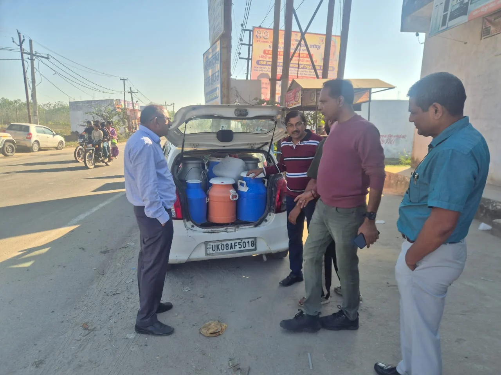
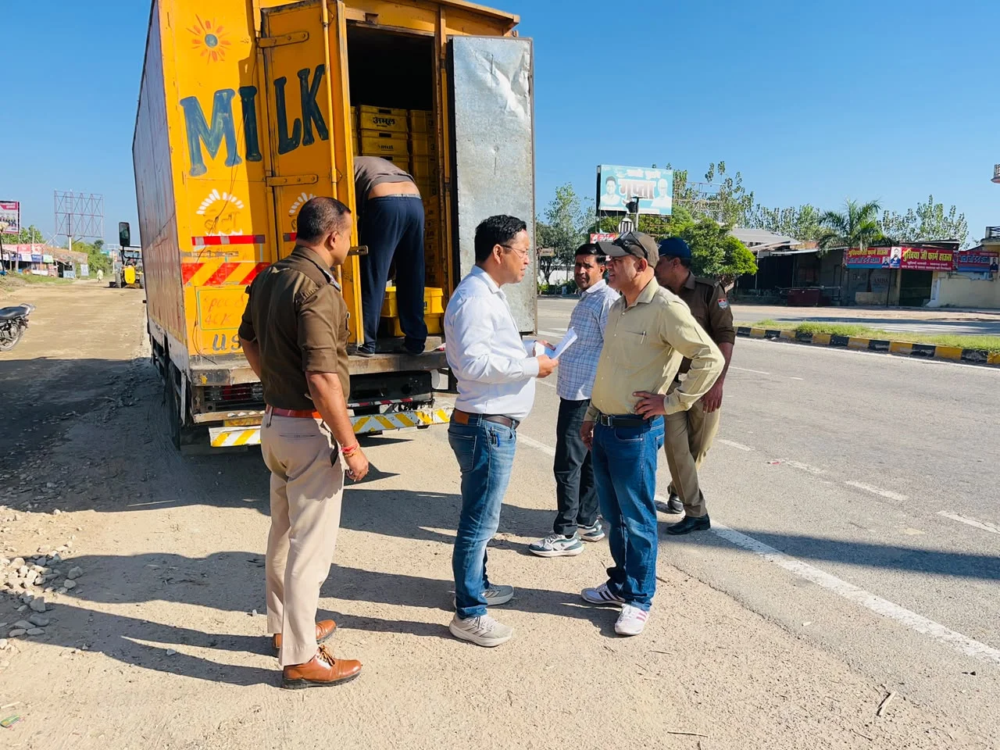
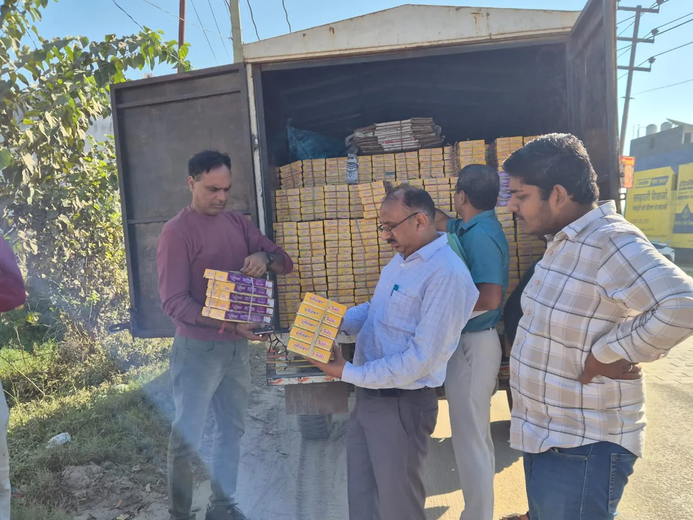

**हरिद्वार संवाददाता | आसिफ खान

हरिद्वार।** दीपावली के त्योहार पर मिठाइयों और खाद्य पदार्थों में मिलावट की आशंका के बीच खाद्य सुरक्षा विभाग ने हरिद्वार में सख्त रुख अपना लिया है। त्योहार से पहले आमजन की सेहत से खिलवाड़ रोकने के लिए विभाग ने जनपद में विशेष निरीक्षण एवं नमूना संग्रह अभियान तेज कर दिया है। दूध, गजक, पेड़ा, पनीर, मावा और मावा बर्फी सहित विभिन्न खाद्य पदार्थों की जांच के लिए कुल 13 विधिक नमूने एकत्र कर प्रयोगशाला भेजे गए हैं। वहीं, खाद्य सामग्री की आपूर्ति करने वाले वाहनों की सघन जांच के दौरान कई अनियमितताएं सामने आईं, जिन पर संबंधित संचालकों को नोटिस जारी किए गए हैं।

खाद्य सुरक्षा एवं औषधि प्रशासन की इस कार्रवाई ने त्योहार के दौरान खाद्य पदार्थों की गुणवत्ता और भंडारण व्यवस्था पर गंभीर सवाल खड़े कर दिए हैं। विभाग ने साफ किया है कि खाद्य सुरक्षा नियमों की अनदेखी करने वाले प्रतिष्ठानों और वाहन संचालकों के खिलाफ कार्रवाई जारी रहेगी।

**भेड़पुर चौराहा, भगवानपुर और सिडकुल में सघन जांच**

माननीय खाद्य सुरक्षा आयुक्त विनय शंकर पांडेय एवं जिलाधिकारी मयूर दीक्षित के निर्देशों के अनुपालन में जनपद में विशेष अभियान चलाया जा रहा है। इसी क्रम में 28 अक्टूबर 2026 को सहायक आयुक्त, खाद्य सुरक्षा एवं औषधि प्रशासन हरिद्वार महिमानंद जोशी के नेतृत्व में विभागीय टीम ने भेड़पुर चौराहा, भगवानपुर और सिडकुल क्षेत्र में खाद्य पदार्थों की आपूर्ति करने वाले वाहनों, मिठाई वाहनों और दूध वाहनों का निरीक्षण किया।

टीम में वरिष्ठ खाद्य सुरक्षा अधिकारी दिलीप जैन, योगेंद्र पांडेय एवं पवन कुमार शामिल रहे। निरीक्षण के दौरान खुले दूध के चार और गजक मिठाई के दो नमूने प्रयोगशाला जांच के लिए लिए गए।

**गजक निर्माता पर कार्रवाई, दूध वाहनों को भी नोटिस**

निरीक्षण के दौरान भगवानपुर स्थित गजक निर्माता कंपनी वैश्य इंटरप्राइजेज की ओर से इनवॉइस पर अनिवार्य एफएसएसएआई (FSSAI) लाइसेंस नंबर अंकित नहीं किए जाने का मामला सामने आया। गजक के पैकेट पर बैच नंबर और अन्य आवश्यक लेबल संबंधी प्रावधानों का पालन नहीं किए जाने पर कंपनी को नोटिस जारी किया गया।

वहीं, एक दूध वाहन मालिक मौके पर सप्लाई का फूड लाइसेंस प्रस्तुत नहीं कर सका। इस पर संबंधित वाहन संचालक को नोटिस दिया गया। इसके अतिरिक्त दो वाहनों में तापमान नियंत्रण की उचित व्यवस्था के बिना दूध का विक्रय किए जाने पर भी विभाग ने नोटिस जारी किए।

खाद्य पदार्थों की आपूर्ति में नियमों की अनदेखी को विभाग ने गंभीरता से लिया है। अधिकारियों का कहना है कि खाद्य सामग्री की गुणवत्ता के साथ किसी भी प्रकार का समझौता बर्दाश्त नहीं किया जाएगा।

**रिलायंस डिस्ट्रीब्यूशन सेंटर में गंदगी और भंडारण की खामियां**

खाद्य सुरक्षा विभाग की टीम ने सिडकुल स्थित रिलायंस स्टोर्स के डिस्ट्रीब्यूशन सेंटर का भी निरीक्षण किया। यहां पेड़ा मिठाई के दो नमूने जांच के लिए संग्रहित किए गए। निरीक्षण के दौरान सामने आई अनियमितताओं के चलते डिस्ट्रीब्यूशन सेंटर को इम्प्रूवमेंट नोटिस जारी किया गया।

जांच में तापमान नियंत्रित रखने वाले चिलर पैड गंदे पाए गए। वहीं, बॉक्स के ऊपर और अंदर धूल जमा मिली। सफाई एवं सैनिटाइजेशन में इस्तेमाल होने वाले कीटनाशक और अन्य रसायन, एक्सपायरी के करीब वाले उत्पादों के क्षेत्र तथा स्वीकृत उत्पादों के भंडारण क्षेत्र के बीच रखे पाए गए।

इतना ही नहीं, सामान की आवाजाही करने वाले वाहनों की सफाई से संबंधित रिकॉर्ड भी उपलब्ध नहीं मिले। इन खामियों को देखते हुए सेंटर को सुधारात्मक कार्रवाई के लिए नोटिस जारी करने की संस्तुति की गई।

खाद्य सुरक्षा मानकों के तहत स्वच्छता, तापमान नियंत्रण और उत्पादों के सुरक्षित भंडारण की व्यवस्था अनिवार्य है। ऐसे में निरीक्षण के दौरान मिली खामियों को विभाग ने गंभीरता से लिया है।

**नारसन बॉर्डर पर बाहरी राज्यों से आने वाले खाद्य वाहनों की जांच**

दीपावली पर मिलावटी खाद्य पदार्थों की आपूर्ति रोकने के लिए विभाग ने उत्तराखंड की सीमाओं पर भी निगरानी बढ़ा दी है। वरिष्ठ खाद्य सुरक्षा अधिकारी कैलाश चंद्र टम्टा एवं कपिल देव की टीम ने पुलिस विभाग के साथ नारसन पुलिस चेक पोस्ट पर बाहरी राज्यों से उत्तराखंड में प्रवेश करने वाले खाद्य एवं पेय पदार्थों के वाहनों की सघन जांच की।

इस दौरान नारसन क्षेत्र से दूध, पनीर, मावा और मावा बर्फी सहित कुल चार खाद्य नमूने प्रयोगशाला जांच के लिए एकत्र किए गए।

**हरिद्वार में मिठाई दुकानों और कारखानों पर भी नजर**

वरिष्ठ खाद्य सुरक्षा अधिकारी कैलाश चंद्र टम्टा ने नगर निगम क्षेत्र हरिद्वार में विभिन्न मिठाई विक्रेता प्रतिष्ठानों का निरीक्षण किया। इस दौरान मिठाइयों और बेकरी उत्पादों पर निर्माण तिथि तथा उपयोग की अंतिम तिथि प्रदर्शित करने संबंधी आदेशों के अनुपालन की जांच की गई।

मिठाई निर्माण करने वाले कारखानों का भी निरीक्षण किया गया। इस दौरान एक मिठाई कारखाने से पेड़ा का एक नमूना प्रयोगशाला जांच के लिए लिया गया।

**13 नमूने जांच को भेजे, दीपावली तक जारी रहेगा अभियान**

खाद्य सुरक्षा विभाग की ओर से चलाए गए विशेष अभियान के तहत जनपद में कुल 13 खाद्य पदार्थों के विधिक नमूने संग्रहित कर प्रयोगशाला जांच के लिए भेजे गए हैं।

विभाग का कहना है कि दीपावली पर्व के दौरान आमजन को सुरक्षित एवं गुणवत्तापूर्ण खाद्य सामग्री उपलब्ध कराना प्राथमिकता है। खाद्य पदार्थों की गुणवत्ता सुनिश्चित करने के लिए निरीक्षण, नमूना संग्रह और नियमों का उल्लंघन करने वाले प्रतिष्ठानों के विरुद्ध आवश्यक कार्रवाई लगातार जारी रहेगी।

खाद्य सुरक्षा विभाग की इस कार्रवाई से मिलावटखोरों और नियमों की अनदेखी करने वाले खाद्य कारोबारियों में हड़कंप मचा हुआ है। अब प्रयोगशाला जांच की रिपोर्ट पर भी नजर रहेगी, जिससे खाद्य पदार्थों की गुणवत्ता को लेकर स्थिति और स्पष्ट हो सकेगी।
