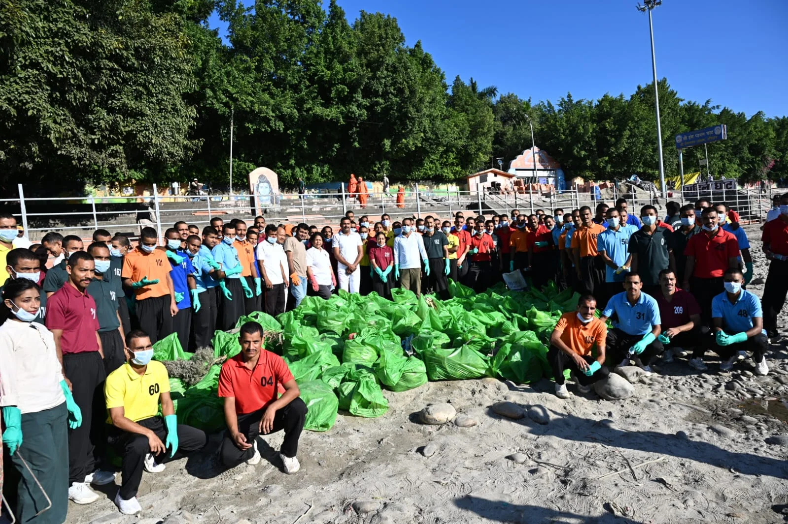
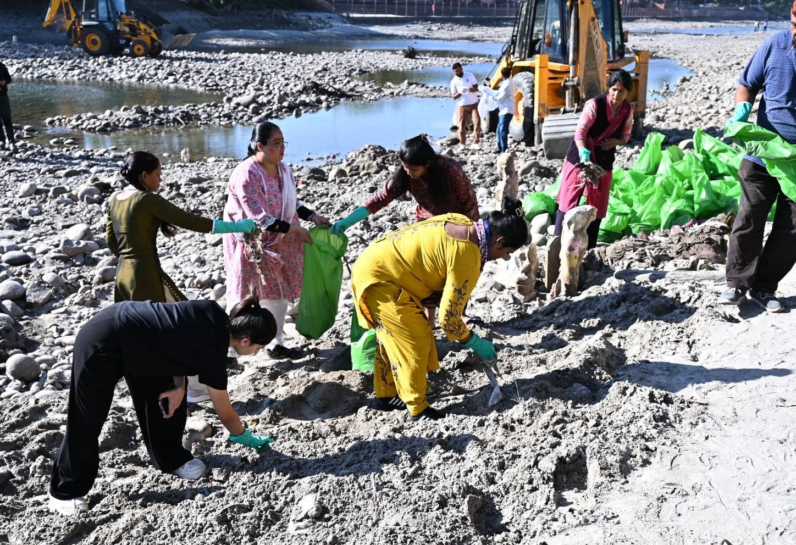
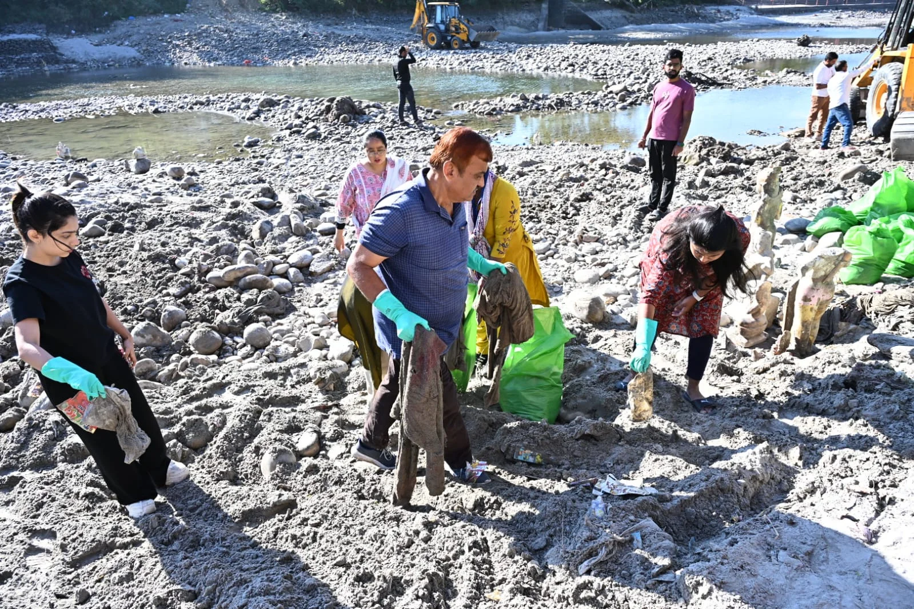
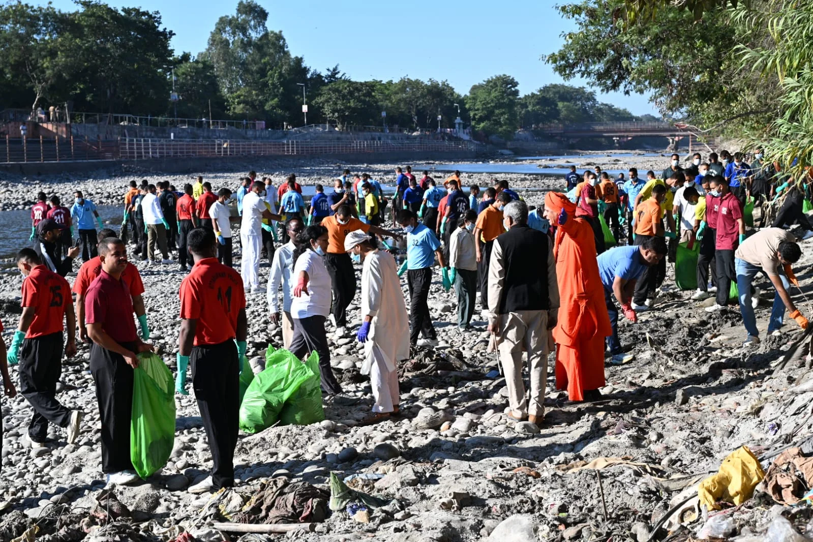

**हरिद्वार संवाददाता | आसिफ खान

हरिद्वार।** कुंभ मेला-2027 की तैयारियों को लेकर हरिद्वार में स्वच्छता अभियान ने अब व्यापक रूप ले लिया है। मुख्यमंत्री पुष्कर सिंह धामी के निर्देशों पर गंगा घाटों, मंदिर परिसरों, सार्वजनिक स्थलों और ग्रामीण क्षेत्रों को स्वच्छ एवं व्यवस्थित बनाने के लिए चलाया जा रहा विशेष स्वच्छता महाअभियान आठवें दिन भी जोरदार तरीके से जारी रहा। कुंभ मेलाधिकारी सोनिका एवं जिलाधिकारी मयूर दीक्षित के नेतृत्व में चलाए जा रहे इस अभियान में प्रशासनिक अधिकारियों से लेकर पुलिसकर्मियों, स्कूली छात्र-छात्राओं, एनएसएस स्वयंसेवियों और सामाजिक संस्थाओं ने बढ़-चढ़कर भागीदारी की।

अभियान के दौरान विभिन्न घाटों एवं क्षेत्रों से लगभग 16 टन गीला और सूखा कूड़ा एकत्रित किया गया। प्रेम नगर आश्रम पुल से सिंहद्वार पुल तक चले विशेष सफाई अभियान में बड़ी मात्रा में कूड़ा-कचरा हटाकर स्वच्छता का संदेश दिया गया। कुंभ से पहले हरिद्वार को स्वच्छ, सुंदर और व्यवस्थित बनाने के लिए जिला प्रशासन ने जनसहभागिता के साथ सफाई अभियान को व्यापक स्तर पर आगे बढ़ाया है।

**250 प्रशिक्षु पुलिसकर्मियों ने संभाली सफाई की कमान**

प्रेम नगर आश्रम पुल से सिंहद्वार पुल तक गंगा घाटों एवं आसपास के क्षेत्रों में चलाए गए अभियान में पुलिस लाइन के लगभग 250 प्रशिक्षु कर्मियों ने प्रतिभाग किया। जिला आपदा प्रबंधन अधिकारी मीरा रावत एवं सीओ ट्रैफिक बिपेंदर सिंह के मार्गदर्शन में संचालित अभियान में प्रेम नगर आश्रम के महाप्रबंधक महात्मा सौम्यानंद के नेतृत्व में लगभग 40 कार्यकर्ताओं ने भी सफाई कार्य में योगदान दिया।

भुवनेश्वरी महिला आश्रम एवं आईटीसी मिशन सुनहरा कल की टीम के 18 स्वयंसेवकों ने भी अभियान में हिस्सा लिया। अभियान के दौरान लगभग 12 टन कूड़ा-कचरा एकत्रित कर निस्तारण के लिए नगर निगम को सौंपा गया।

**गोविंद घाट से चंडी घाट तक चला सफाई अभियान**

स्वच्छता महाअभियान के तहत इनरव्हील क्लब हरिद्वार की ओर से गोविंद घाट पर सफाई अभियान चलाया गया। इसमें मुख्य अतिथि महापौर किरण जैसल एवं गोविंदपुरी की पार्षद ममता नेगी ने प्रतिभाग किया।

वहीं, जिला पंचायत की ओर से नमामि गंगे घाट, चंडी घाट पर विशेष स्वच्छता अभियान चलाया गया। यहां 65 किलोग्राम प्लास्टिक कचरा और 325 किलोग्राम गीला कचरा एकत्रित किया गया। भारत स्काउट्स एवं गाइड्स के सदस्यों ने नाई घाट पहुंचकर मां गंगा के घाटों की सफाई की।

**सतनाम साक्षी घाट पर 2 टन कपड़े एकत्रित**

विशेष स्वच्छता महाअभियान के अंतर्गत बुधवार, 28 अक्टूबर 2026 को सतनाम साक्षी घाट पर भी गंगा स्वच्छता अभियान संचालित किया गया। डेवलपमेंट अल्टरनेटिव्स एवं आदर्श युवा समिति की टीम के 20 स्वयंसेवकों ने घाट क्षेत्र में सफाई करते हुए लगभग 100 बैग कपड़े एकत्रित किए। इनका कुल वजन करीब 2 टन बताया गया। एकत्रित कपड़ों को उचित निस्तारण के लिए नगर निगम को सुपुर्द किया गया।

इसके अतिरिक्त भारत स्काउट गाइड की ओर से नाई सोता घाट पर भी स्वच्छता अभियान चलाया गया।

**कुंभ से पहले स्वच्छता को लेकर प्रशासन का सख्त फोकस**

कुंभ मेला-2027 की तैयारियों के मद्देनजर जिला प्रशासन स्वच्छता अभियान को जनसहभागिता के माध्यम से व्यापक स्वरूप दे रहा है। गंगा घाटों, मंदिर परिसरों, सार्वजनिक स्थलों और ग्रामीण बाजारों को स्वच्छ बनाए रखने के साथ-साथ नागरिकों में स्वच्छता के प्रति जिम्मेदारी और जागरूकता विकसित करना अभियान का प्रमुख उद्देश्य है।

इसके लिए विभिन्न विभागों, स्वयंसेवी संगठनों, सामाजिक संस्थाओं, शैक्षणिक संस्थानों और स्थानीय नागरिकों की सहभागिता सुनिश्चित की जा रही है।

जिला प्रशासन ने जनपदवासियों से अपील की है कि वे स्वच्छता महाअभियान में बढ़-चढ़कर हिस्सा लें, गंगा घाटों एवं सार्वजनिक स्थलों पर कूड़ा-कचरा न फैलाएं और कचरे का उचित निस्तारण सुनिश्चित करने में सहयोग दें।

प्रशासन का कहना है कि जनसहभागिता और सामूहिक प्रयासों से कुंभ मेला-2027 से पहले हरिद्वार को स्वच्छ, सुंदर एवं व्यवस्थित बनाने के लक्ष्य को हासिल किया जा सकता है।

**ये रहे अभियान में शामिल**

अभियान के दौरान प्रेम नगर आश्रम के महाप्रबंधक महात्मा सौम्यानंद, जिला आपदा प्रबंधन अधिकारी मीरा रावत, नगर स्वास्थ्य अधिकारी पवन कार्की, प्रबंधक पवन कुमार, सीएसआई श्रीकांत, सीआई मोहित कुमार सहित पुलिसकर्मी, स्वयंसेवी संस्थाओं के प्रतिनिधि और स्थानीय नागरिक मौजूद रहे।

कुंभ-2027 की तैयारियों के बीच स्वच्छता का यह महाअभियान हरिद्वार को स्वच्छ रखने की दिशा में प्रशासन और जनसहभागिता के संयुक्त प्रयासों की तस्वीर पेश कर रहा है।
