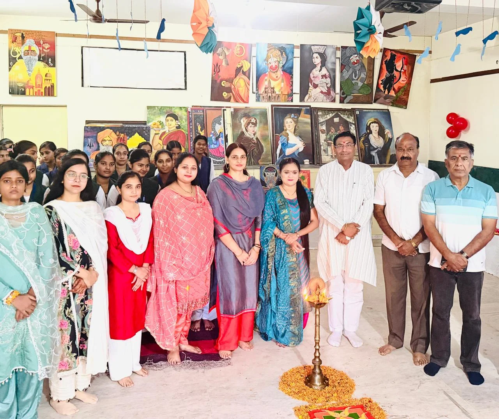

**रुड़की संवाददाता | आसिफ खान

रुड़की।** दीपावली के पावन पर्व पर श्री सनातन धर्म प्रकाश चन्द्र कन्या स्नातकोत्तर महाविद्यालय, रुड़की में रचनात्मकता, कलात्मक प्रतिभा और भारतीय संस्कृति का अनूठा संगम देखने को मिला। महाविद्यालय के बीएससी एवं एमए विभाग की ओर से दीपोत्सव के उपलक्ष्य में अनुपयोगी एवं अपशिष्ट सामग्री से निर्मित भव्य कलाकृतियों की प्रदर्शनी और मेहंदी प्रतियोगिता का आयोजन किया गया। छात्राओं ने अपनी प्रतिभा के दम पर न केवल आकर्षक कलाकृतियां तैयार कीं, बल्कि पर्यावरण संरक्षण और भारतीय सांस्कृतिक परंपराओं का भी प्रभावशाली संदेश दिया।

कार्यक्रम का शुभारंभ महाविद्यालय के सचिव एवं मुख्य अतिथि श्री सौरभ भूषण शर्मा, उपसचिव श्री गोपाल गुप्ता तथा समिति सदस्य श्री योगेश गर्ग ने प्रदर्शनी का फीता काटकर और मां सरस्वती के चित्र के समक्ष दीप प्रज्वलित कर किया। इस दौरान छात्राओं में खासा उत्साह देखने को मिला।

**कचरे से कलाकृति बनाने का हुनर, पर्यावरण संरक्षण का संदेश**

दीपोत्सव प्रदर्शनी में छात्राओं ने अनुपयोगी एवं अपशिष्ट सामग्री का रचनात्मक उपयोग करते हुए आकर्षक कलाकृतियां तैयार कीं। इन कलाकृतियों ने यह साबित किया कि कल्पनाशीलता और कलात्मक दृष्टिकोण के दम पर बेकार समझी जाने वाली वस्तुओं को भी सुंदर एवं उपयोगी बनाया जा सकता है।

प्रदर्शनी के माध्यम से छात्राओं ने पर्यावरण संरक्षण, पुनः उपयोग और रचनात्मक सोच का संदेश दिया। वहीं दीपावली के महत्व पर सुंदर भाषण, कविता-पाठ और मनमोहक नृत्य प्रस्तुतियों ने कार्यक्रम में सांस्कृतिक रंग भर दिए।

**मेहंदी की विभिन्न शैलियों ने मोहा मन**

कार्यक्रम के अंतर्गत आयोजित मेहंदी प्रतियोगिता में छात्राओं ने बढ़-चढ़कर प्रतिभाग किया। भारतीय, अरबी, पाकिस्तानी, पोर्ट्रेट और मंडला मेहंदी की विभिन्न शैलियों में छात्राओं ने अपनी कलात्मक प्रतिभा का शानदार प्रदर्शन किया। एक-दूसरे के हाथों पर रची गई आकर्षक मेहंदी की डिजाइनों ने उपस्थित अतिथियों का मन मोह लिया।

महाविद्यालय के सचिव श्री सौरभ भूषण शर्मा, उपसचिव श्री गोपाल गुप्ता तथा समिति सदस्य श्री योगेश गर्ग ने प्रदर्शनी का अवलोकन किया और छात्राओं द्वारा तैयार कलाकृतियों एवं मेहंदी डिजाइनों की सराहना की।

**संस्कृति और रचनात्मकता का प्रतीक हैं ऐसे आयोजन: सौरभ भूषण शर्मा**

मुख्य अतिथि एवं महाविद्यालय सचिव श्री सौरभ भूषण शर्मा ने सभी प्रतिभागी छात्राओं को दीपोत्सव एवं प्रतियोगिताओं की शुभकामनाएं देते हुए कहा कि इस प्रकार के आयोजन छात्राओं की कला एवं प्रतिभा को निखारने का महत्वपूर्ण माध्यम हैं। ये आयोजन हमारी समृद्ध संस्कृति, परंपराओं और सामूहिक उल्लास के प्रतीक भी हैं।

उन्होंने कहा कि दीपावली का पर्व हमें अंधकार से प्रकाश की ओर बढ़ने का संदेश देता है। छात्राओं द्वारा निर्मित कलाकृतियां और उनके हाथों पर सजी सुंदर मेहंदी इसी प्रकाश, सृजनशीलता और खुशियों को बिखेर रही हैं। उन्होंने छात्राओं को भविष्य में भी ऐसे रचनात्मक कार्यक्रमों में सक्रिय भागीदारी करने और जीवन में निरंतर आगे बढ़ने के लिए प्रेरित किया।

**हर छात्रा में छिपी है विशेष प्रतिभा: डॉ. मधु मेहरा**

कार्यक्रम की अध्यक्षता कर रहीं महाविद्यालय की स्ववित्तपोषित प्रभारी डॉ. मधु मेहरा ने छात्राओं को दीपोत्सव प्रदर्शनी एवं मेहंदी प्रतियोगिता की बधाई देते हुए उनका उत्साहवर्धन किया।

उन्होंने कहा कि प्रत्येक छात्रा के भीतर कोई न कोई विशेष प्रतिभा अवश्य होती है। आवश्यकता केवल उसे पहचानने, निखारने और उचित मंच प्रदान करने की है। छात्राओं को अपनी कलात्मक ऊर्जा, रचनात्मकता और उत्साह को सदैव बनाए रखना चाहिए।

उन्होंने कहा कि जिस प्रकार दीपक स्वयं प्रकाशमान होकर दूसरों के जीवन में उजाला फैलाता है, उसी प्रकार छात्राओं को भी अपने ज्ञान, प्रतिभा और सकारात्मक विचारों से अपने जीवन तथा समाज को प्रकाशित करना चाहिए।

**प्रदर्शनी में ख्याति ने हासिल किया प्रथम स्थान**

प्रदर्शनी में छात्राओं द्वारा निर्मित आकर्षक कलाकृतियों के आधार पर विजेताओं का चयन किया गया।

**प्रदर्शनी के विजेता

प्रथम स्थान: ख्याति — एमए तृतीय सेमेस्टर, ड्राइंग विभाग
द्वितीय स्थान: स्वाति — एमए प्रथम सेमेस्टर, ड्राइंग विभाग
तृतीय स्थान: ज़ीनत — एमए तृतीय सेमेस्टर, ड्राइंग विभाग एवं सना — बीएससी प्रथम सेमेस्टर
सांत्वना पुरस्कार: नाज़िया परवीन — एमए तृतीय सेमेस्टर, राजनीति विज्ञान एवं अनुष्का — बीएससी प्रथम सेमेस्टर
मेहंदी प्रतियोगिता में नाजिया ने मारी बाजी**

मेहंदी प्रतियोगिता में छात्राओं ने अपनी कलात्मक प्रतिभा के दम पर आकर्षक डिजाइनों का प्रदर्शन किया। प्रतियोगिता के परिणाम इस प्रकार रहे—

**प्रथम स्थान: नाजिया — बीएससी प्रथम सेमेस्टर
द्वितीय स्थान: महक — प्रथम सेमेस्टर, ड्राइंग विभाग
तृतीय स्थान: शहरीन — तृतीय सेमेस्टर, राजनीति विज्ञान विभाग**
**प्रवक्तागण सहित महाविद्यालय परिवार रहा मौजूद**

कार्यक्रम में श्रीमती संदीपा, श्रीमती राधा, श्रीमती प्रियंका, सुश्री फिरदौस, सुश्री आंचल, सुश्री शिवानी, सुश्री अंजलि, सुश्री तनु एवं सुश्री ज्योति सहित महाविद्यालय की समस्त प्रवक्तागण उपस्थित रहीं।

कार्यक्रम ने छात्राओं को अपनी रचनात्मक प्रतिभा प्रदर्शित करने का अवसर प्रदान करने के साथ-साथ भारतीय संस्कृति, परंपराओं और पर्यावरण संरक्षण के प्रति जागरूकता का संदेश भी दिया। उत्साह, उमंग, रचनात्मकता और सांस्कृतिक सौहार्द के वातावरण में दीपोत्सव प्रदर्शनी एवं मेहंदी प्रतियोगिता सफलतापूर्वक संपन्न हुई।
