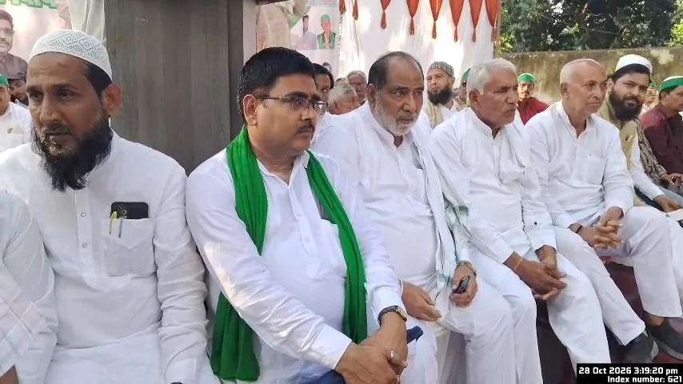
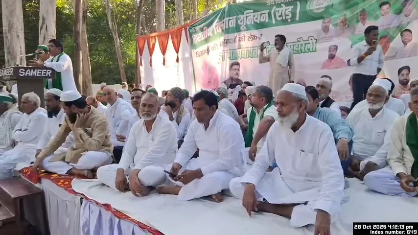
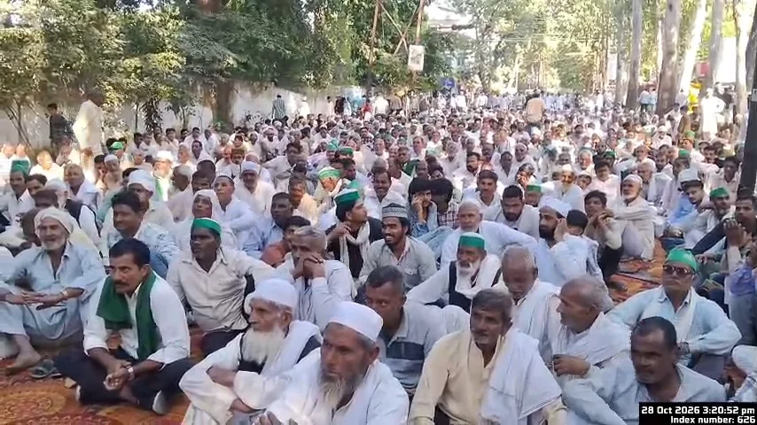
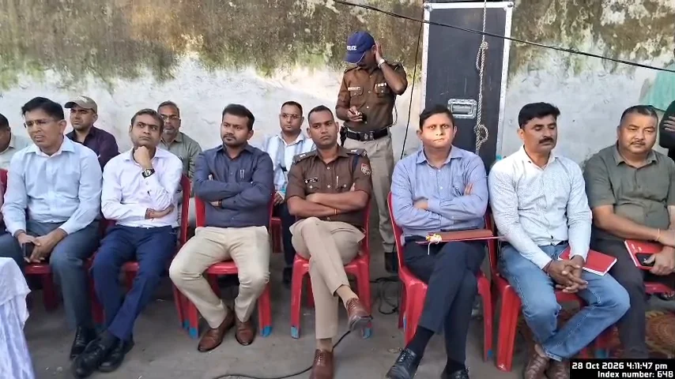

**रुड़की संवाददाता | आसिफ खान** 

रुड़की में किसानों की समस्याओं को लेकर भारतीय किसान यूनियन (रोड़) ने सरकार और प्रशासन के खिलाफ जोरदार हुंकार भरी। एसडीएम चौक के पास आयोजित महापंचायत में जिले के विभिन्न क्षेत्रों से पहुंचे किसानों ने अपनी समस्याओं को प्रमुखता से उठाते हुए सरकार और पूंजीपतियों पर किसानों के शोषण का आरोप लगाया। महापंचायत में गन्ना भुगतान, फसल मुआवजा, बिजली, चकबंदी और किसानों की मूलभूत समस्याओं को लेकर आक्रोश देखने को मिला।

महापंचायत के बाद किसानों ने ज्वाइंट मजिस्ट्रेट दीपक रामचंद्र सेठ को 14 सूत्रीय मांग पत्र सौंपा। किसानों ने स्पष्ट किया कि उनकी समस्याओं का समाधान प्राथमिकता के आधार पर किया जाना चाहिए। ज्ञापन मुख्यमंत्री पुष्कर सिंह धामी को भी भेजा जाएगा।

**किसानों की समस्याओं पर सरकार को घेरा**

महापंचायत को संबोधित करते हुए भारतीय किसान यूनियन (रोड़) के राष्ट्रीय अध्यक्ष चौधरी पदम सिंह रोड़ ने कहा कि किसानों को अपनी जायज मांगों के समाधान के लिए बार-बार आवाज उठानी पड़ रही है। उन्होंने कहा कि किसान देश की अर्थव्यवस्था की रीढ़ हैं, लेकिन इसके बावजूद किसानों को अपनी समस्याओं के समाधान के लिए संघर्ष करना पड़ रहा है।

उन्होंने सरकार और प्रशासन से किसानों के हितों की रक्षा करने तथा उनकी समस्याओं पर समयबद्ध कार्रवाई करने की मांग की। किसानों का कहना था कि यदि उनकी समस्याओं को गंभीरता से नहीं लिया गया तो उन्हें अपने हक के लिए आंदोलन का रास्ता अपनाने को मजबूर होना पड़ेगा।

**गन्ना भुगतान से लेकर फसल मुआवजे तक, 14 सूत्रीय मांगों में उठे कई मुद्दे**

महापंचायत में किसानों ने चकबंदी अधिकारियों के कथित उत्पीड़न पर रोक लगाने, खेतों से पानी की निकासी की समस्या दूर करने और एआरटीओ के चालान से जुड़ी समस्याओं का समाधान कराने की मांग उठाई।

किसानों ने बिजली कनेक्शन की समस्याओं को दूर करने, पात्र लोगों के राशन कार्ड बनवाने और इकबालपुर शुगर मिल से बकाया गन्ना भुगतान दिलाने की मांग भी प्रमुखता से रखी। इसके साथ ही खराब फसलों का उचित मुआवजा देने की मांग उठाई गई।

किसानों ने टोल प्लाजा पर वसूली बंद करने, सोलर प्लांट से संबंधित छूट उपलब्ध कराने और ढंडेरा के तालाबों से अतिक्रमण हटाने की मांग की। खाद, बीज और फसल में इस्तेमाल होने वाली दवाओं की उपलब्धता सुनिश्चित करने का मुद्दा भी महापंचायत में छाया रहा।

इसके अलावा पेयजल आपूर्ति बहाल करने, लिब्बरहेड़ी में क्षतिग्रस्त पुल की मरम्मत कराने और आवागमन की समस्या को देखते हुए अस्थायी पुल का निर्माण कराने की मांग भी ज्ञापन में शामिल की गई।

**50 से अधिक ट्रैक्टर लेकर पहुंचे किसान, प्रमुख चौराहों पर पुलिस तैनात**

महापंचायत में किसानों का उत्साह और आक्रोश दोनों देखने को मिले। जिले के विभिन्न क्षेत्रों से 50 से अधिक ट्रैक्टर लेकर किसान और युवा कार्यक्रम में पहुंचे। किसानों की भीड़ को देखते हुए पुलिस प्रशासन भी सतर्क रहा।

मलकपुर चुंगी, रामपुर चुंगी, आजाद नगर चौक, रामनगर चौक और रुड़की बस अड्डे सहित प्रमुख स्थानों पर पुलिस बल तैनात किया गया। यातायात व्यवस्था बनाए रखने के लिए बैरिकेडिंग भी की गई।

महापंचायत के बाद ज्वाइंट मजिस्ट्रेट दीपक रामचंद्र सेठ की ओर से उचित कार्रवाई का आश्वासन मिलने पर किसानों ने समस्याओं के समाधान की उम्मीद जताई।

अब सवाल यह है कि किसानों की 14 सूत्रीय मांगों पर सरकार और प्रशासन कितनी गंभीरता दिखाते हैं। गन्ना भुगतान, फसल मुआवजा और अन्य समस्याओं का समाधान किसानों को कब तक मिल पाता है, इस पर सभी की निगाहें टिकी हैं।
