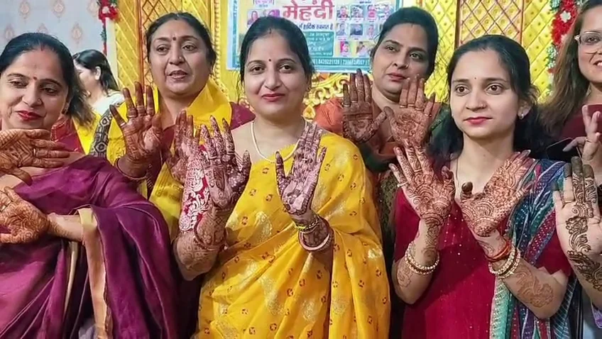
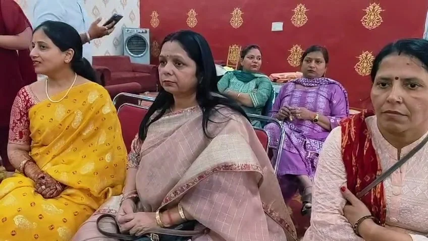
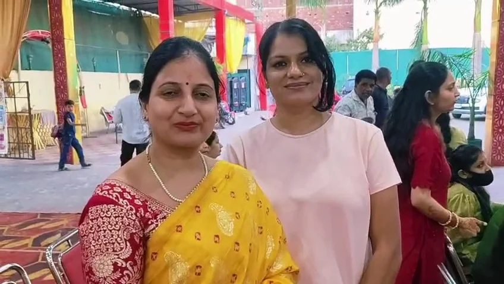
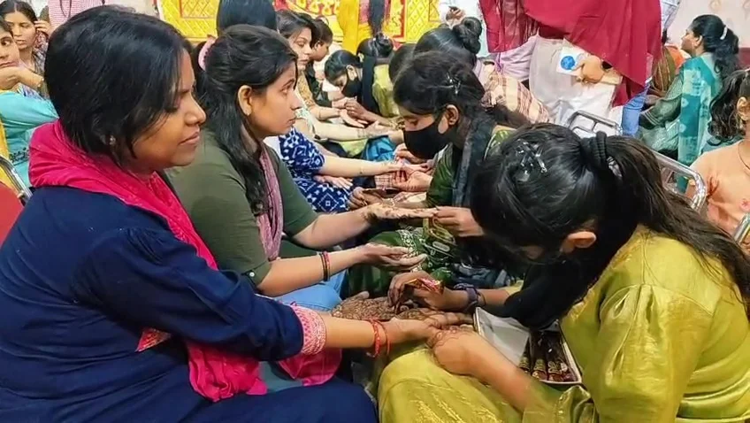

**रुड़की संवाददाता | आसिफ खान**

**रुड़की।** त्योहारों की खुशियां बांटने और महिलाओं को एक मंच पर लाने की अनूठी पहल करते हुए सेवा परमो धर्म संस्था की ओर से आदर्शनगर स्थित श्री गार्डन में निशुल्क मेहंदी कार्यक्रम का आयोजन किया गया। कार्यक्रम में 100 से अधिक महिलाओं ने उत्साहपूर्वक भाग लेकर अपने हाथों पर मेहंदी लगवाई। आयोजन के दौरान महिलाओं के बीच उत्साह, उमंग और आपसी मेलजोल का शानदार माहौल देखने को मिला।

सेवा परमो धर्म संस्था की इस पहल ने महिलाओं को त्योहारों की खुशियों से जोड़ने के साथ सामाजिक एकता, भाईचारे और सहभागिता का संदेश भी दिया। कार्यक्रम में महिलाओं ने एक-दूसरे के साथ समय बिताया और खुशियों के पल साझा किए। निशुल्क मेहंदी कार्यक्रम महिलाओं के चेहरों पर मुस्कान लाने और उन्हें सामाजिक गतिविधियों से जोड़ने का सराहनीय प्रयास साबित हुआ।

**महिलाओं की एकजुटता और सामाजिक सहभागिता पर जोर**

इस अवसर पर संस्था की संरक्षक एवं कांग्रेस की महापौर प्रत्याशी रह चुकीं पूजा गुप्ता ने कहा कि समाज में आपसी प्रेम, भाईचारे और एकजुटता को मजबूत करने के लिए ऐसे आयोजन बेहद जरूरी हैं। सामाजिक संस्थाओं को समय-समय पर इस तरह के कार्यक्रम आयोजित करने चाहिए, जिससे महिलाओं को एक मंच पर आने और आपसी संबंधों को मजबूत करने का अवसर मिल सके।

उन्होंने कहा कि निशुल्क मेहंदी कार्यक्रम केवल त्योहार की खुशियां साझा करने तक सीमित नहीं है, बल्कि यह महिलाओं को सामाजिक गतिविधियों में भागीदारी के लिए प्रेरित करने का भी माध्यम है। ऐसे आयोजनों से समाज में सकारात्मकता का संदेश पहुंचता है और आपसी मेलजोल को बढ़ावा मिलता है।

पूजा गुप्ता ने सेवा परमो धर्म संस्था की पहल की सराहना करते हुए कहा कि महिलाओं के बीच प्रेम, सौहार्द और एकजुटता बढ़ाने के लिए इस तरह के प्रयास लगातार किए जाने चाहिए।

**महिलाओं ने उत्साह के साथ लिया हिस्सा**

कार्यक्रम के दौरान महिलाओं ने उत्साहपूर्वक मेहंदी लगवाई और आयोजन का भरपूर आनंद लिया। श्री गार्डन में आयोजित इस कार्यक्रम ने महिलाओं को एक साथ जुड़ने, त्योहारों की खुशियां साझा करने और सामाजिक सहभागिता बढ़ाने का अवसर प्रदान किया।

कार्यक्रम में संस्था की अध्यक्ष सुरभि चन्ना, रोमा गोस्वामी, महामंत्री डिंपल खोसला, उपाध्यक्ष अनुपम सिंह, इशानी विश्वकर्मा, गरिमा चड्ढा, सीमा चौधरी, सविता, सुमन, रेखा जैन और सविता चौधरी सहित बड़ी संख्या में महिलाएं मौजूद रहीं।

सेवा परमो धर्म संस्था की इस पहल को महिलाओं को एक मंच पर लाने और सामाजिक सौहार्द को मजबूत करने की दिशा में एक सकारात्मक कदम बताया गया।
