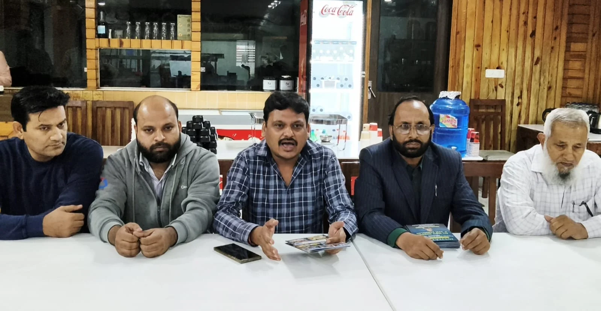
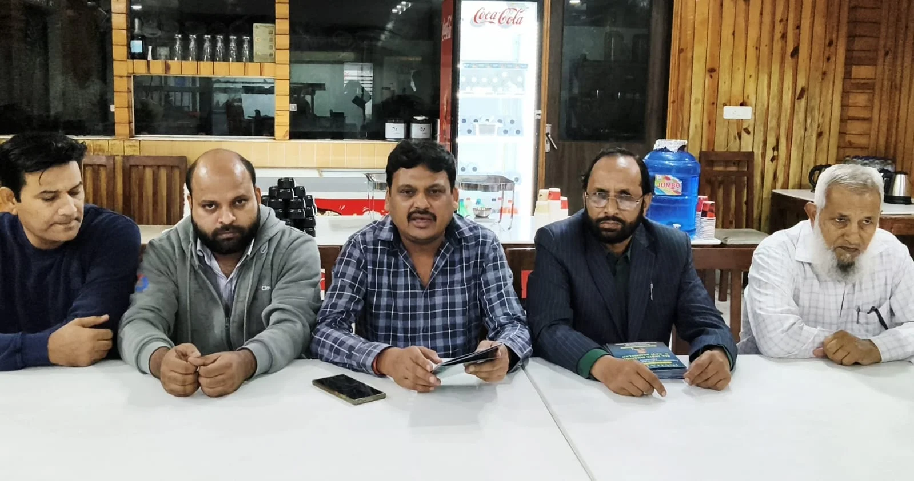

**रूडकी संवाददाता | आसिफ खान

रुड़की।** साहित्य और अदब के शौकीनों के लिए रुड़की में आगामी 14 नवंबर को एक शानदार साहित्यिक महफिल सजने जा रही है। अंजुमन इतरका-ए-अदब, रुड़की की ओर से नगर निगम परिसर में अखिल भारतीय मुशायरा एवं कवि सम्मेलन का भव्य आयोजन किया जाएगा। ‘याद-ए-अब्दुल हकीम’ के नाम से आयोजित होने वाले इस कार्यक्रम में देशभर के नामचीन शायर और कवि अपनी शानदार रचनाओं से श्रोताओं को साहित्य के रंग में सराबोर करेंगे।

कार्यक्रम को लेकर वरिष्ठ समाजसेवी, कांग्रेस नेता एवं संस्था के मुख्य संरक्षक सचिन गुप्ता ने प्रेसवार्ता कर जानकारी दी। उन्होंने बताया कि मुशायरे का उद्देश्य साहित्यिक संस्कृति को बढ़ावा देना और शायरी व कविता के माध्यम से समाज में प्रेम, भाईचारे तथा सांस्कृतिक एकता का संदेश पहुंचाना है।

कार्यक्रम का उद्घाटन वरिष्ठ समाजसेविका पूजा गुप्ता करेंगी, जबकि मुशायरे की सदारत इंजीनियर मुजीब मलिक करेंगे। आयोजन में वरिष्ठ विधायक काजी निजामुद्दीन, विधायक वीरेंद्र जाति, हाजी फुरकान अहमद, रवि बहादुर और विधायक ममता राकेश सहित अनेक जनप्रतिनिधियों एवं सामाजिक हस्तियों को आमंत्रित किया गया है।

**देशभर के नामचीन शायर और कवि बांधेंगे समां**

संस्था के सेक्रेटरी सिकंदर हयात गड़बड़ ने बताया कि मुशायरे में इकबाल अहसर, रियाज सागर, अज्म शाकिरी, अल्ताफ जिया, खुर्शीद हैदर, फखरी मेरठी, मोहन मुंतजिर, राधिका मित्तल, इस्माइल नजर, वसीम राजूपुरी, इमरान फैज, मोनिका मंतशा, महमूद असर और मनोज शाश्वत सहित अनेक प्रसिद्ध शायर एवं कवि अपनी रचनाएं प्रस्तुत करेंगे।

आयोजकों के अनुसार कार्यक्रम में परिवारों के लिए विशेष बैठने की व्यवस्था की जाएगी, ताकि साहित्य प्रेमी अपने परिजनों के साथ इस अदबी महफिल का आनंद ले सकें।

**साहित्यिक संस्कृति को बढ़ावा देने की पहल**

सचिन गुप्ता ने कहा कि मुशायरे और कवि सम्मेलन भारतीय साहित्यिक परंपरा की पहचान हैं। ऐसे आयोजन नई पीढ़ी को साहित्य से जोड़ने के साथ ही समाज में आपसी सौहार्द और सांस्कृतिक समृद्धि को भी मजबूती प्रदान करते हैं।

प्रेसवार्ता में सैय्यद सना-उल-हक, वसीम अकरम, चांद खां, हाजी जमीर सहित अन्य गणमान्य लोग प्रमुख रूप से मौजूद रहे।

14 नवंबर को रुड़की में सजने वाली यह साहित्यिक महफिल शायरी, कविता और अदब के चाहने वालों के लिए खास आकर्षण का केंद्र रहेगी।
