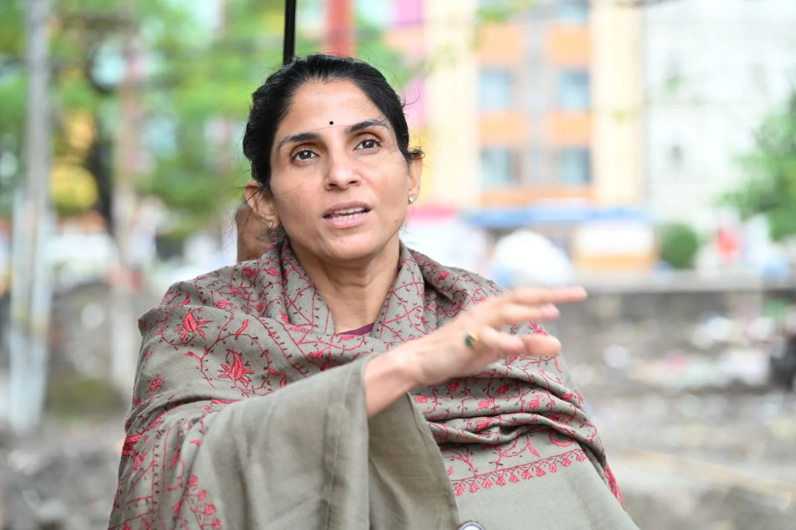
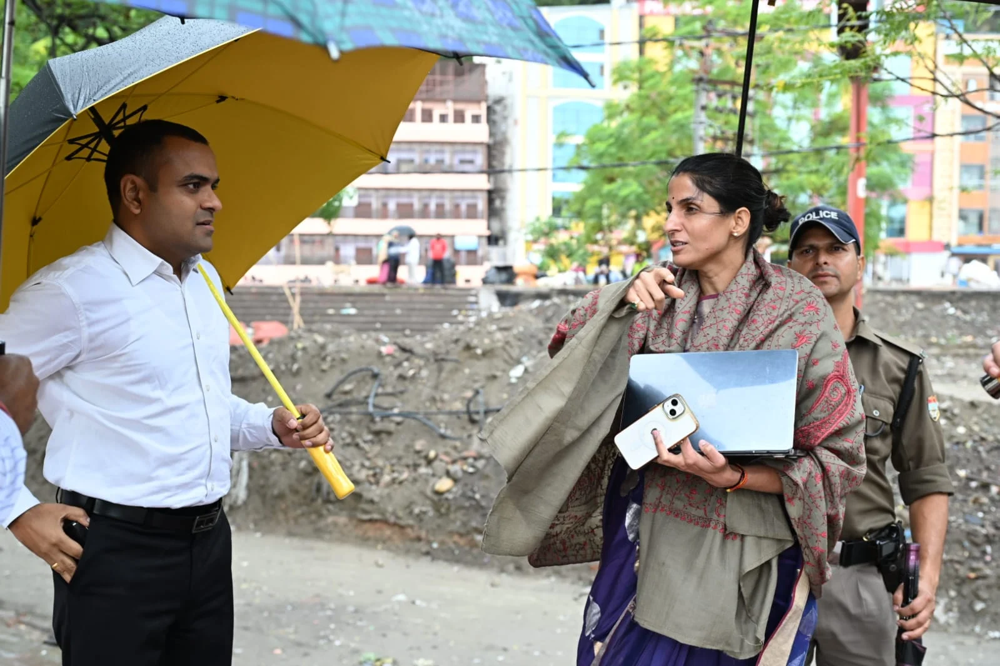
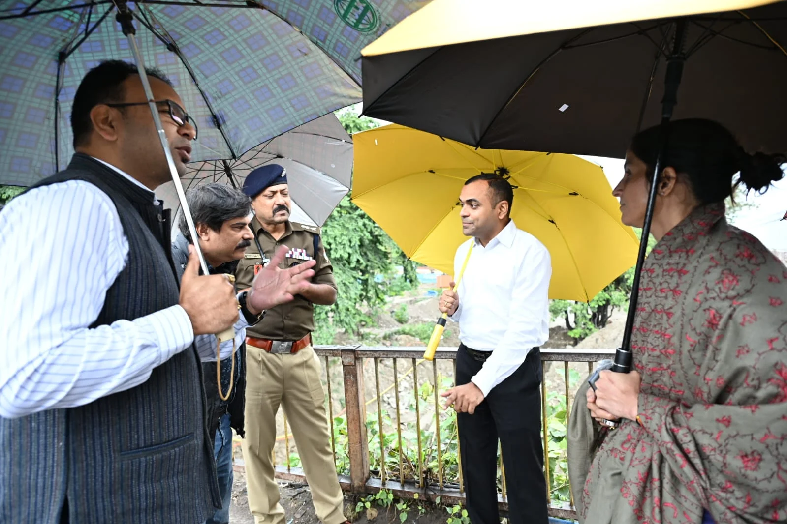
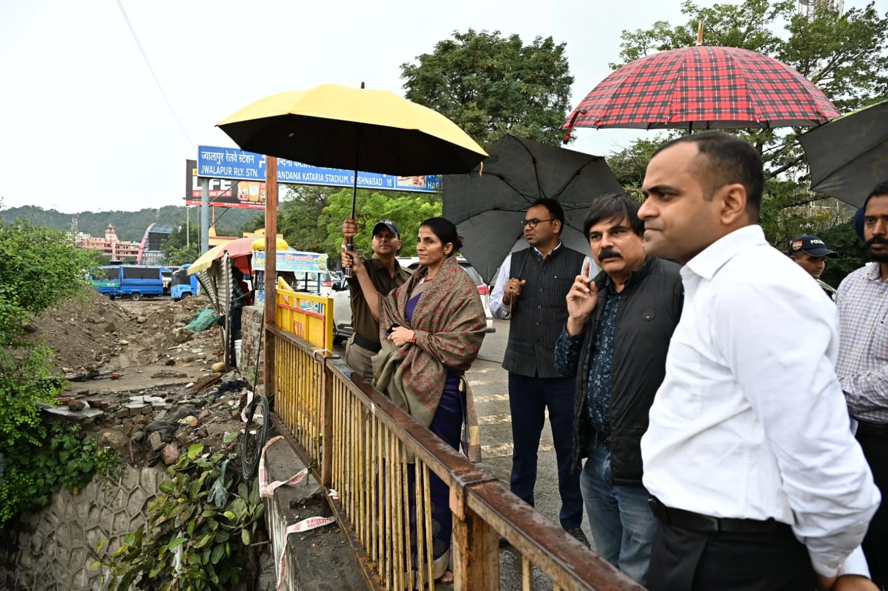

**हरिद्वार संवाददाता | आसिफ खान

हरिद्वार ।** कुंभ-2027 को लेकर मेला प्रशासन अब पूरी तरह एक्शन मोड में नजर आ रहा है। करोड़ों श्रद्धालुओं की सुरक्षित आवाजाही, भीड़ प्रबंधन और यातायात व्यवस्था को लेकर तैयारियों में किसी भी तरह की लापरवाही न हो, इसके लिए मेलाधिकारी श्रीमती सोनिका ने बारिश के बीच भी मेला क्षेत्र का स्थलीय निरीक्षण कर व्यवस्थाओं की बारीकी से पड़ताल की। पंतद्वीप से लेकर रोड़ी-बेलवाला और चंडी चौक तक अधिकारियों की टीम ने निर्माण कार्यों की प्रगति, प्रमुख मार्गों, पुलों, घाटों और श्रद्धालुओं की आवाजाही से जुड़े महत्वपूर्ण बिंदुओं का जायजा लिया।

निरीक्षण के दौरान मेलाधिकारी सोनिका ने स्पष्ट निर्देश दिए कि कुंभ से जुड़े सभी निर्माण कार्य निर्धारित समयसीमा में पूरे किए जाएं और श्रद्धालुओं की सुविधा, सुरक्षा तथा सुगम आवागमन को सर्वोच्च प्राथमिकता दी जाए। जिलाधिकारी मयूर दीक्षित, वरिष्ठ पुलिस अधीक्षक नवनीत सिंह भुल्लर, अपर मेलाधिकारी दयानंद सरस्वती सहित संबंधित विभागों के अधिकारी निरीक्षण में मौजूद रहे।

बारिश के बीच जारी इस निरीक्षण में मेलाधिकारी सोनिका तैयारियों की डिजिटल समीक्षा करती भी नजर आईं। उन्होंने मौके पर ही व्यवस्थाओं से जुड़ी कार्ययोजनाओं को परखा और अधिकारियों के साथ जरूरी सुधारों पर चर्चा कर दिशा-निर्देश दिए।

**पंतद्वीप में भीड़ प्रबंधन की चुनौती, अव्यवस्थाएं दूर करने के निर्देश**

निरीक्षण की शुरुआत कांगड़ा पुल और संजय पुल के संगम के निकट पंतद्वीप की नोज वाले क्षेत्र से हुई। कुंभ के दौरान श्रद्धालुओं की भारी आवाजाही को देखते हुए इस क्षेत्र को महत्वपूर्ण माना जा रहा है। अधिकारियों ने यहां मार्गों और प्लेटफॉर्म की स्थिति का जायजा लिया।

मेलाधिकारी और जिलाधिकारी ने क्षेत्र में आवश्यक सुधार कार्यों को शीघ्र पूरा कराने के निर्देश दिए। अनुपयोगी एवं क्षतिग्रस्त पोल हटाने, खंभों और पेड़ों से लटक रहे तारों, रस्सियों तथा अन्य अनावश्यक सामग्री को हटाने पर विशेष जोर दिया गया।

घाटों और प्लेटफॉर्म को सुव्यवस्थित रखने, साफ-सफाई की बेहतर व्यवस्था सुनिश्चित करने तथा घाटों और पुलों के सौंदर्यीकरण से जुड़े कार्यों को तेजी से पूरा करने के निर्देश भी दिए गए। अधिकारियों को साफ संदेश दिया गया कि कुंभ के दौरान श्रद्धालुओं को किसी भी प्रकार की अनावश्यक परेशानी का सामना न करना पड़े।

**रोड़ी-बेलवाला में निर्माण कार्यों की समीक्षा, चंडी पुल पर डबल लेन अंडरपास पर नजर**

इसके बाद अधिकारियों की टीम ने रोड़ी-बेलवाला क्षेत्र में निर्माणाधीन प्रशासनिक मार्ग का निरीक्षण किया। यहां चल रहे कार्यों की प्रगति का जायजा लेते हुए मेलाधिकारी ने निर्माण कार्यों में तेजी लाने के निर्देश दिए।

चंडी पुल पर बन रहे डबल लेन अंडरपास की स्थिति की भी समीक्षा की गई। कुंभ के दौरान यातायात के दबाव को नियंत्रित करने और वाहनों की आवाजाही सुचारु बनाए रखने में इस परियोजना की अहम भूमिका को देखते हुए अधिकारियों को निर्धारित समयसीमा के भीतर कार्य पूरा करने के निर्देश दिए गए।

**चंडी चौक से वाल्मीकि चौक तक सड़क सुधार कार्यों को प्राथमिकता**

निरीक्षण के दौरान चंडी चौक से वाल्मीकि चौक की ओर जाने वाली सड़क पर चल रहे चौड़ीकरण और सुधार कार्यों की भी समीक्षा की गई। यह मार्ग यातायात के साथ-साथ पैदल श्रद्धालुओं की आवाजाही के लिहाज से बेहद महत्वपूर्ण है।

मेलाधिकारी ने अधिकारियों को निर्देश दिए कि सड़क सुधार कार्यों में तेजी लाई जाए और ऐसे सभी आवश्यक उपाय किए जाएं, जिनसे यातायात संचालन सुचारु रहे तथा पैदल चलने वाले श्रद्धालुओं को आवागमन में किसी प्रकार की असुविधा न हो।

**कुंभ की तैयारियों पर प्रशासन की पैनी नजर, समयसीमा में काम पूरा कराने पर जोर**

कुंभ-2027 की तैयारियों को लेकर मेला प्रशासन लगातार निर्माण कार्यों और उनसे जुड़ी व्यवस्थाओं की निगरानी कर रहा है। स्थलीय निरीक्षण के माध्यम से समस्याओं की पहचान कर मौके पर ही समाधान के निर्देश दिए जा रहे हैं।

मेला प्रशासन का जोर इस बात पर है कि कुंभ के दौरान हरिद्वार आने वाले श्रद्धालुओं को सुरक्षित, सुगम और सुव्यवस्थित आवागमन की सुविधा मिले। प्रमुख मार्गों, पुलों, घाटों और यातायात व्यवस्था को समय रहते दुरुस्त करने के लिए विभागीय अधिकारियों को जिम्मेदारी के साथ कार्य करने के निर्देश दिए गए हैं।

निरीक्षण के दौरान उप मेलाधिकारी मंजीत सिंह, पीआईयू के अधिशासी अभियंता प्रवीण कुश, यूपीडीसीसी के परियोजना प्रबंधक आशीष भट्ट सहित विभिन्न विभागों के अधिकारी उपस्थित रहे।

**स्टार न्यूज़ 11 | हरिद्वार**
