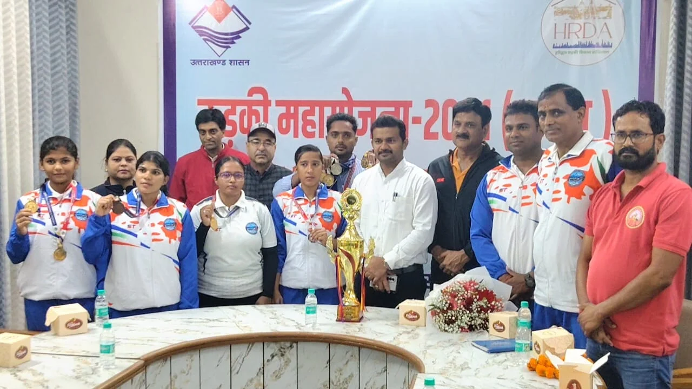
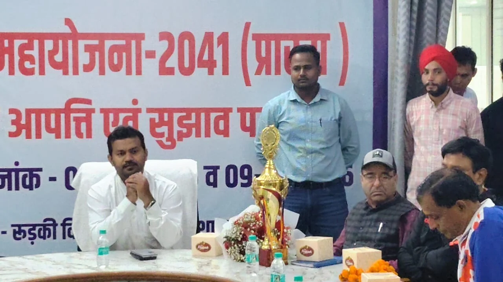
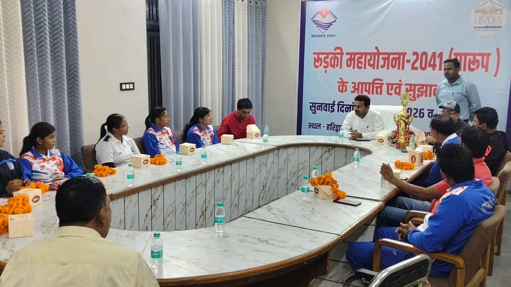
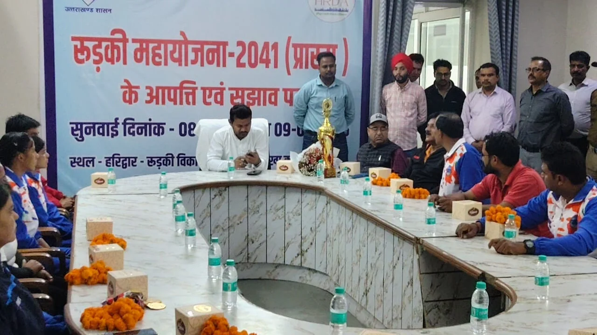

**रूडकी STAR NEWS 11 संवाददाता | आसिफ खान** 

**रुड़की।** राष्ट्रीय स्तर पर उत्तराखंड के खिलाड़ियों ने अपनी प्रतिभा और मेहनत का लोहा मनवाते हुए प्रदेश का नाम रोशन किया है। दिल्ली की भलस्वा झील में आयोजित 13वीं राष्ट्रीय ड्रैगन बोट चैंपियनशिप में शानदार प्रदर्शन करते हुए उत्तराखंड की टीम ने छह स्वर्ण, दो रजत और एक कांस्य पदक सहित कुल नौ पदक अपने नाम किए। 25 राज्यों की रैंकिंग में उत्तराखंड ने तीसरा स्थान हासिल कर खेल जगत में अपनी मजबूत उपस्थिति दर्ज कराई। खिलाड़ियों की इस ऐतिहासिक उपलब्धि पर हरिद्वार-रुड़की विकास प्राधिकरण (एचआरडीए) में सम्मान समारोह आयोजित कर उनका उत्साहवर्धन किया गया।

ज्वॉइंट मजिस्ट्रेट रुड़की दीपक रामचंद्र शेठ ने उत्कृष्ट प्रदर्शन करने वाले छात्र-छात्राओं को सम्मानित करते हुए उनके उज्ज्वल भविष्य की कामना की। उन्होंने कहा कि रुड़की की पुरानी नहर पर सीमित संसाधनों के बीच अभ्यास करने वाले खिलाड़ियों ने राष्ट्रीय प्रतियोगिता में शानदार प्रदर्शन कर पूरे उत्तराखंड का गौरव बढ़ाया है। खिलाड़ियों की मेहनत, अनुशासन और खेल के प्रति समर्पण प्रशंसनीय है।

**सातवें स्थान से तीसरे स्थान तक का सफर, खिलाड़ियों ने दिखाया दम**

नई दिल्ली की भलस्वा झील में 18 से 20 अक्टूबर तक आयोजित 13वीं राष्ट्रीय ड्रैगन बोट चैंपियनशिप में देशभर के 25 राज्यों के खिलाड़ियों ने प्रतिभाग किया। उत्तराखंड की टीम ने प्रतियोगिता में दमदार प्रदर्शन करते हुए छह स्वर्ण, दो रजत और एक कांस्य पदक हासिल किया।

गौरतलब है कि पिछले वर्ष उत्तराखंड की टीम सातवें स्थान पर रही थी, लेकिन इस बार खिलाड़ियों ने अपनी रैंकिंग में बड़ा सुधार करते हुए तीसरा स्थान हासिल किया। यह उपलब्धि प्रदेश में वाटर स्पोर्ट्स के बढ़ते प्रभाव और खिलाड़ियों की कड़ी मेहनत को दर्शाती है।

**खिलाड़ियों की समस्याओं के समाधान का दिया भरोसा**

सम्मान समारोह में ज्वॉइंट मजिस्ट्रेट दीपक रामचंद्र शेठ ने कहा कि सरकार खेल और खिलाड़ियों को प्रोत्साहित करने के लिए गंभीर है। खिलाड़ियों को बेहतर सुविधाएं उपलब्ध कराने और उनकी समस्याओं के समाधान के लिए हरसंभव प्रयास किए जाएंगे।

उन्होंने बताया कि रुड़की की पुरानी नहर पर अभ्यास के दौरान उत्तर प्रदेश सिंचाई विभाग के साथ समन्वय को लेकर कुछ चुनौतियां सामने आई हैं। इन समस्याओं को प्रशासन के संज्ञान में लाया गया है। खिलाड़ियों को अभ्यास के लिए बेहतर वातावरण उपलब्ध कराने के उद्देश्य से संबंधित विभागों के साथ समन्वय स्थापित किया जाएगा।

**रुड़की में राष्ट्रीय ड्रैगन बोट चैंपियनशिप कराने की तैयारी**

आईआईटी रुड़की के खेल अधिकारी डॉ. आलोक कुमार पांडेय ने खिलाड़ियों, प्रशिक्षकों और अधिकारियों को शानदार प्रदर्शन के लिए बधाई दी। उन्होंने कहा कि पिछले वर्ष सातवें स्थान पर रहने वाली उत्तराखंड की टीम ने इस बार तीसरा स्थान हासिल कर अपनी प्रतिभा साबित की है।

उन्होंने कहा कि रुड़की में ड्रैगन बोट और वाटर स्पोर्ट्स की सुविधाओं को बढ़ाने की दिशा में प्रयास किए जाएंगे। अगले एक-दो वर्षों में रुड़की में राष्ट्रीय ड्रैगन बोट चैंपियनशिप आयोजित कराने की दिशा में भी पहल की जाएगी। इससे क्षेत्र में खेल गतिविधियों को बढ़ावा मिलेगा और स्थानीय खिलाड़ियों को राष्ट्रीय स्तर पर अपनी प्रतिभा दिखाने का अवसर प्राप्त होगा।

**बेहतर खेल सुविधाएं उपलब्ध कराने पर जोर**

कैप्टेन परमवीर ने कहा कि राष्ट्रीय ड्रैगन बोट चैंपियनशिप में उत्तराखंड के खिलाड़ियों का शानदार प्रदर्शन गर्व की बात है। छह स्वर्ण, दो रजत और एक कांस्य पदक जीतना खिलाड़ियों की मेहनत, लगन और समर्पण का परिणाम है।

उन्होंने खिलाड़ियों को बधाई देते हुए कहा कि प्रदेश में वाटर स्पोर्ट्स को आगे बढ़ाने के लिए बेहतर खेल सुविधाएं उपलब्ध कराना बेहद जरूरी है। खिलाड़ियों को उचित प्रशिक्षण और संसाधन मिलें तो वे भविष्य में और भी बड़ी उपलब्धियां हासिल कर सकते हैं।

सम्मानित होने पर खिलाड़ियों ने ज्वॉइंट मजिस्ट्रेट दीपक रामचंद्र शेठ का आभार जताया। कार्यक्रम में बड़ी संख्या में छात्र-छात्राएं, प्रशिक्षक और खेल जगत से जुड़े लोग मौजूद रहे
