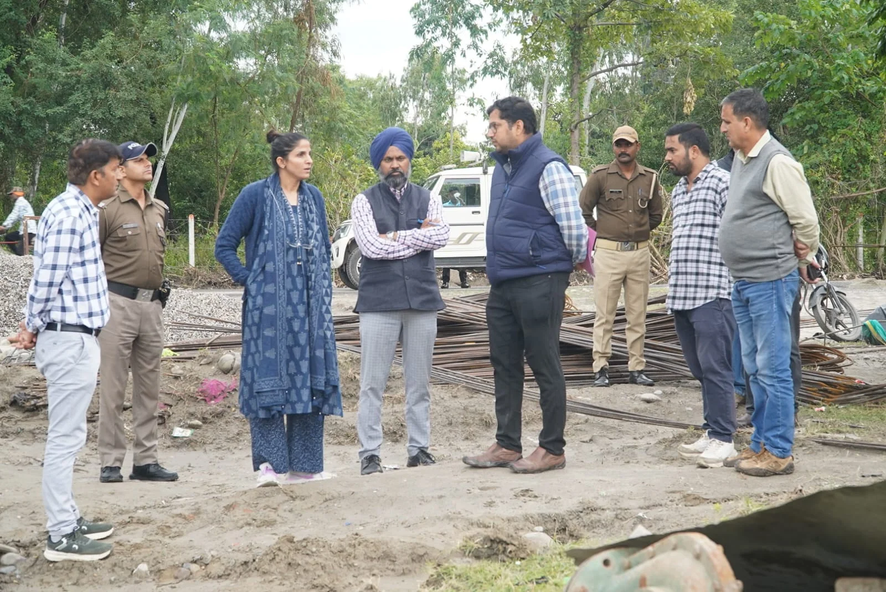
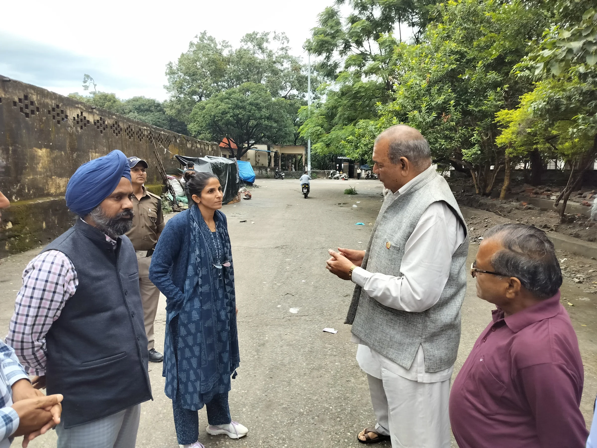
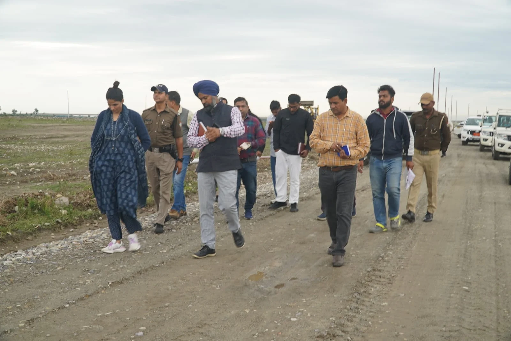
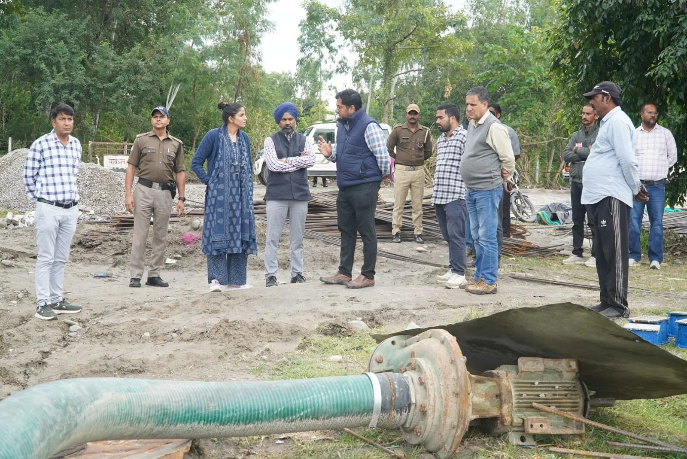

**हरिद्वार संवाददाता | आसिफ खान

हरिद्वार।** कुंभ मेला-2027 को भव्य, सुरक्षित और सुव्यवस्थित बनाने के लिए मेला प्रशासन ने तैयारियों को तेज कर दिया है। शिविर स्थलों से लेकर घाटों, पुलों और संपर्क मार्गों तक व्यवस्थाओं को समयबद्ध तरीके से धरातल पर उतारने के लिए मेलाधिकारी श्रीमती सोनिका एक्शन मोड में नजर आईं। शुक्रवार को उन्होंने बैरागी कैंप, नया टापू, सती द्वीप, दक्ष द्वीप और कनखल क्षेत्र का व्यापक स्थलीय निरीक्षण कर निर्माण कार्यों की प्रगति परखी। इस दौरान उन्होंने अधिकारियों को स्पष्ट निर्देश दिए कि कुंभ से जुड़े सभी कार्य गुणवत्ता के साथ निर्धारित समयसीमा में पूरे किए जाएं। श्रद्धालुओं की सुविधा, सुरक्षा और सुगम आवागमन में किसी भी स्तर पर लापरवाही बर्दाश्त नहीं की जाएगी।

मेलाधिकारी ने बैरागी कैंप, सेक्टर-12 स्थित नया टापू, सती द्वीप और दक्ष द्वीप में कुंभ शिविरों के लिए विकसित की जा रही व्यवस्थाओं का जायजा लिया। उन्होंने भूमि की सफाई, समतलीकरण, ड्रेसिंग, अस्थायी संपर्क मार्गों, बिजली और पेयजल आपूर्ति सहित सेक्टर प्लान के अनुरूप चल रहे कार्यों की समीक्षा की।

उन्होंने अधिकारियों को निर्देशित किया कि सभी सेक्टरों में श्रद्धालुओं के लिए आधारभूत सुविधाएं समय से तैयार की जाएं। सेक्टर-12 के नया टापू तक पहुंचने वाले संपर्क मार्ग को बेहतर बनाने के साथ ही आवागमन को सुरक्षित बनाने के लिए आवश्यक इंतजाम तत्काल सुनिश्चित किए जाएं।

**पुलों के निर्माण में देरी नहीं, गुणवत्ता के साथ काम पूरा करने के निर्देश**

कुंभ की तैयारियों के तहत सतीघाट से बैरागी कैंप को जोड़ने के लिए 48 मीटर लंबे पैदल पुल का निर्माण किया जा रहा है। मेलाधिकारी ने मौके पर पहुंचकर निर्माण कार्य का निरीक्षण किया और संबंधित अधिकारियों को गुणवत्ता सुनिश्चित करते हुए कार्य शीघ्र पूरा करने के निर्देश दिए।

वहीं, दक्ष द्वीप और बैरागी कैंप को जोड़ने के लिए निर्माणाधीन 60 मीटर स्पान के स्टील गर्डर डबल लेन पुल की प्रगति भी परखी गई। मेलाधिकारी ने अधिकारियों को कार्य में तेजी लाने और निर्धारित समयसीमा के भीतर पुल का निर्माण पूरा करने के निर्देश दिए।

दरिद्रभंजन महादेव मंदिर के समीप मायापुर स्कैप चैनल पर प्रस्तावित बैली ब्रिज के स्थल का निरीक्षण करते हुए उन्होंने निर्माण कार्य तत्काल शुरू कराने को कहा। इसके साथ ही कनखल क्षेत्र को जोड़ने वाली सड़क पर दरिद्रभंजन मंदिर और श्मशान घाट के प्रवेश द्वार के बीच मौजूद संकरे हिस्से को चौड़ा करने की आवश्यकता पर जोर दिया।

मेलाधिकारी ने संबंधित अधिकारियों को निर्देश दिए कि भूस्वामियों से वार्ता कर आवश्यक भूमि उपलब्ध कराने की प्रक्रिया तेज की जाए, ताकि कुंभ के दौरान यातायात व्यवस्था बाधित न हो और श्रद्धालुओं को आवागमन में परेशानी का सामना न करना पड़े।

**घाटों की बदहाल व्यवस्था पर नजर, मरम्मत और सुरक्षा के लिए निर्देश**

बैरागी कैंप क्षेत्र में स्कैप चैनल पर निर्माणाधीन 260 मीटर लंबे घाट का निरीक्षण करते हुए मेलाधिकारी ने कार्यों की प्रगति का जायजा लिया। इसके बाद उन्होंने कनखल क्षेत्र के विभिन्न सार्वजनिक घाटों का निरीक्षण कर उनकी स्थिति का आकलन किया।

उन्होंने संबंधित विभागों को घाटों की आवश्यक मरम्मत, साफ-सफाई और रखरखाव सुनिश्चित करने के निर्देश दिए। स्नानार्थियों की सुरक्षा को प्राथमिकता देते हुए घाटों पर रेलिंग एवं चेन लगाने के लिए भी कहा गया।

मेलाधिकारी ने स्पष्ट किया कि स्कैप चैनल की बंदी अवधि का उपयोग घाटों की सफाई और मरम्मत के लिए प्रभावी ढंग से किया जाए। घाटों का सौंदर्यीकरण, नियमित सफाई और सुरक्षा व्यवस्था मजबूत की जाए, ताकि कुंभ के दौरान श्रद्धालुओं को स्वच्छ और सुरक्षित स्नान की सुविधा मिल सके।

**दक्ष मंदिर से श्मशान घाट तक व्यवस्थाओं को मजबूत करने पर जोर**

मेलाधिकारी श्रीमती सोनिका ने कनखल स्थित दक्ष मंदिर, शीतला माता मंदिर और दरिद्रभंजन मंदिर का भ्रमण कर क्षेत्र की व्यवस्थाओं का जायजा लिया। इसके साथ ही कनखल श्मशान घाट क्षेत्र में कुंभ मेला मद से कराए जा रहे विकास कार्यों का भी निरीक्षण किया।

उन्होंने श्मशान घाट की अवस्थापना सुविधाओं को सुदृढ़ करने के निर्देश देते हुए प्रकाश व्यवस्था, पेयजल आपूर्ति, शौचालय निर्माण और अन्य जनसुविधाओं से जुड़े कार्यों को प्राथमिकता से पूरा करने को कहा।

निरीक्षण के दौरान मेलाधिकारी ने स्थानीय नागरिकों से भी मुलाकात की और कुंभ की तैयारियों को लेकर उनके सुझाव एवं फीडबैक प्राप्त किए। उन्होंने कहा कि स्थानीय नागरिकों की आवश्यकताओं को ध्यान में रखते हुए व्यवस्थाओं को बेहतर बनाया जाए, जिससे कुंभ के दौरान श्रद्धालुओं के साथ-साथ स्थानीय लोगों को भी सुविधाएं मिल सकें।

**अधिकारियों की जवाबदेही तय, नियमित निगरानी के निर्देश**

मेलाधिकारी ने सभी संबंधित विभागों को निर्देशित किया कि कुंभ-2027 से जुड़े निर्माण एवं व्यवस्थागत कार्यों की नियमित निगरानी की जाए। कार्यों में गुणवत्ता, समयबद्धता और उपयोगिता का विशेष ध्यान रखा जाए।

उन्होंने कहा कि कुंभ जैसे विशाल आयोजन में बेहतर समन्वय और मजबूत आधारभूत व्यवस्थाएं बेहद जरूरी हैं। शिविर स्थलों, घाटों, पुलों और संपर्क मार्गों को समय रहते तैयार करना प्रशासन की प्राथमिकता है, ताकि कुंभ के दौरान श्रद्धालुओं को किसी प्रकार की असुविधा न हो।

निरीक्षण के दौरान उप मेलाधिकारी मंजीत सिंह, सिंचाई विभाग के अधिशासी अभियंता अनुभव नौटियाल, पेयजल निगम के अधिशासी अभियंता राजेश गुप्ता सहित ग्रामीण निर्माण विभाग, लोक निर्माण विभाग, पीआईयू, यूपीसीएल एवं अन्य संबंधित विभागों के अधिकारी मौजूद रहे।
