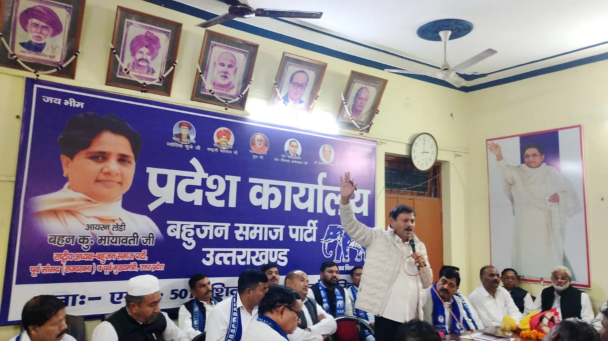
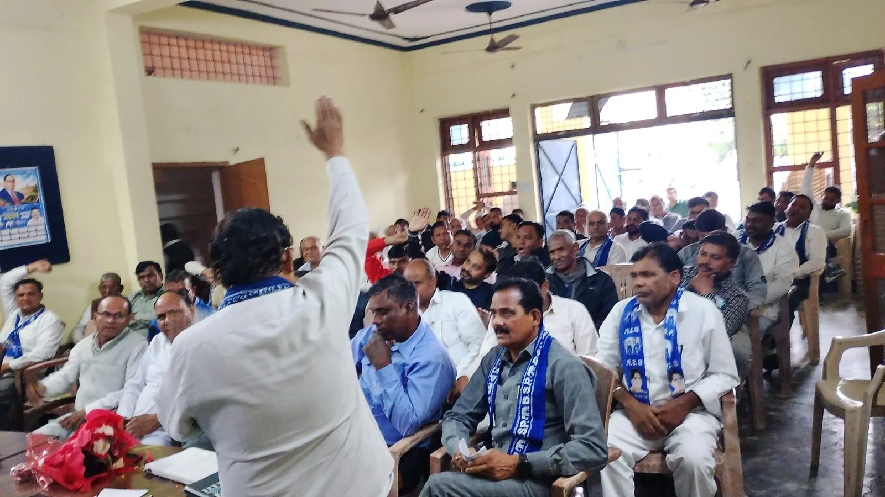
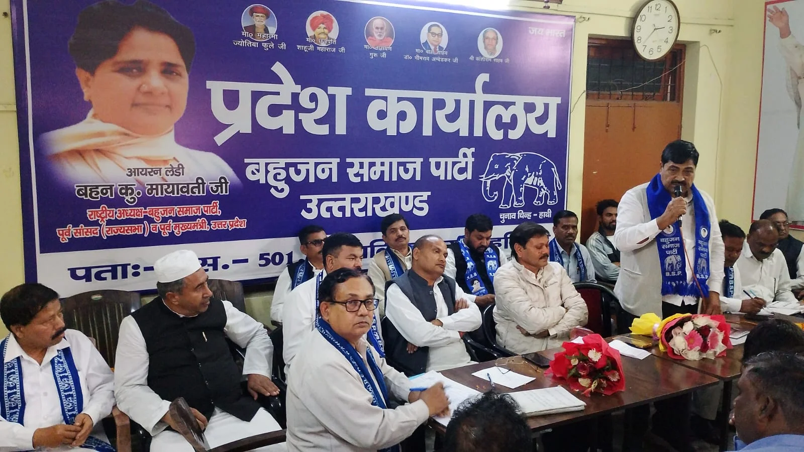

**हरिद्वार स्टार न्यूज़ 11 संवाददाता | आसिफ खान**  

**हरिद्वार।** उत्तराखंड की सियासत में 2027 के विधानसभा चुनाव को लेकर हलचल तेज होने लगी है। बहुजन समाज पार्टी ने भी अब अपनी चुनावी तैयारियों को धार देना शुरू कर दिया है। राष्ट्रीय अध्यक्ष एवं पूर्व मुख्यमंत्री मायावती के दिशा-निर्देशों पर शुक्रवार को हरिद्वार में आयोजित प्रदेश स्तरीय महत्वपूर्ण बैठक में बसपा ने साफ संकेत दे दिए कि आगामी विधानसभा चुनाव को लेकर पार्टी पूरी ताकत के साथ मैदान में उतरने की तैयारी कर रही है। संगठन को बूथ स्तर तक मजबूत करने और उत्तराखंड में बसपा की सरकार बनाने के लक्ष्य के साथ पदाधिकारियों को चुनावी मोर्चे पर सक्रिय होने का आह्वान किया गया।

हरिद्वार स्थित बीएसपी प्रदेश कार्यालय, शिबालिक नगर में आयोजित इस बैठक में केंद्रीय प्रभारी एवं पूर्व सांसद राजा राम ने पदाधिकारियों को संबोधित करते हुए संगठन को मजबूत बनाने पर जोर दिया। उन्होंने कहा कि विधानसभा, जिला और प्रदेश स्तर पर संगठन की कमियों को दूर कर पार्टी को मजबूत बनाया जाए। सभी पदाधिकारी पूरी मेहनत और समर्पण के साथ चुनावी तैयारियों में जुटें, ताकि उत्तराखंड में बहुजन समाज पार्टी की सरकार बनाने का लक्ष्य हासिल किया जा सके।

**2027 के लिए बसपा का सीधा संदेश—बूथ मजबूत करो, सत्ता की लड़ाई लड़ो!**

प्रदेश अध्यक्ष नरेश कुमार गौतम ने बैठक में संगठन की मजबूती को चुनावी जीत की सबसे बड़ी कुंजी बताया। उन्होंने कहा कि पार्टी के प्रत्येक पदाधिकारी की जिम्मेदारी है कि वह अपने क्षेत्र में संगठन को मजबूत करे और पार्टी की नीतियों को जन-जन तक पहुंचाए।

उन्होंने स्पष्ट किया कि अब 2026-2027 के चुनावी अभियान को लेकर पूरी मेहनत करनी होगी। बूथ स्तर तक संगठन खड़ा करना, कार्यकर्ताओं को सक्रिय करना और अधिक से अधिक लोगों को पार्टी से जोड़ना प्राथमिकता है।

बसपा विधायक हाजी मोहम्मद शहनाज अली ने भी संगठन को मजबूत बनाने पर जोर देते हुए कहा कि राष्ट्रीय अध्यक्ष मायावती के दिशा-निर्देशों का पूरी तरह पालन किया जाए। उन्होंने कहा कि यदि कार्यकर्ता अपने-अपने बूथ को मजबूत कर लेते हैं तो आगामी विधानसभा चुनाव में पार्टी को मजबूती मिलेगी।

**बाबा साहेब के महापरिनिर्वाण दिवस पर शक्ति प्रदर्शन की तैयारी**

बैठक में 6 दिसंबर 2026 को भारत रत्न बाबा साहेब डॉ. भीमराव अंबेडकर के महापरिनिर्वाण दिवस पर श्रद्धांजलि सभा एवं कार्यक्रम आयोजित करने की तैयारियों पर भी चर्चा हुई। कार्यक्रम में मुख्य अतिथि के रूप में आकाश आनंद के शामिल होने की जानकारी दी गई।

पार्टी पदाधिकारियों को कार्यक्रम को सफल बनाने के लिए अभी से तैयारियों में जुटने के निर्देश दिए गए। बसपा इस आयोजन के जरिए बाबा साहेब के विचारों को जन-जन तक पहुंचाने और संगठनात्मक सक्रियता बढ़ाने की तैयारी में है।

**हरिद्वार से लेकर मंगलौर तक संगठन को धार देने की रणनीति**

बैठक का संचालन हरिद्वार जिलाध्यक्ष मदनपाल ने किया। इस दौरान प्रदेश उपाध्यक्ष पवन पाल, प्रदेश महासचिव प्रदीप चौधरी, पूर्व प्रदेश महासचिव राजवीर नेगीवाल, प्रदेश कोषाध्यक्ष एवं कार्यालय प्रभारी रतीराम, जिला सचिव खड़क सिंह समेत अनेक पदाधिकारी मौजूद रहे।

हरिद्वार ग्रामीण, रुड़की, ज्वालापुर, भगवानपुर, खानपुर, मंगलौर और झबरेड़ा सहित विभिन्न विधानसभा क्षेत्रों के पदाधिकारियों ने बैठक में भाग लिया। सभी ने संगठन को मजबूत करने और आगामी चुनाव में पार्टी को पूरी ताकत के साथ मैदान में उतारने का संकल्प लिया।

**सियासी संदेश साफ—बसपा अब चुनावी मोड में!**

उत्तराखंड में 2027 के विधानसभा चुनाव से पहले बसपा की यह बैठक संगठनात्मक सक्रियता बढ़ाने की दिशा में महत्वपूर्ण मानी जा रही है। पार्टी नेतृत्व ने बूथ स्तर तक संगठन को मजबूत करने, कार्यकर्ताओं को सक्रिय करने और चुनावी तैयारियों में जुटने का संदेश दिया है।

बसपा की नजर अब केवल संगठन विस्तार पर नहीं, बल्कि उत्तराखंड की सत्ता की लड़ाई में अपनी मजबूत दावेदारी पेश करने पर है। हरिद्वार से उठी इस चुनावी हुंकार के बाद प्रदेश की सियासत में बसपा की सक्रियता बढ़ने के संकेत मिल रहे हैं।
