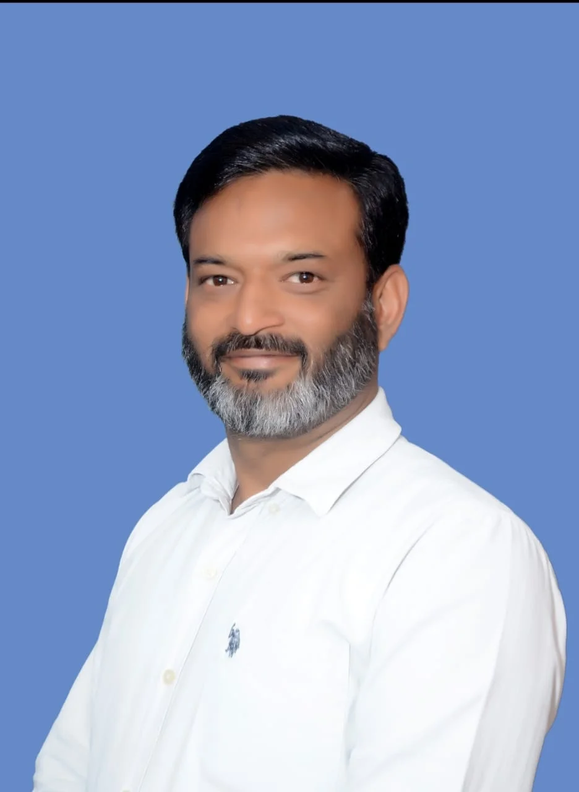

**रुड़की संवाददाता | आसिफ खान

रुड़की।** रुड़की विधानसभा की सियासत में चुनावी हलचल तेज होने लगी है। जन निर्माण पार्टी के प्रत्याशी, वरिष्ठ पत्रकार एवं पूर्व प्रेस क्लब अध्यक्ष दीपक शर्मा ने जनसंपर्क अभियान के दौरान भाजपा विधायक के 15 साल के कार्यकाल पर तीखे सवाल खड़े करते हुए विकास के दावों को कटघरे में खड़ा किया। दीपक शर्मा ने कहा कि रुड़की का जितना विकास पिछले 15 वर्षों में होना चाहिए था, उतना विकास धरातल पर दिखाई नहीं दे रहा है। उन्होंने तंज कसते हुए कहा कि रुड़की के विकास के पहिये में पंचर हो गया है और अब 2027 के विधानसभा चुनाव में जनता उस पंचर को ठीक करने का काम करेगी।

शुक्रवार को शहर के विभिन्न क्षेत्रों में जनसंपर्क के दौरान दीपक शर्मा ने लोगों से मुलाकात कर स्थानीय समस्याओं और विकास कार्यों पर संवाद किया। इस दौरान उन्होंने भाजपा और कांग्रेस से अलग जन निर्माण पार्टी के विकल्प को लेकर अपनी बात रखी। उनके जनसंपर्क अभियान में स्थानीय मुद्दों के साथ-साथ भाजपा विधायक के कार्यकाल को लेकर भी चर्चा हुई।

**15 साल का कार्यकाल, फिर भी विकास की रफ्तार पर सवाल!**

दीपक शर्मा ने भाजपा विधायक के 15 साल के कार्यकाल पर सवाल उठाते हुए कहा कि रुड़की को जिस विकास की जरूरत थी, वह अपेक्षाओं के अनुरूप नहीं हो पाया है। उन्होंने कहा कि शहर की समस्याओं को लेकर जनता लगातार सवाल उठा रही है और अब इन सवालों का जवाब देना जरूरी हो गया है।

उन्होंने कहा कि विकास केवल घोषणाओं और दावों से नहीं होता, बल्कि उसका असर जनता की जिंदगी में दिखाई देना चाहिए। रुड़की की जनता को बेहतर विकास, मजबूत बुनियादी सुविधाएं और समस्याओं से राहत मिलनी चाहिए थी, लेकिन विकास की रफ्तार को लेकर लोगों के मन में सवाल हैं।

**“रुड़की के विकास के पहिये में पंचर हो गया है”**

जनसंपर्क के दौरान दीपक शर्मा ने भाजपा विधायक पर निशाना साधते हुए कहा कि रुड़की के विकास के पहिये में पंचर हो गया है। उन्होंने कहा कि 15 साल के कार्यकाल के बाद भी यदि जनता विकास को लेकर सवाल उठा रही है, तो यह गंभीर विषय है।

दीपक शर्मा ने कहा कि “रुड़की के विकास के पहिये में पंचर हो गया है और रुड़की की जनता 2027 के चुनाव में उस पंचर को ठीक करने का काम करेगी।”

उनके इस बयान ने जनसंपर्क अभियान के दौरान चुनावी माहौल को और गरमा दिया। दीपक शर्मा ने कहा कि जनता को अब विकास के नाम पर केवल आश्वासन नहीं, बल्कि ठोस काम चाहिए।

**भाजपा-कांग्रेस से अलग विकल्प की तलाश, जन निर्माण पार्टी ने बढ़ाई सक्रियता**

दीपक शर्मा ने भाजपा और कांग्रेस से अलग जन निर्माण पार्टी के प्रत्याशी के रूप में चुनाव मैदान में उतरने का फैसला किया है। उनका कहना है कि जनता की समस्याओं को प्राथमिकता देना और उनकी आवाज को मजबूती से उठाना उनकी राजनीति का मुख्य उद्देश्य है।

उन्होंने कहा कि रुड़की की जनता के मुद्दों को सड़क से सदन तक उठाया जाएगा। जनसंपर्क के दौरान लोगों ने भी अपनी समस्याएं सामने रखीं और कुछ लोगों ने उन्हें समर्थन देने का भरोसा जताया।

दीपक शर्मा ने कहा कि जनता का विश्वास उनके लिए सबसे बड़ी ताकत है। वह रुड़की के विकास और जनहित से जुड़े मुद्दों को लेकर लगातार संघर्ष करेंगे।

**2027 में विकास के दावों और जनता के सवालों के बीच होगा मुकाबला**

रुड़की विधानसभा में 2027 के चुनाव को लेकर राजनीतिक गतिविधियां धीरे-धीरे तेज होने लगी हैं। भाजपा विधायक के 15 साल के कार्यकाल पर दीपक शर्मा के सवाल और विकास के पहिये में पंचर होने वाला उनका बयान अब चुनावी चर्चा का हिस्सा बन गया है।

अब देखना होगा कि दीपक शर्मा का जनसंपर्क अभियान कितना प्रभावी साबित होता है और रुड़की की जनता 2027 के चुनाव में विकास के मुद्दे पर किसे अपना समर्थन देती है।

रुड़की की सियासत में अब सवाल साफ है—15 साल के विकास का हिसाब या 2027 में बदलाव की नई पटकथा?
