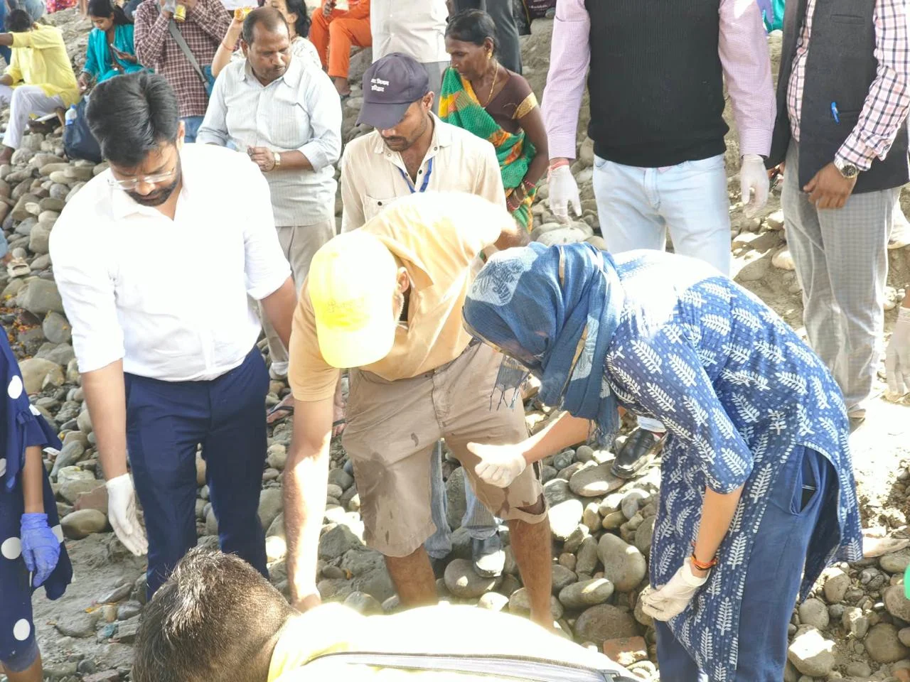
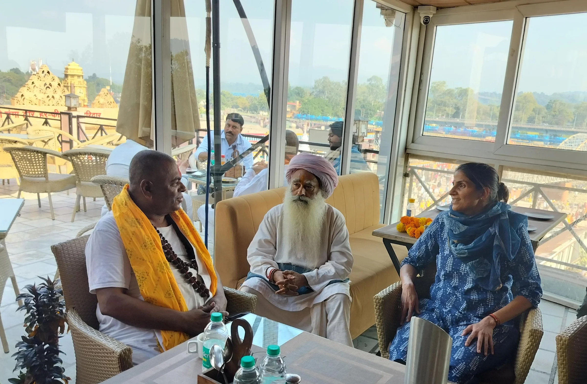
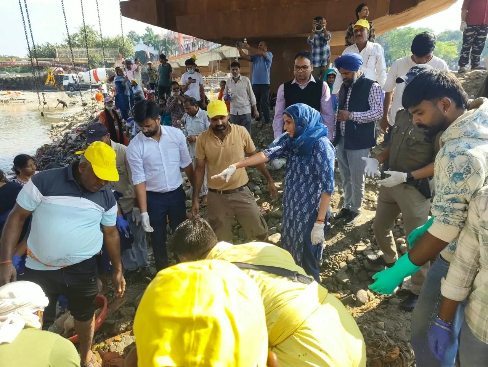

**हरिद्वार संवाददाता | आसिफ खान

हरिद्वार।** कुंभ-2027 के भव्य आयोजन से पहले धर्मनगरी हरिद्वार में गंगा सेवा और स्वच्छता को लेकर जनसहभागिता की बड़ी तस्वीर सामने आई। मां गंगा की निर्मलता और घाटों की स्वच्छता का संकल्प लेकर शनिवार को हरकी पैड़ी पर हजारों लोग एकजुट हुए। मिश्री मठ की ओर से आयोजित व्यापक स्वच्छता अभियान में संत समाज, श्रद्धालुओं, सामाजिक संगठनों और मेला प्रशासन ने एक साथ श्रमदान कर स्वच्छ हरिद्वार का संदेश दिया। अभियान ने साफ कर दिया कि कुंभ की तैयारियां केवल सरकारी योजनाओं और प्रशासनिक व्यवस्थाओं तक सीमित नहीं, बल्कि जनसहभागिता के बिना इनका उद्देश्य अधूरा है।

**स्वच्छता के लिए मैदान में उतरीं मेलाधिकारी सोनिका**

गंगा सेवा कार्यक्रम के तहत आयोजित इस अभियान में मेलाधिकारी श्रीमती सोनिका के नेतृत्व में मेला प्रशासन के अधिकारियों और कर्मचारियों ने भी सक्रिय भागीदारी निभाई। मेलाधिकारी स्वयं सफाई कार्य में उतरीं और मिश्री मठ के अनुयायियों के साथ श्रमदान किया। अधिकारियों और कर्मचारियों ने घाटों पर सफाई करते हुए एकत्रित कूड़े-कचरे को निर्धारित स्थान तक पहुंचाने तथा उसके सुरक्षित निस्तारण में सहयोग किया।

प्रशासनिक अधिकारियों को आमजन के साथ कंधे से कंधा मिलाकर सफाई करते देख अभियान में उत्साह और सामूहिक जिम्मेदारी का माहौल नजर आया। हजारों लोगों की भागीदारी ने गंगा घाटों की स्वच्छता को लेकर एक मजबूत जनसंदेश दिया।

**संत समाज और प्रशासन ने मिलाया हाथ**

स्वच्छता अभियान में नगर आयुक्त श्री नंदन कुमार, मुख्य विकास अधिकारी डॉ. ललित नारायण मिश्र, अपर मेलाधिकारी श्री दयानंद सरस्वती, उप मेलाधिकारी श्री मनजीत सिंह सहित मेला अधिष्ठान के अन्य अधिकारी एवं कर्मचारी भी शामिल रहे।

इस अवसर पर मेलाधिकारी श्रीमती सोनिका ने नया उदासीन अखाड़ा के अध्यक्ष श्री महंत धूनी दास जी महाराज तथा मिश्री मठ के मठाधिपति महामंडलेश्वर श्री करौली शंकर महाराज से भेंट की। उन्होंने गंगा सेवा और स्वच्छता के इस पुनीत अभियान के आयोजन तथा हजारों लोगों की सहभागिता सुनिश्चित करने के लिए संत समाज और मिश्री मठ के अनुयायियों का आभार व्यक्त किया।

**कुंभ-2027 से पहले स्वच्छता को लेकर बड़ा संदेश**

मेलाधिकारी श्रीमती सोनिका ने कहा कि हरिद्वार केवल धार्मिक नगरी नहीं, बल्कि करोड़ों श्रद्धालुओं की आस्था का केंद्र है। मां गंगा के घाटों की स्वच्छता और पवित्रता बनाए रखना प्रत्येक नागरिक का साझा दायित्व है।

उन्होंने कहा कि कुंभ मेला-2027 में देश-विदेश से बड़ी संख्या में श्रद्धालु हरिद्वार पहुंचेंगे। ऐसे में स्वच्छता को केवल प्रशासनिक व्यवस्था तक सीमित नहीं रखा जा सकता। इसे जनभागीदारी का विषय बनाना जरूरी है। संत समाज, धार्मिक संस्थाओं, सामाजिक संगठनों और स्थानीय नागरिकों के सहयोग से हरिद्वार को स्वच्छ एवं सुंदर बनाने के प्रयासों को नई गति मिलेगी।

मेलाधिकारी ने कहा कि कुंभ की तैयारियों में आधारभूत सुविधाओं के विकास के साथ-साथ स्वच्छता और पर्यावरण संरक्षण को भी प्राथमिकता दी जा रही है। गंगा घाटों की स्वच्छता बनाए रखने के लिए प्रशासनिक स्तर पर किए जा रहे प्रयासों को जनसहयोग से और अधिक प्रभावी बनाया जा सकता है।

**गंगा की स्वच्छता ही कुंभ की भव्यता का आधार**

हरकी पैड़ी पर आयोजित इस अभियान ने कुंभ-2027 की तैयारियों के बीच एक महत्वपूर्ण संदेश दिया है। गंगा की निर्मलता, घाटों की स्वच्छता और पर्यावरण संरक्षण के लिए प्रशासन के साथ आमजन की भागीदारी भी जरूरी है। हजारों लोगों का एक साथ श्रमदान करना इस बात का संकेत है कि धार्मिक आस्था को स्वच्छता के संकल्प से जोड़कर हरिद्वार को स्वच्छ, सुंदर और श्रद्धालुओं के स्वागत के लिए तैयार किया जा सकता है।

कुंभ-2027 की भव्यता के साथ स्वच्छता का संकल्प भी मजबूत हो रहा है। हरकी पैड़ी से उठी गंगा सेवा की यह पहल जनसहभागिता के जरिए स्वच्छ हरिद्वार की दिशा में एक प्रभावी संदेश बनकर सामने आई।
