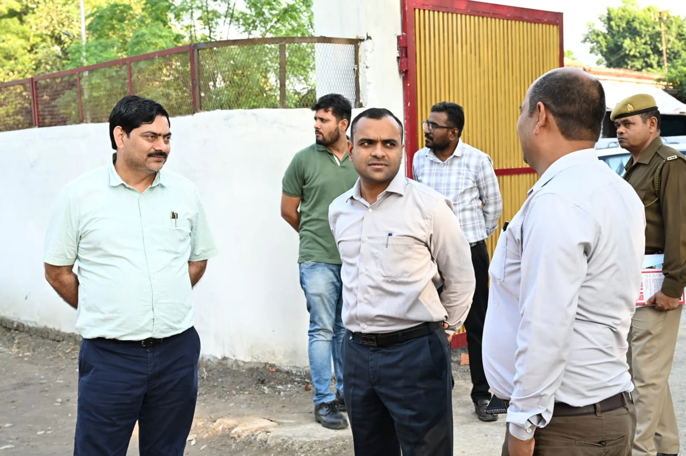
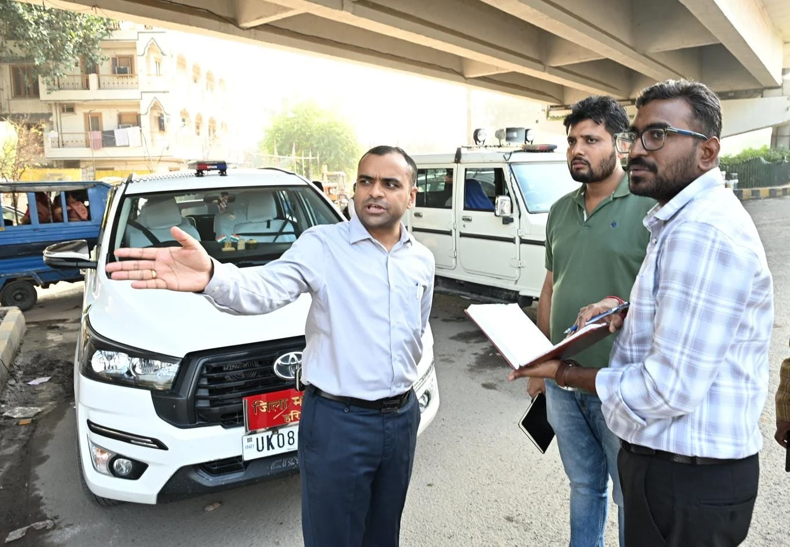
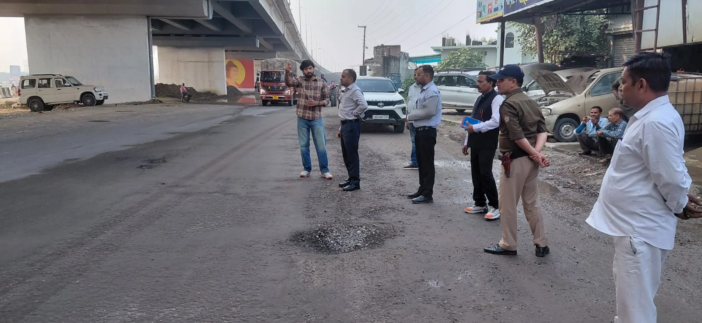

**हरिद्वार संवाददाता | आसिफ खान

हरिद्वार।** कुंभ मेला-2027 की तैयारियों को लेकर जिला प्रशासन अब निर्माण कार्यों में किसी भी तरह की ढिलाई के मूड में नहीं है। मुख्यमंत्री के निर्देशों के क्रम में जिलाधिकारी मयूर दीक्षित ने शनिवार को रुड़की से बहादराबाद और हरिद्वार तक विभिन्न क्षेत्रों में चल रहे कुंभ निर्माण कार्यों तथा सड़क निर्माण एवं मरम्मत कार्यों का स्थलीय निरीक्षण कर अधिकारियों को कड़े निर्देश दिए। डीएम ने स्पष्ट किया कि कुंभ जैसे ऐतिहासिक आयोजन की तैयारियों में लापरवाही और अनावश्यक देरी किसी भी सूरत में स्वीकार नहीं की जाएगी।

निरीक्षण के दौरान जिलाधिकारी ने निर्माण कार्यों की प्रगति का जायजा लेते हुए संबंधित विभागों को कार्यों में तेजी लाने के निर्देश दिए। उन्होंने कहा कि निर्माण कार्यों को निर्धारित समयसीमा में पूरा करने के लिए श्रमिकों की संख्या बढ़ाई जाए और निर्माण स्थलों पर पर्याप्त संसाधन उपलब्ध रखे जाएं। कुंभ मेला-2027 की तैयारियां शासन की प्राथमिकता हैं और सभी विभागों को पूरी गंभीरता के साथ अपनी जिम्मेदारी निभानी होगी।

**15 दिन का अल्टीमेटम, एनएच अधिकारियों को दो टूक निर्देश**

जिलाधिकारी मयूर दीक्षित ने राष्ट्रीय राजमार्ग के अधिकारियों को रुड़की के बड़ेरी राजपूताना से बहादराबाद टोल प्लाजा तक सड़क मरम्मत एवं सर्विस लेन निर्माण कार्य 15 दिन के भीतर अनिवार्य रूप से पूरा करने के निर्देश दिए। उन्होंने कहा कि सड़क निर्माण और मरम्मत कार्यों में किसी भी प्रकार की लापरवाही आमजन के लिए परेशानी का कारण बन सकती है, इसलिए इन कार्यों को प्राथमिकता के आधार पर पूरा किया जाए।

डीएम ने अधिकारियों को निर्देशित किया कि निर्माण कार्यों के दौरान आने वाली समस्याओं का तत्काल समाधान किया जाए। यदि किसी स्तर पर बाधा उत्पन्न होती है तो संबंधित अधिकारी अपने उच्चाधिकारियों से समन्वय स्थापित कर उसका निराकरण सुनिश्चित करें। किसी भी समस्या को निर्माण कार्यों में देरी का बहाना नहीं बनाया जाना चाहिए।

**कुंभ निर्माण कार्यों में तेजी लाने के निर्देश**

जिलाधिकारी ने सभी संबंधित विभागों को आपसी समन्वय के साथ कार्य करने और निर्माण स्थलों पर पर्याप्त श्रमिक एवं आवश्यक संसाधन उपलब्ध रखने के निर्देश दिए। उन्होंने कहा कि कुंभ मेला-2027 में देश-विदेश से लाखों श्रद्धालुओं के हरिद्वार पहुंचने की संभावना है। ऐसे में सड़कें, संपर्क मार्ग और अन्य बुनियादी सुविधाएं समय से तैयार होना बेहद जरूरी है।

उन्होंने अधिकारियों को चेताया कि निर्माण कार्यों की गुणवत्ता से किसी भी प्रकार का समझौता नहीं किया जाएगा। सभी कार्य निर्धारित समयसीमा में पूरे किए जाएं, ताकि कुंभ के दौरान श्रद्धालुओं और स्थानीय नागरिकों को आवागमन में किसी प्रकार की परेशानी का सामना न करना पड़े।

**शंकराचार्य चौक से डाम कोठी तक सड़क सुधार कार्यों का भी निरीक्षण**

जिलाधिकारी ने उत्तर प्रदेश सिंचाई विभाग द्वारा शंकराचार्य चौक से डाम कोठी क्षेत्र में कराए जा रहे सड़क सुधारीकरण कार्यों का भी स्थलीय निरीक्षण किया। उन्होंने संबंधित अधिकारियों को निर्माण कार्यों में तेजी लाते हुए इन्हें शीघ्र पूरा करने के निर्देश दिए।

डीएम ने कहा कि सड़क सुधारीकरण कार्यों का समय से पूरा होना यातायात व्यवस्था को सुचारु बनाए रखने के लिए आवश्यक है। कुंभ मेले के दौरान श्रद्धालुओं की आवाजाही को देखते हुए सभी विभागों को अभी से अपनी तैयारियां दुरुस्त करनी होंगी।

**अधिकारियों की मौजूदगी में लिया निर्माण कार्यों का जायजा**

निरीक्षण के दौरान अधिशासी अभियंता उत्तर प्रदेश सिंचाई विभाग त्यागी, एसडीओ सिंचाई विभाग भारत भूषण, तहसीलदार रुड़की विकास अवस्थी, राष्ट्रीय राजमार्ग के अधिकारी एवं संबंधित कॉन्ट्रैक्टर मौजूद रहे।

जिलाधिकारी ने सभी अधिकारियों को निर्देशित किया कि कुंभ मेला-2027 से जुड़े निर्माण एवं सड़क सुधार कार्यों को गुणवत्ता के साथ निर्धारित समयसीमा में पूरा करना सुनिश्चित करें। प्रशासन की प्राथमिकता है कि कुंभ के आयोजन से पहले सड़कें और बुनियादी सुविधाएं पूरी तरह तैयार हों, ताकि श्रद्धालुओं को बेहतर आवागमन व्यवस्था उपलब्ध कराई जा सके।
