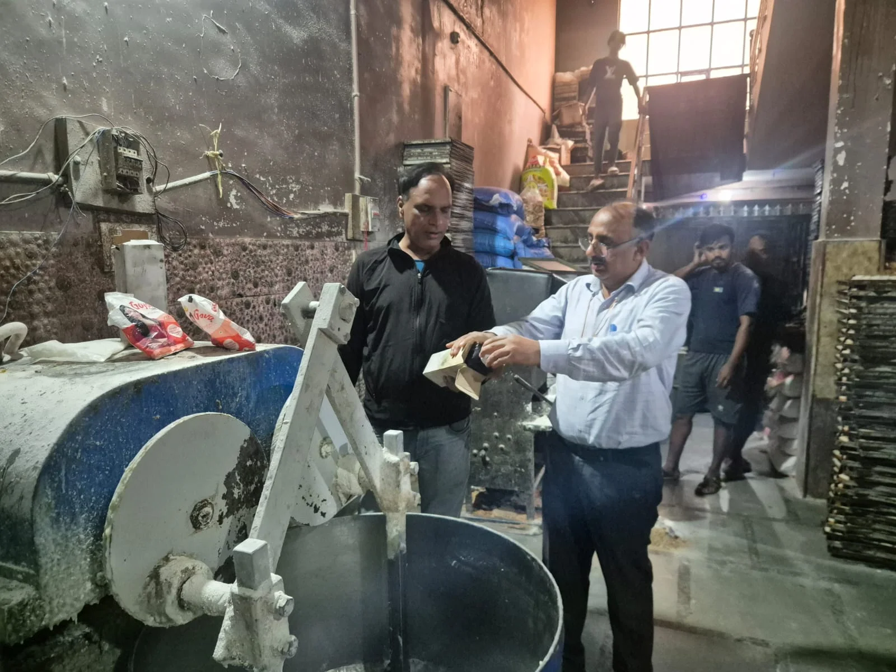
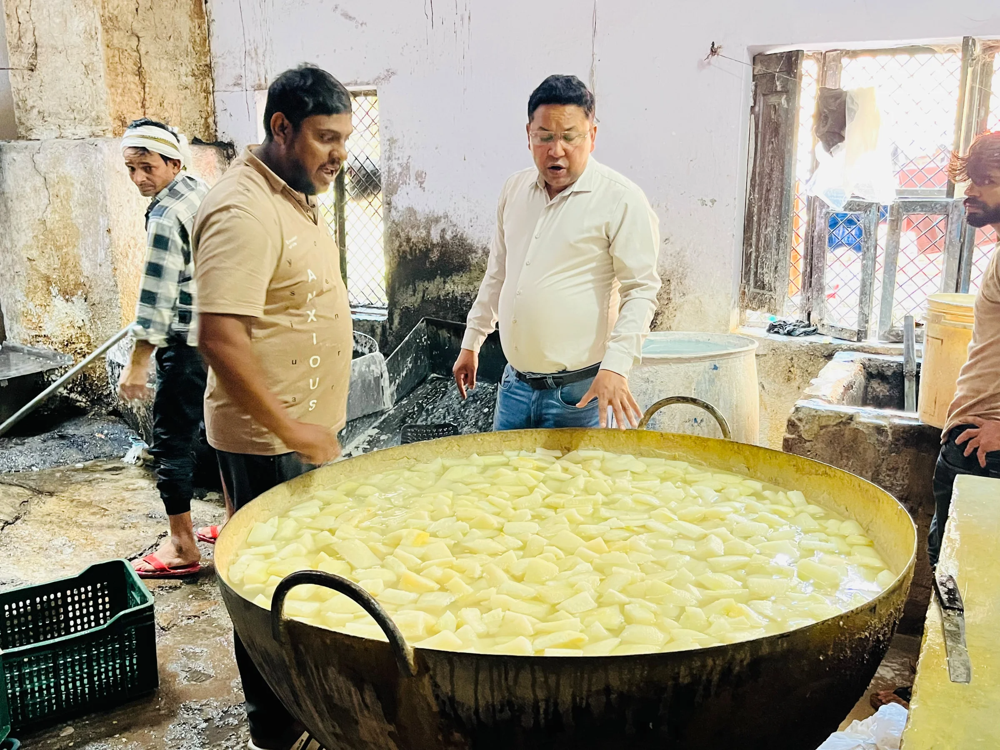
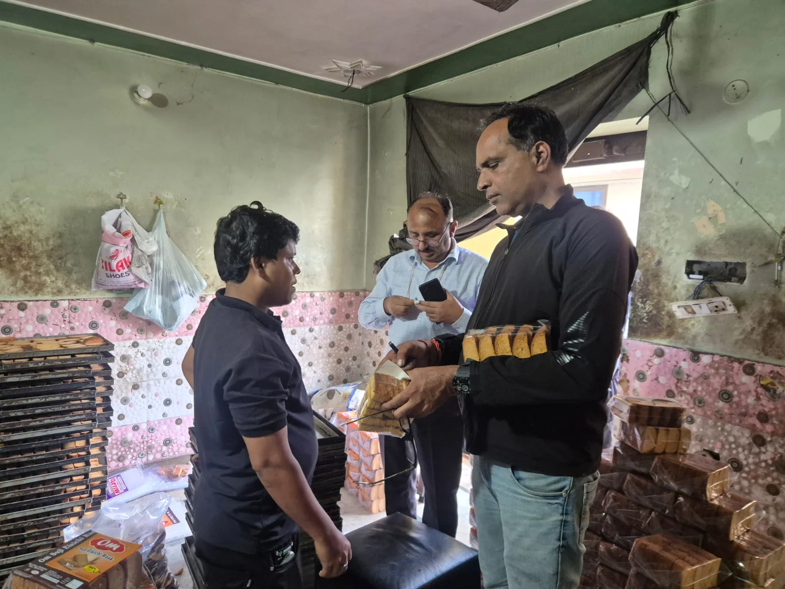
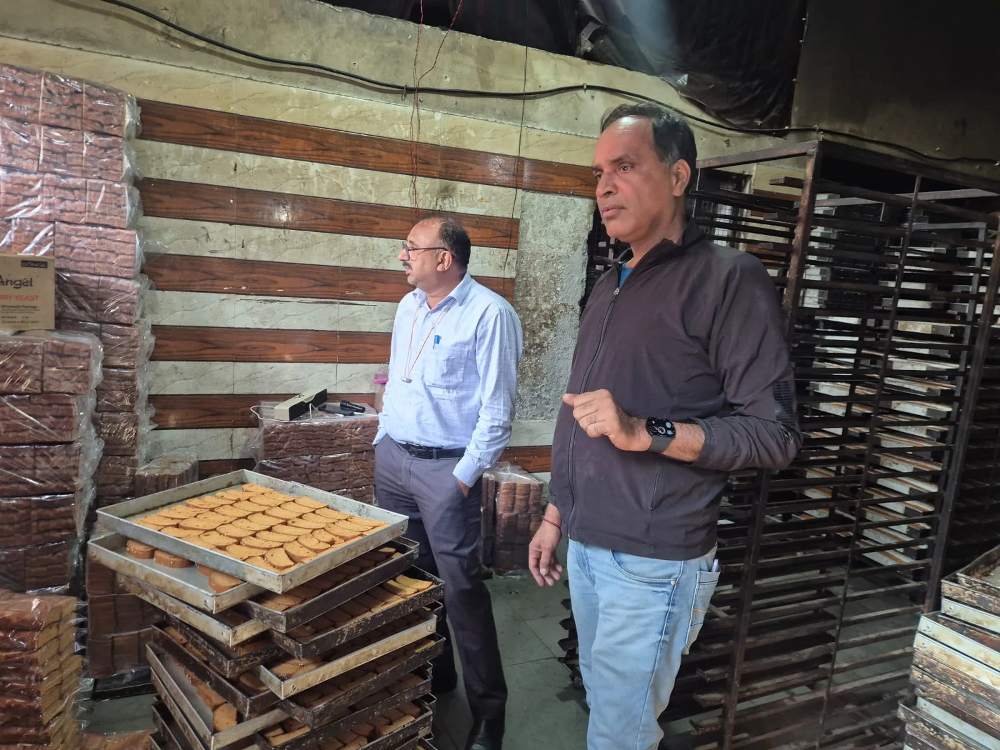

**हरिद्वार संवाददाता | आसिफ खान

हरिद्वार।** दीपावली का त्योहार नजदीक आते ही मिठाइयों और खाद्य पदार्थों में मिलावट की आशंका के बीच खाद्य सुरक्षा विभाग ने अपनी कार्रवाई तेज कर दी है। त्योहार की मिठास में मिलावट का जहर घोलने वालों पर शिकंजा कसने के लिए विभाग ने हरिद्वार के ज्वालापुर क्षेत्र में औचक छापेमारी अभियान चलाया। इस दौरान पेठा, बताशा और डेयरी उत्पादों की निर्माण इकाइयों का निरीक्षण किया गया। विभागीय टीम ने पांच विधिक नमूने जांच के लिए संग्रहित किए, जबकि आवश्यक अभिलेख प्रस्तुत नहीं कर पाने पर दो निर्माण इकाइयों को नोटिस जारी किए गए।

खाद्य सुरक्षा विभाग की इस कार्रवाई से खाद्य कारोबारियों में हड़कंप मचा रहा। अधिकारियों ने स्पष्ट किया कि दीपावली के दौरान आमजन की सेहत से खिलवाड़ किसी भी सूरत में बर्दाश्त नहीं किया जाएगा।

खाद्य सुरक्षा आयुक्त एवं जिलाधिकारी मयूर दीक्षित के निर्देशों के अनुपालन में शनिवार, 31 अक्टूबर को सहायक आयुक्त खाद्य सुरक्षा एवं औषधि प्रशासन महिमानंद जोशी के नेतृत्व में यह अभियान चलाया गया। अभियान के तहत हरिद्वार नगर निगम क्षेत्र की विभिन्न मिष्ठान निर्माण इकाइयों एवं डेयरी प्रतिष्ठानों का औचक निरीक्षण किया गया।

**किसान डेयरी से घी और दूध के नमूने लिए**

निरीक्षण अभियान के दौरान वरिष्ठ खाद्य सुरक्षा अधिकारी कैलाश चंद्र टम्टा ने झंडा चौक, पीठ बाजार, ज्वालापुर स्थित किसान डेयरी का निरीक्षण किया। यहां से घी एवं गाय के दूध के दो विधिक नमूने जांच के लिए संग्रहित किए गए।

इसके बाद विभागीय टीम ईदगाह रोड, पांवधोई ज्वालापुर स्थित पेठा निर्माण इकाई पर पहुंची। यहां निरीक्षण के दौरान पेठा का एक नमूना जांच के लिए लिया गया। लेकिन जांच के दौरान इकाई संचालक पेयजल की जांच रिपोर्ट, कर्मचारियों के मेडिकल फिटनेस प्रमाणपत्र, पेस्ट कंट्रोल रिपोर्ट और खाद्य पदार्थों की जांच से संबंधित आवश्यक अभिलेख प्रस्तुत नहीं कर सके।

अभिलेखों के अभाव को गंभीरता से लेते हुए विभाग ने संबंधित इकाई संचालक को नोटिस जारी किया और सात दिनों के भीतर सभी आवश्यक दस्तावेज प्रस्तुत करने के निर्देश दिए।

**बताशा और खिलौना निर्माण इकाई भी जांच के घेरे में**

खाद्य सुरक्षा विभाग की टीम ने डांट मोहल्ला, ज्वालापुर स्थित बताशा एवं खिलौना निर्माण इकाई का भी औचक निरीक्षण किया। यहां से बताशा एवं खिलौना के दो विधिक नमूने जांच के लिए संग्रहित किए गए।

निरीक्षण के दौरान इस इकाई के संचालक भी पेयजल जांच रिपोर्ट, खाद्य सामग्री की जांच रिपोर्ट, कर्मचारियों के मेडिकल फिटनेस प्रमाणपत्र और पेस्ट कंट्रोल संबंधी अभिलेख प्रस्तुत नहीं कर सके। विभाग ने इस प्रतिष्ठान को भी नोटिस जारी कर सात दिनों के भीतर आवश्यक दस्तावेज उपलब्ध कराने के निर्देश दिए हैं।

**सात दिन की मोहलत, फिर कानूनी कार्रवाई**

दीपावली से पहले चलाए गए इस अभियान में कुल पांच विधिक नमूने जांच के लिए संग्रहित किए गए, जबकि दो निर्माण इकाइयों को नोटिस जारी किए गए हैं।

विभागीय अधिकारियों ने साफ किया कि निर्धारित सात दिनों की अवधि में आवश्यक अभिलेख प्रस्तुत नहीं करने वाले प्रतिष्ठानों के विरुद्ध खाद्य सुरक्षा एवं मानक अधिनियम के तहत नियमानुसार कानूनी कार्रवाई की जाएगी।

दीपावली के मद्देनजर विभाग का यह अभियान आगे भी जारी रहेगा। खाद्य सुरक्षा विभाग की नजर अब मिठाई निर्माण इकाइयों, डेयरी प्रतिष्ठानों और अन्य खाद्य कारोबारियों पर रहेगी।

त्योहारी सीजन में खाद्य पदार्थों की गुणवत्ता और सुरक्षा सुनिश्चित करना विभाग की प्राथमिकता है। ऐसे में कारोबारियों को नियमों का पालन करना होगा, अन्यथा कार्रवाई के लिए तैयार रहना होगा।
