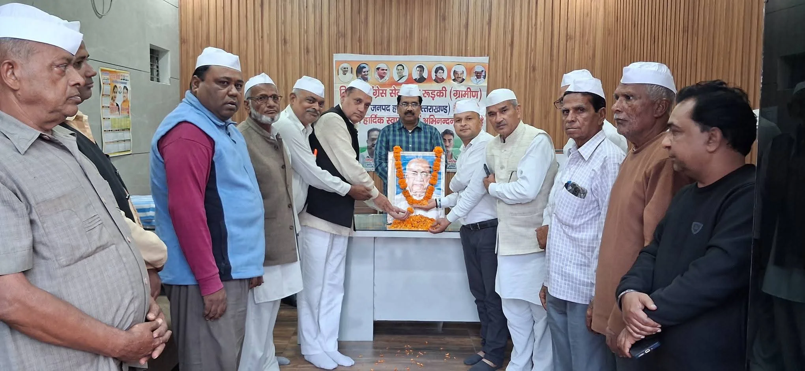

**रूडकी संवाददाता | आसिफ खान 

रुड़की।** देश की पूर्व प्रधानमंत्री एवं ‘लेडी आयरन’ के नाम से विख्यात इंदिरा गांधी की पुण्यतिथि और लौह पुरुष सरदार वल्लभभाई पटेल की जयंती के अवसर पर रुड़की कांग्रेस कार्यालय में संयुक्त श्रद्धांजलि कार्यक्रम का आयोजन किया गया। रुड़की ग्रामीण जिला सेवादल एवं रुड़की जिला महानगर सेवादल के तत्वावधान में आयोजित इस कार्यक्रम में दोनों महान विभूतियों को भावपूर्ण श्रद्धांजलि अर्पित करते हुए उनके विचारों, सिद्धांतों और राष्ट्रसेवा के आदर्शों को आत्मसात करने का संकल्प लिया गया।

कार्यक्रम में उपस्थित कांग्रेसजनों ने इंदिरा गांधी एवं सरदार वल्लभभाई पटेल के चित्रों पर पुष्प अर्पित कर उन्हें शत-शत नमन किया। इस दौरान दोनों महान नेताओं के योगदान को याद करते हुए देश की एकता, अखंडता और लोकतांत्रिक मूल्यों की रक्षा के लिए उनके बताए मार्ग पर चलने का संकल्प दोहराया गया।

इंदिरा गांधी को याद करते हुए उनके दृढ़ नेतृत्व, साहस और देश के प्रति समर्पण को नमन किया गया। वहीं, सरदार वल्लभभाई पटेल के राष्ट्र निर्माण और देश की रियासतों को एक सूत्र में पिरोने के ऐतिहासिक योगदान को याद किया गया। कार्यक्रम में दोनों महान विभूतियों के विचारों को वर्तमान समय में भी प्रासंगिक बताते हुए राष्ट्रहित और जनसेवा के प्रति प्रतिबद्धता जताई गई।

इस अवसर पर पूर्व राज्य मंत्री मेला राम प्रजापति, प्रवीण मित्तल, सुधीर शांडिल्य, बेनी प्रसाद सैनी, नवीन जैन, आशीष गोयल, कंवरपाल सैनी, नीरज ठाकुर, मकसूद हसन, सुमित उपाध्याय, वारिस अली, राहुल सैनी, तनवीर, नितिन सैनी, अमन, सुनील सहित अनेक कांग्रेसजन उपस्थित रहे।

कार्यक्रम के माध्यम से कांग्रेस सेवादल के कार्यकर्ताओं ने देश की एकता, अखंडता और सामाजिक सद्भाव को मजबूत करने के साथ ही दोनों महान नेताओं के आदर्शों को जन-जन तक पहुंचाने का संकल्प लिया।
