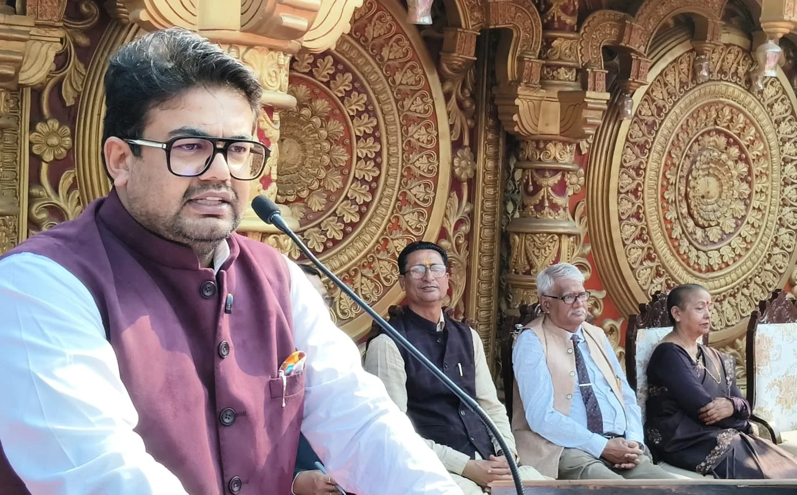
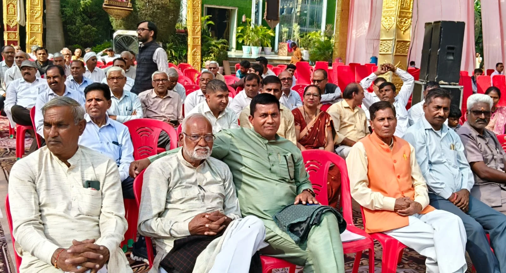

**रूडकी संवाददाता | आसिफ खान** 

**रुड़की।** सैनी समाज के चहुंमुखी विकास और सामाजिक मजबूती के लिए एकजुटता बेहद जरूरी है। समाज के सभी लोगों को एकता के सूत्र में बंधकर आगे आना चाहिए, तभी विकास की नई इबारत लिखी जा सकेगी। यह बात राज्यसभा सांसद डॉ. कल्पना सैनी ने ग्रैंड वेदांतम में आयोजित दीपावली मिलन समारोह में बतौर मुख्य अतिथि संबोधित करते हुए कही।

डॉ. कल्पना सैनी ने कहा कि दीपावली जैसे पावन पर्व भारतीय संस्कृति की पहचान हैं। ये पर्व समाज में आपसी प्रेम, सद्भाव, एकता और भाईचारे की भावना को मजबूत करते हैं। उन्होंने सभी लोगों से दीपावली का त्योहार आपसी सौहार्द और सद्भावपूर्ण वातावरण में मनाने का आह्वान किया। उन्होंने कहा कि सामाजिक एकता ही किसी भी समाज की सबसे बड़ी ताकत होती है और इसी ताकत के बल पर समाज नई ऊंचाइयों को हासिल कर सकता है।

**दीपावली का संदेश, अंधकार पर प्रकाश और बुराई पर अच्छाई की जीत**

समारोह के आयोजक इंजीनियर सौरभ सैनी ने कहा कि उन्होंने अफ्रीका और संयुक्त अरब अमीरात जैसे प्रमुख देशों में विधिक व्यवसाय से जुड़कर वहां की संस्कृति को करीब से समझा है। भारत विविधताओं से भरा देश है, जहां विभिन्न धर्मों, संस्कृतियों और परंपराओं के लोग एक साथ मिलकर रहते हैं। दीपावली जैसे पर्व सभी को एकता के सूत्र में बांधने का काम करते हैं।

उन्होंने कहा कि दीपावली भारत का प्राचीन धार्मिक एवं सांस्कृतिक पर्व है, जो अंधकार पर प्रकाश, बुराई पर अच्छाई और असत्य पर सत्य की विजय का प्रतीक है। भगवान श्रीराम के चौदह वर्ष के वनवास के बाद रावण पर विजय प्राप्त कर अयोध्या लौटने पर नगरवासियों ने दीप जलाकर उनका स्वागत किया था। तभी से दीपावली मनाने की परंपरा चली आ रही है।

इंजीनियर सौरभ सैनी ने सैनी समाज के लोगों से आपसी मतभेद भुलाकर एकजुट होने का आह्वान किया। उन्होंने एक गीत के माध्यम से भी समाज को एकता का संदेश दिया और सभी उपस्थित लोगों को दीपावली की शुभकामनाएं दीं।

**समाज के गणमान्य लोगों ने रखे विचार**

दीपावली मिलन समारोह में राज्यमंत्री आदेश सैनी, डॉ. नाथीराम सैनी, डॉ. रोशन लाल सैनी, नगर पंचायत अध्यक्ष मनोज सैनी, कुमारी रोमा सैनी, जिला उपाध्यक्ष महिला मोर्चा कुशल पाल सैनी, सतीश सैनी, प्रदेश कार्यकारिणी सदस्य तेज सिंह सैनी, राजेंद्र सैनी, ओम ग्रुप के डायरेक्टर मुनेश सैनी, हरपाल सिंह सैनी, राज्यमंत्री श्यामवीर सैनी, अनुज सैनी, तेज प्रताप सैनी, जगदीश प्रसाद सैनी, ईश्वर चंद सैनी, कर्म सिंह सैनी, समय सिंह सैनी, मुकेश सैनी और इंजीनियर राकेश कुमार सैनी सहित अन्य वक्ताओं ने संबोधित किया।

कार्यक्रम की अध्यक्षता एमईएस के सेवानिवृत्त एडीसी महानिदेशक राकेश कुमार सैनी ने की, जबकि समारोह का सफल संचालन पत्रकार शशि कुमार सैनी ने किया।

इस अवसर पर देशबंधु सैनी, सोर्सिंग सैनी, तेज प्रताप सिंह, श्रीमती राजबाला सैनी, सुरेश सैनी, सोमपाल आर्य पूर्व प्रधान, डॉ. जयपाल सिंह, शिवानी सैनी, पार्षद ईश्वर चंद सैनी, फूल सिंह सैनी, ब्रह्मपाल सिंह, विजयपाल सिंह, संदीप सैनी, अनूप सैनी, कुंवर पाल सिंह, इतिहासकार करण सिंह सैनी, राजेश सैनी, सुभाष सैनी, डॉ. बीएस सैनी, फिजिशियन डॉ. रामसुभग सैनी, महक सिंह सैनी एडवोकेट, मास्टर विनोद सैनी, मुल्कीराज सैनी, प्रमोद कुमार सैनी, प्रमेंद्र सैनी, अजय सैनी और गीता सैनी सहित बड़ी संख्या में समाज के लोग मौजूद रहे।

समारोह के समापन से पूर्व कार्यक्रम संयोजक इंजीनियर सौरभ सैनी ने सभी अतिथियों एवं उपस्थित लोगों का आभार व्यक्त किया। समारोह में सामाजिक एकता, आपसी भाईचारे और समाज के विकास को लेकर सकारात्मक संदेश दिया गया।
