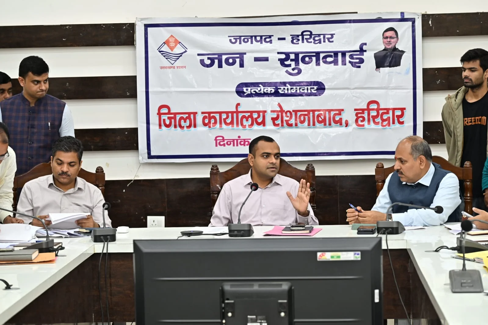
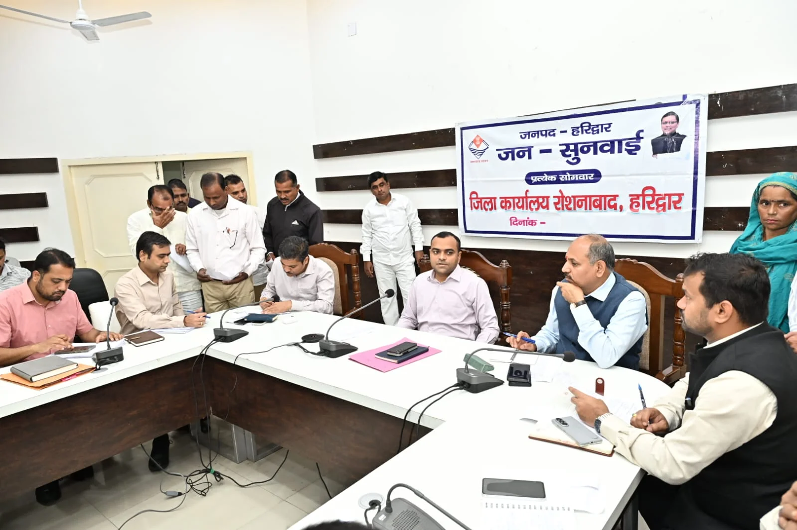
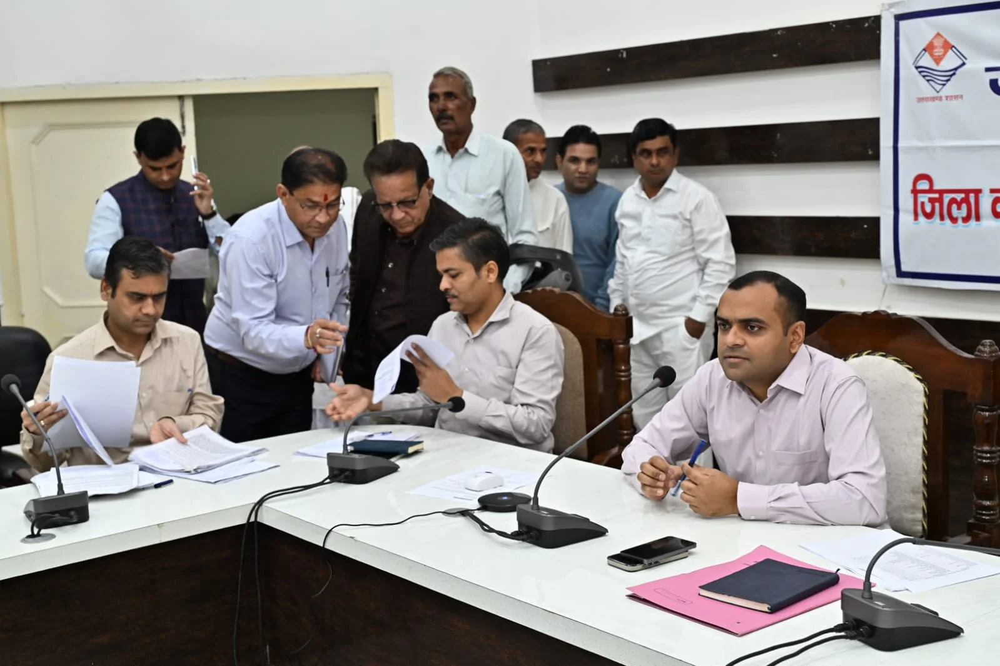
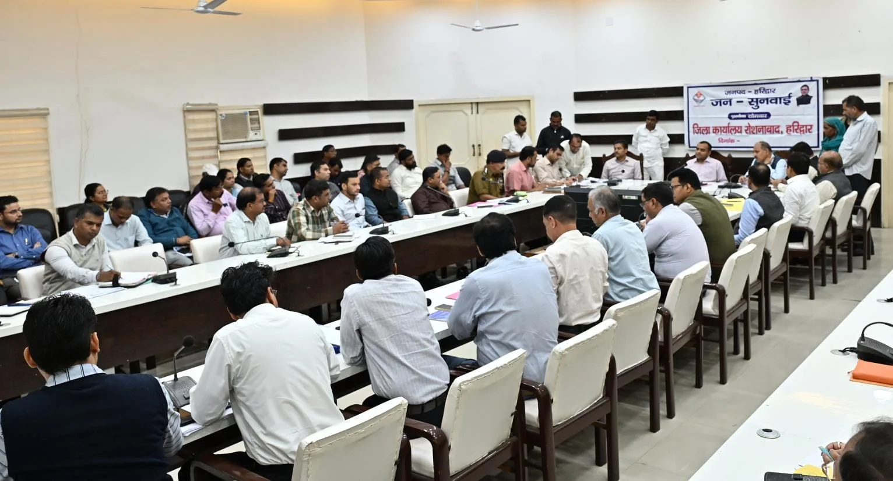

**हरिद्वार संवाददाता | आसिफ खान

हरिद्वार।** जनता की समस्याओं के निस्तारण में लापरवाही और अनावश्यक देरी अब अधिकारियों पर भारी पड़ सकती है। जिलाधिकारी मयूर दीक्षित ने स्पष्ट कर दिया है कि जनसुनवाई में आने वाली शिकायतों का निस्तारण केवल औपचारिकता नहीं, बल्कि अधिकारियों की प्राथमिक जिम्मेदारी है। शिकायतों के समाधान में किसी भी प्रकार की शिथिलता बर्दाश्त नहीं की जाएगी और लापरवाही सामने आने पर संबंधित अधिकारियों के खिलाफ आवश्यक कार्रवाई सुनिश्चित की जाएगी।

जिला कार्यालय सभागार में जिलाधिकारी मयूर दीक्षित की अध्यक्षता में आयोजित जनसुनवाई कार्यक्रम में विभिन्न विभागों से संबंधित 90 शिकायतें दर्ज की गईं, जिनमें से 55 शिकायतों का मौके पर ही निस्तारण कर दिया गया। शेष शिकायतों को संबंधित विभागों के अधिकारियों को त्वरित एवं समयबद्ध समाधान के लिए भेजा गया।

प्रत्येक सोमवार को आयोजित होने वाले इस जनसुनवाई कार्यक्रम में राजस्व, भूमि विवाद, विद्युत, अतिक्रमण, जलभराव, पेयजल और राशन कार्ड सहित विभिन्न जनसमस्याएं सामने आईं। जिलाधिकारी ने अधिकारियों को निर्देश दिए कि शिकायतों को गंभीरता से लेते हुए उनका प्राथमिकता के आधार पर समाधान किया जाए।

**जमीन से लेकर आवास तक, फरियादियों ने उठाए मुद्दे**

जनसुनवाई में कई महत्वपूर्ण समस्याएं अधिकारियों के सामने रखी गईं। जगजीतपुर निवासी श्यामलाल ने प्रधानमंत्री आवास योजना शहरी के तहत आवास उपलब्ध कराने की मांग की।

वहीं, धर्मेंद्र पुत्र लालसिंह ने बताया कि ग्राम रांघड़वाला, परगना रुड़की में वर्ष 1998-99 में खसरा संख्या 333 के अंतर्गत उन्हें पट्टा आवंटित किया गया था, लेकिन आज तक खतौनी में उसका दर्ज नहीं किया गया है। उन्होंने संबंधित अभिलेखों में पट्टे को दर्ज कराने की मांग उठाई।

समाजसेवी नितिन यादव ने भागीरथी बिंदु से गीता कुटीर तक गंगा पटरी मार्ग के निर्माण एवं सौंदर्यीकरण की मांग को लेकर प्रार्थना पत्र दिया। वहीं, पीठ बाजार भूपतवाला के व्यापारी नितिन यादव ने पिछले 25 वर्षों से संचालित पीठ बाजार की अव्यवस्थित स्थिति का मुद्दा उठाते हुए बाजार की व्यवस्था सुधारने तथा इसे किसी अन्य उपयुक्त भूमि पर स्थानांतरित करने की मांग की।

**जिलाधिकारी की दो टूक—समस्या का समाधान करें, फाइलों में न उलझाएं**

जिलाधिकारी मयूर दीक्षित ने संबंधित अधिकारियों को निर्देशित किया कि जनसुनवाई में प्राप्त शिकायतों का निस्तारण निर्धारित समयसीमा के भीतर सुनिश्चित किया जाए। उन्होंने कहा कि जनता अपनी समस्याओं के समाधान की उम्मीद लेकर प्रशासन के पास आती है। ऐसे में अधिकारियों की जिम्मेदारी है कि वे संवेदनशीलता और गंभीरता के साथ शिकायतों का समाधान करें।

उन्होंने स्पष्ट किया कि जिन शिकायतों में स्थलीय निरीक्षण की आवश्यकता है, उनमें संबंधित अधिकारी आपसी समन्वय स्थापित कर मौके पर पहुंचें और वास्तविक स्थिति का आकलन करते हुए समस्या का समाधान सुनिश्चित करें।

जिलाधिकारी ने कहा कि शिकायतों के निस्तारण में किसी भी प्रकार की लापरवाही अथवा शिथिलता सामने आने पर संबंधित अधिकारियों के विरुद्ध आवश्यक कार्रवाई की जाएगी।

**सीएम हेल्पलाइन की 658 शिकायतें लंबित, अधिकारियों को फटकार के संकेत**

जनसुनवाई के दौरान सीएम हेल्पलाइन में दर्ज शिकायतों की भी समीक्षा की गई। मुख्य विकास अधिकारी डॉ. ललित नारायण मिश्र ने अधिकारियों को निर्देश दिए कि सीएम हेल्पलाइन पर दर्ज शिकायतों को गंभीरता से लेते हुए उनका तत्काल निस्तारण सुनिश्चित किया जाए।

उन्होंने कहा कि शिकायतों के समाधान के लिए संबंधित अधिकारी शिकायतकर्ता से दूरभाष पर वार्ता करें। आवश्यकता पड़ने पर स्थलीय निरीक्षण कर शिकायतकर्ता से स्वयं मिलें और समस्या के समाधान की वास्तविक स्थिति की जानकारी प्राप्त करें।

समीक्षा में सामने आया कि 36 दिन से अधिक समय से लंबित शिकायतों में एल-1 स्तर पर 524 तथा एल-2 स्तर पर 134 शिकायतें निस्तारण के लिए लंबित हैं। अधिकारियों को इन शिकायतों का शीघ्र समाधान करने के निर्देश दिए गए।

लंबे समय से लंबित शिकायतों की संख्या प्रशासनिक कार्यप्रणाली पर सवाल खड़े करती है। ऐसे में अधिकारियों के सामने अब चुनौती केवल शिकायतों को दर्ज करने की नहीं, बल्कि उनका प्रभावी और धरातल पर समाधान सुनिश्चित करने की है।

**प्रशासनिक अधिकारियों की रही मौजूदगी**

जनसुनवाई कार्यक्रम में मुख्य विकास अधिकारी डॉ. ललित नारायण मिश्र, ज्वाइंट मजिस्ट्रेट रुड़की दीपक रामचंद्र सेठ, अपर जिलाधिकारी (प्रशासन) जितेंद्र कुमार, जिलाधिकारी वैभव गुप्ता, मुख्य चिकित्सा अधिकारी डॉ. आरके सिंह, उप जिलाधिकारी हरिद्वार योगेश मेहरा, अपर मुख्य अधिकारी जिला पंचायत महेश कुमार बिश्नोई, जिला खाद्य सुरक्षा अधिकारी महिमानंद जोशी, महाप्रबंधक जिला उद्योग केंद्र उत्तम कुमार तिवारी, जिला पर्यटन अधिकारी सुशील नौटियाल, जिला आपदा प्रबंधन अधिकारी मीरा रावत, जिला प्रोवेशन अधिकारी अविनाश भदौरिया तथा अधिशासी अभियंता यूपीसीएल दीपक सैनी सहित विभिन्न विभागों के जिला स्तरीय अधिकारी और विभिन्न क्षेत्रों से आए फरियादी मौजूद रहे।

अब देखना होगा कि अधिकारियों को दिए गए सख्त निर्देशों का असर धरातल पर कितना दिखाई देता है और लंबे समय से लंबित शिकायतों से जूझ रहे लोगों को आखिर कब राहत मिलती है।
