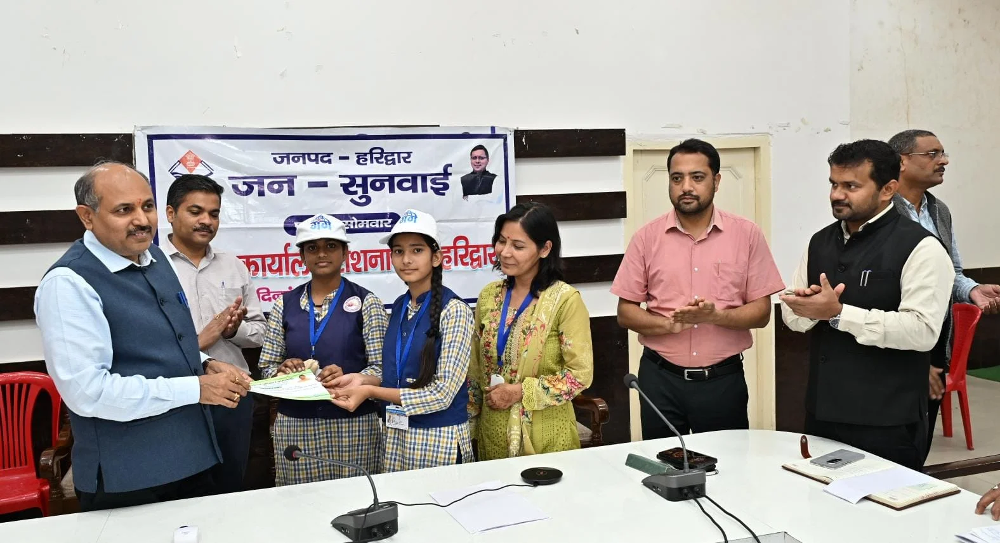
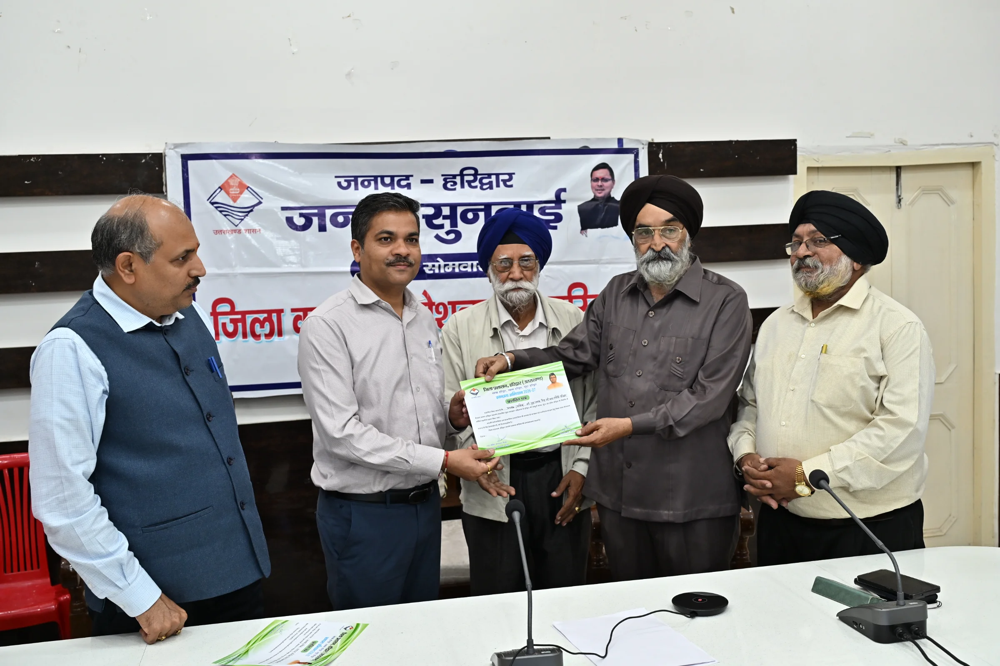
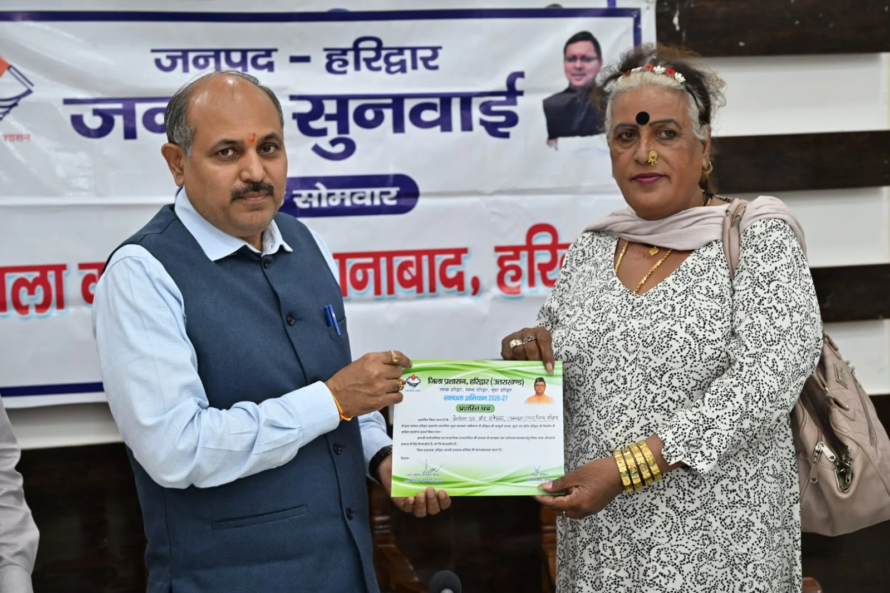

**हरिद्वार संवाददाता | आसिफ खान

हरिद्वार।** मां गंगा की निर्मलता और स्वच्छता को लेकर जिला प्रशासन ने विशेष स्वच्छता अभियान के माध्यम से बड़ा संदेश दिया है। जनपद में चलाए जा रहे अभियान के तहत अब तक 13 हजार से अधिक लोगों ने सहभागिता कर स्वच्छता की मुहिम को जनआंदोलन का रूप दिया है। अभियान के प्रथम चरण में 100 मैट्रिक टन कूड़ा-कचरा एकत्रित किया गया, जिसे उचित निस्तारण के लिए नगर निगम को भेजा गया है। इस अभियान में महत्वपूर्ण योगदान देने वाली 32 संस्थाओं को जिला प्रशासन ने प्रशस्ति पत्र देकर सम्मानित किया।

मुख्यमंत्री के निर्देशों के अनुपालन में मां गंगा को स्वच्छ एवं निर्मल बनाए रखने के उद्देश्य से मेला अधिकारी श्रीमती सोनिका एवं जिलाधिकारी मयूर दीक्षित के कुशल नेतृत्व और निर्देशन में विशेष स्वच्छता अभियान संचालित किया जा रहा है। अभियान में सामाजिक संगठनों, धार्मिक संस्थाओं, संत समाज, व्यापारिक प्रतिष्ठानों, औद्योगिक संस्थानों, शिक्षण संस्थानों, सीवरेज इकाई, नमामि गंगे, नगर निगम, स्वजल, जिला पंचायत, जिला स्तरीय अधिकारियों और स्थानीय नागरिकों की सक्रिय भागीदारी देखने को मिल रही है।

**100 मैट्रिक टन कूड़ा हटाकर स्वच्छता की दिशा में बड़ा कदम**

मुख्य विकास अधिकारी डॉ. ललित नारायण मिश्र ने बताया कि विशेष स्वच्छता अभियान के प्रथम चरण में 100 मैट्रिक टन कूड़ा-कचरा एकत्रित किया गया। एकत्रित कचरे को उचित निस्तारण के लिए नगर निगम को भेजा गया है। उन्होंने कहा कि अभियान में अब तक 13 हजार से अधिक लोगों की सहभागिता इस बात का प्रमाण है कि मां गंगा की स्वच्छता को लेकर जनपदवासी गंभीर हैं और प्रशासन के साथ कंधे से कंधा मिलाकर कार्य कर रहे हैं।

उन्होंने अभियान में सहयोग करने वाले सभी संस्थानों, स्वयंसेवकों और नागरिकों का आभार व्यक्त करते हुए कहा कि स्वच्छता केवल प्रशासन की जिम्मेदारी नहीं, बल्कि प्रत्येक नागरिक का कर्तव्य है। मां गंगा की निर्मलता बनाए रखने के लिए सभी को निरंतर सक्रिय भूमिका निभानी होगी।

**32 संस्थाओं को मिला सम्मान, सहयोगियों का बढ़ाया उत्साह**

विशेष स्वच्छता अभियान के प्रथम चरण में सक्रिय सहभागिता करने वाली 32 संस्थाओं को प्रशस्ति पत्र देकर सम्मानित किया गया। जिला प्रशासन ने संस्थाओं के प्रतिनिधियों के योगदान की सराहना करते हुए भविष्य में भी इसी प्रकार स्वच्छता अभियान में सक्रिय सहभागिता बनाए रखने की अपील की।

सम्मानित होने वाली संस्थाओं में आदर्श युवा समिति, सोनिया फाउंडेशन चैरिटेबल ट्रस्ट, एसबीएमए-आईटीसी मिशन सुनहरा कल, शांतिकुंज, श्री गंगा सभा, सप्तऋषि आश्रम, श्री गुरु नानक देव जी घाट समिति, गंगा सेवा ट्रस्ट, रामराज ग्रामोद्योग सेवा संस्थान, बीड़ंग भागीरथ जनपद, रोटरी क्लब, राष्ट्रीय सेवा योजना, सेवा भारती, स्काउट्स एंड गाइड्स, एकम्प्स कम्पनी सिडकुल, बाबा बंशी वाले अन्नपूर्णा आश्रम समिति, प्रेमनगर आश्रम, आस्था सेवा संस्थान, नागा कुटीर आश्रम, उत्तरांचल पंजाबी महासभा, निर्मल हरिद्वार परियोजना, डेवलपमेन्ट अल्टीमेटीव, नेचर फाउंडेशन, राजकीय कन्या इंटर कॉलेज ज्वालापुर, बहुउदय लोक सेवा संस्थान, एनसीसी हरिद्वार, वसुधैव कुटुम्बकम फाउंडेशन, समर्पण संस्था रुड़की, शिव शक्ति वेलनेस फाउंडेशन, भारतीय योग संस्थान, नया उदासीन अखाड़ा शंकर आश्रम तथा सेवानिवृत्त पुलिसकर्मी परिवार जनकल्याण समिति हरिद्वार शामिल हैं।

**प्रशासन ने जताया आभार, अभियान को आगे भी जारी रखने की अपील**

जिला प्रशासन ने सभी संस्थाओं एवं उनके प्रतिनिधियों के सराहनीय सहयोग के लिए आभार व्यक्त किया। अधिकारियों ने कहा कि स्वच्छता अभियान को सफल बनाने में सामाजिक और धार्मिक संस्थाओं के साथ-साथ आम नागरिकों की भागीदारी बेहद महत्वपूर्ण है। भविष्य में भी इसी प्रकार जनसहयोग से अभियान को आगे बढ़ाया जाएगा।

इस दौरान ज्वाइंट मजिस्ट्रेट रुड़की दीपक रामचंद्र सेठ, अपर जिलाधिकारी (प्रशासन) जितेंद्र कुमार, जिलाधिकारी वैभव गुप्ता, सीएमओ डॉ. आर.के. सिंह, उप जिलाधिकारी हरिद्वार योगेश मेहरा, अपर मुख्य अधिकारी जिला पंचायत महेश कुमार बिश्नोई, जिला खाद्य सुरक्षा अधिकारी महिमानंद जोशी, जिला पर्यटन अधिकारी सुशील नौटियाल, जिला आपदा प्रबंधन अधिकारी मीरा रावत सहित जिला स्तरीय अधिकारी, विभिन्न स्वयंसेवी संस्थाओं के प्रतिनिधि एवं छात्र-छात्राएं मौजूद रहे।

स्वच्छता का संदेश: मां गंगा की निर्मलता बनाए रखने के लिए प्रशासन और जनता की संयुक्त पहल अब जनपद में स्वच्छता की नई मिसाल कायम करने की दिशा में आगे बढ़ रही है।
