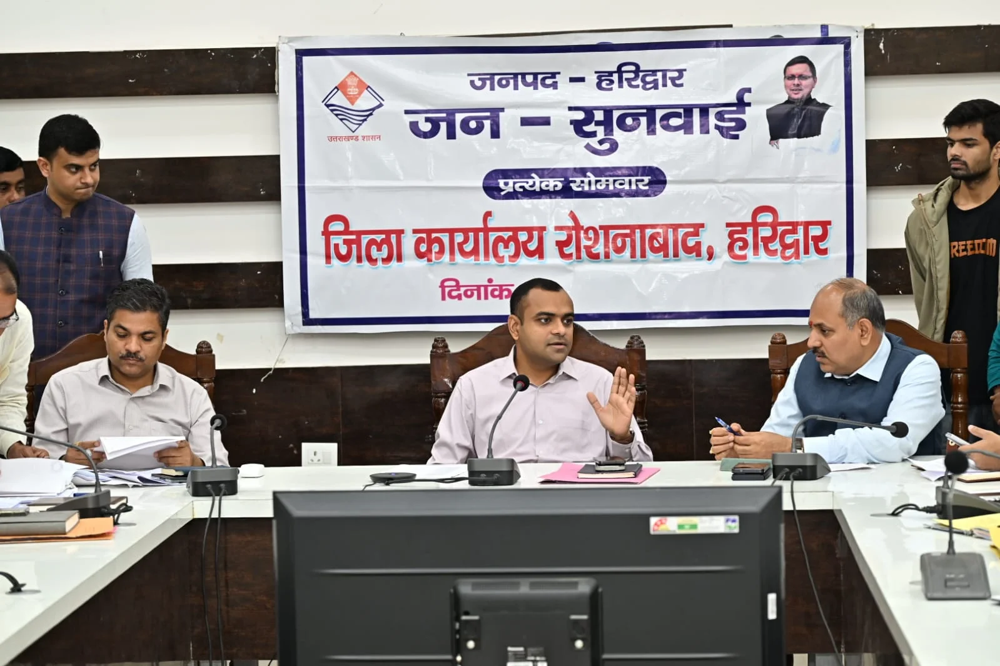
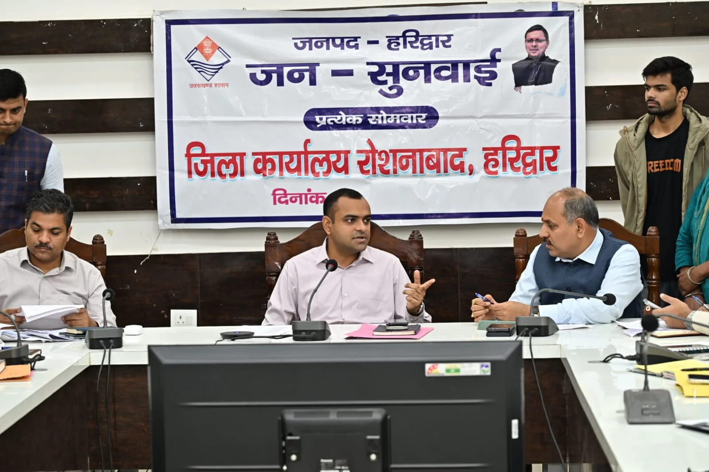
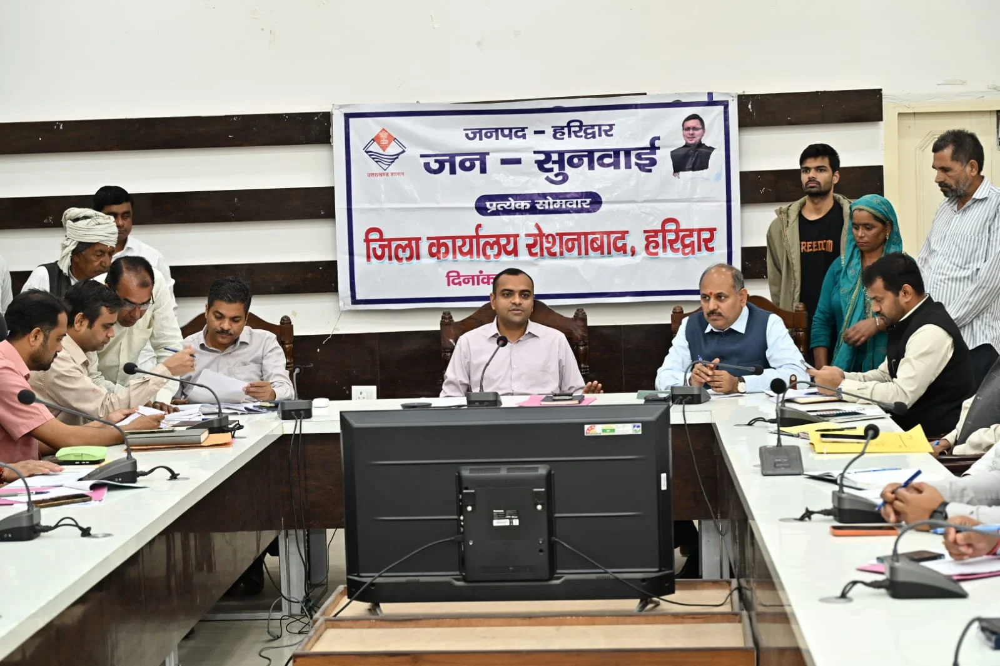

**हरिद्वार संवाददाता | आसिफ खान

हरिद्वार।** जनपद में विकास योजनाओं की धीमी रफ्तार और लंबित कार्यों को लेकर जिलाधिकारी मयूर दीक्षित ने अधिकारियों को सख्त निर्देश जारी किए हैं। जिला योजना के अंतर्गत स्वीकृत धनराशि का नवंबर माह तक शत-प्रतिशत व्यय सुनिश्चित करने के साथ ही लंबित टेंडर प्रक्रिया को एक सप्ताह के भीतर पूरा करने का अल्टीमेटम दिया गया है। जिलाधिकारी ने स्पष्ट किया कि विकास कार्यों में अनावश्यक देरी, लापरवाही और शिथिलता किसी भी सूरत में बर्दाश्त नहीं की जाएगी। योजनाओं का लाभ समय पर जनता तक पहुंचाना सभी विभागों की जिम्मेदारी है।

सोमवार को जिला कार्यालय सभागार में आयोजित समीक्षा बैठक में जिलाधिकारी मयूर दीक्षित ने विभिन्न विभागों द्वारा संचालित योजनाओं, जिला योजना के अंतर्गत स्वीकृत विकास कार्यों और मुख्यमंत्री घोषणाओं की विभागवार समीक्षा की। बैठक में उन्होंने अधिकारियों को दो टूक निर्देश दिए कि विकास योजनाओं को केवल कागजों तक सीमित न रखा जाए, बल्कि उनकी प्रगति धरातल पर दिखाई देनी चाहिए।

**बजट खर्च में देरी पर डीएम सख्त**

जिला योजना की समीक्षा करते हुए जिलाधिकारी ने निर्देश दिए कि विकास कार्यों के लिए स्वीकृत धनराशि का नवंबर माह तक शत-प्रतिशत व्यय सुनिश्चित किया जाए। उन्होंने कहा कि बजट स्वीकृत होने के बावजूद यदि विकास कार्यों में देरी होती है तो यह गंभीर विषय है।

जिन विभागों द्वारा अभी तक विकास कार्यों की टेंडर प्रक्रिया शुरू नहीं की गई है अथवा पूरी नहीं की गई है, उन्हें एक सप्ताह के भीतर सभी आवश्यक औपचारिकताएं पूर्ण कर टेंडर प्रक्रिया संपन्न कराने के निर्देश दिए गए। धीमी प्रगति वाले विभागों को तत्काल कार्यों में तेजी लाने तथा प्रत्येक परियोजना की नियमित मॉनिटरिंग कर अद्यतन रिपोर्ट उपलब्ध कराने को कहा गया।

**डी और सी श्रेणी वाले विभागों की कार्यप्रणाली पर उठे सवाल**

20 सूत्रीय कार्यक्रम की समीक्षा के दौरान जिलाधिकारी ने डी और सी श्रेणी में चल रहे विभागों को अपनी कार्यप्रणाली में सुधार लाने के निर्देश दिए। उन्होंने कहा कि संबंधित विभाग निर्धारित लक्ष्यों के अनुरूप प्रभावी कार्ययोजना तैयार करें और अपनी रैंकिंग में सुधार करते हुए ए श्रेणी में आने के लिए गंभीर प्रयास करें।

जिलाधिकारी ने स्पष्ट किया कि योजनाओं के क्रियान्वयन में लापरवाही और निर्धारित लक्ष्यों की अनदेखी से विभागों की रैंकिंग प्रभावित होती है। ऐसे में सभी विभागों को अपनी जिम्मेदारी समझते हुए परिणामोन्मुख कार्य करना होगा।

**मुख्यमंत्री घोषणाओं को लेकर भी सख्त रुख**

मुख्यमंत्री द्वारा जनपद के लिए की गई घोषणाओं की विभागवार समीक्षा करते हुए जिलाधिकारी ने इन्हें सर्वोच्च प्राथमिकता पर पूर्ण करने के निर्देश दिए। उन्होंने कहा कि मुख्यमंत्री घोषणाओं से जुड़े लंबित कार्यों में तेजी लाई जाए और सभी आवश्यक प्रक्रियाएं समयबद्ध तरीके से पूरी कर योजनाओं को धरातल पर उतारा जाए।

उन्होंने अधिकारियों को निर्देशित किया कि विकास कार्यों की भौतिक एवं वित्तीय प्रगति पर लगातार नजर रखी जाए। निर्माण कार्यों, आधारभूत सुविधाओं और जनहित से जुड़ी योजनाओं में किसी भी प्रकार की अनावश्यक देरी न हो।

**लापरवाही मिलने पर तय होगी जवाबदेही**

जिलाधिकारी मयूर दीक्षित ने अधिकारियों को आपसी समन्वय के साथ कार्य करने तथा विकास योजनाओं का लाभ आमजन तक समय पर पहुंचाने के निर्देश दिए। उन्होंने कहा कि विकास कार्यों में पारदर्शिता, गुणवत्ता और समयबद्धता सर्वोच्च प्राथमिकता होनी चाहिए।

उन्होंने साफ किया कि यदि किसी विभाग में विकास कार्यों के प्रति लापरवाही अथवा शिथिलता पाई जाती है तो संबंधित अधिकारियों की जवाबदेही तय की जाएगी।

बैठक में मुख्य विकास अधिकारी डॉ. ललित नारायण मिश्र, अपर जिलाधिकारी (वित्त एवं राजस्व) वैभव गुप्ता, अपर जिलाधिकारी (प्रशासन) जितेंद्र कुमार, मुख्य चिकित्साधिकारी डॉ. आर.के. सिंह, जिला अर्थ एवं संख्या अधिकारी नलिनी ध्यानी, जिला खाद्य सुरक्षा अधिकारी महिमानंद जोशी, महाप्रबंधक जिला उद्योग केंद्र उत्तम कुमार तिवारी, जिला पर्यटन अधिकारी सुशील नौटियाल, जिला आपदा प्रबंधन अधिकारी मीरा रावत, जिला प्रोबेशन अधिकारी अविनाश भदौरिया सहित संबंधित विभागों के अधिकारी एवं कर्मचारी उपस्थित रहे।
