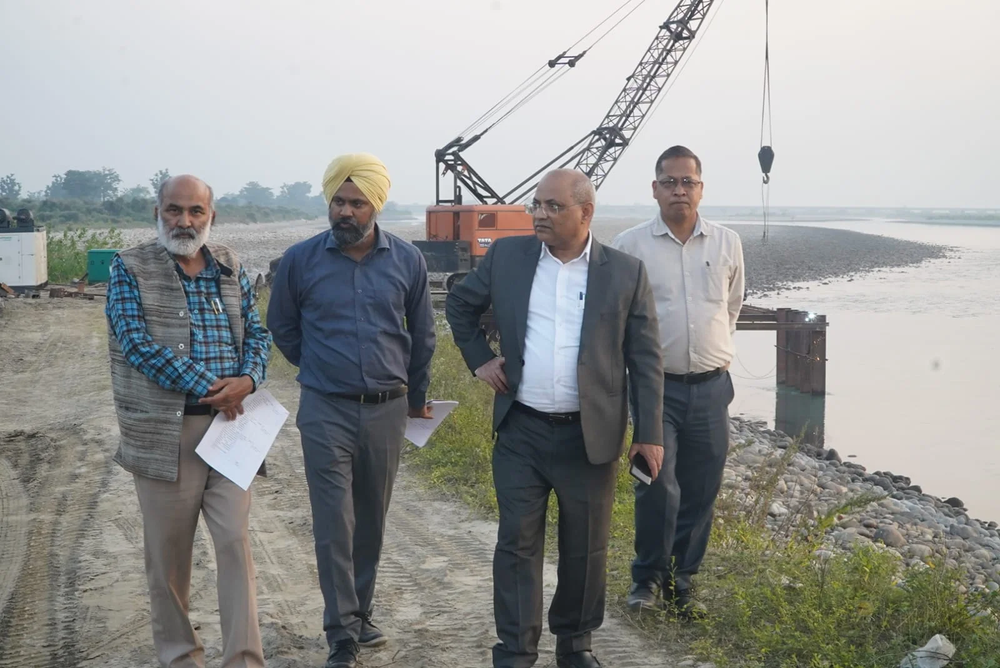
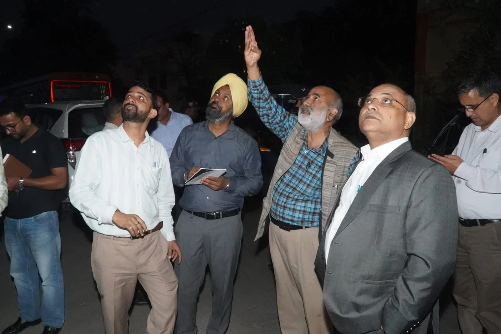
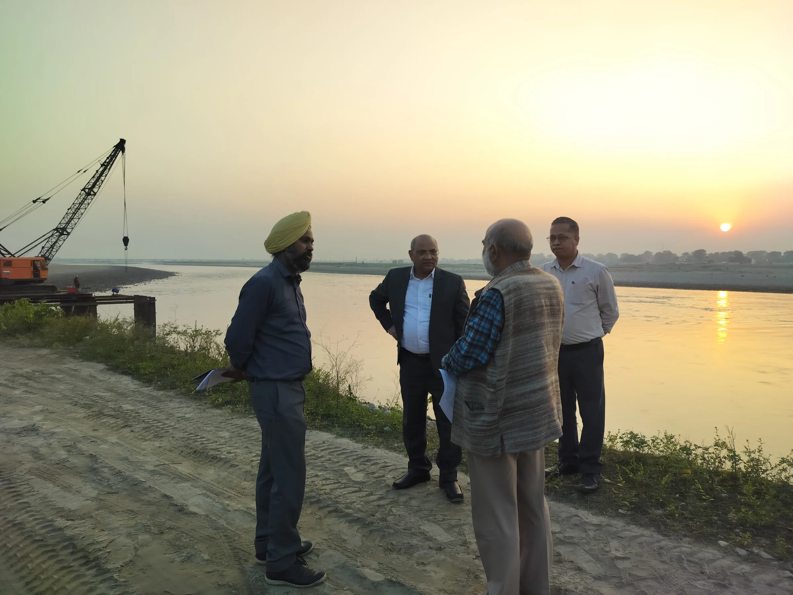

**हरिद्वार संवाददाता | आसिफ खान

हरिद्वार।** कुंभ मेला-2027 की तैयारियों को लेकर प्रशासन अब निर्माण कार्यों में किसी भी तरह की ढिलाई बर्दाश्त करने के मूड में नहीं है। कुंभ के भव्य आयोजन से पहले हरिद्वार में आधारभूत सुविधाओं को दुरुस्त करने के लिए मंडलायुक्त गढ़वाल मंडल आनंद स्वरूप ने निर्माण कार्यों की जमीनी हकीकत परखते हुए अधिकारियों को सख्त निर्देश दिए। सोमवार को देर सायं तक चिड़ियापुर, गौरीशंकर द्वीप, बैरागी कैंप और देवपुरा में किए गए निरीक्षण के दौरान उन्होंने साफ कर दिया कि कुंभ के कार्यों में देरी या गुणवत्ता से समझौता करने वाले अधिकारियों और कार्यदायी संस्थाओं पर सख्त कार्रवाई की जाएगी।

कुंभ-2027 के लिए समय तेजी से बीत रहा है। ऐसे में निर्माण कार्यों की सुस्त रफ्तार आयोजन की तैयारियों पर भारी न पड़े, इसके लिए मंडलायुक्त ने अधिकारियों को युद्धस्तर पर काम करने के निर्देश दिए। उन्होंने कहा कि कुंभ जैसे विश्वस्तरीय आयोजन में व्यवस्थाओं की गुणवत्ता और समयबद्धता से कोई समझौता नहीं किया जा सकता। प्रत्येक निर्माण कार्य निर्धारित समयसीमा में पूरा होना चाहिए।

**रोजाना देनी होगी प्रगति रिपोर्ट, बहानेबाजी नहीं चलेगी**

मंडलायुक्त आनंद स्वरूप ने अधिकारियों को निर्देशित किया कि कुंभ से संबंधित सभी निर्माण कार्यों की दैनिक प्रगति रिपोर्ट प्रस्तुत की जाए। शेष कार्यों को पूरा करने के लिए दिनवार कार्ययोजना तैयार कर उसकी जानकारी भी उपलब्ध कराई जाए। उन्होंने कार्यदायी संस्थाओं को निर्माण स्थलों पर नियमित उपस्थिति सुनिश्चित करने और कार्यों की लगातार निगरानी करने के निर्देश दिए।

उन्होंने स्पष्ट किया कि केवल कागजों पर प्रगति दिखाने से काम नहीं चलेगा, बल्कि निर्माण स्थलों पर वास्तविक स्थिति के अनुरूप कार्यों में तेजी दिखाई देनी चाहिए। अधिकारियों की जवाबदेही तय करते हुए उन्होंने कहा कि समयसीमा का पालन और निर्माण की गुणवत्ता दोनों अनिवार्य हैं।

**चिड़ियापुर स्वागत द्वार पर तेजी लाने के निर्देश**

निरीक्षण की शुरुआत चिड़ियापुर में निर्माणाधीन स्वागत द्वार से हुई। मंडलायुक्त ने निर्माण कार्य की स्थिति का जायजा लेते हुए इसे जल्द पूरा करने के निर्देश दिए। उन्होंने कहा कि कुंभ के दौरान हरिद्वार आने वाले श्रद्धालुओं के स्वागत और प्रवेश व्यवस्था से जुड़े निर्माण कार्य समय पर पूरे होने चाहिए, ताकि आयोजन से पहले सभी व्यवस्थाएं तैयार रहें।

**गौरीशंकर द्वीप में अस्थायी पुल की मजबूती पर जोर**

इसके बाद मंडलायुक्त ने गौरीशंकर द्वीप में बैरागी कैंप को जोड़ने के लिए गंगा नदी पर बनाए जा रहे अस्थायी पुल का निरीक्षण किया। उन्होंने पुल की मजबूती, सुरक्षा और निर्माण गुणवत्ता को लेकर विशेष सतर्कता बरतने के निर्देश दिए।

उन्होंने कहा कि श्रद्धालुओं की आवाजाही के लिहाज से यह पुल बेहद महत्वपूर्ण है। ऐसे में निर्माण के दौरान सुरक्षा मानकों का पूरी तरह पालन किया जाए और किसी भी स्तर पर लापरवाही न बरती जाए।

**बैरागी कैंप और गौरीशंकर सेक्टर में व्यवस्थाओं की समीक्षा**

गौरीशंकर सेक्टर में मंडलायुक्त ने शिविर स्थलों की ड्रेसिंग एवं लेवलिंग, सड़क निर्माण, विद्युत आपूर्ति और पेयजल व्यवस्था से जुड़े कार्यों का निरीक्षण किया। इसके साथ ही गंगा कैनाल पर निर्माणाधीन बैली ब्रिज की प्रगति की जानकारी भी ली।

उन्होंने कहा कि बैरागी कैंप और गौरीशंकर क्षेत्र कुंभ के प्रमुख शिविर स्थलों में शामिल हैं। यहां संत-महात्माओं, श्रद्धालुओं और विभिन्न संस्थाओं के शिविरों के लिए जरूरी सुविधाएं समय रहते विकसित की जाएं। संबंधित विभाग आपसी समन्वय के साथ काम करें, ताकि अंतिम समय में व्यवस्थाओं को लेकर किसी तरह की परेशानी सामने न आए।

**देवपुरा में सौंदर्यीकरण कार्यों को लेकर भी सख्ती**

देवपुरा क्षेत्र में चल रहे सौंदर्यीकरण और फसाड विकास कार्यों का निरीक्षण करते हुए मंडलायुक्त ने भवनों एवं दीवारों पर निर्धारित रंग योजना के अनुरूप आकर्षक पेंटिंग कराने के निर्देश दिए। उन्होंने उपयुक्त स्थानों पर चित्रांकन कर क्षेत्र को सुव्यवस्थित और आकर्षक स्वरूप देने पर जोर दिया।

उन्होंने कहा कि कुंभ के दौरान हरिद्वार की समग्र सज्जा में इन कार्यों की अहम भूमिका होगी। इसलिए सौंदर्यीकरण के नाम पर गुणवत्ता से समझौता न किया जाए और सभी कार्य निर्धारित योजना के अनुसार पूरे किए जाएं।

**अधिकारियों की जवाबदेही तय, गुणवत्ता पर रहेगी पैनी नजर**

मंडलायुक्त ने सभी संबंधित अधिकारियों को निर्देशित किया कि कुंभ-2027 के निर्माण कार्यों को आपसी समन्वय, जवाबदेही और निर्धारित समयसीमा के अनुरूप पूरा किया जाए। उन्होंने दो टूक कहा कि निर्माण कार्यों की गति के साथ उनकी गुणवत्ता और उपयोगिता पर भी समान रूप से ध्यान देना होगा।

निरीक्षण के दौरान विशेषज्ञ समन्वयक गंगा प्रसाद पंत, उप मेलाधिकारी मंजीत सिंह, सिटी मजिस्ट्रेट हर गिरी सहित संबंधित विभागों के अधिकारी मौजूद रहे।

कुंभ-2027 की तैयारियों को लेकर मंडलायुक्त के इस सख्त रुख से साफ है कि अब निर्माण कार्यों में देरी करने वाली कार्यदायी संस्थाओं और लापरवाही बरतने वाले अधिकारियों की जवाबदेही तय होगी।
